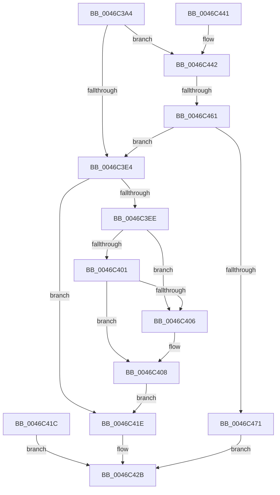

# RtlGetImageBaseAndLoadConfig

- RVA: `0x0046C3A4`–`0x0046C478` (길이 `212` bytes)
- VA: `0x000000014046C3A4`
- 실행 섹션: `.text`
- PDB 이름 있음: `예`; PDB Function 태그: `예`
- unwind 정보 RVA: `0x000AB7FC`
- 디코드: `58`개 명령, `212/212` bytes 표시
- 미해석 바이트: `0` (있으면 어셈블리에 `.byte`로 보존)

> 이 문서는 커널 이미지의 기계어와 PDB 기호를 분석해 생성했습니다. 4번과 5번은 함수 원형과 자료형을 바이너리 사용 방식에서 추정한 C 해석이며 원본 소스 복구 결과는 아닙니다.

## 1. Dependencies

- 직접 호출 지점: **3**; 고유 호출 대상: **3**
- 직접 호출자로 확인된 함수: **2**
- RIP 상대 이미지 참조: **0**

### Outgoing calls
- `0x0046C3DA` → [RtlpLookupUserFunctionTableInverted](../2F/RtlpLookupUserFunctionTableInverted_function_002F3B20.md) (function, `0x002F3B20`)
- `0x0046C40D` → [LdrImageDirectoryEntryToLoadConfig](../../page/A8/LdrImageDirectoryEntryToLoadConfig_function_00A8F564.md) (function, `0x00A8F564`)
- `0x0046C454` → [MmGetImageInformation](../../page/8D/MmGetImageInformation_function_008D9C68.md) (function, `0x008D9C68`)

### Direct callers
- [KiVerifyContextIpForUserCet](../40/KiVerifyContextIpForUserCet_function_0040C028.md) at `0x0040C1B9`
- [RtlVerifyUserUnwindTarget](../../page/A1/RtlVerifyUserUnwindTarget_function_00A1FDB8.md) at `0x00A1FDE6`

### Static image references
- 디코드된 RIP-relative 메모리 참조가 없습니다.

## 2. Other-region calls and transfers

- 다른 실행 섹션으로 향하는 call: **2**
  - `0x0046C40D` → [LdrImageDirectoryEntryToLoadConfig](../../page/A8/LdrImageDirectoryEntryToLoadConfig_function_00A8F564.md) (`.text` → `PAGE`)
  - `0x0046C454` → [MmGetImageInformation](../../page/8D/MmGetImageInformation_function_008D9C68.md) (`.text` → `PAGE`)
- call이 아닌 외부 분기/꼬리 이동: **1**
  - `0x0046C45B` → [sub_006F31E6](../6F/Unknown_function_006F31E6.md) (`tail-transfer`)

## 3. Assembly (complete function range)

```asm
0046C3A4  4C 8B DC                        mov r11, rsp
0046C3A7  49 89 5B 08                     mov qword ptr [r11 + 8], rbx
0046C3AB  49 89 73 10                     mov qword ptr [r11 + 0x10], rsi
0046C3AF  49 89 7B 18                     mov qword ptr [r11 + 0x18], rdi
0046C3B3  41 56                           push r14
0046C3B5  48 83 EC 50                     sub rsp, 0x50
0046C3B9  49 8B F0                        mov rsi, r8
0046C3BC  4C 8B F2                        mov r14, rdx
0046C3BF  48 8B F9                        mov rdi, rcx
0046C3C2  0F 57 C0                        xorps xmm0, xmm0
0046C3C5  33 C0                           xor eax, eax
0046C3C7  0F 11 44 24 30                  movups xmmword ptr [rsp + 0x30], xmm0
0046C3CC  49 89 43 E8                     mov qword ptr [r11 - 0x18], rax
0046C3D0  33 DB                           xor ebx, ebx
0046C3D2  49 89 5B C8                     mov qword ptr [r11 - 0x38], rbx
0046C3D6  49 8D 53 D8                     lea rdx, [r11 - 0x28]
0046C3DA  E8 41 77 E8 FF                  call 0x1402f3b20
0046C3DF  48 85 C0                        test rax, rax
0046C3E2  74 5E                           je 0x14046c442
0046C3E4  48 8B 44 24 38                  mov rax, qword ptr [rsp + 0x38]
0046C3E9  48 85 C0                        test rax, rax
0046C3EC  74 30                           je 0x14046c41e
0046C3EE  48 8D 48 40                     lea rcx, [rax + 0x40]
0046C3F2  48 BA 00 00 FF FF FF 7F 00 00   movabs rdx, 0x7fffffff0000
0046C3FC  48 3B CA                        cmp rcx, rdx
0046C3FF  77 05                           ja 0x14046c406
0046C401  48 3B C8                        cmp rcx, rax
0046C404  73 02                           jae 0x14046c408
0046C406  8A 02                           mov al, byte ptr [rdx]
0046C408  48 8B 4C 24 38                  mov rcx, qword ptr [rsp + 0x38]
0046C40D  E8 52 31 62 00                  call 0x140a8f564
0046C412  48 8B D8                        mov rbx, rax
0046C415  48 89 44 24 28                  mov qword ptr [rsp + 0x28], rax
0046C41A  EB 02                           jmp 0x14046c41e
0046C41C  EB 0D                           jmp 0x14046c42b
0046C41E  48 8B 44 24 38                  mov rax, qword ptr [rsp + 0x38]
0046C423  49 89 06                        mov qword ptr [r14], rax
0046C426  48 89 1E                        mov qword ptr [rsi], rbx
0046C429  33 C0                           xor eax, eax
0046C42B  48 8B 5C 24 60                  mov rbx, qword ptr [rsp + 0x60]
0046C430  48 8B 74 24 68                  mov rsi, qword ptr [rsp + 0x68]
0046C435  48 8B 7C 24 70                  mov rdi, qword ptr [rsp + 0x70]
0046C43A  48 83 C4 50                     add rsp, 0x50
0046C43E  41 5E                           pop r14
0046C440  C3                              ret
0046C441  CC                              int3
0046C442  4C 8D 4C 24 78                  lea r9, [rsp + 0x78]
0046C447  4C 8D 44 24 20                  lea r8, [rsp + 0x20]
0046C44C  48 8D 54 24 38                  lea rdx, [rsp + 0x38]
0046C451  48 8B CF                        mov rcx, rdi
0046C454  E8 0F D8 46 00                  call 0x1408d9c68
0046C459  85 C0                           test eax, eax
0046C45B  0F 88 85 6D 28 00               js 0x1406f31e6
0046C461  B8 FF FF FF FF                  mov eax, 0xffffffff
0046C466  48 39 44 24 20                  cmp qword ptr [rsp + 0x20], rax
0046C46B  0F 82 73 FF FF FF               jb 0x14046c3e4
0046C471  B8 95 00 00 C0                  mov eax, 0xc0000095
0046C476  EB B3                           jmp 0x14046c42b
```

## 4. C-style interpretation (structured pseudocode)

```c
__int64 __fastcall RtlGetImageBaseAndLoadConfig(__int64 a1, __int64 a2, __int64 a3)
{
    __int64 result;
    __int64 v_rbx;
    __int64 v_rsp;
    unsigned __int64 v_stack_m20;
    unsigned __int64 v_stack_m28;
    unsigned __int64 v_stack_m30;
    unsigned __int64 v_stack_p10;
    unsigned __int64 v_stack_p18;
    unsigned __int64 v_stack_p20;
    unsigned __int64 v_stack_p38;
    unsigned __int64 v_stack_p78;
    unsigned __int64 v_stack_p8;

    *(unsigned __int64 *)(v_rsp + 8) = v_rbx;
    *(unsigned __int64 *)(v_rsp + 16) = v_rsi;
    *(unsigned __int64 *)(v_rsp + 24) = v_rdi;
    v_rsp = (v_rsp) - (80);
    result = 0;
    v_stack_m28 = v_xmm0;
    *(unsigned __int64 *)(v_rsp - 24) = 0;
    v_rbx = 0;
    *(unsigned __int64 *)(v_rsp - 56) = 0;
    result = RtlpLookupUserFunctionTableInverted(a1, v_rsp - 40, a3, a4);
    if (result == 0) goto loc_0046C442;
loc_0046C3E4:
    if (v_stack_m20 == 0) goto loc_0046C41E;
    if ((v_stack_m20 + 64) > (v_rsp - 40)) goto loc_0046C406;
    result = v_stack_m20;
    if ((v_stack_m20 + 64) < v_stack_m20) {
        result = *(unsigned __int8 *)(v_rsp - 40);
    }
    result = LdrImageDirectoryEntryToLoadConfig(v_stack_m20, v_rsp - 40, a3, a4);
    v_stack_m30 = result;
    goto loc_0046C41E;
loc_0046C41E:
    *(unsigned __int64 *)(a2) = v_stack_m20;
    *(unsigned __int64 *)(a3) = result;
    result = 0;
loc_0046C42B:
    v_rsp = (v_rsp) + (80);
    return result;
loc_0046C442:
    result = MmGetImageInformation(v_stack_p18, v_stack_p38, v_stack_p20, v_stack_p78);
    if (v_stack_p20 < ((unsigned int)(0xFFFFFFFFULL))) goto loc_0046C3E4;
    goto loc_0046C42B;
}
```

## 5. (Beta) C Style

```c
int64_t RtlGetImageBaseAndLoadConfig(int64_t Arg1, void *Arg2, void *Arg3)
{
    uint8_t *arg2 = (uint8_t *)Arg2;
    uint8_t *arg3 = (uint8_t *)Arg3;

    int64_t result;
    int64_t local_rbx;
    int64_t local_rsp;
    uint64_t v_stack_m20;
    uint64_t v_stack_m28;
    uint64_t v_stack_m30;
    uint64_t v_stack_p10;
    uint64_t v_stack_p18;
    uint64_t v_stack_p20;
    uint64_t v_stack_p38;
    uint64_t v_stack_p78;
    uint64_t v_stack_p8;

    *(uint64_t *)(local_rsp + 0x8) = local_rbx;
    *(uint64_t *)(local_rsp + 0x10) = local_rsi;
    *(uint64_t *)(local_rsp + 0x18) = local_rdi;
    local_rsp = (local_rsp) - (80);
    result = 0;
    v_stack_m28 = v_xmm0;
    *(uint64_t *)(local_rsp - 0x18) = 0;
    local_rbx = 0;
    *(uint64_t *)(local_rsp - 0x38) = 0;
    result = RtlpLookupUserFunctionTableInverted(Arg1, local_rsp - 40, Arg3, a4);
    if (result == 0) goto loc_0046C442;
loc_0046C3E4:
    if (v_stack_m20 == 0) goto loc_0046C41E;
    if ((v_stack_m20 + 64) > (local_rsp - 40)) goto loc_0046C406;
    result = v_stack_m20;
    if ((v_stack_m20 + 64) < v_stack_m20) {
        result = *(uint8_t *)(local_rsp - 0x28);
    }
    result = LdrImageDirectoryEntryToLoadConfig(v_stack_m20, local_rsp - 40, Arg3, a4);
    v_stack_m30 = result;
    goto loc_0046C41E;
loc_0046C41E:
    *(uint64_t *)(arg2) = v_stack_m20;
    *(uint64_t *)(arg3) = result;
    result = 0;
loc_0046C42B:
    local_rsp = (local_rsp) + (80);
    return result;
loc_0046C442:
    result = MmGetImageInformation(v_stack_p18, v_stack_p38, v_stack_p20, v_stack_p78);
    if (v_stack_p20 < ((uint32_t)(0xFFFFFFFFULL))) goto loc_0046C3E4;
    goto loc_0046C42B;
}
```

### 관측된 메모리 오프셋

구조체 형식이 확인되지 않은 접근은 인자 기준의 오프셋으로만 기록했습니다.

| 기준 인자 | 오프셋 표현 | 폭 (bit) | 접근 |
|---|---:|---:|---|
| `Arg2` | `+ 0x0` | `64` | `W` |
| `Arg3` | `+ 0x0` | `64` | `W` |

## 6. Execution-region graph

[열기: 2D/3D 그래프와 함수 탐색 컨트롤 패널](../../../control-panel.html?section=text&rva=0x0046C3A4&view=graph)

- 2D 그래프는 위에서 아래로 흐르고, 3D 그래프는 빈 공간을 드래그해 회전합니다. Shift+드래그는 이동, 휠은 확대·축소, 함수 노드 선택은 대상 보고서 이동입니다.

### Static fallback


