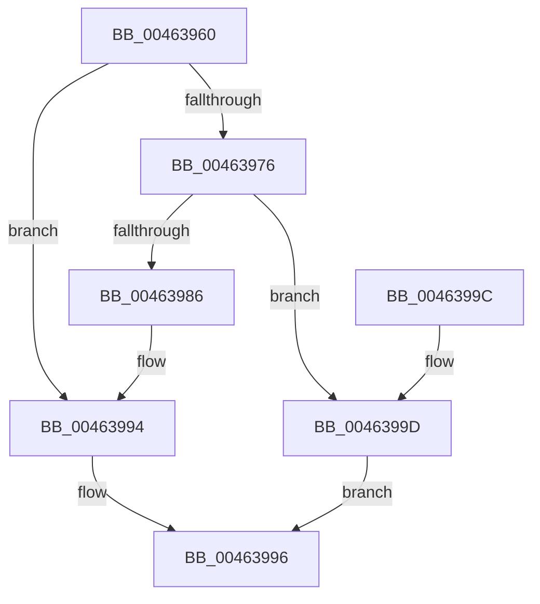

# RtlInitUnicodeStringEx

- RVA: `0x00463960`–`0x004639A4` (길이 `68` bytes)
- VA: `0x0000000140463960`
- 실행 섹션: `.text`
- PDB 이름 있음: `예`; PDB Function 태그: `아니요`
- unwind 정보 RVA: `0x0005DAC8`
- 디코드: `22`개 명령, `68/68` bytes 표시
- 미해석 바이트: `0` (있으면 어셈블리에 `.byte`로 보존)

> 이 문서는 커널 이미지의 기계어와 PDB 기호를 분석해 생성했습니다. 4번과 5번은 함수 원형과 자료형을 바이너리 사용 방식에서 추정한 C 해석이며 원본 소스 복구 결과는 아닙니다.

## 1. Dependencies

- 직접 호출 지점: **1**; 고유 호출 대상: **1**
- 직접 호출자로 확인된 함수: **124**
- RIP 상대 이미지 참조: **0**

### Outgoing calls
- `0x00463979` → [wcslen](../50/wcslen_function_00501BA0.md) (function, `0x00501BA0`)

### Direct callers
- [IopIsReportedAlready](../../page/72/IopIsReportedAlready_function_00726C6C.md) at `0x00726D44`
- [IoGetDeviceDirectory](../../page/72/IoGetDeviceDirectory_function_00728370.md) at `0x00728531`
- [PiDcResetChildDeviceContainerCallback](../../page/73/PiDcResetChildDeviceContainerCallback_function_00730DE0.md) at `0x00730E4A`
- [PiDevCfgQueryPolicyStringList](../../page/73/PiDevCfgQueryPolicyStringList_function_00735358.md) at `0x00735546`
- [PiCMDeleteDeviceWorker](../../page/73/PiCMDeleteDeviceWorker_function_0073B420.md) at `0x0073B4ED`
- [PiCMDeleteDeviceWorker](../../page/73/PiCMDeleteDeviceWorker_function_0073B420.md) at `0x0073B574`
- [PiCMDeleteDeviceWorker](../../page/73/PiCMDeleteDeviceWorker_function_0073B420.md) at `0x0073B5AE`
- [PiCMDeleteDeviceWorker](../../page/73/PiCMDeleteDeviceWorker_function_0073B420.md) at `0x0073B641`
- [PiCMDeleteDeviceWorker](../../page/73/PiCMDeleteDeviceWorker_function_0073B420.md) at `0x0073B665`
- [PiCMGenerateDeviceInstance](../../page/73/PiCMGenerateDeviceInstance_function_0073B69C.md) at `0x0073B765`
- [PiInitializeDevice](../../page/73/PiInitializeDevice_function_0073EC5C.md) at `0x0073EE4B`
- [ObpStopRuntimeStackTrace](../../page/75/ObpStopRuntimeStackTrace_function_00750574.md) at `0x0075063E`
- [PfpQueryFileExtentsRequest](../../page/75/PfpQueryFileExtentsRequest_function_007508E8.md) at `0x00750B7A`
- [PfpQueryFileExtentsRequest](../../page/75/PfpQueryFileExtentsRequest_function_007508E8.md) at `0x00750BDC`
- [AslRegistryGetUInt32](../../page/81/AslRegistryGetUInt32_function_0081A228.md) at `0x0081A24C`
- [AslRegistryOpenSubKey](../../page/81/AslRegistryOpenSubKey_function_0081A3E0.md) at `0x0081A419`
- [CmDeleteCommonClassRegKeyWorker](../../page/82/CmDeleteCommonClassRegKeyWorker_function_008298F8.md) at `0x008299DE`
- [CmDeleteDeviceInterfaceRegKeyWorker](../../page/82/CmDeleteDeviceInterfaceRegKeyWorker_function_00829E1C.md) at `0x00829F1E`
- [CmDeleteDeviceContainerRegKeyWorker](../../page/82/CmDeleteDeviceContainerRegKeyWorker_function_0082B15C.md) at `0x0082B246`
- [CmClassFilterCallback](../../page/82/CmClassFilterCallback_function_0082C6F0.md) at `0x0082C760`
- [CmClassFilterCallback](../../page/82/CmClassFilterCallback_function_0082C6F0.md) at `0x0082C7C4`
- [CmClassSubkeyCallback](../../page/82/CmClassSubkeyCallback_function_0082C830.md) at `0x0082C8B7`
- [CmDeviceClassesSubkeyCallback](../../page/82/CmDeviceClassesSubkeyCallback_function_0082C940.md) at `0x0082CAE1`
- [CmDeviceClassesSubkeyCallback](../../page/82/CmDeviceClassesSubkeyCallback_function_0082C940.md) at `0x0082CAF5`
- [CmDeviceClassesSubkeyCallback](../../page/82/CmDeviceClassesSubkeyCallback_function_0082C940.md) at `0x0082CD55`
- [CmEnumSubkeyCallback](../../page/82/CmEnumSubkeyCallback_function_0082CE50.md) at `0x0082D045`
- [CmServiceFilterCallback](../../page/82/CmServiceFilterCallback_function_0082D7A0.md) at `0x0082D821`
- [CmServiceFilterCallback](../../page/82/CmServiceFilterCallback_function_0082D7A0.md) at `0x0082D8FE`
- [CmServiceFilterCallback](../../page/82/CmServiceFilterCallback_function_0082D7A0.md) at `0x0082DB4B`
- [CmDeleteDevicePanelRegKeyWorker](../../page/82/CmDeleteDevicePanelRegKeyWorker_function_0082E554.md) at `0x0082E63D`
- [CmDevicePanelEnumSubkeyCallback](../../page/82/CmDevicePanelEnumSubkeyCallback_function_0082E9B0.md) at `0x0082EC1A`
- [PiPnpRtlGetFilteredDeviceInterfaceList](../../page/8D/PiPnpRtlGetFilteredDeviceInterfaceList_function_008DE9D0.md) at `0x008DEAB4`
- [PiPnpRtlInterfaceFilterCallback](../../page/8E/PiPnpRtlInterfaceFilterCallback_function_008E4FC0.md) at `0x008E5038`
- [PiPnpRtlEnumeratorFilterCallback](../../page/8E/PiPnpRtlEnumeratorFilterCallback_function_008E52F0.md) at `0x008E533C`
- [PiPnpRtlEnumeratorFilterCallback](../../page/8E/PiPnpRtlEnumeratorFilterCallback_function_008E52F0.md) at `0x008E53E4`
- [IopDeviceInterfaceFilterCallback](../../page/8E/IopDeviceInterfaceFilterCallback_function_008E5410.md) at `0x008E5543`
- [IopDeviceInterfaceFilterCallback](../../page/8E/IopDeviceInterfaceFilterCallback_function_008E5410.md) at `0x008E5553`
- [PiCMValidateDeviceInstance](../../page/8E/PiCMValidateDeviceInstance_function_008E799C.md) at `0x008E7C78`
- [sub_008E80AE](../../page/8E/Unknown_function_008E80AE.md) at `0x008E80D2`
- [sub_008EDC5D](../../page/8E/Unknown_function_008EDC5D.md) at `0x008EDDC4`
- [PnpRegQueryValueIndirect](../../page/8E/PnpRegQueryValueIndirect_function_008EE210.md) at `0x008EE292`
- [sub_008EE966](../../page/8E/Unknown_function_008EE966.md) at `0x008EEAEF`
- [sub_008EF81D](../../page/8E/Unknown_function_008EF81D.md) at `0x008EF870`
- [_CmOpenCommonClassRegKeyWorker](../../page/8F/_CmOpenCommonClassRegKeyWorker_function_008F0A1C.md) at `0x008F0ADA`
- [CmGetDeviceInterfaceSubkeyPath](../../page/8F/CmGetDeviceInterfaceSubkeyPath_function_008F1010.md) at `0x008F1078`
- [CmGetDeviceInterfaceSubkeyPath](../../page/8F/CmGetDeviceInterfaceSubkeyPath_function_008F1010.md) at `0x008F11C8`
- [CmGetDeviceInterfaceSubkeyPath](../../page/8F/CmGetDeviceInterfaceSubkeyPath_function_008F1010.md) at `0x008F1372`
- [CmValidateDeviceInterfaceName](../../page/8F/CmValidateDeviceInterfaceName_function_008F1A40.md) at `0x008F1A83`
- [CmValidateDeviceInterfaceName](../../page/8F/CmValidateDeviceInterfaceName_function_008F1A40.md) at `0x008F1BB4`
- [sub_008F1D09](../../page/8F/Unknown_function_008F1D09.md) at `0x008F1D32`
- [sub_008F210A](../../page/8F/Unknown_function_008F210A.md) at `0x008F2131`
- [sub_008F229E](../../page/8F/Unknown_function_008F229E.md) at `0x008F22C7`
- [sub_008F246A](../../page/8F/Unknown_function_008F246A.md) at `0x008F249D`
- [_CmOpenDeviceInterfaceRegKeyWorker](../../page/8F/_CmOpenDeviceInterfaceRegKeyWorker_function_008F2B48.md) at `0x008F2C3A`
- [CmGetDeviceInterfaceClassGuid](../../page/8F/CmGetDeviceInterfaceClassGuid_function_008F3380.md) at `0x008F33E5`
- [PnpIsValidGuidString](../../page/8F/PnpIsValidGuidString_function_008F37F8.md) at `0x008F3823`
- [CmGetDeviceInterfaceMappedPropertyFromRegValue](../../page/8F/CmGetDeviceInterfaceMappedPropertyFromRegValue_function_008F40BC.md) at `0x008F41D0`
- [CmOpenDeviceContainerRegKeyWorker](../../page/8F/CmOpenDeviceContainerRegKeyWorker_function_008F4904.md) at `0x008F49CB`
- [IoGetDeviceInterfaceAlias](../../page/8F/IoGetDeviceInterfaceAlias_function_008F5570.md) at `0x008F587F`
- [CmGetDeviceInterfacePathFormat](../../page/8F/CmGetDeviceInterfacePathFormat_function_008F5BE8.md) at `0x008F5C14`
- [CmIsRootEnumeratedDevice](../../page/8F/CmIsRootEnumeratedDevice_function_008F6E08.md) at `0x008F6E2A`
- [PnpCtxRegDeleteValue](../../page/8F/PnpCtxRegDeleteValue_function_008FE5E0.md) at `0x008FE5F9`
- [PiPnpRtlGetFilteredDeviceList](../../page/8F/PiPnpRtlGetFilteredDeviceList_function_008FE9F8.md) at `0x008FEC70`
- [PiPnpRtlGetFilteredDeviceList](../../page/8F/PiPnpRtlGetFilteredDeviceList_function_008FE9F8.md) at `0x008FED11`
- [_CmAddDeviceToContainerWorker](../../page/8F/_CmAddDeviceToContainerWorker_function_008FF2EC.md) at `0x008FF531`
- [_CmAddDeviceToContainerWorker](../../page/8F/_CmAddDeviceToContainerWorker_function_008FF2EC.md) at `0x008FF5DE`
- [DrvDbGetRegValueMappedProperty](../../page/92/DrvDbGetRegValueMappedProperty_function_0092FB80.md) at `0x0092FC0A`
- [RegRtlCreateTreeTransacted](../../page/93/RegRtlCreateTreeTransacted_function_00931D1C.md) at `0x00931D86`
- [RegRtlCreateKeyTransacted](../../page/93/RegRtlCreateKeyTransacted_function_0093207C.md) at `0x009320D7`
- [CmGetDeviceParent](../../page/93/CmGetDeviceParent_function_00932368.md) at `0x009323D2`
- [CmIsRootDevice](../../page/93/CmIsRootDevice_function_009325E4.md) at `0x009325F8`
- [DrvDbFindDatabaseNode](../../page/93/DrvDbFindDatabaseNode_function_00932628.md) at `0x00932652`
- [IoRegisterDeviceInterface](../../page/94/IoRegisterDeviceInterface_function_0094F9A0.md) at `0x0094FA7D`
- [IopProcessSetInterfaceState](../../page/95/IopProcessSetInterfaceState_function_00950964.md) at `0x00950DD8`
- [NtApphelpCacheControl](../../page/95/NtApphelpCacheControl_function_00953050.md) at `0x0095316F`
- [PiCMOpenClassKey](../../page/96/PiCMOpenClassKey_function_009617A8.md) at `0x00961868`
- [PiCMSetObjectProperty](../../page/96/PiCMSetObjectProperty_function_00962564.md) at `0x009626D5`
- [PiCMSetRegistryProperty](../../page/96/PiCMSetRegistryProperty_function_00963118.md) at `0x00963278`
- [PiCMDeviceAction](../../page/96/PiCMDeviceAction_function_0096488C.md) at `0x00964A19`
- [PnpDeleteDeviceInterfaces](../../page/97/PnpDeleteDeviceInterfaces_function_0097A08C.md) at `0x0097A281`
- [RegRtlSetValue](../../page/99/RegRtlSetValue_function_00991B28.md) at `0x00991B4C`
- [PnpSetPropertyWorker](../../page/99/PnpSetPropertyWorker_function_00991C08.md) at `0x00991F11`
- [PnpSetPropertyWorker](../../page/99/PnpSetPropertyWorker_function_00991C08.md) at `0x00991FBD`
- [PnpGetGenericStorePropertyKeys](../../page/99/PnpGetGenericStorePropertyKeys_function_00992378.md) at `0x009924C0`
- [PnpGetGenericStorePropertyKeys](../../page/99/PnpGetGenericStorePropertyKeys_function_00992378.md) at `0x00992567`
- [PnpCtxRegQueryValue](../../page/99/PnpCtxRegQueryValue_function_009940FC.md) at `0x0099414C`
- [PnpPrepareDriverLoading](../../page/99/PnpPrepareDriverLoading_function_00996CC8.md) at `0x00996D86`
- [PiDevCfgCopyDeviceKey](../../page/99/PiDevCfgCopyDeviceKey_function_00997374.md) at `0x009974DD`
- [PiDevCfgCopyDeviceKey](../../page/99/PiDevCfgCopyDeviceKey_function_00997374.md) at `0x00997848`
- [IopGetRegistryValue](../../page/99/IopGetRegistryValue_function_009990EC.md) at `0x00999122`
- [PiNormalizeDeviceText](../../page/99/PiNormalizeDeviceText_function_0099A43C.md) at `0x0099A4B1`
- [IopUpdateSecureDeviceClassState](../../page/9A/IopUpdateSecureDeviceClassState_function_009A2CE8.md) at `0x009A2DE0`
- [CmGetDeviceRelationsList](../../page/9D/CmGetDeviceRelationsList_function_009D0660.md) at `0x009D06AD`
- [CmGetDeviceChildren](../../page/9D/CmGetDeviceChildren_function_009D08DC.md) at `0x009D093F`
- [CmGetDeviceChildren](../../page/9D/CmGetDeviceChildren_function_009D08DC.md) at `0x009D0A36`
- [CmGetDeviceStatus](../../page/9D/CmGetDeviceStatus_function_009D154C.md) at `0x009D1596`
- [_CmGetDeviceMappedPropertyFromComposite](../../page/9D/_CmGetDeviceMappedPropertyFromComposite_function_009D1684.md) at `0x009D1C9A`
- [_CmGetDeviceMappedPropertyFromComposite](../../page/9D/_CmGetDeviceMappedPropertyFromComposite_function_009D1684.md) at `0x009D1E5F`
- [_CmGetDeviceMappedPropertyFromComposite](../../page/9D/_CmGetDeviceMappedPropertyFromComposite_function_009D1684.md) at `0x009D1EF8`
- [_CmGetDeviceMappedPropertyFromComposite](../../page/9D/_CmGetDeviceMappedPropertyFromComposite_function_009D1684.md) at `0x009D1FB9`
- [_CmGetDeviceMappedPropertyFromComposite](../../page/9D/_CmGetDeviceMappedPropertyFromComposite_function_009D1684.md) at `0x009D2322`
- [_CmGetDeviceMappedPropertyFromComposite](../../page/9D/_CmGetDeviceMappedPropertyFromComposite_function_009D1684.md) at `0x009D2446`
- [_CmGetDeviceMappedPropertyFromComposite](../../page/9D/_CmGetDeviceMappedPropertyFromComposite_function_009D1684.md) at `0x009D25E9`
- [_CmGetDeviceMappedPropertyFromComposite](../../page/9D/_CmGetDeviceMappedPropertyFromComposite_function_009D1684.md) at `0x009D27A4`
- [_CmGetDeviceMappedPropertyFromComposite](../../page/9D/_CmGetDeviceMappedPropertyFromComposite_function_009D1684.md) at `0x009D2978`
- [sub_009D2CEA](../../page/9D/Unknown_function_009D2CEA.md) at `0x009D2D69`
- [PnpParseIndirectResourceString](../../page/9D/PnpParseIndirectResourceString_function_009D3444.md) at `0x009D351C`
- [RegRtlQueryValue](../../page/9D/RegRtlQueryValue_function_009DD310.md) at `0x009DD356`
- [CmIsDeviceInterfaceEnabled](../../page/9F/CmIsDeviceInterfaceEnabled_function_009F21E0.md) at `0x009F21FD`
- [PiDeviceRegistration](../../page/A0/PiDeviceRegistration_function_00A07A60.md) at `0x00A07BE2`
- [PiPnpRtlServiceFilterCallback](../../page/A0/PiPnpRtlServiceFilterCallback_function_00A0DB80.md) at `0x00A0DC84`
- [PiPnpRtlServiceFilterCallback](../../page/A0/PiPnpRtlServiceFilterCallback_function_00A0DB80.md) at `0x00A0DE6B`
- [CmIsDevicePresent](../../page/A0/CmIsDevicePresent_function_00A0DF7C.md) at `0x00A0DFAA`
- [DrvDbGetObjectSubKeyCallback](../../page/A1/DrvDbGetObjectSubKeyCallback_function_00A11300.md) at `0x00A114A4`
- [PiCMGetDeviceInterfaceList](../../page/A1/PiCMGetDeviceInterfaceList_function_00A163D0.md) at `0x00A16542`
- [PnpGenerateDeviceIdsHash](../../page/A2/PnpGenerateDeviceIdsHash_function_00A2B120.md) at `0x00A2B17A`
- [RtlQueryImageFileKeyOption](../../page/A2/RtlQueryImageFileKeyOption_function_00A2D110.md) at `0x00A2D160`
- [RtlpProcessIFEOKeyFilter](../../page/A3/RtlpProcessIFEOKeyFilter_function_00A3BA78.md) at `0x00A3BAF2`
- [RtlpProcessIFEOKeyFilter](../../page/A3/RtlpProcessIFEOKeyFilter_function_00A3BA78.md) at `0x00A3BBAF`
- [RtlpProcessIFEOKeyFilter](../../page/A3/RtlpProcessIFEOKeyFilter_function_00A3BA78.md) at `0x00A3BCA4`
- [PiCMGetDeviceInterfaceAlias](../../page/A4/PiCMGetDeviceInterfaceAlias_function_00A47904.md) at `0x00A479DF`
- [DrvDbSetDeviceIdDriverInfMatches](../../page/A6/DrvDbSetDeviceIdDriverInfMatches_function_00A6251C.md) at `0x00A62749`
- [KGetAppModelStateSeparatedRegKeyPath](../../page/A6/KGetAppModelStateSeparatedRegKeyPath_function_00A690C0.md) at `0x00A6919B`
- [_CmSetDeviceInterfaceMappedPropertyFromRegValue](../../page/A7/_CmSetDeviceInterfaceMappedPropertyFromRegValue_function_00A729E4.md) at `0x00A72C80`
- [_CmCreateOrdinalInstanceKey](../../page/A7/_CmCreateOrdinalInstanceKey_function_00A77838.md) at `0x00A77A08`
- [IopGetRootDevices](../../page/A7/IopGetRootDevices_function_00A7A4BC.md) at `0x00A7A581`
- [PiDevCfgConfigureDeviceInterfaces](../../page/A9/PiDevCfgConfigureDeviceInterfaces_function_00A90060.md) at `0x00A90245`
- [_CmDeleteDeviceRegKeyWorker](../../page/A9/_CmDeleteDeviceRegKeyWorker_function_00A9200C.md) at `0x00A92116`
- [PiCMGetDeviceDepth](../../page/A9/PiCMGetDeviceDepth_function_00A96B98.md) at `0x00A96C63`
- [_CmOpenDevicePanelRegKeyWorker](../../page/A9/_CmOpenDevicePanelRegKeyWorker_function_00A98434.md) at `0x00A984F5`
- [PiSwGetChildPdo](../../page/AC/PiSwGetChildPdo_function_00AC3544.md) at `0x00AC367B`
- [PiCMCreateDevice](../../page/AC/PiCMCreateDevice_function_00ACB824.md) at `0x00ACBB65`
- [PiCMCreateDevice](../../page/AC/PiCMCreateDevice_function_00ACB824.md) at `0x00ACBC69`
- [PiCMCreateDevice](../../page/AC/PiCMCreateDevice_function_00ACB824.md) at `0x00ACBECF`
- [CmSplitDevicePanelId](../../page/AC/CmSplitDevicePanelId_function_00ACEA18.md) at `0x00ACEA60`
- [PiCMQueryRemove](../../page/AD/PiCMQueryRemove_function_00AD43F4.md) at `0x00AD472E`
- [IopDeviceObjectFromSymbolicName](../../page/AD/IopDeviceObjectFromSymbolicName_function_00AD63EC.md) at `0x00AD64CC`
- [PiCMDeleteDeviceKey](../../page/AD/PiCMDeleteDeviceKey_function_00AD6780.md) at `0x00AD68F6`
- [sub_00B1E436](../../page/B1/Unknown_function_00B1E436.md) at `0x00B1E52D`
- [sub_00B284C0](../../page/B2/Unknown_function_00B284C0.md) at `0x00B284F4`
- [sub_00B284C0](../../page/B2/Unknown_function_00B284C0.md) at `0x00B28693`
- [sub_00B2BA82](../../page/B2/Unknown_function_00B2BA82.md) at `0x00B2BD13`
- [sub_00B2CCAC](../../page/B2/Unknown_function_00B2CCAC.md) at `0x00B2CCD0`
- [sub_00B2CD8C](../../page/B2/Unknown_function_00B2CD8C.md) at `0x00B2CDCD`
- [sub_00B2D22A](../../page/B2/Unknown_function_00B2D22A.md) at `0x00B2D2E6`
- [sub_00B34868](../../page/B3/Unknown_function_00B34868.md) at `0x00B34870`
- [sub_00B3807C](../../page/B3/Unknown_function_00B3807C.md) at `0x00B3811B`
- [sub_00B3EB30](../../page/B3/Unknown_function_00B3EB30.md) at `0x00B3EB6D`
- [MfgInitSystem](../../init/C1/MfgInitSystem_function_00C1C390.md) at `0x00C1C4C5`
- [MfgInitSystem](../../init/C1/MfgInitSystem_function_00C1C390.md) at `0x00C1C57F`
- [MfgInitSystem](../../init/C1/MfgInitSystem_function_00C1C390.md) at `0x00C1C5C7`
- [IopInitCrashDumpRegCallback](../../init/C2/IopInitCrashDumpRegCallback_function_00C2CC80.md) at `0x00C2CCE5`
- [PipResetDevice](../../init/C3/PipResetDevice_function_00C31F90.md) at `0x00C3203D`
- [ObpInitStackTrace](../../init/C3/ObpInitStackTrace_function_00C3C86C.md) at `0x00C3CAA3`
- [BapdpProcessVsmKeyBlobs](../../init/C4/BapdpProcessVsmKeyBlobs_function_00C4FD60.md) at `0x00C5009F`
- [CmpAddDriverToList](../../init/C5/CmpAddDriverToList_function_00C5B758.md) at `0x00C5B81E`
- [CmpIsLoadType](../../init/C5/CmpIsLoadType_function_00C5CBF8.md) at `0x00C5CCCD`
- [CmpLoadManufacturingProfileNode](../../init/C5/CmpLoadManufacturingProfileNode_function_00C5D0C8.md) at `0x00C5D119`
- [VhdiGetVolumeNumber](../../init/C6/VhdiGetVolumeNumber_function_00C6E014.md) at `0x00C6E09F`
- [VhdiInitializeBootDisk](../../init/C6/VhdiInitializeBootDisk_function_00C6E190.md) at `0x00C6E288`
- [CimfsInitializeBootDisk](../../init/C6/CimfsInitializeBootDisk_function_00C6E9D0.md) at `0x00C6EABC`
- [CimfsInitializeBootDisk](../../init/C6/CimfsInitializeBootDisk_function_00C6E9D0.md) at `0x00C6ED18`

### Static image references
- 디코드된 RIP-relative 메모리 참조가 없습니다.

## 2. Other-region calls and transfers

- 다른 실행 섹션으로 향하는 call: **0**
- 별도 외부 분기/꼬리 이동을 확인하지 못했습니다.

## 3. Assembly (complete function range)

```asm
00463960  40 53                           push rbx
00463962  48 83 EC 20                     sub rsp, 0x20
00463966  48 83 21 00                     and qword ptr [rcx], 0
0046396A  48 8B D9                        mov rbx, rcx
0046396D  48 89 51 08                     mov qword ptr [rcx + 8], rdx
00463971  48 85 D2                        test rdx, rdx
00463974  74 1E                           je 0x140463994
00463976  48 8B CA                        mov rcx, rdx
00463979  E8 22 E2 09 00                  call 0x140501ba0
0046397E  48 3D FE 7F 00 00               cmp rax, 0x7ffe
00463984  77 17                           ja 0x14046399d
00463986  66 03 C0                        add ax, ax
00463989  66 89 03                        mov word ptr [rbx], ax
0046398C  66 83 C0 02                     add ax, 2
00463990  66 89 43 02                     mov word ptr [rbx + 2], ax
00463994  33 C0                           xor eax, eax
00463996  48 83 C4 20                     add rsp, 0x20
0046399A  5B                              pop rbx
0046399B  C3                              ret
0046399C  CC                              int3
0046399D  B8 06 01 00 C0                  mov eax, 0xc0000106
004639A2  EB F2                           jmp 0x140463996
```

## 4. C-style interpretation (structured pseudocode)

```c
__int64 __fastcall RtlInitUnicodeStringEx(__int64 a1, __int64 a2)
{
    __int64 result;
    __int64 v_rsp;

    v_rsp = (v_rsp) - (32);
    *(unsigned __int64 *)(a1 + 8) = a2;
    if (a2 == 0) goto loc_00463994;
    result = wcslen(a2, a2, a3, a4);
    if (result > 0x7FFEULL) goto loc_0046399D;
    result = (unsigned __int16)((result) + ((unsigned __int16)(result)));
    *(unsigned __int16 *)(a1) = (unsigned __int16)(result);
    result = (unsigned __int16)((result) + (2));
    *(unsigned __int16 *)(a1 + 2) = (unsigned __int16)(result);
loc_00463994:
    result = 0;
loc_00463996:
    v_rsp = (v_rsp) + (32);
    return result;
loc_0046399D:
    goto loc_00463996;
}
```

## 5. (Beta) C Style

```c
int64_t RtlInitUnicodeStringEx(void *Arg1, int64_t Arg2)
{
    uint8_t *arg1 = (uint8_t *)Arg1;

    int64_t result;
    int64_t local_rsp;

    local_rsp = (local_rsp) - (32);
    *(uint64_t *)(arg1 + 0x8) = Arg2;
    if (Arg2 == 0) goto loc_00463994;
    result = wcslen(Arg2, Arg2, a3, a4);
    if (result > 0x7FFEULL) goto loc_0046399D;
    result = (uint16_t)((result) + ((uint16_t)(result)));
    *(uint16_t *)(arg1) = (uint16_t)(result);
    result = (uint16_t)((result) + (2));
    *(uint16_t *)(arg1 + 0x2) = (uint16_t)(result);
loc_00463994:
    result = 0;
loc_00463996:
    local_rsp = (local_rsp) + (32);
    return result;
loc_0046399D:
    goto loc_00463996;
}
```

### 관측된 메모리 오프셋

구조체 형식이 확인되지 않은 접근은 인자 기준의 오프셋으로만 기록했습니다.

| 기준 인자 | 오프셋 표현 | 폭 (bit) | 접근 |
|---|---:|---:|---|
| `Arg1` | `+ 0x0` | `16` | `W` |
| `Arg1` | `+ 0x0` | `64` | `R/W` |
| `Arg1` | `+ 0x2` | `16` | `W` |
| `Arg1` | `+ 0x8` | `64` | `W` |

## 6. Execution-region graph

[열기: 2D/3D 그래프와 함수 탐색 컨트롤 패널](../../../control-panel.html?section=text&rva=0x00463960&view=graph)

- 2D 그래프는 위에서 아래로 흐르고, 3D 그래프는 빈 공간을 드래그해 회전합니다. Shift+드래그는 이동, 휠은 확대·축소, 함수 노드 선택은 대상 보고서 이동입니다.

### Static fallback


