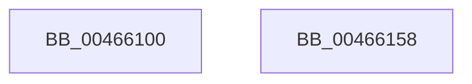

# RtlInitializeGenericTableAvl

- RVA: `0x00466100`–`0x00466159` (길이 `89` bytes)
- VA: `0x0000000140466100`
- 실행 섹션: `.text`
- PDB 이름 있음: `예`; PDB Function 태그: `아니요`
- unwind 정보 RVA: `0x0005C954`
- 디코드: `25`개 명령, `89/89` bytes 표시
- 미해석 바이트: `0` (있으면 어셈블리에 `.byte`로 보존)

> 이 문서는 커널 이미지의 기계어와 PDB 기호를 분석해 생성했습니다. 4번과 5번은 함수 원형과 자료형을 바이너리 사용 방식에서 추정한 C 해석이며 원본 소스 복구 결과는 아닙니다.

## 1. Dependencies

- 직접 호출 지점: **1**; 고유 호출 대상: **1**
- 직접 호출자로 확인된 함수: **9**
- RIP 상대 이미지 참조: **0**

### Outgoing calls
- `0x00466126` → [memset](../6C/memset_function_006C6C40.md) (function, `0x006C6C40`)

### Direct callers
- [PiDmObjectManagerInit](../../page/73/PiDmObjectManagerInit_function_00730548.md) at `0x0073057B`
- [PopDirectedDripsUmInitialize](../../page/77/PopDirectedDripsUmInitialize_function_007717D8.md) at `0x00771818`
- [EtwpEnableKeyProviders](../../page/7B/EtwpEnableKeyProviders_function_007BE28C.md) at `0x007BE2FC`
- [EtwpInitializeAutoLoggers](../../page/7B/EtwpInitializeAutoLoggers_function_007BE694.md) at `0x007BE7D1`
- [PiDqQueryCreate](../../page/8D/PiDqQueryCreate_function_008DCA88.md) at `0x008DCB03`
- [PiPnpRtlBeginOperation](../../page/8E/PiPnpRtlBeginOperation_function_008E033C.md) at `0x008E03D7`
- [SshpCacheInitializeLibraryCache](../../page/AD/SshpCacheInitializeLibraryCache_function_00AD0D30.md) at `0x00AD0D61`
- [VfAvlInitializeTreeEx](../../pagevrfy/B9/VfAvlInitializeTreeEx_function_00B93CC8.md) at `0x00B93DD3`
- [ViPtInitAvlTrees](../../pagevrfy/B9/ViPtInitAvlTrees_function_00B9C8E0.md) at `0x00B9C90D`
- [ViPtInitAvlTrees](../../pagevrfy/B9/ViPtInitAvlTrees_function_00B9C8E0.md) at `0x00B9C93F`

### Static image references
- 디코드된 RIP-relative 메모리 참조가 없습니다.

## 2. Other-region calls and transfers

- 다른 실행 섹션으로 향하는 call: **0**
- 별도 외부 분기/꼬리 이동을 확인하지 못했습니다.

## 3. Assembly (complete function range)

```asm
00466100  48 89 5C 24 08                  mov qword ptr [rsp + 8], rbx
00466105  48 89 6C 24 10                  mov qword ptr [rsp + 0x10], rbp
0046610A  48 89 74 24 18                  mov qword ptr [rsp + 0x18], rsi
0046610F  57                              push rdi
00466110  48 83 EC 20                     sub rsp, 0x20
00466114  48 8B DA                        mov rbx, rdx
00466117  49 8B F8                        mov rdi, r8
0046611A  33 D2                           xor edx, edx
0046611C  49 8B E9                        mov rbp, r9
0046611F  48 8B F1                        mov rsi, rcx
00466122  44 8D 42 68                     lea r8d, [rdx + 0x68]
00466126  E8 15 0B 26 00                  call 0x1406c6c40
0046612B  48 8B 44 24 50                  mov rax, qword ptr [rsp + 0x50]
00466130  48 89 5E 48                     mov qword ptr [rsi + 0x48], rbx
00466134  48 8B 5C 24 30                  mov rbx, qword ptr [rsp + 0x30]
00466139  48 89 6E 58                     mov qword ptr [rsi + 0x58], rbp
0046613D  48 8B 6C 24 38                  mov rbp, qword ptr [rsp + 0x38]
00466142  48 89 46 60                     mov qword ptr [rsi + 0x60], rax
00466146  48 89 36                        mov qword ptr [rsi], rsi
00466149  48 89 7E 50                     mov qword ptr [rsi + 0x50], rdi
0046614D  48 8B 74 24 40                  mov rsi, qword ptr [rsp + 0x40]
00466152  48 83 C4 20                     add rsp, 0x20
00466156  5F                              pop rdi
00466157  C3                              ret
00466158  CC                              int3
```

## 4. C-style interpretation (structured pseudocode)

```c
__int64 __fastcall RtlInitializeGenericTableAvl(__int64 a1, __int64 a2, __int64 a3, __int64 a4, __int64 a5)
{
    __int64 result;
    __int64 v_rsp;
    unsigned __int64 v_stack_p10;
    unsigned __int64 v_stack_p18;
    unsigned __int64 v_stack_p8;

    v_stack_p8 = v_rbx;
    v_stack_p10 = v_rbp;
    v_stack_p18 = v_rsi;
    v_rsp = (v_rsp) - (32);
    a2 = 0;
    result = memset(a1, a2, a2 + 104, a4);
    *(unsigned __int64 *)(a1 + 72) = 0;
    *(unsigned __int64 *)(a1 + 88) = a4;
    *(unsigned __int64 *)(a1 + 96) = a5;
    *(unsigned __int64 *)(a1) = a1;
    *(unsigned __int64 *)(a1 + 80) = a3;
    v_rsp = (v_rsp) + (32);
    return a5;
}
```

## 5. (Beta) C Style

```c
int64_t RtlInitializeGenericTableAvl(void *GenericTableAvl, int64_t Arg2, int64_t Arg3, int64_t Arg4, int64_t Arg5)
{
    uint8_t *genericTableAvl = (uint8_t *)GenericTableAvl;

    int64_t result;
    int64_t local_rsp;
    uint64_t v_stack_p10;
    uint64_t v_stack_p18;
    uint64_t v_stack_p8;

    v_stack_p8 = local_rbx;
    v_stack_p10 = local_rbp;
    v_stack_p18 = local_rsi;
    local_rsp = (local_rsp) - (32);
    Arg2 = 0;
    result = memset(GenericTableAvl, Arg2, Arg2 + 104, Arg4);
    *(uint64_t *)(genericTableAvl + 0x48) = 0;
    *(uint64_t *)(genericTableAvl + 0x58) = Arg4;
    *(uint64_t *)(genericTableAvl + 0x60) = Arg5;
    *(void **)(genericTableAvl) = GenericTableAvl;
    *(uint64_t *)(genericTableAvl + 0x50) = Arg3;
    local_rsp = (local_rsp) + (32);
    return Arg5;
}
```

### 관측된 메모리 오프셋

구조체 형식이 확인되지 않은 접근은 인자 기준의 오프셋으로만 기록했습니다.

| 기준 인자 | 오프셋 표현 | 폭 (bit) | 접근 |
|---|---:|---:|---|
| `GenericTableAvl` | `+ 0x0` | `64` | `W` |
| `GenericTableAvl` | `+ 0x48` | `64` | `W` |
| `GenericTableAvl` | `+ 0x50` | `64` | `W` |
| `GenericTableAvl` | `+ 0x58` | `64` | `W` |
| `GenericTableAvl` | `+ 0x60` | `64` | `W` |

## 6. Execution-region graph

[열기: 2D/3D 그래프와 함수 탐색 컨트롤 패널](../../../control-panel.html?section=text&rva=0x00466100&view=graph)

- 2D 그래프는 위에서 아래로 흐르고, 3D 그래프는 빈 공간을 드래그해 회전합니다. Shift+드래그는 이동, 휠은 확대·축소, 함수 노드 선택은 대상 보고서 이동입니다.

### Static fallback


