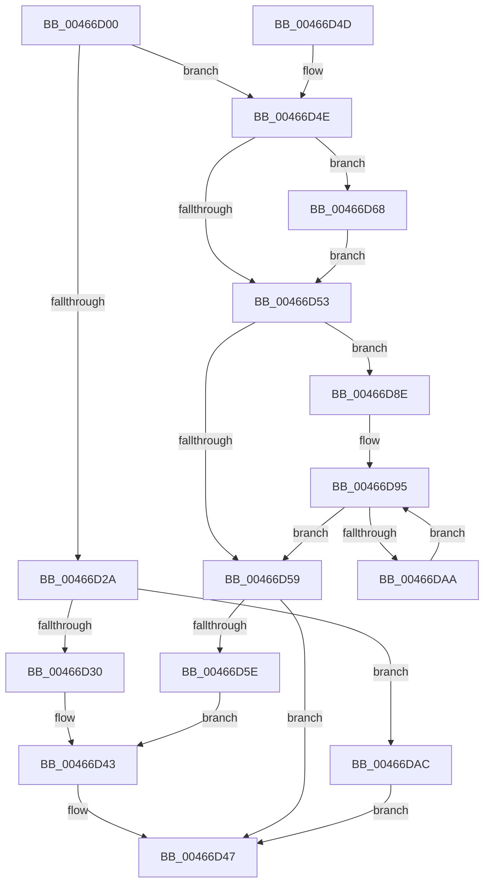

# RtlInterlockedClearBitRun

- RVA: `0x00466D00`–`0x00466DB5` (길이 `181` bytes)
- VA: `0x0000000140466D00`
- 실행 섹션: `.text`
- PDB 이름 있음: `예`; PDB Function 태그: `아니요`
- unwind 정보 RVA: `0x000AAE78`
- 디코드: `58`개 명령, `181/181` bytes 표시
- 미해석 바이트: `0` (있으면 어셈블리에 `.byte`로 보존)

> 이 문서는 커널 이미지의 기계어와 PDB 기호를 분석해 생성했습니다. 4번과 5번은 함수 원형과 자료형을 바이너리 사용 방식에서 추정한 C 해석이며 원본 소스 복구 결과는 아닙니다.

## 1. Dependencies

- 직접 호출 지점: **0**; 고유 호출 대상: **0**
- 직접 호출자로 확인된 함수: **2**
- RIP 상대 이미지 참조: **0**

### Outgoing calls
- 직접 디코드된 call 명령이 없습니다.

### Direct callers
- [EtwpFreeUserBufferSpace](../../page/7C/EtwpFreeUserBufferSpace_function_007C0C08.md) at `0x007C0C5C`
- [MiLogPinDriverAddressesWorker](../../page/A4/MiLogPinDriverAddressesWorker_function_00A441B0.md) at `0x00A44298`

### Static image references
- 디코드된 RIP-relative 메모리 참조가 없습니다.

## 2. Other-region calls and transfers

- 다른 실행 섹션으로 향하는 call: **0**
- 별도 외부 분기/꼬리 이동을 확인하지 못했습니다.

## 3. Assembly (complete function range)

```asm
00466D00  48 89 5C 24 08                  mov qword ptr [rsp + 8], rbx
00466D05  48 8B 41 08                     mov rax, qword ptr [rcx + 8]
00466D09  45 8B C8                        mov r9d, r8d
00466D0C  44 8B DA                        mov r11d, edx
00466D0F  41 83 E3 1F                     and r11d, 0x1f
00466D13  44 8B C2                        mov r8d, edx
00466D16  49 C1 E8 05                     shr r8, 5
00466D1A  8B DA                           mov ebx, edx
00466D1C  4E 8D 14 80                     lea r10, [rax + r8*4]
00466D20  4B 8D 04 0B                     lea rax, [r11 + r9]
00466D24  48 83 F8 20                     cmp rax, 0x20
00466D28  77 24                           ja 0x140466d4e
00466D2A  41 83 F9 20                     cmp r9d, 0x20
00466D2E  74 7C                           je 0x140466dac
00466D30  41 8B C9                        mov ecx, r9d
00466D33  B8 01 00 00 00                  mov eax, 1
00466D38  D3 E0                           shl eax, cl
00466D3A  41 8B CB                        mov ecx, r11d
00466D3D  FF C8                           dec eax
00466D3F  D3 E0                           shl eax, cl
00466D41  F7 D0                           not eax
00466D43  F0 41 21 02                     lock and dword ptr [r10], eax
00466D47  48 8B 5C 24 08                  mov rbx, qword ptr [rsp + 8]
00466D4C  C3                              ret
00466D4D  CC                              int3
00466D4E  83 E3 1F                        and ebx, 0x1f
00466D51  75 15                           jne 0x140466d68
00466D53  41 83 F9 20                     cmp r9d, 0x20
00466D57  73 35                           jae 0x140466d8e
00466D59  45 85 C9                        test r9d, r9d
00466D5C  74 E9                           je 0x140466d47
00466D5E  41 8B C9                        mov ecx, r9d
00466D61  83 C8 FF                        or eax, 0xffffffff
00466D64  D3 E0                           shl eax, cl
00466D66  EB DB                           jmp 0x140466d43
00466D68  BA 20 00 00 00                  mov edx, 0x20
00466D6D  B8 01 00 00 00                  mov eax, 1
00466D72  2B D3                           sub edx, ebx
00466D74  8B CA                           mov ecx, edx
00466D76  D3 E0                           shl eax, cl
00466D78  49 8B CB                        mov rcx, r11
00466D7B  FF C8                           dec eax
00466D7D  D3 E0                           shl eax, cl
00466D7F  F7 D0                           not eax
00466D81  F0 41 21 02                     lock and dword ptr [r10], eax
00466D85  44 2B CA                        sub r9d, edx
00466D88  49 83 C2 04                     add r10, 4
00466D8C  EB C5                           jmp 0x140466d53
00466D8E  41 8B C1                        mov eax, r9d
00466D91  48 C1 E8 05                     shr rax, 5
00466D95  41 C7 02 00 00 00 00            mov dword ptr [r10], 0
00466D9C  41 83 C1 E0                     add r9d, -0x20
00466DA0  49 83 C2 04                     add r10, 4
00466DA4  48 83 E8 01                     sub rax, 1
00466DA8  74 AF                           je 0x140466d59
00466DAA  EB E9                           jmp 0x140466d95
00466DAC  41 C7 02 00 00 00 00            mov dword ptr [r10], 0
00466DB3  EB 92                           jmp 0x140466d47
```

## 4. C-style interpretation (structured pseudocode)

```c
__int64 __fastcall RtlInterlockedClearBitRun(__int64 a1, int a2, int a3)
{
    __int64 result;
    __int64 v_r10;
    __int64 v_r11;
    __int64 v_rbx;
    unsigned __int64 v_stack_p8;

    v_stack_p8 = v_rbx;
    v_r11 = (unsigned int)(((unsigned int)(a2)) & (31));
    a3 = ((unsigned int)(a2)) >> (5);
    if ((v_r11 + (unsigned int)(a3) * 1) > 32) goto loc_00466D4E;
    if (((unsigned int)((unsigned int)(a3))) == 32) goto loc_00466DAC;
    result = (unsigned int)((1) << ((unsigned __int8)((unsigned int)((unsigned int)((unsigned int)(a3))))));
    result = (unsigned int)((result) - 1);
    result = (unsigned int)((result) << ((unsigned __int8)((unsigned int)((unsigned int)(v_r11)))));
    result = (unsigned int)(~(result));
loc_00466D43:
loc_00466D47:
    return result;
loc_00466D4E:
    v_rbx = (unsigned int)((v_stack_p8) & (31));
    if (condition_is_not_equal) goto loc_00466D68;
loc_00466D53:
    if (((unsigned int)((unsigned int)(a3))) >= 32) goto loc_00466D8E;
loc_00466D59:
    if ((unsigned int)((unsigned int)(a3)) == 0) goto loc_00466D47;
    result = (unsigned int)((result) | (0xFFFFFFFFULL));
    result = (unsigned int)((result) << ((unsigned __int8)((unsigned int)((unsigned int)((unsigned int)(a3))))));
    goto loc_00466D43;
loc_00466D68:
    a2 = (unsigned int)((32) - ((unsigned int)(v_rbx)));
    result = (unsigned int)((1) << ((unsigned __int8)((unsigned int)(a2))));
    result = (unsigned int)((result) - 1);
    result = (unsigned int)((result) << ((unsigned __int8)(v_r11)));
    result = (unsigned int)(~(result));
    a4 = (unsigned int)(((unsigned int)(a3)) - (a2));
    v_r10 = (*(unsigned __int64 *)(a1 + 8) + a3 * 4) + (4);
    goto loc_00466D53;
loc_00466D8E:
    result = ((unsigned int)((unsigned int)(a4))) >> (5);
loc_00466D95:
    *(unsigned int *)(v_r10) = 0;
    a4 = (unsigned int)((a4) + (-32));
    v_r10 = (v_r10) + (4);
    result = (result) - (1);
    if (condition_is_equal) goto loc_00466D59;
    goto loc_00466D95;
loc_00466DAC:
    *(unsigned int *)(v_r10) = 0;
    goto loc_00466D47;
}
```

## 5. (Beta) C Style

```c
int64_t RtlInterlockedClearBitRun(void *Arg1, void *Arg2, int32_t Arg3)
{
    uint8_t *arg1 = (uint8_t *)Arg1;
    uint8_t *arg2 = (uint8_t *)Arg2;

    int64_t result;
    int64_t local_r10;
    int64_t local_r11;
    int64_t local_rbx;
    uint64_t v_stack_p8;

    v_stack_p8 = local_rbx;
    local_r11 = (uint32_t)(((uint32_t)(Arg2)) & (31));
    Arg3 = ((uint32_t)(Arg2)) >> (5);
    if ((local_r11 + (uint32_t)(Arg3) * 1) > 32) goto loc_00466D4E;
    if (((uint32_t)((uint32_t)(Arg3))) == 32) goto loc_00466DAC;
    result = (uint32_t)((1) << ((uint8_t)((uint32_t)((uint32_t)((uint32_t)(Arg3))))));
    result = (uint32_t)((result) - 1);
    result = (uint32_t)((result) << ((uint8_t)((uint32_t)((uint32_t)(local_r11)))));
    result = (uint32_t)(~(result));
loc_00466D43:
loc_00466D47:
    return result;
loc_00466D4E:
    local_rbx = (uint32_t)((v_stack_p8) & (31));
    if (condition_is_not_equal) goto loc_00466D68;
loc_00466D53:
    if (((uint32_t)((uint32_t)(Arg3))) >= 32) goto loc_00466D8E;
loc_00466D59:
    if ((uint32_t)((uint32_t)(Arg3)) == 0) goto loc_00466D47;
    result = (uint32_t)((result) | (0xFFFFFFFFULL));
    result = (uint32_t)((result) << ((uint8_t)((uint32_t)((uint32_t)((uint32_t)(Arg3))))));
    goto loc_00466D43;
loc_00466D68:
    Arg2 = (uint32_t)((32) - ((uint32_t)(local_rbx)));
    result = (uint32_t)((1) << ((uint8_t)((uint32_t)(Arg2))));
    result = (uint32_t)((result) - 1);
    result = (uint32_t)((result) << ((uint8_t)(local_r11)));
    result = (uint32_t)(~(result));
    a4 = (uint32_t)(((uint32_t)(Arg3)) - (Arg2));
    local_r10 = (*(uint64_t *)(arg1 + 0x8) + Arg3 * 4) + (4);
    goto loc_00466D53;
loc_00466D8E:
    result = ((uint32_t)((uint32_t)(a4))) >> (5);
loc_00466D95:
    *(uint32_t *)(local_r10) = 0;
    a4 = (uint32_t)((a4) + (-32));
    local_r10 = (local_r10) + (4);
    result = (result) - (1);
    if (condition_is_equal) goto loc_00466D59;
    goto loc_00466D95;
loc_00466DAC:
    *(uint32_t *)(local_r10) = 0;
    goto loc_00466D47;
}
```

### 관측된 메모리 오프셋

구조체 형식이 확인되지 않은 접근은 인자 기준의 오프셋으로만 기록했습니다.

| 기준 인자 | 오프셋 표현 | 폭 (bit) | 접근 |
|---|---:|---:|---|
| `Arg1` | `+ 0x8` | `64` | `R` |
| `Arg2` | `+ 0x0 + r9*1` | `64` | `R` |

## 6. Execution-region graph

[열기: 2D/3D 그래프와 함수 탐색 컨트롤 패널](../../../control-panel.html?section=text&rva=0x00466D00&view=graph)

- 2D 그래프는 위에서 아래로 흐르고, 3D 그래프는 빈 공간을 드래그해 회전합니다. Shift+드래그는 이동, 휠은 확대·축소, 함수 노드 선택은 대상 보고서 이동입니다.

### Static fallback


