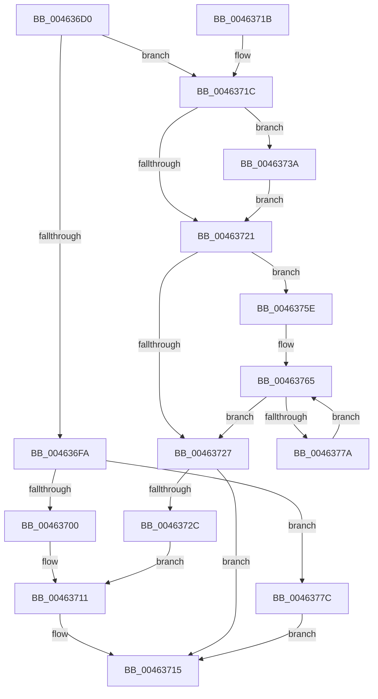

# RtlInterlockedSetBitRun

- RVA: `0x004636D0`–`0x00463785` (길이 `181` bytes)
- VA: `0x00000001404636D0`
- 실행 섹션: `.text`
- PDB 이름 있음: `예`; PDB Function 태그: `아니요`
- unwind 정보 RVA: `0x000AA71C`
- 디코드: `57`개 명령, `181/181` bytes 표시
- 미해석 바이트: `0` (있으면 어셈블리에 `.byte`로 보존)

> 이 문서는 커널 이미지의 기계어와 PDB 기호를 분석해 생성했습니다. 4번과 5번은 함수 원형과 자료형을 바이너리 사용 방식에서 추정한 C 해석이며 원본 소스 복구 결과는 아닙니다.

## 1. Dependencies

- 직접 호출 지점: **0**; 고유 호출 대상: **0**
- 직접 호출자로 확인된 함수: **0**
- RIP 상대 이미지 참조: **0**

### Outgoing calls
- 직접 디코드된 call 명령이 없습니다.

### Direct callers
- 이 함수 시작 RVA로 연결되는 직접 call은 확인되지 않았습니다. 간접 호출은 완전히 역산할 수 없습니다.

### Static image references
- 디코드된 RIP-relative 메모리 참조가 없습니다.

## 2. Other-region calls and transfers

- 다른 실행 섹션으로 향하는 call: **0**
- 별도 외부 분기/꼬리 이동을 확인하지 못했습니다.

## 3. Assembly (complete function range)

```asm
004636D0  48 89 5C 24 08                  mov qword ptr [rsp + 8], rbx
004636D5  48 8B 41 08                     mov rax, qword ptr [rcx + 8]
004636D9  45 8B C8                        mov r9d, r8d
004636DC  44 8B DA                        mov r11d, edx
004636DF  41 83 E3 1F                     and r11d, 0x1f
004636E3  44 8B C2                        mov r8d, edx
004636E6  49 C1 E8 05                     shr r8, 5
004636EA  8B DA                           mov ebx, edx
004636EC  4E 8D 14 80                     lea r10, [rax + r8*4]
004636F0  4B 8D 04 0B                     lea rax, [r11 + r9]
004636F4  48 83 F8 20                     cmp rax, 0x20
004636F8  77 22                           ja 0x14046371c
004636FA  41 83 F9 20                     cmp r9d, 0x20
004636FE  74 7C                           je 0x14046377c
00463700  41 8B C9                        mov ecx, r9d
00463703  B8 01 00 00 00                  mov eax, 1
00463708  D3 E0                           shl eax, cl
0046370A  41 8B CB                        mov ecx, r11d
0046370D  FF C8                           dec eax
0046370F  D3 E0                           shl eax, cl
00463711  F0 41 09 02                     lock or dword ptr [r10], eax
00463715  48 8B 5C 24 08                  mov rbx, qword ptr [rsp + 8]
0046371A  C3                              ret
0046371B  CC                              int3
0046371C  83 E3 1F                        and ebx, 0x1f
0046371F  75 19                           jne 0x14046373a
00463721  41 83 F9 20                     cmp r9d, 0x20
00463725  73 37                           jae 0x14046375e
00463727  45 85 C9                        test r9d, r9d
0046372A  74 E9                           je 0x140463715
0046372C  41 8B C9                        mov ecx, r9d
0046372F  B8 01 00 00 00                  mov eax, 1
00463734  D3 E0                           shl eax, cl
00463736  FF C8                           dec eax
00463738  EB D7                           jmp 0x140463711
0046373A  BA 20 00 00 00                  mov edx, 0x20
0046373F  B8 01 00 00 00                  mov eax, 1
00463744  2B D3                           sub edx, ebx
00463746  8B CA                           mov ecx, edx
00463748  D3 E0                           shl eax, cl
0046374A  49 8B CB                        mov rcx, r11
0046374D  FF C8                           dec eax
0046374F  D3 E0                           shl eax, cl
00463751  F0 41 09 02                     lock or dword ptr [r10], eax
00463755  44 2B CA                        sub r9d, edx
00463758  49 83 C2 04                     add r10, 4
0046375C  EB C3                           jmp 0x140463721
0046375E  41 8B C1                        mov eax, r9d
00463761  48 C1 E8 05                     shr rax, 5
00463765  41 C7 02 FF FF FF FF            mov dword ptr [r10], 0xffffffff
0046376C  41 83 C1 E0                     add r9d, -0x20
00463770  49 83 C2 04                     add r10, 4
00463774  48 83 E8 01                     sub rax, 1
00463778  74 AD                           je 0x140463727
0046377A  EB E9                           jmp 0x140463765
0046377C  41 C7 02 FF FF FF FF            mov dword ptr [r10], 0xffffffff
00463783  EB 90                           jmp 0x140463715
```

## 4. C-style interpretation (structured pseudocode)

```c
__int64 __fastcall RtlInterlockedSetBitRun(__int64 a1, int a2, int a3)
{
    __int64 result;
    __int64 v_r10;
    __int64 v_r11;
    __int64 v_rbx;
    unsigned __int64 v_stack_p8;

    v_stack_p8 = v_rbx;
    v_r11 = (unsigned int)(((unsigned int)(a2)) & (31));
    a3 = ((unsigned int)(a2)) >> (5);
    if ((v_r11 + (unsigned int)(a3) * 1) > 32) goto loc_0046371C;
    if (((unsigned int)((unsigned int)(a3))) == 32) goto loc_0046377C;
    result = (unsigned int)((1) << ((unsigned __int8)((unsigned int)((unsigned int)((unsigned int)(a3))))));
    result = (unsigned int)((result) - 1);
    result = (unsigned int)((result) << ((unsigned __int8)((unsigned int)((unsigned int)(v_r11)))));
loc_00463711:
loc_00463715:
    return result;
loc_0046371C:
    v_rbx = (unsigned int)((v_stack_p8) & (31));
    if (condition_is_not_equal) goto loc_0046373A;
loc_00463721:
    if (((unsigned int)((unsigned int)(a3))) >= 32) goto loc_0046375E;
loc_00463727:
    if ((unsigned int)((unsigned int)(a3)) == 0) goto loc_00463715;
    result = (unsigned int)((1) << ((unsigned __int8)((unsigned int)((unsigned int)((unsigned int)(a3))))));
    result = (unsigned int)((result) - 1);
    goto loc_00463711;
loc_0046373A:
    a2 = (unsigned int)((32) - ((unsigned int)(v_rbx)));
    result = (unsigned int)((1) << ((unsigned __int8)((unsigned int)(a2))));
    result = (unsigned int)((result) - 1);
    result = (unsigned int)((result) << ((unsigned __int8)(v_r11)));
    a4 = (unsigned int)(((unsigned int)(a3)) - (a2));
    v_r10 = (*(unsigned __int64 *)(a1 + 8) + a3 * 4) + (4);
    goto loc_00463721;
loc_0046375E:
    result = ((unsigned int)((unsigned int)(a4))) >> (5);
loc_00463765:
    *(unsigned int *)(v_r10) = 0xFFFFFFFFULL;
    a4 = (unsigned int)((a4) + (-32));
    v_r10 = (v_r10) + (4);
    result = (result) - (1);
    if (condition_is_equal) goto loc_00463727;
    goto loc_00463765;
loc_0046377C:
    *(unsigned int *)(v_r10) = 0xFFFFFFFFULL;
    goto loc_00463715;
}
```

## 5. (Beta) C Style

```c
int64_t RtlInterlockedSetBitRun(void *Arg1, void *Arg2, int32_t Arg3)
{
    uint8_t *arg1 = (uint8_t *)Arg1;
    uint8_t *arg2 = (uint8_t *)Arg2;

    int64_t result;
    int64_t local_r10;
    int64_t local_r11;
    int64_t local_rbx;
    uint64_t v_stack_p8;

    v_stack_p8 = local_rbx;
    local_r11 = (uint32_t)(((uint32_t)(Arg2)) & (31));
    Arg3 = ((uint32_t)(Arg2)) >> (5);
    if ((local_r11 + (uint32_t)(Arg3) * 1) > 32) goto loc_0046371C;
    if (((uint32_t)((uint32_t)(Arg3))) == 32) goto loc_0046377C;
    result = (uint32_t)((1) << ((uint8_t)((uint32_t)((uint32_t)((uint32_t)(Arg3))))));
    result = (uint32_t)((result) - 1);
    result = (uint32_t)((result) << ((uint8_t)((uint32_t)((uint32_t)(local_r11)))));
loc_00463711:
loc_00463715:
    return result;
loc_0046371C:
    local_rbx = (uint32_t)((v_stack_p8) & (31));
    if (condition_is_not_equal) goto loc_0046373A;
loc_00463721:
    if (((uint32_t)((uint32_t)(Arg3))) >= 32) goto loc_0046375E;
loc_00463727:
    if ((uint32_t)((uint32_t)(Arg3)) == 0) goto loc_00463715;
    result = (uint32_t)((1) << ((uint8_t)((uint32_t)((uint32_t)((uint32_t)(Arg3))))));
    result = (uint32_t)((result) - 1);
    goto loc_00463711;
loc_0046373A:
    Arg2 = (uint32_t)((32) - ((uint32_t)(local_rbx)));
    result = (uint32_t)((1) << ((uint8_t)((uint32_t)(Arg2))));
    result = (uint32_t)((result) - 1);
    result = (uint32_t)((result) << ((uint8_t)(local_r11)));
    a4 = (uint32_t)(((uint32_t)(Arg3)) - (Arg2));
    local_r10 = (*(uint64_t *)(arg1 + 0x8) + Arg3 * 4) + (4);
    goto loc_00463721;
loc_0046375E:
    result = ((uint32_t)((uint32_t)(a4))) >> (5);
loc_00463765:
    *(uint32_t *)(local_r10) = 0xFFFFFFFFULL;
    a4 = (uint32_t)((a4) + (-32));
    local_r10 = (local_r10) + (4);
    result = (result) - (1);
    if (condition_is_equal) goto loc_00463727;
    goto loc_00463765;
loc_0046377C:
    *(uint32_t *)(local_r10) = 0xFFFFFFFFULL;
    goto loc_00463715;
}
```

### 관측된 메모리 오프셋

구조체 형식이 확인되지 않은 접근은 인자 기준의 오프셋으로만 기록했습니다.

| 기준 인자 | 오프셋 표현 | 폭 (bit) | 접근 |
|---|---:|---:|---|
| `Arg1` | `+ 0x8` | `64` | `R` |
| `Arg2` | `+ 0x0 + r9*1` | `64` | `R` |

## 6. Execution-region graph

[열기: 2D/3D 그래프와 함수 탐색 컨트롤 패널](../../../control-panel.html?section=text&rva=0x004636D0&view=graph)

- 2D 그래프는 위에서 아래로 흐르고, 3D 그래프는 빈 공간을 드래그해 회전합니다. Shift+드래그는 이동, 휠은 확대·축소, 함수 노드 선택은 대상 보고서 이동입니다.

### Static fallback


