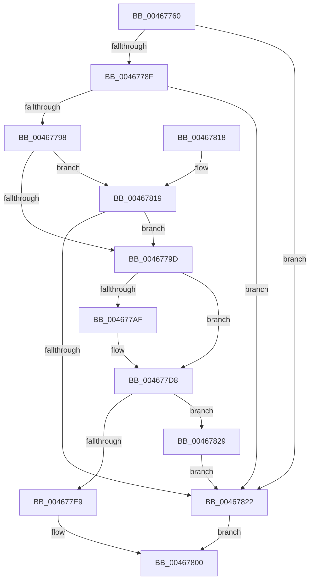

# RtlIpv4AddressToStringExW

- RVA: `0x00467760`–`0x0046782D` (길이 `205` bytes)
- VA: `0x0000000140467760`
- 실행 섹션: `.text`
- PDB 이름 있음: `예`; PDB Function 태그: `아니요`
- unwind 정보 RVA: `0x000AAFBC`
- 디코드: `64`개 명령, `205/205` bytes 표시
- 미해석 바이트: `0` (있으면 어셈블리에 `.byte`로 보존)

> 이 문서는 커널 이미지의 기계어와 PDB 기호를 분석해 생성했습니다. 4번과 5번은 함수 원형과 자료형을 바이너리 사용 방식에서 추정한 C 해석이며 원본 소스 복구 결과는 아닙니다.

## 1. Dependencies

- 직접 호출 지점: **4**; 고유 호출 대상: **4**
- 직접 호출자로 확인된 함수: **0**
- RIP 상대 이미지 참조: **2**

### Outgoing calls
- `0x004677A2` → [RtlIpv4AddressToStringW](RtlIpv4AddressToStringW_function_00467840.md) (function, `0x00467840`)
- `0x004677CC` → [swprintf_s](../50/swprintf_s_function_00504B20.md) (function, `0x00504B20`)
- `0x004677F7` → [memcpy](../6C/memcpy_function_006C6840.md) (function, `0x006C6840`)
- `0x00467808` → [_security_check_cookie](../6A/_security_check_cookie_function_006AC640.md) (function, `0x006AC640`)

### Direct callers
- 이 함수 시작 RVA로 연결되는 직접 call은 확인되지 않았습니다. 간접 호출은 완전히 역산할 수 없습니다.

### Static image references
- `0x0046776B` → RVA `0x00E0A740` (`.data`; read)
- `0x004677C2` → RVA `0x006CCD00` (` ?? ::FNODOBFM::`string'`; read)

## 2. Other-region calls and transfers

- 다른 실행 섹션으로 향하는 call: **0**
- 별도 외부 분기/꼬리 이동을 확인하지 못했습니다.

## 3. Assembly (complete function range)

```asm
00467760  40 53                           push rbx
00467762  55                              push rbp
00467763  56                              push rsi
00467764  57                              push rdi
00467765  41 56                           push r14
00467767  48 83 EC 60                     sub rsp, 0x60
0046776B  48 8B 05 CE 2F 9A 00            mov rax, qword ptr [rip + 0x9a2fce]
00467772  48 33 C4                        xor rax, rsp
00467775  48 89 44 24 50                  mov qword ptr [rsp + 0x50], rax
0046777A  45 33 F6                        xor r14d, r14d
0046777D  49 8B F9                        mov rdi, r9
00467780  49 8B E8                        mov rbp, r8
00467783  0F B7 F2                        movzx esi, dx
00467786  48 85 C9                        test rcx, rcx
00467789  0F 84 93 00 00 00               je 0x140467822
0046778F  4D 85 C9                        test r9, r9
00467792  0F 84 8A 00 00 00               je 0x140467822
00467798  4D 85 C0                        test r8, r8
0046779B  74 7C                           je 0x140467819
0046779D  48 8D 54 24 20                  lea rdx, [rsp + 0x20]
004677A2  E8 99 00 00 00                  call 0x140467840
004677A7  48 8B D8                        mov rbx, rax
004677AA  66 85 F6                        test si, si
004677AD  74 29                           je 0x1404677d8
004677AF  66 C1 CE 08                     ror si, 8
004677B3  48 8D 54 24 4C                  lea rdx, [rsp + 0x4c]
004677B8  48 2B D0                        sub rdx, rax
004677BB  44 0F B7 CE                     movzx r9d, si
004677BF  48 D1 FA                        sar rdx, 1
004677C2  4C 8D 05 37 55 26 00            lea r8, [rip + 0x265537]
004677C9  48 8B C8                        mov rcx, rax
004677CC  E8 4F D3 09 00                  call 0x140504b20
004677D1  48 63 C8                        movsxd rcx, eax
004677D4  48 8D 1C 4B                     lea rbx, [rbx + rcx*2]
004677D8  48 8D 44 24 20                  lea rax, [rsp + 0x20]
004677DD  48 2B D8                        sub rbx, rax
004677E0  48 D1 FB                        sar rbx, 1
004677E3  FF C3                           inc ebx
004677E5  39 1F                           cmp dword ptr [rdi], ebx
004677E7  72 40                           jb 0x140467829
004677E9  44 8B C3                        mov r8d, ebx
004677EC  48 8D 54 24 20                  lea rdx, [rsp + 0x20]
004677F1  4D 03 C0                        add r8, r8
004677F4  48 8B CD                        mov rcx, rbp
004677F7  E8 44 F0 25 00                  call 0x1406c6840
004677FC  33 C0                           xor eax, eax
004677FE  89 1F                           mov dword ptr [rdi], ebx
00467800  48 8B 4C 24 50                  mov rcx, qword ptr [rsp + 0x50]
00467805  48 33 CC                        xor rcx, rsp
00467808  E8 33 4E 24 00                  call 0x1406ac640
0046780D  48 83 C4 60                     add rsp, 0x60
00467811  41 5E                           pop r14
00467813  5F                              pop rdi
00467814  5E                              pop rsi
00467815  5D                              pop rbp
00467816  5B                              pop rbx
00467817  C3                              ret
00467818  CC                              int3
00467819  45 39 31                        cmp dword ptr [r9], r14d
0046781C  0F 84 7B FF FF FF               je 0x14046779d
00467822  B8 0D 00 00 C0                  mov eax, 0xc000000d
00467827  EB D7                           jmp 0x140467800
00467829  89 1F                           mov dword ptr [rdi], ebx
0046782B  EB F5                           jmp 0x140467822
```

## 4. C-style interpretation (structured pseudocode)

```c
__int64 __fastcall RtlIpv4AddressToStringExW(__int64 a1, unsigned __int16 a2, __int64 a3, __int64 a4)
{
    __int64 result;
    __int64 v_r14;
    __int64 v_rbx;
    __int64 v_rsp;
    unsigned __int64 v_stack_m38;
    unsigned __int64 v_stack_m3C;
    unsigned __int64 v_stack_m68;

    v_rsp = (v_rsp) - (96);
    result = (*(unsigned __int64 *)(v_rip + 10104782)) ^ (v_rsp);
    v_stack_m38 = result;
    v_r14 = 0;
    if (a1 == 0) goto loc_00467822;
    if (a4 == 0) goto loc_00467822;
    if (a3 == 0) goto loc_00467819;
loc_0046779D:
    result = RtlIpv4AddressToStringW(a1, v_stack_m68, a3, a4);
    v_rbx = result;
    if (a2 != 0) {
        a2 = v_stack_m3C;
        a2 = (a2) - (result);
        a4 = a2;
        a2 = (a2) >> (1);
        a3 = v_rip + 2512183;
        a1 = result;
        result = swprintf_s(a1, a2, a3, a4);
        a1 = (int)((unsigned int)(result));
        v_rbx = result + a1 * 2;
    }
    v_rbx = (v_rbx) - (v_stack_m68);
    v_rbx = (v_rbx) >> (1);
    v_rbx = (unsigned int)((v_rbx) + 1);
    if ((*(unsigned int *)(a4)) < ((unsigned int)(v_rbx))) goto loc_00467829;
    a3 = ((unsigned int)((unsigned int)(v_rbx))) + ((unsigned int)((unsigned int)(v_rbx)));
    result = memcpy(a3, v_stack_m68, a3, a4);
    result = 0;
    *(unsigned int *)(a4) = (unsigned int)(v_rbx);
loc_00467800:
    a1 = (v_stack_m38) ^ (v_rsp);
    result = _security_check_cookie(a1, v_stack_m68, a3, a4);
    v_rsp = (v_rsp) + (96);
    return result;
loc_00467819:
    if ((*(unsigned int *)(a4)) == 0) goto loc_0046779D;
loc_00467822:
    goto loc_00467800;
loc_00467829:
    *(unsigned int *)(a4) = (unsigned int)(v_rbx);
    goto loc_00467822;
}
```

## 5. (Beta) C Style

```c
int64_t RtlIpv4AddressToStringExW(int64_t Arg1, uint16_t Arg2, int64_t Arg3, void *Arg4)
{
    uint8_t *arg4 = (uint8_t *)Arg4;

    int64_t result;
    int64_t local_r14;
    int64_t local_rbx;
    int64_t local_rsp;
    uint64_t v_stack_m38;
    uint64_t v_stack_m3C;
    uint64_t v_stack_m68;

    local_rsp = (local_rsp) - (96);
    result = (*(uint64_t *)(v_rip + 0x9A2FCE)) ^ (local_rsp);
    v_stack_m38 = result;
    local_r14 = 0;
    if (Arg1 == 0) goto loc_00467822;
    if (Arg4 == NULL) goto loc_00467822;
    if (Arg3 == 0) goto loc_00467819;
loc_0046779D:
    result = RtlIpv4AddressToStringW(Arg1, v_stack_m68, Arg3, Arg4);
    local_rbx = result;
    if (Arg2 != 0) {
        Arg2 = v_stack_m3C;
        Arg2 = (Arg2) - (result);
        Arg4 = Arg2;
        Arg2 = (Arg2) >> (1);
        Arg3 = v_rip + 2512183;
        Arg1 = result;
        result = swprintf_s(Arg1, Arg2, Arg3, Arg4);
        Arg1 = (int32_t)((uint32_t)(result));
        local_rbx = result + Arg1 * 2;
    }
    local_rbx = (local_rbx) - (v_stack_m68);
    local_rbx = (local_rbx) >> (1);
    local_rbx = (uint32_t)((local_rbx) + 1);
    if ((*(uint32_t *)(arg4)) < ((uint32_t)(local_rbx))) goto loc_00467829;
    Arg3 = ((uint32_t)((uint32_t)(local_rbx))) + ((uint32_t)((uint32_t)(local_rbx)));
    result = memcpy(Arg3, v_stack_m68, Arg3, Arg4);
    result = 0;
    *(uint32_t *)(arg4) = (uint32_t)(local_rbx);
loc_00467800:
    Arg1 = (v_stack_m38) ^ (local_rsp);
    result = _security_check_cookie(Arg1, v_stack_m68, Arg3, Arg4);
    local_rsp = (local_rsp) + (96);
    return result;
loc_00467819:
    if ((*(uint32_t *)(arg4)) == 0) goto loc_0046779D;
loc_00467822:
    goto loc_00467800;
loc_00467829:
    *(uint32_t *)(arg4) = (uint32_t)(local_rbx);
    goto loc_00467822;
}
```

### 관측된 메모리 오프셋

구조체 형식이 확인되지 않은 접근은 인자 기준의 오프셋으로만 기록했습니다.

| 기준 인자 | 오프셋 표현 | 폭 (bit) | 접근 |
|---|---:|---:|---|
| `Arg4` | `+ 0x0` | `32` | `R` |
| `Arg4` | `+ 0x0` | `32` | `W` |

## 6. Execution-region graph

[열기: 2D/3D 그래프와 함수 탐색 컨트롤 패널](../../../control-panel.html?section=text&rva=0x00467760&view=graph)

- 2D 그래프는 위에서 아래로 흐르고, 3D 그래프는 빈 공간을 드래그해 회전합니다. Shift+드래그는 이동, 휠은 확대·축소, 함수 노드 선택은 대상 보고서 이동입니다.

### Static fallback


