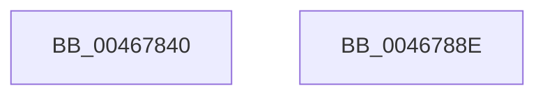

# RtlIpv4AddressToStringW

- RVA: `0x00467840`–`0x0046788F` (길이 `79` bytes)
- VA: `0x0000000140467840`
- 실행 섹션: `.text`
- PDB 이름 있음: `예`; PDB Function 태그: `아니요`
- unwind 정보 RVA: `0x000697A4`
- 디코드: `21`개 명령, `79/79` bytes 표시
- 미해석 바이트: `0` (있으면 어셈블리에 `.byte`로 보존)

> 이 문서는 커널 이미지의 기계어와 PDB 기호를 분석해 생성했습니다. 4번과 5번은 함수 원형과 자료형을 바이너리 사용 방식에서 추정한 C 해석이며 원본 소스 복구 결과는 아닙니다.

## 1. Dependencies

- 직접 호출 지점: **1**; 고유 호출 대상: **1**
- 직접 호출자로 확인된 함수: **2**
- RIP 상대 이미지 참조: **1**

### Outgoing calls
- `0x0046787C` → [swprintf_s](../50/swprintf_s_function_00504B20.md) (function, `0x00504B20`)

### Direct callers
- [RtlIpv4AddressToStringExW](RtlIpv4AddressToStringExW_function_00467760.md) at `0x004677A2`
- [AdtpBuildIPv4Strings](../../page/A2/AdtpBuildIPv4Strings_function_00A2B5C8.md) at `0x00A2B6D8`

### Static image references
- `0x00467867` → RVA `0x006CCD10` (` ?? ::FNODOBFM::`string'`; read)

## 2. Other-region calls and transfers

- 다른 실행 섹션으로 향하는 call: **0**
- 별도 외부 분기/꼬리 이동을 확인하지 못했습니다.

## 3. Assembly (complete function range)

```asm
00467840  40 53                           push rbx
00467842  48 83 EC 40                     sub rsp, 0x40
00467846  44 0F B6 41 03                  movzx r8d, byte ptr [rcx + 3]
0046784B  48 8B DA                        mov rbx, rdx
0046784E  44 0F B6 51 02                  movzx r10d, byte ptr [rcx + 2]
00467853  BA 10 00 00 00                  mov edx, 0x10
00467858  44 0F B6 59 01                  movzx r11d, byte ptr [rcx + 1]
0046785D  8B 01                           mov eax, dword ptr [rcx]
0046785F  48 8B CB                        mov rcx, rbx
00467862  44 89 44 24 30                  mov dword ptr [rsp + 0x30], r8d
00467867  4C 8D 05 A2 54 26 00            lea r8, [rip + 0x2654a2]
0046786E  44 89 54 24 28                  mov dword ptr [rsp + 0x28], r10d
00467873  44 0F B6 C8                     movzx r9d, al
00467877  44 89 5C 24 20                  mov dword ptr [rsp + 0x20], r11d
0046787C  E8 9F D2 09 00                  call 0x140504b20
00467881  48 63 C8                        movsxd rcx, eax
00467884  48 8D 04 4B                     lea rax, [rbx + rcx*2]
00467888  48 83 C4 40                     add rsp, 0x40
0046788C  5B                              pop rbx
0046788D  C3                              ret
0046788E  CC                              int3
```

## 4. C-style interpretation (structured pseudocode)

```c
__int64 __fastcall RtlIpv4AddressToStringW(__int64 a1, __int64 a2)
{
    __int64 result;
    __int64 v_rsp;
    unsigned int v_stack_m18;
    unsigned int v_stack_m20;
    unsigned int v_stack_m28;

    v_rsp = (v_rsp) - (64);
    v_stack_m18 = (unsigned int)(*(unsigned __int8 *)(a1 + 3));
    v_stack_m20 = (unsigned int)(*(unsigned __int8 *)(a1 + 2));
    v_stack_m28 = (unsigned int)(*(unsigned __int8 *)(a1 + 1));
    result = swprintf_s(a2, 16, v_rip + 2512034, (unsigned __int8)((unsigned int)(*(unsigned int *)(a1))));
    v_rsp = (v_rsp) + (64);
    return a2 + (int)((unsigned int)(result)) * 2;
}
```

## 5. (Beta) C Style

```c
int64_t RtlIpv4AddressToStringW(void *Arg1, void *Arg2)
{
    uint8_t *arg1 = (uint8_t *)Arg1;
    uint8_t *arg2 = (uint8_t *)Arg2;

    int64_t result;
    int64_t local_rsp;
    uint32_t v_stack_m18;
    uint32_t v_stack_m20;
    uint32_t v_stack_m28;

    local_rsp = (local_rsp) - (64);
    v_stack_m18 = (uint32_t)(*(uint8_t *)(arg1 + 0x3));
    v_stack_m20 = (uint32_t)(*(uint8_t *)(arg1 + 0x2));
    v_stack_m28 = (uint32_t)(*(uint8_t *)(arg1 + 0x1));
    result = swprintf_s(Arg2, 16, v_rip + 2512034, (uint8_t)((uint32_t)(*(uint32_t *)(arg1))));
    local_rsp = (local_rsp) + (64);
    return Arg2 + (int32_t)((uint32_t)(result)) * 2;
}
```

### 관측된 메모리 오프셋

구조체 형식이 확인되지 않은 접근은 인자 기준의 오프셋으로만 기록했습니다.

| 기준 인자 | 오프셋 표현 | 폭 (bit) | 접근 |
|---|---:|---:|---|
| `Arg1` | `+ 0x0` | `32` | `R` |
| `Arg1` | `+ 0x1` | `8` | `R` |
| `Arg1` | `+ 0x2` | `8` | `R` |
| `Arg1` | `+ 0x3` | `8` | `R` |
| `Arg2` | `+ 0x0 + rcx*2` | `64` | `R` |

## 6. Execution-region graph

[열기: 2D/3D 그래프와 함수 탐색 컨트롤 패널](../../../control-panel.html?section=text&rva=0x00467840&view=graph)

- 2D 그래프는 위에서 아래로 흐르고, 3D 그래프는 빈 공간을 드래그해 회전합니다. Shift+드래그는 이동, 휠은 확대·축소, 함수 노드 선택은 대상 보고서 이동입니다.

### Static fallback


