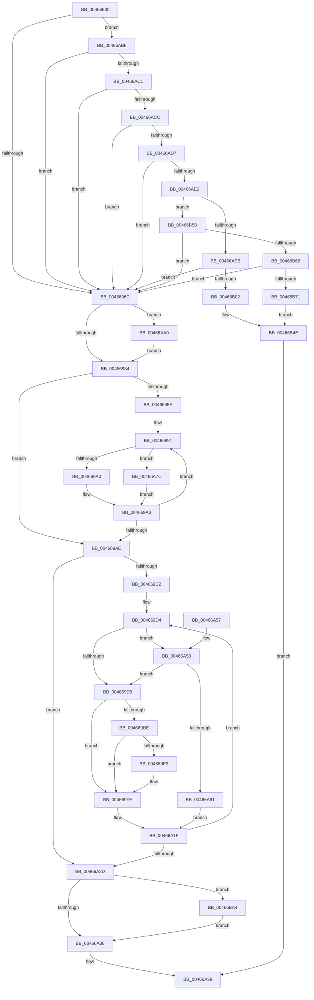

# RtlIpv6AddressToStringA

- RVA: `0x00466930`–`0x00466BE3` (길이 `691` bytes)
- VA: `0x0000000140466930`
- 실행 섹션: `.text`
- PDB 이름 있음: `예`; PDB Function 태그: `아니요`
- unwind 정보 RVA: `0x000AAE10`
- 디코드: `183`개 명령, `691/691` bytes 표시
- 미해석 바이트: `0` (있으면 어셈블리에 `.byte`로 보존)

> 이 문서는 커널 이미지의 기계어와 PDB 기호를 분석해 생성했습니다. 4번과 5번은 함수 원형과 자료형을 바이너리 사용 방식에서 추정한 C 해석이며 원본 소스 복구 결과는 아닙니다.

## 1. Dependencies

- 직접 호출 지점: **6**; 고유 호출 대상: **1**
- 직접 호출자로 확인된 함수: **1**
- RIP 상대 이미지 참조: **8**

### Outgoing calls
- `0x004669F3` → [sprintf_s](../50/sprintf_s_function_00505E40.md) (function, `0x00505E40`)
- `0x00466A1A` → [sprintf_s](../50/sprintf_s_function_00505E40.md) (function, `0x00505E40`)
- `0x00466A71` → [sprintf_s](../50/sprintf_s_function_00505E40.md) (function, `0x00505E40`)
- `0x00466B49` → [sprintf_s](../50/sprintf_s_function_00505E40.md) (function, `0x00505E40`)
- `0x00466B9D` → [sprintf_s](../50/sprintf_s_function_00505E40.md) (function, `0x00505E40`)
- `0x00466BD3` → [sprintf_s](../50/sprintf_s_function_00505E40.md) (function, `0x00505E40`)

### Direct callers
- [RtlIpv6AddressToStringExA](RtlIpv6AddressToStringExA_function_00466800.md) at `0x00466871`

### Static image references
- `0x004669E6` → RVA `0x006CCB20` (` ?? ::FNODOBFM::`string'`; read)
- `0x00466A02` → RVA `0x006CCBB0` (` ?? ::FNODOBFM::`string'`; read)
- `0x00466A64` → RVA `0x006CCB30` (` ?? ::FNODOBFM::`string'`; read)
- `0x00466B06` → RVA `0x006CCB10` (` ?? ::FNODOBFM::`string'`; read)
- `0x00466B11` → RVA `0x006C7800` (` ?? ::FNODOBFM::`string'`; read)
- `0x00466B42` → RVA `0x006CCB60` (` ?? ::FNODOBFM::`string'`; read)
- `0x00466B75` → RVA `0x006CCB40` (` ?? ::FNODOBFM::`string'`; read)
- `0x00466BCC` → RVA `0x006CCBA0` (` ?? ::FNODOBFM::`string'`; read)

## 2. Other-region calls and transfers

- 다른 실행 섹션으로 향하는 call: **0**
- 별도 외부 분기/꼬리 이동을 확인하지 못했습니다.

## 3. Assembly (complete function range)

```asm
00466930  48 89 5C 24 08                  mov qword ptr [rsp + 8], rbx
00466935  48 89 6C 24 10                  mov qword ptr [rsp + 0x10], rbp
0046693A  48 89 74 24 18                  mov qword ptr [rsp + 0x18], rsi
0046693F  57                              push rdi
00466940  41 54                           push r12
00466942  41 55                           push r13
00466944  41 56                           push r14
00466946  41 57                           push r15
00466948  48 83 EC 40                     sub rsp, 0x40
0046694C  BD 08 00 00 00                  mov ebp, 8
00466951  4C 8D 72 2E                     lea r14, [rdx + 0x2e]
00466955  45 33 E4                        xor r12d, r12d
00466958  48 8B FA                        mov rdi, rdx
0046695B  48 8B D9                        mov rbx, rcx
0046695E  44 8D 6D F9                     lea r13d, [rbp - 7]
00466962  66 44 39 21                     cmp word ptr [rcx], r12w
00466966  0F 84 4A 01 00 00               je 0x140466ab6
0046696C  B9 FD FF 00 00                  mov ecx, 0xfffd
00466971  45 8B D4                        mov r10d, r12d
00466974  45 8B DC                        mov r11d, r12d
00466977  41 8B F4                        mov esi, r12d
0046697A  66 85 4B 08                     test word ptr [rbx + 8], cx
0046697E  0F 84 1C 01 00 00               je 0x140466aa0
00466984  44 8B FD                        mov r15d, ebp
00466987  41 8B D4                        mov edx, r12d
0046698A  85 ED                           test ebp, ebp
0046698C  74 20                           je 0x1404669ae
0046698E  4D 8B C4                        mov r8, r12
00466991  44 8D 4A 01                     lea r9d, [rdx + 1]
00466995  66 46 39 24 43                  cmp word ptr [rbx + r8*2], r12w
0046699A  0F 84 DC 00 00 00               je 0x140466a7c
004669A0  41 8B F1                        mov esi, r9d
004669A3  4D 03 C5                        add r8, r13
004669A6  41 8B D1                        mov edx, r9d
004669A9  4D 3B C7                        cmp r8, r15
004669AC  7C E3                           jl 0x140466991
004669AE  41 8B CA                        mov ecx, r10d
004669B1  41 8B C4                        mov eax, r12d
004669B4  41 2B CB                        sub ecx, r11d
004669B7  41 3B CD                        cmp ecx, r13d
004669BA  41 0F 4F C2                     cmovg eax, r10d
004669BE  85 ED                           test ebp, ebp
004669C0  74 6B                           je 0x140466a2d
004669C2  4C 63 E8                        movsxd r13, eax
004669C5  83 F9 01                        cmp ecx, 1
004669C8  41 8B C4                        mov eax, r12d
004669CB  41 0F 4F C3                     cmovg eax, r11d
004669CF  33 F6                           xor esi, esi
004669D1  4C 63 E0                        movsxd r12, eax
004669D4  49 3B F5                        cmp rsi, r13
004669D7  7C 7F                           jl 0x140466a58
004669D9  48 85 F6                        test rsi, rsi
004669DC  74 20                           je 0x1404669fe
004669DE  49 3B F5                        cmp rsi, r13
004669E1  74 1B                           je 0x1404669fe
004669E3  49 8B D6                        mov rdx, r14
004669E6  4C 8D 05 33 61 26 00            lea r8, [rip + 0x266133]
004669ED  48 2B D7                        sub rdx, rdi
004669F0  48 8B CF                        mov rcx, rdi
004669F3  E8 48 F4 09 00                  call 0x140505e40
004669F8  48 63 C8                        movsxd rcx, eax
004669FB  48 03 F9                        add rdi, rcx
004669FE  0F B7 04 73                     movzx eax, word ptr [rbx + rsi*2]
00466A02  4C 8D 05 A7 61 26 00            lea r8, [rip + 0x2661a7]
00466A09  66 C1 C8 08                     ror ax, 8
00466A0D  49 8B D6                        mov rdx, r14
00466A10  44 0F B7 C8                     movzx r9d, ax
00466A14  48 2B D7                        sub rdx, rdi
00466A17  48 8B CF                        mov rcx, rdi
00466A1A  E8 21 F4 09 00                  call 0x140505e40
00466A1F  48 63 C8                        movsxd rcx, eax
00466A22  48 FF C6                        inc rsi
00466A25  48 03 F9                        add rdi, rcx
00466A28  49 3B F7                        cmp rsi, r15
00466A2B  7C A7                           jl 0x1404669d4
00466A2D  83 FD 08                        cmp ebp, 8
00466A30  0F 82 6E 01 00 00               jb 0x140466ba4
00466A36  48 8B C7                        mov rax, rdi
00466A39  4C 8D 5C 24 40                  lea r11, [rsp + 0x40]
00466A3E  49 8B 5B 30                     mov rbx, qword ptr [r11 + 0x30]
00466A42  49 8B 6B 38                     mov rbp, qword ptr [r11 + 0x38]
00466A46  49 8B 73 40                     mov rsi, qword ptr [r11 + 0x40]
00466A4A  49 8B E3                        mov rsp, r11
00466A4D  41 5F                           pop r15
00466A4F  41 5E                           pop r14
00466A51  41 5D                           pop r13
00466A53  41 5C                           pop r12
00466A55  5F                              pop rdi
00466A56  C3                              ret
00466A57  CC                              int3
00466A58  4C 3B E6                        cmp r12, rsi
00466A5B  0F 8F 78 FF FF FF               jg 0x1404669d9
00466A61  49 8B D6                        mov rdx, r14
00466A64  4C 8D 05 C5 60 26 00            lea r8, [rip + 0x2660c5]
00466A6B  48 2B D7                        sub rdx, rdi
00466A6E  48 8B CF                        mov rcx, rdi
00466A71  E8 CA F3 09 00                  call 0x140505e40
00466A76  49 8D 75 FF                     lea rsi, [r13 - 1]
00466A7A  EB A3                           jmp 0x140466a1f
00466A7C  2B D6                           sub edx, esi
00466A7E  41 8B CA                        mov ecx, r10d
00466A81  41 2B CB                        sub ecx, r11d
00466A84  FF C2                           inc edx
00466A86  3B D1                           cmp edx, ecx
00466A88  8B C6                           mov eax, esi
00466A8A  41 0F 4E C3                     cmovle eax, r11d
00466A8E  44 8B D8                        mov r11d, eax
00466A91  41 8B C1                        mov eax, r9d
00466A94  41 0F 4E C2                     cmovle eax, r10d
00466A98  44 8B D0                        mov r10d, eax
00466A9B  E9 03 FF FF FF                  jmp 0x1404669a3
00466AA0  B8 5E FE 00 00                  mov eax, 0xfe5e
00466AA5  B9 06 00 00 00                  mov ecx, 6
00466AAA  66 39 43 0A                     cmp word ptr [rbx + 0xa], ax
00466AAE  0F 44 E9                        cmove ebp, ecx
00466AB1  E9 CE FE FF FF                  jmp 0x140466984
00466AB6  66 44 39 61 02                  cmp word ptr [rcx + 2], r12w
00466ABB  0F 85 AB FE FF FF               jne 0x14046696c
00466AC1  66 44 39 61 04                  cmp word ptr [rcx + 4], r12w
00466AC6  0F 85 A0 FE FF FF               jne 0x14046696c
00466ACC  66 44 39 61 06                  cmp word ptr [rcx + 6], r12w
00466AD1  0F 85 95 FE FF FF               jne 0x14046696c
00466AD7  66 44 39 61 0C                  cmp word ptr [rcx + 0xc], r12w
00466ADC  0F 84 8A FE FF FF               je 0x14046696c
00466AE2  0F B7 41 08                     movzx eax, word ptr [rcx + 8]
00466AE6  66 85 C0                        test ax, ax
00466AE9  75 6D                           jne 0x140466b58
00466AEB  44 0F B7 51 0A                  movzx r10d, word ptr [rcx + 0xa]
00466AF0  B9 FE FF 00 00                  mov ecx, 0xfffe
00466AF5  43 8D 04 2A                     lea eax, [r10 + r13]
00466AF9  66 85 C1                        test cx, ax
00466AFC  0F 85 6A FE FF FF               jne 0x14046696c
00466B02  0F B6 4B 0E                     movzx ecx, byte ptr [rbx + 0xe]
00466B06  4C 8D 1D 03 60 26 00            lea r11, [rip + 0x266003]
00466B0D  0F B6 53 0D                     movzx edx, byte ptr [rbx + 0xd]
00466B11  4C 8D 0D E8 0C 26 00            lea r9, [rip + 0x260ce8]
00466B18  44 0F B6 43 0C                  movzx r8d, byte ptr [rbx + 0xc]
00466B1D  66 45 85 D2                     test r10w, r10w
00466B21  0F B6 43 0F                     movzx eax, byte ptr [rbx + 0xf]
00466B25  89 44 24 38                     mov dword ptr [rsp + 0x38], eax
00466B29  4D 0F 45 CB                     cmovne r9, r11
00466B2D  89 4C 24 30                     mov dword ptr [rsp + 0x30], ecx
00466B31  48 8B CF                        mov rcx, rdi
00466B34  89 54 24 28                     mov dword ptr [rsp + 0x28], edx
00466B38  BA 2E 00 00 00                  mov edx, 0x2e
00466B3D  44 89 44 24 20                  mov dword ptr [rsp + 0x20], r8d
00466B42  4C 8D 05 17 60 26 00            lea r8, [rip + 0x266017]
00466B49  E8 F2 F2 09 00                  call 0x140505e40
00466B4E  48 98                           cdqe
00466B50  48 03 C7                        add rax, rdi
00466B53  E9 E1 FE FF FF                  jmp 0x140466a39
00466B58  B9 FF FF 00 00                  mov ecx, 0xffff
00466B5D  66 3B C1                        cmp ax, cx
00466B60  0F 85 06 FE FF FF               jne 0x14046696c
00466B66  66 44 39 63 0A                  cmp word ptr [rbx + 0xa], r12w
00466B6B  0F 85 FB FD FF FF               jne 0x14046696c
00466B71  0F B6 4B 0E                     movzx ecx, byte ptr [rbx + 0xe]
00466B75  4C 8D 05 C4 5F 26 00            lea r8, [rip + 0x265fc4]
00466B7C  0F B6 53 0D                     movzx edx, byte ptr [rbx + 0xd]
00466B80  0F B6 43 0F                     movzx eax, byte ptr [rbx + 0xf]
00466B84  44 0F B6 4B 0C                  movzx r9d, byte ptr [rbx + 0xc]
00466B89  89 44 24 30                     mov dword ptr [rsp + 0x30], eax
00466B8D  89 4C 24 28                     mov dword ptr [rsp + 0x28], ecx
00466B91  48 8B CF                        mov rcx, rdi
00466B94  89 54 24 20                     mov dword ptr [rsp + 0x20], edx
00466B98  BA 2E 00 00 00                  mov edx, 0x2e
00466B9D  E8 9E F2 09 00                  call 0x140505e40
00466BA2  EB AA                           jmp 0x140466b4e
00466BA4  0F B6 4B 0E                     movzx ecx, byte ptr [rbx + 0xe]
00466BA8  4C 2B F7                        sub r14, rdi
00466BAB  44 0F B6 43 0D                  movzx r8d, byte ptr [rbx + 0xd]
00466BB0  49 8B D6                        mov rdx, r14
00466BB3  0F B6 43 0F                     movzx eax, byte ptr [rbx + 0xf]
00466BB7  44 0F B6 4B 0C                  movzx r9d, byte ptr [rbx + 0xc]
00466BBC  89 44 24 30                     mov dword ptr [rsp + 0x30], eax
00466BC0  89 4C 24 28                     mov dword ptr [rsp + 0x28], ecx
00466BC4  48 8B CF                        mov rcx, rdi
00466BC7  44 89 44 24 20                  mov dword ptr [rsp + 0x20], r8d
00466BCC  4C 8D 05 CD 5F 26 00            lea r8, [rip + 0x265fcd]
00466BD3  E8 68 F2 09 00                  call 0x140505e40
00466BD8  48 63 C8                        movsxd rcx, eax
00466BDB  48 03 F9                        add rdi, rcx
00466BDE  E9 53 FE FF FF                  jmp 0x140466a36
```

## 4. C-style interpretation (structured pseudocode)

```c
__int64 __fastcall RtlIpv6AddressToStringA(__int64 a1, __int64 a2)
{
    __int64 result;
    __int64 v_r12;
    __int64 v_r14;
    __int64 v_rbp;
    __int64 v_rdi;
    __int64 v_rsi;
    __int64 v_rsp;
    unsigned int v_stack_m10;
    unsigned int v_stack_m18;
    unsigned int v_stack_m20;
    unsigned __int64 v_stack_m28;
    unsigned int v_stack_m8;
    unsigned __int64 v_stack_p10;
    unsigned __int64 v_stack_p18;
    unsigned __int64 v_stack_p8;

    v_stack_p8 = v_rbx;
    v_stack_p10 = v_rbp;
    v_stack_p18 = v_rsi;
    v_rsp = (v_rsp) - (64);
    v_r12 = 0;
    if ((*(unsigned __int16 *)(a1)) == 0) goto loc_00466AB6;
loc_0046696C:
    if (((*(unsigned __int16 *)(a1 + 8)) & ((unsigned __int16)((unsigned int)(0xFFFDULL)))) == 0) goto loc_00466AA0;
loc_00466984:
    if (8 == 0) goto loc_004669AE;
loc_00466991:
    if ((*(unsigned __int16 *)(a1 + 0 * 2)) == 0) goto loc_00466A7C;
loc_004669A3:
    a3 = (0) + (8 - 7);
    if (a3 < 8) goto loc_00466991;
loc_004669AE:
    a1 = (unsigned int)((0) - (0));
    result = 0;
    if (((unsigned int)(a1)) > ((unsigned int)(8 - 7))) { result = 0; }
    if (8 == 0) goto loc_00466A2D;
    result = 0;
    if (((unsigned int)(a1)) > 1) { result = 0; }
    v_rsi = 0;
loc_004669D4:
    if (0 < ((int)((unsigned int)(result)))) goto loc_00466A58;
loc_004669D9:
    if (0 == 0) goto loc_004669FE;
    v_rdi = a2;
    if (0 != ((int)((unsigned int)(result)))) {
        a2 = a2 + 46;
        a3 = v_rip + 2515251;
        a2 = (a2) - (a2);
        a1 = a2;
        result = sprintf_s(a1, a2, a3, 0 + 1);
        a1 = (int)((unsigned int)(result));
        v_rdi = (a2) + (a1);
    }
    a2 = (a2 + 46) - (v_rdi);
    result = sprintf_s(v_rdi, a2, v_rip + 2515367, (unsigned __int16)(*(unsigned __int16 *)(a1 + v_rsi * 2)));
loc_00466A1F:
    v_rsi = (v_rsi) + 1;
    v_rdi = (v_rdi) + ((int)((unsigned int)(result)));
    if (v_rsi < 8) goto loc_004669D4;
loc_00466A2D:
    if (8 < 8) goto loc_00466BA4;
loc_00466A36:
loc_00466A39:
    return v_rdi;
loc_00466A58:
    if (((int)((unsigned int)(result))) > (*(unsigned __int64 *)(v_stack_m28 + 64))) goto loc_004669D9;
    a2 = (a2 + 46) - (v_rdi);
    result = sprintf_s(v_rdi, a2, v_rip + 2515141, (unsigned __int16)(*(unsigned __int16 *)(a1 + v_rsi * 2)));
    goto loc_00466A1F;
loc_00466A7C:
    a2 = (unsigned int)((a2) - ((unsigned int)((int)((unsigned int)(result)) - 1)));
    a1 = (unsigned int)((0) - ((unsigned int)(v_stack_m28)));
    a2 = (unsigned int)((a2) + 1);
    result = (unsigned int)((unsigned int)((int)((unsigned int)(result)) - 1));
    if (((unsigned int)(a2)) <= ((unsigned int)(a1))) { result = (unsigned int)(v_stack_m28); }
    result = (unsigned int)((unsigned int)((unsigned __int16)(*(unsigned __int16 *)(a1 + v_rsi * 2))));
    if (((unsigned int)(a2)) <= ((unsigned int)(a1))) { result = 0; }
    goto loc_004669A3;
loc_00466AA0:
    v_rbp = *(unsigned __int64 *)(v_stack_m28 + 56);
    if ((*(unsigned __int16 *)(*(unsigned __int64 *)(v_stack_m28 + 48) + 10)) == ((unsigned __int16)((unsigned int)(0xFE5EULL)))) { v_rbp = 6; }
    goto loc_00466984;
loc_00466AB6:
    if ((*(unsigned __int16 *)(6 + 2)) != ((unsigned __int16)((int)((unsigned int)(result))))) goto loc_0046696C;
    if ((*(unsigned __int16 *)(6 + 4)) != ((unsigned __int16)((int)((unsigned int)(result))))) goto loc_0046696C;
    if ((*(unsigned __int16 *)(6 + 6)) != ((unsigned __int16)((int)((unsigned int)(result))))) goto loc_0046696C;
    if ((*(unsigned __int16 *)(6 + 12)) == ((unsigned __int16)((int)((unsigned int)(result))))) goto loc_0046696C;
    if ((unsigned __int16)(*(unsigned __int16 *)(6 + 8)) != 0) goto loc_00466B58;
    if ((((unsigned __int16)((unsigned int)(0xFFFEULL))) & ((unsigned __int16)(*(unsigned __int16 *)(6 + 10) + (int)((unsigned int)(result)) * 1))) != 0) goto loc_0046696C;
    v_stack_m8 = (unsigned int)(*(unsigned __int8 *)(*(unsigned __int64 *)(v_stack_m28 + 48) + 15));
    a4 = v_rip + 2493672;
    if ((unsigned __int16)(*(unsigned __int16 *)(6 + 10)) != 0) { a4 = v_rip + 2514947; }
    v_stack_m10 = (unsigned int)(*(unsigned __int8 *)(*(unsigned __int64 *)(v_stack_m28 + 48) + 14));
    v_stack_m18 = (unsigned int)(*(unsigned __int8 *)(*(unsigned __int64 *)(v_stack_m28 + 48) + 13));
    v_stack_m20 = (unsigned int)(*(unsigned __int8 *)(*(unsigned __int64 *)(v_stack_m28 + 48) + 12));
    result = sprintf_s(v_rdi, 46, v_rip + 2514967, a4);
loc_00466B4E:
    result = (result) + (v_rdi);
    goto loc_00466A39;
loc_00466B58:
    if (((unsigned __int16)(result)) != ((unsigned __int16)((unsigned int)(0xFFFFULL)))) goto loc_0046696C;
    if ((*(unsigned __int16 *)(*(unsigned __int64 *)(v_stack_m28 + 48) + 10)) != ((unsigned __int16)((int)((unsigned int)(result))))) goto loc_0046696C;
    v_stack_m10 = (unsigned int)(*(unsigned __int8 *)(*(unsigned __int64 *)(v_stack_m28 + 48) + 15));
    v_stack_m18 = (unsigned int)(*(unsigned __int8 *)(*(unsigned __int64 *)(v_stack_m28 + 48) + 14));
    v_stack_m20 = (unsigned int)(*(unsigned __int8 *)(*(unsigned __int64 *)(v_stack_m28 + 48) + 13));
    result = sprintf_s(v_rdi, 46, v_rip + 2514884, *(unsigned __int8 *)(*(unsigned __int64 *)(v_stack_m28 + 48) + 12));
    goto loc_00466B4E;
loc_00466BA4:
    v_r14 = (a2 + 46) - (v_rdi);
    v_stack_m10 = (unsigned int)(*(unsigned __int8 *)(*(unsigned __int64 *)(v_stack_m28 + 48) + 15));
    v_stack_m18 = (unsigned int)(*(unsigned __int8 *)(*(unsigned __int64 *)(v_stack_m28 + 48) + 14));
    v_stack_m20 = (unsigned int)(*(unsigned __int8 *)(*(unsigned __int64 *)(v_stack_m28 + 48) + 13));
    result = sprintf_s(v_rdi, v_r14, v_rip + 2514893, *(unsigned __int8 *)(*(unsigned __int64 *)(v_stack_m28 + 48) + 12));
    v_rdi = (v_rdi) + ((int)((unsigned int)(result)));
    goto loc_00466A36;
}
```

## 5. (Beta) C Style

```c
int64_t RtlIpv6AddressToStringA(void *Arg1, void *Arg2)
{
    uint8_t *arg1 = (uint8_t *)Arg1;
    uint8_t *arg2 = (uint8_t *)Arg2;

    int64_t result;
    int64_t local_r12;
    int64_t local_r14;
    int64_t local_rbp;
    int64_t local_rdi;
    int64_t local_rsi;
    int64_t local_rsp;
    uint32_t v_stack_m10;
    uint32_t v_stack_m18;
    uint32_t v_stack_m20;
    uint64_t v_stack_m28;
    uint32_t v_stack_m8;
    uint64_t v_stack_p10;
    uint64_t v_stack_p18;
    uint64_t v_stack_p8;

    v_stack_p8 = local_rbx;
    v_stack_p10 = local_rbp;
    v_stack_p18 = local_rsi;
    local_rsp = (local_rsp) - (64);
    local_r12 = 0;
    if ((*(uint16_t *)(arg1)) == 0) goto loc_00466AB6;
loc_0046696C:
    if (((*(uint16_t *)(arg1 + 0x8)) & ((uint16_t)((uint32_t)(0xFFFDULL)))) == 0) goto loc_00466AA0;
loc_00466984:
    if (8 == 0) goto loc_004669AE;
loc_00466991:
    if ((*(uint16_t *)(arg1 + 0x0 * 2)) == 0) goto loc_00466A7C;
loc_004669A3:
    a3 = (0) + (8 - 7);
    if (a3 < 8) goto loc_00466991;
loc_004669AE:
    Arg1 = (uint32_t)((0) - (0));
    result = 0;
    if (((uint32_t)(Arg1)) > ((uint32_t)(8 - 7))) { result = 0; }
    if (8 == 0) goto loc_00466A2D;
    result = 0;
    if (((uint32_t)(Arg1)) > 1) { result = 0; }
    local_rsi = 0;
loc_004669D4:
    if (0 < ((int32_t)((uint32_t)(result)))) goto loc_00466A58;
loc_004669D9:
    if (0 == 0) goto loc_004669FE;
    local_rdi = Arg2;
    if (0 != ((int32_t)((uint32_t)(result)))) {
        Arg2 = Arg2 + 46;
        a3 = v_rip + 2515251;
        Arg2 = (Arg2) - (Arg2);
        Arg1 = Arg2;
        result = sprintf_s(Arg1, Arg2, a3, 0 + 1);
        Arg1 = (int32_t)((uint32_t)(result));
        local_rdi = (Arg2) + (Arg1);
    }
    Arg2 = (Arg2 + 46) - (local_rdi);
    result = sprintf_s(local_rdi, Arg2, v_rip + 2515367, (uint16_t)(*(uint16_t *)(arg1 + local_rsi * 2)));
loc_00466A1F:
    local_rsi = (local_rsi) + 1;
    local_rdi = (local_rdi) + ((int32_t)((uint32_t)(result)));
    if (local_rsi < 8) goto loc_004669D4;
loc_00466A2D:
    if (8 < 8) goto loc_00466BA4;
loc_00466A36:
loc_00466A39:
    return local_rdi;
loc_00466A58:
    if (((int32_t)((uint32_t)(result))) > (*(uint64_t *)(v_stack_m28 + 0x40))) goto loc_004669D9;
    Arg2 = (Arg2 + 46) - (local_rdi);
    result = sprintf_s(local_rdi, Arg2, v_rip + 2515141, (uint16_t)(*(uint16_t *)(arg1 + local_rsi * 2)));
    goto loc_00466A1F;
loc_00466A7C:
    Arg2 = (uint32_t)((Arg2) - ((uint32_t)((int32_t)((uint32_t)(result)) - 1)));
    Arg1 = (uint32_t)((0) - ((uint32_t)(v_stack_m28)));
    Arg2 = (uint32_t)((Arg2) + 1);
    result = (uint32_t)((uint32_t)((int32_t)((uint32_t)(result)) - 1));
    if (((uint32_t)(Arg2)) <= ((uint32_t)(Arg1))) { result = (uint32_t)(v_stack_m28); }
    result = (uint32_t)((uint32_t)((uint16_t)(*(uint16_t *)(arg1 + local_rsi * 2))));
    if (((uint32_t)(Arg2)) <= ((uint32_t)(Arg1))) { result = 0; }
    goto loc_004669A3;
loc_00466AA0:
    local_rbp = *(uint64_t *)(v_stack_m28 + 0x38);
    if ((*(uint16_t *)(*(uint64_t *)(v_stack_m28 + 0x30) + 0xA)) == ((uint16_t)((uint32_t)(0xFE5EULL)))) { local_rbp = 6; }
    goto loc_00466984;
loc_00466AB6:
    if ((*(uint16_t *)(6 + 0x2)) != ((uint16_t)((int32_t)((uint32_t)(result))))) goto loc_0046696C;
    if ((*(uint16_t *)(6 + 0x4)) != ((uint16_t)((int32_t)((uint32_t)(result))))) goto loc_0046696C;
    if ((*(uint16_t *)(6 + 0x6)) != ((uint16_t)((int32_t)((uint32_t)(result))))) goto loc_0046696C;
    if ((*(uint16_t *)(6 + 0xC)) == ((uint16_t)((int32_t)((uint32_t)(result))))) goto loc_0046696C;
    if ((uint16_t)(*(uint16_t *)(6 + 0x8)) != 0) goto loc_00466B58;
    if ((((uint16_t)((uint32_t)(0xFFFEULL))) & ((uint16_t)(*(uint16_t *)(6 + 0xA) + (int32_t)((uint32_t)(result)) * 1))) != 0) goto loc_0046696C;
    v_stack_m8 = (uint32_t)(*(uint8_t *)(*(uint64_t *)(v_stack_m28 + 0x30) + 0xF));
    a4 = v_rip + 2493672;
    if ((uint16_t)(*(uint16_t *)(6 + 0xA)) != 0) { a4 = v_rip + 2514947; }
    v_stack_m10 = (uint32_t)(*(uint8_t *)(*(uint64_t *)(v_stack_m28 + 0x30) + 0xE));
    v_stack_m18 = (uint32_t)(*(uint8_t *)(*(uint64_t *)(v_stack_m28 + 0x30) + 0xD));
    v_stack_m20 = (uint32_t)(*(uint8_t *)(*(uint64_t *)(v_stack_m28 + 0x30) + 0xC));
    result = sprintf_s(local_rdi, 46, v_rip + 2514967, a4);
loc_00466B4E:
    result = (result) + (local_rdi);
    goto loc_00466A39;
loc_00466B58:
    if (((uint16_t)(result)) != ((uint16_t)((uint32_t)(0xFFFFULL)))) goto loc_0046696C;
    if ((*(uint16_t *)(*(uint64_t *)(v_stack_m28 + 0x30) + 0xA)) != ((uint16_t)((int32_t)((uint32_t)(result))))) goto loc_0046696C;
    v_stack_m10 = (uint32_t)(*(uint8_t *)(*(uint64_t *)(v_stack_m28 + 0x30) + 0xF));
    v_stack_m18 = (uint32_t)(*(uint8_t *)(*(uint64_t *)(v_stack_m28 + 0x30) + 0xE));
    v_stack_m20 = (uint32_t)(*(uint8_t *)(*(uint64_t *)(v_stack_m28 + 0x30) + 0xD));
    result = sprintf_s(local_rdi, 46, v_rip + 2514884, *(uint8_t *)(*(uint64_t *)(v_stack_m28 + 0x30) + 0xC));
    goto loc_00466B4E;
loc_00466BA4:
    local_r14 = (Arg2 + 46) - (local_rdi);
    v_stack_m10 = (uint32_t)(*(uint8_t *)(*(uint64_t *)(v_stack_m28 + 0x30) + 0xF));
    v_stack_m18 = (uint32_t)(*(uint8_t *)(*(uint64_t *)(v_stack_m28 + 0x30) + 0xE));
    v_stack_m20 = (uint32_t)(*(uint8_t *)(*(uint64_t *)(v_stack_m28 + 0x30) + 0xD));
    result = sprintf_s(local_rdi, local_r14, v_rip + 2514893, *(uint8_t *)(*(uint64_t *)(v_stack_m28 + 0x30) + 0xC));
    local_rdi = (local_rdi) + ((int32_t)((uint32_t)(result)));
    goto loc_00466A36;
}
```

### 관측된 메모리 오프셋

구조체 형식이 확인되지 않은 접근은 인자 기준의 오프셋으로만 기록했습니다.

| 기준 인자 | 오프셋 표현 | 폭 (bit) | 접근 |
|---|---:|---:|---|
| `Arg1` | `+ 0x0` | `16` | `R` |
| `Arg1` | `+ 0x0 + r8*2` | `16` | `R` |
| `Arg1` | `+ 0x0 + rsi*2` | `16` | `R` |
| `Arg1` | `+ 0x2` | `16` | `R` |
| `Arg1` | `+ 0x4` | `16` | `R` |
| `Arg1` | `+ 0x6` | `16` | `R` |
| `Arg1` | `+ 0x8` | `16` | `R` |
| `Arg1` | `+ 0xA` | `16` | `R` |
| `Arg1` | `+ 0xC` | `8` | `R` |
| `Arg1` | `+ 0xC` | `16` | `R` |
| `Arg1` | `+ 0xD` | `8` | `R` |
| `Arg1` | `+ 0xE` | `8` | `R` |
| `Arg1` | `+ 0xF` | `8` | `R` |
| `Arg2` | `+ 0x2E` | `64` | `R` |

## 6. Execution-region graph

[열기: 2D/3D 그래프와 함수 탐색 컨트롤 패널](../../../control-panel.html?section=text&rva=0x00466930&view=graph)

- 2D 그래프는 위에서 아래로 흐르고, 3D 그래프는 빈 공간을 드래그해 회전합니다. Shift+드래그는 이동, 휠은 확대·축소, 함수 노드 선택은 대상 보고서 이동입니다.

### Static fallback


