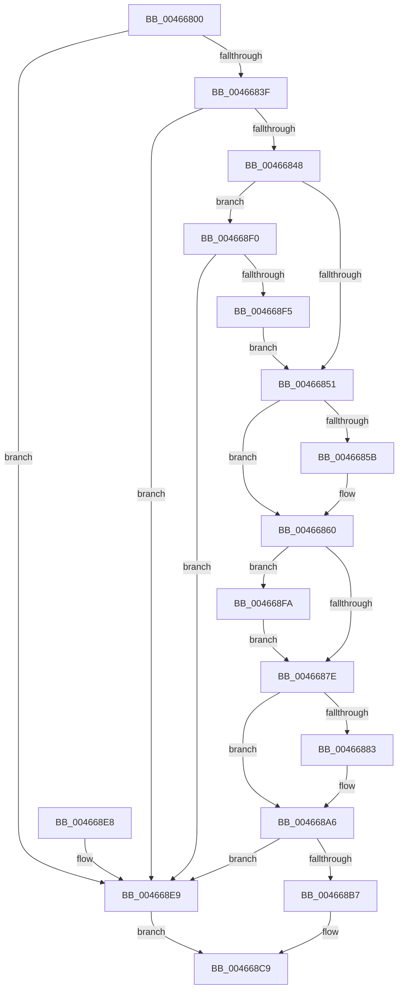

# RtlIpv6AddressToStringExA

- RVA: `0x00466800`–`0x0046691D` (길이 `285` bytes)
- VA: `0x0000000140466800`
- 실행 섹션: `.text`
- PDB 이름 있음: `예`; PDB Function 태그: `아니요`
- unwind 정보 RVA: `0x000AADF0`
- 디코드: `84`개 명령, `285/285` bytes 표시
- 미해석 바이트: `0` (있으면 어셈블리에 `.byte`로 보존)

> 이 문서는 커널 이미지의 기계어와 PDB 기호를 분석해 생성했습니다. 4번과 5번은 함수 원형과 자료형을 바이너리 사용 방식에서 추정한 C 해석이며 원본 소스 복구 결과는 아닙니다.

## 1. Dependencies

- 직접 호출 지점: **5**; 고유 호출 대상: **4**
- 직접 호출자로 확인된 함수: **0**
- RIP 상대 이미지 참조: **3**

### Outgoing calls
- `0x00466871` → [RtlIpv6AddressToStringA](RtlIpv6AddressToStringA_function_00466930.md) (function, `0x00466930`)
- `0x0046689B` → [sprintf_s](../50/sprintf_s_function_00505E40.md) (function, `0x00505E40`)
- `0x004668C2` → [memcpy](../6C/memcpy_function_006C6840.md) (function, `0x006C6840`)
- `0x004668D1` → [_security_check_cookie](../6A/_security_check_cookie_function_006AC640.md) (function, `0x006AC640`)
- `0x0046690D` → [sprintf_s](../50/sprintf_s_function_00505E40.md) (function, `0x00505E40`)

### Direct callers
- 이 함수 시작 RVA로 연결되는 직접 call은 확인되지 않았습니다. 간접 호출은 완전히 역산할 수 없습니다.

### Static image references
- `0x00466812` → RVA `0x00E0A740` (`.data`; read)
- `0x00466887` → RVA `0x006CCB80` (` ?? ::FNODOBFM::`string'`; read)
- `0x004668FD` → RVA `0x006CCB90` (` ?? ::FNODOBFM::`string'`; read)

## 2. Other-region calls and transfers

- 다른 실행 섹션으로 향하는 call: **0**
- 별도 외부 분기/꼬리 이동을 확인하지 못했습니다.

## 3. Assembly (complete function range)

```asm
00466800  40 53                           push rbx
00466802  55                              push rbp
00466803  56                              push rsi
00466804  57                              push rdi
00466805  41 54                           push r12
00466807  41 56                           push r14
00466809  41 57                           push r15
0046680B  48 81 EC 80 00 00 00            sub rsp, 0x80
00466812  48 8B 05 27 3F 9A 00            mov rax, qword ptr [rip + 0x9a3f27]
00466819  48 33 C4                        xor rax, rsp
0046681C  48 89 44 24 70                  mov qword ptr [rsp + 0x70], rax
00466821  48 8B B4 24 E0 00 00 00         mov rsi, qword ptr [rsp + 0xe0]
00466829  45 33 E4                        xor r12d, r12d
0046682C  4D 8B F1                        mov r14, r9
0046682F  41 0F B7 F8                     movzx edi, r8w
00466833  44 8B FA                        mov r15d, edx
00466836  48 85 C9                        test rcx, rcx
00466839  0F 84 AA 00 00 00               je 0x1404668e9
0046683F  48 85 F6                        test rsi, rsi
00466842  0F 84 A1 00 00 00               je 0x1404668e9
00466848  4D 85 C9                        test r9, r9
0046684B  0F 84 9F 00 00 00               je 0x1404668f0
00466851  48 8D 6C 24 61                  lea rbp, [rsp + 0x61]
00466856  66 85 FF                        test di, di
00466859  74 05                           je 0x140466860
0046685B  C6 44 24 20 5B                  mov byte ptr [rsp + 0x20], 0x5b
00466860  48 8D 44 24 21                  lea rax, [rsp + 0x21]
00466865  66 85 FF                        test di, di
00466868  48 8D 54 24 20                  lea rdx, [rsp + 0x20]
0046686D  48 0F 45 D0                     cmovne rdx, rax
00466871  E8 BA 00 00 00                  call 0x140466930
00466876  48 8B D8                        mov rbx, rax
00466879  45 85 FF                        test r15d, r15d
0046687C  75 7C                           jne 0x1404668fa
0046687E  66 85 FF                        test di, di
00466881  74 23                           je 0x1404668a6
00466883  66 C1 CF 08                     ror di, 8
00466887  4C 8D 05 F2 62 26 00            lea r8, [rip + 0x2662f2]
0046688E  48 2B EB                        sub rbp, rbx
00466891  44 0F B7 CF                     movzx r9d, di
00466895  48 8B D5                        mov rdx, rbp
00466898  48 8B CB                        mov rcx, rbx
0046689B  E8 A0 F5 09 00                  call 0x140505e40
004668A0  48 63 C8                        movsxd rcx, eax
004668A3  48 03 D9                        add rbx, rcx
004668A6  48 8D 44 24 20                  lea rax, [rsp + 0x20]
004668AB  2B D8                           sub ebx, eax
004668AD  8B 06                           mov eax, dword ptr [rsi]
004668AF  FF C3                           inc ebx
004668B1  89 1E                           mov dword ptr [rsi], ebx
004668B3  3B C3                           cmp eax, ebx
004668B5  72 32                           jb 0x1404668e9
004668B7  44 8B C3                        mov r8d, ebx
004668BA  48 8D 54 24 20                  lea rdx, [rsp + 0x20]
004668BF  49 8B CE                        mov rcx, r14
004668C2  E8 79 FF 25 00                  call 0x1406c6840
004668C7  33 C0                           xor eax, eax
004668C9  48 8B 4C 24 70                  mov rcx, qword ptr [rsp + 0x70]
004668CE  48 33 CC                        xor rcx, rsp
004668D1  E8 6A 5D 24 00                  call 0x1406ac640
004668D6  48 81 C4 80 00 00 00            add rsp, 0x80
004668DD  41 5F                           pop r15
004668DF  41 5E                           pop r14
004668E1  41 5C                           pop r12
004668E3  5F                              pop rdi
004668E4  5E                              pop rsi
004668E5  5D                              pop rbp
004668E6  5B                              pop rbx
004668E7  C3                              ret
004668E8  CC                              int3
004668E9  B8 0D 00 00 C0                  mov eax, 0xc000000d
004668EE  EB D9                           jmp 0x1404668c9
004668F0  44 39 26                        cmp dword ptr [rsi], r12d
004668F3  75 F4                           jne 0x1404668e9
004668F5  E9 57 FF FF FF                  jmp 0x140466851
004668FA  48 8B D5                        mov rdx, rbp
004668FD  4C 8D 05 8C 62 26 00            lea r8, [rip + 0x26628c]
00466904  48 2B D3                        sub rdx, rbx
00466907  45 8B CF                        mov r9d, r15d
0046690A  48 8B CB                        mov rcx, rbx
0046690D  E8 2E F5 09 00                  call 0x140505e40
00466912  48 63 C8                        movsxd rcx, eax
00466915  48 03 D9                        add rbx, rcx
00466918  E9 61 FF FF FF                  jmp 0x14046687e
```

## 4. C-style interpretation (structured pseudocode)

```c
__int64 __fastcall RtlIpv6AddressToStringExA(__int64 a1, int a2, unsigned __int16 a3, __int64 a4, __int64 a5)
{
    __int64 result;
    __int64 v_r12;
    __int64 v_rbp;
    __int64 v_rbx;
    __int64 v_rsp;
    unsigned __int64 v_stack_m48;
    unsigned __int64 v_stack_m57;
    unsigned __int64 v_stack_m97;
    unsigned __int8 v_stack_m98;

    v_rsp = (v_rsp) - (128);
    result = (*(unsigned __int64 *)(v_rip + 10108711)) ^ (v_rsp);
    v_stack_m48 = result;
    v_r12 = 0;
    if (a1 == 0) goto loc_004668E9;
    if (a5 == 0) goto loc_004668E9;
    if (a4 == 0) goto loc_004668F0;
loc_00466851:
    if (a3 != 0) {
        v_stack_m98 = 91;
    }
    a2 = v_stack_m98;
    if (a3 != 0) { a2 = v_stack_m97; }
    result = RtlIpv6AddressToStringA(a1, a2, a3, a4);
    if ((unsigned int)((unsigned int)(a2)) != 0) goto loc_004668FA;
loc_0046687E:
    v_rbx = result;
    v_rbp = v_stack_m57;
    if (a3 != 0) {
        a3 = v_rip + 2515698;
        v_rbp = (v_stack_m57) - (result);
        a4 = a3;
        a2 = v_rbp;
        a1 = result;
        result = sprintf_s(a1, a2, a3, a4);
        a1 = (int)((unsigned int)(result));
        v_rbx = (result) + (a1);
    }
    v_rbx = (unsigned int)((v_rbx) - ((unsigned int)(v_stack_m98)));
    v_rbx = (unsigned int)((v_rbx) + 1);
    *(unsigned int *)(a5) = (unsigned int)(v_rbx);
    if (((unsigned int)((unsigned int)(*(unsigned int *)(a5)))) < ((unsigned int)(v_rbx))) goto loc_004668E9;
    result = memcpy(a4, v_stack_m98, (unsigned int)((unsigned int)(v_rbx)), a4);
    result = 0;
loc_004668C9:
    a1 = (v_stack_m48) ^ (v_rsp);
    result = _security_check_cookie(a1, v_stack_m98, (unsigned int)((unsigned int)(v_rbx)), a4);
    v_rsp = (v_rsp) + (128);
    return result;
loc_004668E9:
    goto loc_004668C9;
loc_004668F0:
    if ((*(unsigned int *)(a5)) != 0) goto loc_004668E9;
    goto loc_00466851;
loc_004668FA:
    a2 = (v_rbp) - (v_rbx);
    result = sprintf_s(v_rbx, a2, v_rip + 2515596, (unsigned int)((unsigned int)((unsigned int)(a2))));
    v_rbx = (v_rbx) + ((int)((unsigned int)(result)));
    goto loc_0046687E;
}
```

## 5. (Beta) C Style

```c
int64_t RtlIpv6AddressToStringExA(int64_t Arg1, int32_t Arg2, uint16_t Arg3, int64_t Arg4, int64_t Arg5)
{
    int64_t result;
    int64_t local_r12;
    int64_t local_rbp;
    int64_t local_rbx;
    int64_t local_rsp;
    uint64_t v_stack_m48;
    uint64_t v_stack_m57;
    uint64_t v_stack_m97;
    uint8_t v_stack_m98;

    local_rsp = (local_rsp) - (128);
    result = (*(uint64_t *)(v_rip + 0x9A3F27)) ^ (local_rsp);
    v_stack_m48 = result;
    local_r12 = 0;
    if (Arg1 == 0) goto loc_004668E9;
    if (Arg5 == 0) goto loc_004668E9;
    if (Arg4 == 0) goto loc_004668F0;
loc_00466851:
    if (Arg3 != 0) {
        v_stack_m98 = 91;
    }
    Arg2 = v_stack_m98;
    if (Arg3 != 0) { Arg2 = v_stack_m97; }
    result = RtlIpv6AddressToStringA(Arg1, Arg2, Arg3, Arg4);
    if ((uint32_t)((uint32_t)(Arg2)) != 0) goto loc_004668FA;
loc_0046687E:
    local_rbx = result;
    local_rbp = v_stack_m57;
    if (Arg3 != 0) {
        Arg3 = v_rip + 2515698;
        local_rbp = (v_stack_m57) - (result);
        Arg4 = Arg3;
        Arg2 = local_rbp;
        Arg1 = result;
        result = sprintf_s(Arg1, Arg2, Arg3, Arg4);
        Arg1 = (int32_t)((uint32_t)(result));
        local_rbx = (result) + (Arg1);
    }
    local_rbx = (uint32_t)((local_rbx) - ((uint32_t)(v_stack_m98)));
    local_rbx = (uint32_t)((local_rbx) + 1);
    *(uint32_t *)(Arg5) = (uint32_t)(local_rbx);
    if (((uint32_t)((uint32_t)(*(uint32_t *)(Arg5)))) < ((uint32_t)(local_rbx))) goto loc_004668E9;
    result = memcpy(Arg4, v_stack_m98, (uint32_t)((uint32_t)(local_rbx)), Arg4);
    result = 0;
loc_004668C9:
    Arg1 = (v_stack_m48) ^ (local_rsp);
    result = _security_check_cookie(Arg1, v_stack_m98, (uint32_t)((uint32_t)(local_rbx)), Arg4);
    local_rsp = (local_rsp) + (128);
    return result;
loc_004668E9:
    goto loc_004668C9;
loc_004668F0:
    if ((*(uint32_t *)(Arg5)) != 0) goto loc_004668E9;
    goto loc_00466851;
loc_004668FA:
    Arg2 = (local_rbp) - (local_rbx);
    result = sprintf_s(local_rbx, Arg2, v_rip + 2515596, (uint32_t)((uint32_t)((uint32_t)(Arg2))));
    local_rbx = (local_rbx) + ((int32_t)((uint32_t)(result)));
    goto loc_0046687E;
}
```

## 6. Execution-region graph

[열기: 2D/3D 그래프와 함수 탐색 컨트롤 패널](../../../control-panel.html?section=text&rva=0x00466800&view=graph)

- 2D 그래프는 위에서 아래로 흐르고, 3D 그래프는 빈 공간을 드래그해 회전합니다. Shift+드래그는 이동, 휠은 확대·축소, 함수 노드 선택은 대상 보고서 이동입니다.

### Static fallback


