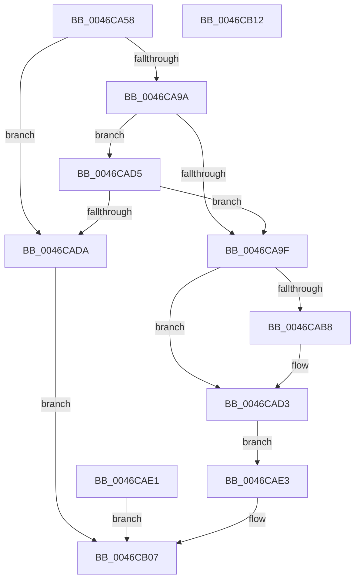

# RtlPrepareEnclaveCall

- RVA: `0x0046CA58`–`0x0046CB13` (길이 `187` bytes)
- VA: `0x000000014046CA58`
- 실행 섹션: `.text`
- PDB 이름 있음: `예`; PDB Function 태그: `아니요`
- unwind 정보 RVA: `0x000AB888`
- 디코드: `48`개 명령, `187/187` bytes 표시
- 미해석 바이트: `0` (있으면 어셈블리에 `.byte`로 보존)

> 이 문서는 커널 이미지의 기계어와 PDB 기호를 분석해 생성했습니다. 4번과 5번은 함수 원형과 자료형을 바이너리 사용 방식에서 추정한 C 해석이며 원본 소스 복구 결과는 아닙니다.

## 1. Dependencies

- 직접 호출 지점: **0**; 고유 호출 대상: **0**
- 직접 호출자로 확인된 함수: **1**
- RIP 상대 이미지 참조: **0**

### Outgoing calls
- 직접 디코드된 call 명령이 없습니다.

### Direct callers
- [PsCallEnclave](../../page/A0/PsCallEnclave_function_00A0CF50.md) at `0x00A0D082`

### Static image references
- 디코드된 RIP-relative 메모리 참조가 없습니다.

## 2. Other-region calls and transfers

- 다른 실행 섹션으로 향하는 call: **0**
- 별도 외부 분기/꼬리 이동을 확인하지 못했습니다.

## 3. Assembly (complete function range)

```asm
0046CA58  48 89 5C 24 08                  mov qword ptr [rsp + 8], rbx
0046CA5D  48 89 7C 24 10                  mov qword ptr [rsp + 0x10], rdi
0046CA62  49 8B D9                        mov rbx, r9
0046CA65  48 8B FA                        mov rdi, rdx
0046CA68  4C 8B D1                        mov r10, rcx
0046CA6B  4C 8B 99 80 01 00 00            mov r11, qword ptr [rcx + 0x180]
0046CA72  4D 8B CB                        mov r9, r11
0046CA75  48 B8 00 00 FF FF FF 7F 00 00   movabs rax, 0x7fffffff0000
0046CA7F  4C 3B D8                        cmp r11, rax
0046CA82  4C 0F 43 C8                     cmovae r9, rax
0046CA86  49 8B 01                        mov rax, qword ptr [r9]
0046CA89  49 89 01                        mov qword ptr [r9], rax
0046CA8C  49 8B 0B                        mov rcx, qword ptr [r11]
0046CA8F  66 41 83 BA 70 01 00 00 33      cmp word ptr [r10 + 0x170], 0x33
0046CA98  75 40                           jne 0x14046cada
0046CA9A  48 3B CB                        cmp rcx, rbx
0046CA9D  75 36                           jne 0x14046cad5
0046CA9F  49 8D 43 08                     lea rax, [r11 + 8]
0046CAA3  49 89 82 80 01 00 00            mov qword ptr [r10 + 0x180], rax
0046CAAA  49 89 8A 68 01 00 00            mov qword ptr [r10 + 0x168], rcx
0046CAB1  80 7C 24 28 00                  cmp byte ptr [rsp + 0x28], 0
0046CAB6  74 1B                           je 0x14046cad3
0046CAB8  B9 A7 06 00 00                  mov ecx, 0x6a7
0046CABD  0F 32                           rdmsr
0046CABF  48 C1 E2 20                     shl rdx, 0x20
0046CAC3  48 0B C2                        or rax, rdx
0046CAC6  48 83 C0 08                     add rax, 8
0046CACA  48 8B D0                        mov rdx, rax
0046CACD  48 C1 EA 20                     shr rdx, 0x20
0046CAD1  0F 30                           wrmsr
0046CAD3  EB 0E                           jmp 0x14046cae3
0046CAD5  49 3B C8                        cmp rcx, r8
0046CAD8  74 C5                           je 0x14046ca9f
0046CADA  B8 0D 00 00 C0                  mov eax, 0xc000000d
0046CADF  EB 26                           jmp 0x14046cb07
0046CAE1  EB 24                           jmp 0x14046cb07
0046CAE3  49 89 7A 50                     mov qword ptr [r10 + 0x50], rdi
0046CAE7  49 8B 8A 68 01 00 00            mov rcx, qword ptr [r10 + 0x168]
0046CAEE  48 8B 44 24 30                  mov rax, qword ptr [rsp + 0x30]
0046CAF3  48 89 08                        mov qword ptr [rax], rcx
0046CAF6  49 8B 8A 58 01 00 00            mov rcx, qword ptr [r10 + 0x158]
0046CAFD  48 8B 44 24 38                  mov rax, qword ptr [rsp + 0x38]
0046CB02  48 89 08                        mov qword ptr [rax], rcx
0046CB05  33 C0                           xor eax, eax
0046CB07  48 8B 5C 24 08                  mov rbx, qword ptr [rsp + 8]
0046CB0C  48 8B 7C 24 10                  mov rdi, qword ptr [rsp + 0x10]
0046CB11  C3                              ret
0046CB12  CC                              int3
```

## 4. C-style interpretation (structured pseudocode)

```c
__int64 __fastcall RtlPrepareEnclaveCall(__int64 a1, __int64 a2, __int64 a3, __int64 a4, unsigned __int8 a5, __int64 a6, __int64 a7)
{
    __int64 result;
    unsigned __int64 v_stack_p10;
    unsigned __int64 v_stack_p8;

    v_stack_p8 = v_rbx;
    v_stack_p10 = v_rdi;
    a4 = *(unsigned __int64 *)(a1 + 384);
    if ((*(unsigned __int64 *)(a1 + 384)) >= result) { a4 = result; }
    *(unsigned __int64 *)(a4) = *(unsigned __int64 *)(a4);
    if ((*(unsigned __int16 *)(a1 + 368)) != 51) goto loc_0046CADA;
    if ((*(unsigned __int64 *)(*(unsigned __int64 *)(a1 + 384))) != a4) goto loc_0046CAD5;
loc_0046CA9F:
    *(unsigned __int64 *)(a1 + 384) = *(unsigned __int64 *)(a1 + 384) + 8;
    *(unsigned __int64 *)(a1 + 360) = *(unsigned __int64 *)(*(unsigned __int64 *)(a1 + 384));
    result = *(unsigned __int64 *)(a1 + 384) + 8;
    if (a5 != 0) {
        a1 = 0x6A7ULL;
        a2 = (a2) << (32);
        result = (*(unsigned __int64 *)(a1 + 384) + 8) | (a2);
        result = (result) + (8);
        a2 = result;
        a2 = (a2) >> (32);
    }
    goto loc_0046CAE3;
loc_0046CAD5:
    if (a1 == a3) goto loc_0046CA9F;
loc_0046CADA:
    goto loc_0046CB07;
loc_0046CAE3:
    *(unsigned __int64 *)(a1 + 80) = a2;
    *(unsigned __int64 *)(a6) = *(unsigned __int64 *)(a1 + 360);
    *(unsigned __int64 *)(a7) = *(unsigned __int64 *)(a1 + 344);
    result = 0;
loc_0046CB07:
    return result;
}
```

## 5. (Beta) C Style

```c
int64_t RtlPrepareEnclaveCall(void *Arg1, int64_t Arg2, int64_t Arg3, int64_t Arg4, uint8_t Arg5, void *Arg6, void *Arg7)
{
    uint8_t *arg1 = (uint8_t *)Arg1;
    uint8_t *arg6 = (uint8_t *)Arg6;
    uint8_t *arg7 = (uint8_t *)Arg7;

    int64_t result;
    uint64_t v_stack_p10;
    uint64_t v_stack_p8;

    v_stack_p8 = local_rbx;
    v_stack_p10 = local_rdi;
    Arg4 = *(uint64_t *)(arg1 + 0x180);
    if ((*(uint64_t *)(arg1 + 0x180)) >= result) { Arg4 = result; }
    *(uint64_t *)(Arg4) = *(uint64_t *)(Arg4);
    if ((*(uint16_t *)(arg1 + 0x170)) != 51) goto loc_0046CADA;
    if ((*(uint64_t *)(*(uint64_t *)(arg1 + 0x180))) != Arg4) goto loc_0046CAD5;
loc_0046CA9F:
    *(uint64_t *)(arg1 + 0x180) = *(uint64_t *)(arg1 + 0x180) + 8;
    *(uint64_t *)(arg1 + 0x168) = *(uint64_t *)(*(uint64_t *)(arg1 + 0x180));
    result = *(uint64_t *)(arg1 + 0x180) + 8;
    if (Arg5 != 0) {
        Arg1 = 0x6A7ULL;
        Arg2 = (Arg2) << (32);
        result = (*(uint64_t *)(arg1 + 0x180) + 8) | (Arg2);
        result = (result) + (8);
        Arg2 = result;
        Arg2 = (Arg2) >> (32);
    }
    goto loc_0046CAE3;
loc_0046CAD5:
    if (Arg1 == Arg3) goto loc_0046CA9F;
loc_0046CADA:
    goto loc_0046CB07;
loc_0046CAE3:
    *(uint64_t *)(arg1 + 0x50) = Arg2;
    *(uint64_t *)(arg6) = *(uint64_t *)(arg1 + 0x168);
    *(uint64_t *)(arg7) = *(uint64_t *)(arg1 + 0x158);
    result = 0;
loc_0046CB07:
    return result;
}
```

### 관측된 메모리 오프셋

구조체 형식이 확인되지 않은 접근은 인자 기준의 오프셋으로만 기록했습니다.

| 기준 인자 | 오프셋 표현 | 폭 (bit) | 접근 |
|---|---:|---:|---|
| `Arg1` | `+ 0x50` | `64` | `W` |
| `Arg1` | `+ 0x158` | `64` | `R` |
| `Arg1` | `+ 0x168` | `64` | `R` |
| `Arg1` | `+ 0x168` | `64` | `W` |
| `Arg1` | `+ 0x170` | `16` | `R` |
| `Arg1` | `+ 0x180` | `64` | `R` |
| `Arg1` | `+ 0x180` | `64` | `W` |
| `Arg6` | `+ 0x0` | `64` | `W` |
| `Arg7` | `+ 0x0` | `64` | `W` |

## 6. Execution-region graph

[열기: 2D/3D 그래프와 함수 탐색 컨트롤 패널](../../../control-panel.html?section=text&rva=0x0046CA58&view=graph)

- 2D 그래프는 위에서 아래로 흐르고, 3D 그래프는 빈 공간을 드래그해 회전합니다. Shift+드래그는 이동, 휠은 확대·축소, 함수 노드 선택은 대상 보고서 이동입니다.

### Static fallback


