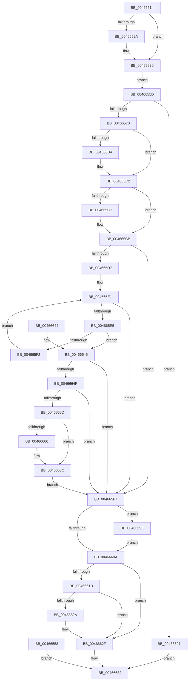

# RtlRemoveDynamicUserFunctionTable

- RVA: `0x00466514`–`0x004666AB` (길이 `407` bytes)
- VA: `0x0000000140466514`
- 실행 섹션: `.text`
- PDB 이름 있음: `예`; PDB Function 태그: `아니요`
- unwind 정보 RVA: `0x000AAD0C`
- 디코드: `115`개 명령, `407/407` bytes 표시
- 미해석 바이트: `0` (있으면 어셈블리에 `.byte`로 보존)

> 이 문서는 커널 이미지의 기계어와 PDB 기호를 분석해 생성했습니다. 4번과 5번은 함수 원형과 자료형을 바이너리 사용 방식에서 추정한 C 해석이며 원본 소스 복구 결과는 아닙니다.

## 1. Dependencies

- 직접 호출 지점: **7**; 고유 호출 대상: **7**
- 직접 호출자로 확인된 함수: **1**
- RIP 상대 이미지 참조: **0**

### Outgoing calls
- `0x0046652A` → [ExRaiseDatatypeMisalignment](../../page/89/ExRaiseDatatypeMisalignment_function_00899FD0.md) (function, `0x00899FD0`)
- `0x004665A4` → [KeAbPreAcquire](../21/KeAbPreAcquire_function_00210230.md) (function, `0x00210230`)
- `0x004665BD` → [ExfAcquirePushLockExclusiveEx](../20/ExfAcquirePushLockExclusiveEx_function_0020FC90.md) (function, `0x0020FC90`)
- `0x0046660D` → [KeAbPostRelease](../2E/KeAbPostRelease_function_002E1600.md) (function, `0x002E1600`)
- `0x0046662A` → [KiCheckForKernelApcDelivery](../2E/KiCheckForKernelApcDelivery_function_002E2C80.md) (function, `0x002E2C80`)
- `0x00466687` → [memcpy](../6C/memcpy_function_006C6840.md) (function, `0x006C6840`)
- `0x004666A1` → [ExfTryToWakePushLock](../26/ExfTryToWakePushLock_function_00265DD0.md) (function, `0x00265DD0`)

### Direct callers
- [NtSetInformationProcess](../../page/AE/NtSetInformationProcess_function_00AE5370.md) at `0x00AE8A3B`

### Static image references
- 디코드된 RIP-relative 메모리 참조가 없습니다.

## 2. Other-region calls and transfers

- 다른 실행 섹션으로 향하는 call: **1**
  - `0x0046652A` → [ExRaiseDatatypeMisalignment](../../page/89/ExRaiseDatatypeMisalignment_function_00899FD0.md) (`.text` → `PAGE`)
- 별도 외부 분기/꼬리 이동을 확인하지 못했습니다.

## 3. Assembly (complete function range)

```asm
00466514  48 89 5C 24 08                  mov qword ptr [rsp + 8], rbx
00466519  56                              push rsi
0046651A  57                              push rdi
0046651B  41 54                           push r12
0046651D  41 56                           push r14
0046651F  41 57                           push r15
00466521  48 83 EC 20                     sub rsp, 0x20
00466525  F6 C1 03                        test cl, 3
00466528  74 06                           je 0x140466530
0046652A  E8 A1 3A 43 00                  call 0x140899fd0
0046652F  CC                              int3
00466530  48 B8 00 00 FF FF FF 7F 00 00   movabs rax, 0x7fffffff0000
0046653A  48 3B C8                        cmp rcx, rax
0046653D  48 0F 42 C1                     cmovb rax, rcx
00466541  90                              nop
00466542  8A 00                           mov al, byte ptr [rax]
00466544  48 8B 41 30                     mov rax, qword ptr [rcx + 0x30]
00466548  48 89 44 24 58                  mov qword ptr [rsp + 0x58], rax
0046654D  48 8B 41 28                     mov rax, qword ptr [rcx + 0x28]
00466551  48 89 44 24 60                  mov qword ptr [rsp + 0x60], rax
00466556  EB 05                           jmp 0x14046655d
00466558  E9 D5 00 00 00                  jmp 0x140466632
0046655D  48 2B 44 24 58                  sub rax, qword ptr [rsp + 0x58]
00466562  B9 FF FF FF FF                  mov ecx, 0xffffffff
00466567  48 3B C1                        cmp rax, rcx
0046656A  0F 83 27 01 00 00               jae 0x140466697
00466570  41 BF FF 00 00 C0               mov r15d, 0xc00000ff
00466576  65 48 8B 34 25 88 01 00 00      mov rsi, qword ptr gs:[0x188]
0046657F  4C 8B B6 20 02 00 00            mov r14, qword ptr [rsi + 0x220]
00466586  41 BC 01 00 00 00               mov r12d, 1
0046658C  66 44 29 A6 E6 01 00 00         sub word ptr [rsi + 0x1e6], r12w
00466594  90                              nop
00466595  49 8D 9E D0 05 00 00            lea rbx, [r14 + 0x5d0]
0046659C  45 33 C0                        xor r8d, r8d
0046659F  33 D2                           xor edx, edx
004665A1  48 8B CB                        mov rcx, rbx
004665A4  E8 87 9C DA FF                  call 0x140210230
004665A9  48 8B F8                        mov rdi, rax
004665AC  F0 48 0F BA 2B 00               lock bts qword ptr [rbx], 0
004665B2  73 0E                           jae 0x1404665c2
004665B4  4C 8B C3                        mov r8, rbx
004665B7  48 8B D0                        mov rdx, rax
004665BA  48 8B CB                        mov rcx, rbx
004665BD  E8 CE 96 DA FF                  call 0x14020fc90
004665C2  48 85 FF                        test rdi, rdi
004665C5  74 04                           je 0x1404665cb
004665C7  44 88 67 0A                     mov byte ptr [rdi + 0xa], r12b
004665CB  49 8B BE C8 05 00 00            mov rdi, qword ptr [r14 + 0x5c8]
004665D2  48 85 FF                        test rdi, rdi
004665D5  74 20                           je 0x1404665f7
004665D7  8B 17                           mov edx, dword ptr [rdi]
004665D9  41 8B CC                        mov ecx, r12d
004665DC  4C 8B 44 24 58                  mov r8, qword ptr [rsp + 0x58]
004665E1  3B CA                           cmp ecx, edx
004665E3  73 12                           jae 0x1404665f7
004665E5  8B C1                           mov eax, ecx
004665E7  4C 8D 0C 40                     lea r9, [rax + rax*2]
004665EB  4E 39 44 CF 18                  cmp qword ptr [rdi + r9*8 + 0x18], r8
004665F0  73 53                           jae 0x140466645
004665F2  41 03 CC                        add ecx, r12d
004665F5  EB EA                           jmp 0x1404665e1
004665F7  48 83 C8 FF                     or rax, 0xffffffffffffffff
004665FB  F0 48 0F C1 03                  lock xadd qword ptr [rbx], rax
00466600  24 06                           and al, 6
00466602  3C 02                           cmp al, 2
00466604  0F 84 94 00 00 00               je 0x14046669e
0046660A  48 8B CB                        mov rcx, rbx
0046660D  E8 EE AF E7 FF                  call 0x1402e1600
00466612  90                              nop
00466613  66 44 01 A6 E6 01 00 00         add word ptr [rsi + 0x1e6], r12w
0046661B  75 12                           jne 0x14046662f
0046661D  90                              nop
0046661E  48 8D 8E 98 00 00 00            lea rcx, [rsi + 0x98]
00466625  48 39 09                        cmp qword ptr [rcx], rcx
00466628  74 05                           je 0x14046662f
0046662A  E8 51 C6 E7 FF                  call 0x1402e2c80
0046662F  41 8B C7                        mov eax, r15d
00466632  48 8B 5C 24 50                  mov rbx, qword ptr [rsp + 0x50]
00466637  48 83 C4 20                     add rsp, 0x20
0046663B  41 5F                           pop r15
0046663D  41 5E                           pop r14
0046663F  41 5C                           pop r12
00466641  5F                              pop rdi
00466642  5E                              pop rsi
00466643  C3                              ret
00466644  CC                              int3
00466645  4C 8D 57 10                     lea r10, [rdi + 0x10]
00466649  4F 8D 14 CA                     lea r10, [r10 + r9*8]
0046664D  75 A8                           jne 0x1404665f7
0046664F  8B 44 24 60                     mov eax, dword ptr [rsp + 0x60]
00466653  41 2B C0                        sub eax, r8d
00466656  42 39 44 CF 20                  cmp dword ptr [rdi + r9*8 + 0x20], eax
0046665B  75 9A                           jne 0x1404665f7
0046665D  44 8D 72 FF                     lea r14d, [rdx - 1]
00466661  41 3B CE                        cmp ecx, r14d
00466664  74 26                           je 0x14046668c
00466666  2B D1                           sub edx, ecx
00466668  41 2B D4                        sub edx, r12d
0046666B  4C 8D 04 52                     lea r8, [rdx + rdx*2]
0046666F  49 C1 E0 03                     shl r8, 3
00466673  8D 41 01                        lea eax, [rcx + 1]
00466676  8B D0                           mov edx, eax
00466678  48 83 C2 02                     add rdx, 2
0046667C  48 8D 04 42                     lea rax, [rdx + rax*2]
00466680  48 8D 14 C7                     lea rdx, [rdi + rax*8]
00466684  49 8B CA                        mov rcx, r10
00466687  E8 B4 01 26 00                  call 0x1406c6840
0046668C  45 33 FF                        xor r15d, r15d
0046668F  44 89 37                        mov dword ptr [rdi], r14d
00466692  E9 60 FF FF FF                  jmp 0x1404665f7
00466697  B8 95 00 00 C0                  mov eax, 0xc0000095
0046669C  EB 94                           jmp 0x140466632
0046669E  48 8B CB                        mov rcx, rbx
004666A1  E8 2A F7 DF FF                  call 0x140265dd0
004666A6  E9 5F FF FF FF                  jmp 0x14046660a
```

## 4. C-style interpretation (structured pseudocode)

```c
__int64 __fastcall RtlRemoveDynamicUserFunctionTable(__int64 a1, int a2, int a3)
{
    __int64 result;
    __int64 v_r15;
    __int64 v_rsp;
    unsigned __int64 v_stack_p10;
    unsigned __int64 v_stack_p18;
    unsigned int v_stack_p60;
    unsigned __int64 v_stack_p8;

    v_stack_p8 = v_rbx;
    v_rsp = (v_rsp) - (32);
    if ((((unsigned __int8)(a1)) & (3)) != 0) {
        result = ExRaiseDatatypeMisalignment(a1, a2, a3, a4);
    }
    if (a1 < result) { result = a1; }
    v_stack_p10 = *(unsigned __int64 *)(a1 + 48);
    v_stack_p18 = *(unsigned __int64 *)(a1 + 40);
    goto loc_0046655D;
loc_0046655D:
    result = (*(unsigned __int64 *)(a1 + 40)) - (v_stack_p10);
    if (result >= ((unsigned int)(0xFFFFFFFFULL))) goto loc_00466697;
    a3 = 0;
    a2 = 0;
    result = KeAbPreAcquire(*(unsigned __int64 *)(*(unsigned __int64 *)(gs_base + (0 + 392)) + 544) + 1488, a2, a3, a4);
    if (!(condition_is_above_or_equal)) {
        a3 = *(unsigned __int64 *)(*(unsigned __int64 *)(gs_base + (0 + 392)) + 544) + 1488;
        a2 = result;
        a1 = *(unsigned __int64 *)(*(unsigned __int64 *)(gs_base + (0 + 392)) + 544) + 1488;
        result = ExfAcquirePushLockExclusiveEx(a1, a2, a3, a4);
    }
    if (result != 0) {
        *(unsigned __int8 *)(result + 10) = 1;
    }
    if (*(unsigned __int64 *)(*(unsigned __int64 *)(*(unsigned __int64 *)(gs_base + (0 + 392)) + 544) + 1480) == 0) goto loc_004665F7;
loc_004665E1:
    if (1 >= ((unsigned int)((unsigned int)(*(unsigned int *)(*(unsigned __int64 *)(*(unsigned __int64 *)(*(unsigned __int64 *)(gs_base + (0 + 392)) + 544) + 1480)))))) goto loc_004665F7;
    if ((*(unsigned __int64 *)(*(unsigned __int64 *)(*(unsigned __int64 *)(*(unsigned __int64 *)(gs_base + (0 + 392)) + 544) + 1480) + 1 + 1 * 2 * 8 + 24)) >= v_stack_p10) goto loc_00466645;
    a1 = (unsigned int)((1) + (1));
    goto loc_004665E1;
loc_004665F7:
    result = (1) | (-1);
    result = (unsigned __int8)((result) & (6));
    if (((unsigned __int8)(result)) == 2) goto loc_0046669E;
loc_0046660A:
    result = KeAbPostRelease(*(unsigned __int64 *)(*(unsigned __int64 *)(gs_base + (0 + 392)) + 544) + 1488, (unsigned int)(*(unsigned int *)(*(unsigned __int64 *)(*(unsigned __int64 *)(*(unsigned __int64 *)(gs_base + (0 + 392)) + 544) + 1480))), v_stack_p10, 1 + 1 * 2);
    if (((unsigned __int8)(result)) != 2) goto loc_0046662F;
    if ((*(unsigned __int64 *)(*(unsigned __int64 *)(gs_base + (0 + 392)) + 152)) != (*(unsigned __int64 *)(gs_base + (0 + 392)) + 152)) {
        result = KiCheckForKernelApcDelivery(*(unsigned __int64 *)(gs_base + (0 + 392)) + 152, (unsigned int)(*(unsigned int *)(*(unsigned __int64 *)(*(unsigned __int64 *)(*(unsigned __int64 *)(gs_base + (0 + 392)) + 544) + 1480))), v_stack_p10, 1 + 1 * 2);
    }
loc_00466632:
    v_rsp = (v_rsp) + (32);
    return (unsigned int)((unsigned int)((unsigned int)(0xC00000FFULL)));
loc_00466645:
    if (condition_is_not_equal) goto loc_004665F7;
    result = (unsigned int)(((unsigned int)(v_stack_p60)) - ((unsigned int)(v_stack_p10)));
    if ((*(unsigned int *)(*(unsigned __int64 *)(*(unsigned __int64 *)(*(unsigned __int64 *)(gs_base + (0 + 392)) + 544) + 1480) + 1 + 1 * 2 * 8 + 32)) != ((unsigned int)(result))) goto loc_004665F7;
    if (((unsigned int)(*(unsigned __int64 *)(gs_base + (0 + 392)) + 152)) != ((unsigned int)((unsigned int)(*(unsigned int *)(*(unsigned __int64 *)(*(unsigned __int64 *)(*(unsigned __int64 *)(gs_base + (0 + 392)) + 544) + 1480))) - 1))) {
        a2 = (unsigned int)(((unsigned int)(*(unsigned int *)(*(unsigned __int64 *)(*(unsigned __int64 *)(*(unsigned __int64 *)(gs_base + (0 + 392)) + 544) + 1480)))) - ((unsigned int)(*(unsigned __int64 *)(gs_base + (0 + 392)) + 152)));
        a2 = (unsigned int)((a2) - (1));
        a3 = a2 + a2 * 2;
        a3 = (a3) << (3);
        result = *(unsigned __int64 *)(gs_base + (0 + 392)) + 152 + 1;
        a2 = (unsigned int)(result);
        a2 = (a2) + (2);
        result = a2 + result * 2;
        a2 = *(unsigned __int64 *)(*(unsigned __int64 *)(*(unsigned __int64 *)(gs_base + (0 + 392)) + 544) + 1480) + result * 8;
        a1 = *(unsigned __int64 *)(*(unsigned __int64 *)(*(unsigned __int64 *)(gs_base + (0 + 392)) + 544) + 1480) + 16 + 1 + 1 * 2 * 8;
        result = memcpy(a1, a2, a3, 1 + 1 * 2);
    }
    v_r15 = 0;
    *(unsigned int *)(*(unsigned __int64 *)(*(unsigned __int64 *)(*(unsigned __int64 *)(gs_base + (0 + 392)) + 544) + 1480)) = (unsigned int)((unsigned int)(*(unsigned int *)(*(unsigned __int64 *)(*(unsigned __int64 *)(*(unsigned __int64 *)(gs_base + (0 + 392)) + 544) + 1480))) - 1);
    goto loc_004665F7;
loc_00466697:
    goto loc_00466632;
loc_0046669E:
    result = ExfTryToWakePushLock(v_stack_p8, a2, a3, 1 + 1 * 2);
    goto loc_0046660A;
}
```

## 5. (Beta) C Style

```c
int64_t RtlRemoveDynamicUserFunctionTable(int64_t Arg1, int32_t Arg2, int32_t Arg3)
{
    int64_t result;
    int64_t local_r15;
    int64_t local_rsp;
    uint64_t v_stack_p10;
    uint64_t v_stack_p18;
    uint32_t v_stack_p60;
    uint64_t v_stack_p8;

    v_stack_p8 = local_rbx;
    local_rsp = (local_rsp) - (32);
    if ((((uint8_t)(Arg1)) & (3)) != 0) {
        result = ExRaiseDatatypeMisalignment(Arg1, Arg2, Arg3, a4);
    }
    if (Arg1 < result) { result = Arg1; }
    v_stack_p10 = *(uint64_t *)(Arg1 + 0x30);
    v_stack_p18 = *(uint64_t *)(Arg1 + 0x28);
    goto loc_0046655D;
loc_0046655D:
    result = (*(uint64_t *)(Arg1 + 0x28)) - (v_stack_p10);
    if (result >= ((uint32_t)(0xFFFFFFFFULL))) goto loc_00466697;
    Arg3 = 0;
    Arg2 = 0;
    result = KeAbPreAcquire(*(uint64_t *)(*(uint64_t *)(gs_base + (0 + 0x188)) + 0x220) + 1488, Arg2, Arg3, a4);
    if (!(condition_is_above_or_equal)) {
        Arg3 = *(uint64_t *)(*(uint64_t *)(gs_base + (0 + 0x188)) + 0x220) + 1488;
        Arg2 = result;
        Arg1 = *(uint64_t *)(*(uint64_t *)(gs_base + (0 + 0x188)) + 0x220) + 1488;
        result = ExfAcquirePushLockExclusiveEx(Arg1, Arg2, Arg3, a4);
    }
    if (result != 0) {
        *(uint8_t *)(result + 0xA) = 1;
    }
    if (*(uint64_t *)(*(uint64_t *)(*(uint64_t *)(gs_base + (0 + 0x188)) + 0x220) + 0x5C8) == 0) goto loc_004665F7;
loc_004665E1:
    if (1 >= ((uint32_t)((uint32_t)(*(uint32_t *)(*(uint64_t *)(*(uint64_t *)(*(uint64_t *)(gs_base + (0 + 0x188)) + 0x220) + 0x5C8)))))) goto loc_004665F7;
    if ((*(uint64_t *)(*(uint64_t *)(*(uint64_t *)(*(uint64_t *)(gs_base + (0 + 0x188)) + 0x220) + 0x5C8) + 0x1 + 0x1 * 2 * 8 + 0x18)) >= v_stack_p10) goto loc_00466645;
    Arg1 = (uint32_t)((1) + (1));
    goto loc_004665E1;
loc_004665F7:
    result = (1) | (-1);
    result = (uint8_t)((result) & (6));
    if (((uint8_t)(result)) == 2) goto loc_0046669E;
loc_0046660A:
    result = KeAbPostRelease(*(uint64_t *)(*(uint64_t *)(gs_base + (0 + 0x188)) + 0x220) + 1488, (uint32_t)(*(uint32_t *)(*(uint64_t *)(*(uint64_t *)(*(uint64_t *)(gs_base + (0 + 0x188)) + 0x220) + 0x5C8))), v_stack_p10, 1 + 1 * 2);
    if (((uint8_t)(result)) != 2) goto loc_0046662F;
    if ((*(uint64_t *)(*(uint64_t *)(gs_base + (0 + 0x188)) + 0x98)) != (*(uint64_t *)(gs_base + (0 + 0x188)) + 152)) {
        result = KiCheckForKernelApcDelivery(*(uint64_t *)(gs_base + (0 + 0x188)) + 152, (uint32_t)(*(uint32_t *)(*(uint64_t *)(*(uint64_t *)(*(uint64_t *)(gs_base + (0 + 0x188)) + 0x220) + 0x5C8))), v_stack_p10, 1 + 1 * 2);
    }
loc_00466632:
    local_rsp = (local_rsp) + (32);
    return (uint32_t)((uint32_t)((uint32_t)(0xC00000FFULL)));
loc_00466645:
    if (condition_is_not_equal) goto loc_004665F7;
    result = (uint32_t)(((uint32_t)(v_stack_p60)) - ((uint32_t)(v_stack_p10)));
    if ((*(uint32_t *)(*(uint64_t *)(*(uint64_t *)(*(uint64_t *)(gs_base + (0 + 0x188)) + 0x220) + 0x5C8) + 0x1 + 0x1 * 2 * 8 + 0x20)) != ((uint32_t)(result))) goto loc_004665F7;
    if (((uint32_t)(*(uint64_t *)(gs_base + (0 + 0x188)) + 152)) != ((uint32_t)((uint32_t)(*(uint32_t *)(*(uint64_t *)(*(uint64_t *)(*(uint64_t *)(gs_base + (0 + 0x188)) + 0x220) + 0x5C8))) - 1))) {
        Arg2 = (uint32_t)(((uint32_t)(*(uint32_t *)(*(uint64_t *)(*(uint64_t *)(*(uint64_t *)(gs_base + (0 + 0x188)) + 0x220) + 0x5C8)))) - ((uint32_t)(*(uint64_t *)(gs_base + (0 + 0x188)) + 152)));
        Arg2 = (uint32_t)((Arg2) - (1));
        Arg3 = Arg2 + Arg2 * 2;
        Arg3 = (Arg3) << (3);
        result = *(uint64_t *)(gs_base + (0 + 0x188)) + 152 + 1;
        Arg2 = (uint32_t)(result);
        Arg2 = (Arg2) + (2);
        result = Arg2 + result * 2;
        Arg2 = *(uint64_t *)(*(uint64_t *)(*(uint64_t *)(gs_base + (0 + 0x188)) + 0x220) + 0x5C8) + result * 8;
        Arg1 = *(uint64_t *)(*(uint64_t *)(*(uint64_t *)(gs_base + (0 + 0x188)) + 0x220) + 0x5C8) + 16 + 1 + 1 * 2 * 8;
        result = memcpy(Arg1, Arg2, Arg3, 1 + 1 * 2);
    }
    local_r15 = 0;
    *(uint32_t *)(*(uint64_t *)(*(uint64_t *)(*(uint64_t *)(gs_base + (0 + 0x188)) + 0x220) + 0x5C8)) = (uint32_t)((uint32_t)(*(uint32_t *)(*(uint64_t *)(*(uint64_t *)(*(uint64_t *)(gs_base + (0 + 0x188)) + 0x220) + 0x5C8))) - 1);
    goto loc_004665F7;
loc_00466697:
    goto loc_00466632;
loc_0046669E:
    result = ExfTryToWakePushLock(v_stack_p8, Arg2, Arg3, 1 + 1 * 2);
    goto loc_0046660A;
}
```

## 6. Execution-region graph

[열기: 2D/3D 그래프와 함수 탐색 컨트롤 패널](../../../control-panel.html?section=text&rva=0x00466514&view=graph)

- 2D 그래프는 위에서 아래로 흐르고, 3D 그래프는 빈 공간을 드래그해 회전합니다. Shift+드래그는 이동, 휠은 확대·축소, 함수 노드 선택은 대상 보고서 이동입니다.

### Static fallback


