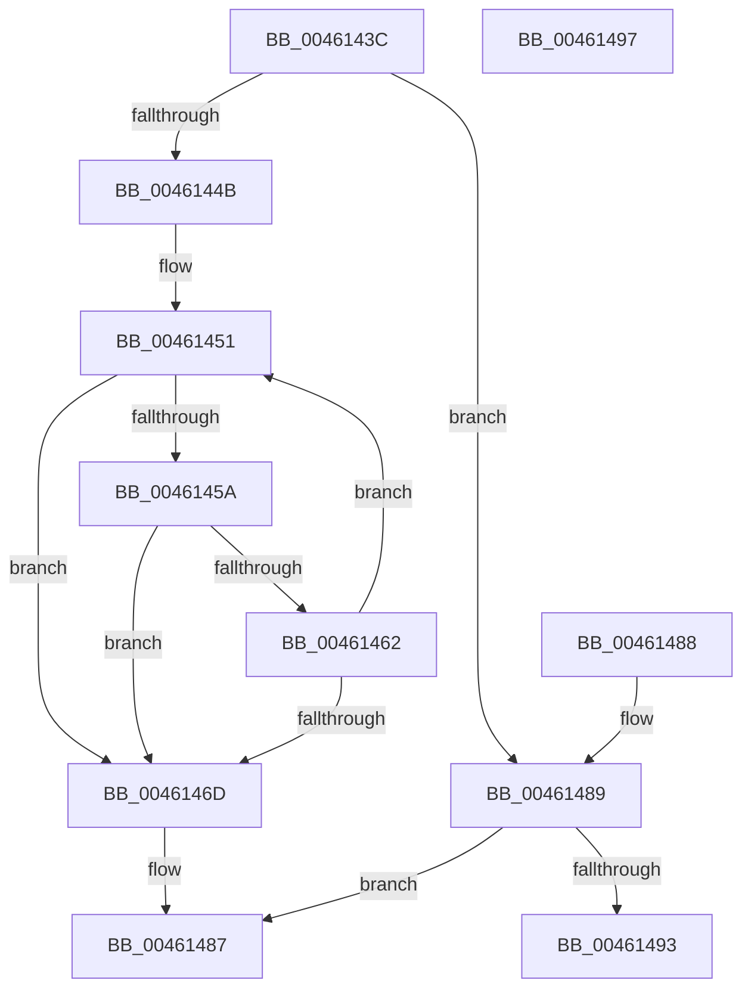

# RtlStringCbCopyA

- RVA: `0x0046143C`–`0x00461498` (길이 `92` bytes)
- VA: `0x000000014046143C`
- 실행 섹션: `.text`
- PDB 이름 있음: `예`; PDB Function 태그: `아니요`
- unwind 정보 RVA: `0x000DB714`
- 디코드: `32`개 명령, `92/92` bytes 표시
- 미해석 바이트: `0` (있으면 어셈블리에 `.byte`로 보존)

> 이 문서는 커널 이미지의 기계어와 PDB 기호를 분석해 생성했습니다. 4번과 5번은 함수 원형과 자료형을 바이너리 사용 방식에서 추정한 C 해석이며 원본 소스 복구 결과는 아닙니다.

## 1. Dependencies

- 직접 호출 지점: **0**; 고유 호출 대상: **0**
- 직접 호출자로 확인된 함수: **5**
- RIP 상대 이미지 참조: **0**

### Outgoing calls
- 직접 디코드된 call 명령이 없습니다.

### Direct callers
- [EtwpLogRefSetAutoMark](../../page/7C/EtwpLogRefSetAutoMark_function_007C01A8.md) at `0x007C01F9`
- [ObpRegisterObject](../../page/AC/ObpRegisterObject_function_00ACF3EC.md) at `0x00ACF568`
- [NtSetInformationProcess](../../page/AE/NtSetInformationProcess_function_00AE5370.md) at `0x00AE94A1`
- [Phase1InitializationDiscard](../../init/C1/Phase1InitializationDiscard_function_00C1C728.md) at `0x00C1CCC9`
- [IopStoreArcInformation](../../init/C2/IopStoreArcInformation_function_00C2D3C4.md) at `0x00C2D48E`

### Static image references
- 디코드된 RIP-relative 메모리 참조가 없습니다.

## 2. Other-region calls and transfers

- 다른 실행 섹션으로 향하는 call: **0**
- 별도 외부 분기/꼬리 이동을 확인하지 못했습니다.

## 3. Assembly (complete function range)

```asm
0046143C  48 8D 42 FF                     lea rax, [rdx - 1]
00461440  41 B9 FE FF FF 7F               mov r9d, 0x7ffffffe
00461446  49 3B C1                        cmp rax, r9
00461449  77 3E                           ja 0x140461489
0046144B  4C 2B CA                        sub r9, rdx
0046144E  4C 2B C1                        sub r8, rcx
00461451  49 8D 04 11                     lea rax, [r9 + rdx]
00461455  48 85 C0                        test rax, rax
00461458  74 13                           je 0x14046146d
0046145A  41 8A 04 08                     mov al, byte ptr [r8 + rcx]
0046145E  84 C0                           test al, al
00461460  74 0B                           je 0x14046146d
00461462  88 01                           mov byte ptr [rcx], al
00461464  48 FF C1                        inc rcx
00461467  48 83 EA 01                     sub rdx, 1
0046146B  75 E4                           jne 0x140461451
0046146D  48 85 D2                        test rdx, rdx
00461470  48 8D 41 FF                     lea rax, [rcx - 1]
00461474  48 0F 45 C1                     cmovne rax, rcx
00461478  48 F7 DA                        neg rdx
0046147B  C6 00 00                        mov byte ptr [rax], 0
0046147E  1B C0                           sbb eax, eax
00461480  F7 D0                           not eax
00461482  25 05 00 00 80                  and eax, 0x80000005
00461487  C3                              ret
00461488  CC                              int3
00461489  B8 0D 00 00 C0                  mov eax, 0xc000000d
0046148E  48 85 D2                        test rdx, rdx
00461491  74 F4                           je 0x140461487
00461493  C6 01 00                        mov byte ptr [rcx], 0
00461496  C3                              ret
00461497  CC                              int3
```

## 4. C-style interpretation (structured pseudocode)

```c
__int64 __fastcall RtlStringCbCopyA(__int64 a1, __int64 a2, __int64 a3)
{
    __int64 result;

    if ((a2 - 1) > ((unsigned int)(0x7FFFFFFEULL))) goto loc_00461489;
    a4 = ((unsigned int)(0x7FFFFFFEULL)) - (a2);
    a3 = (a3) - (a1);
loc_00461451:
    if (a4 + a2 * 1 == 0) goto loc_0046146D;
    if ((unsigned __int8)(*(unsigned __int8 *)(a3 + a1 * 1)) == 0) goto loc_0046146D;
    *(unsigned __int8 *)(a1) = (unsigned __int8)(*(unsigned __int8 *)(a3 + a1 * 1));
    a1 = (a1) + 1;
    a2 = (a2) - (1);
    if (condition_is_not_equal) goto loc_00461451;
loc_0046146D:
    result = a1 - 1;
    if (a2 != 0) { result = a1; }
    a2 = -(a2);
    *(unsigned __int8 *)(result) = 0;
    result = (unsigned int)(~(result));
    result = (unsigned int)((result) & (0x80000005ULL));
loc_00461487:
    return result;
loc_00461489:
    if (a2 == 0) goto loc_00461487;
    *(unsigned __int8 *)(a1) = 0;
    return (unsigned int)(0xC000000DULL);
}
```

## 5. (Beta) C Style

```c
int64_t RtlStringCbCopyA(void *Arg1, void *Arg2, void *Arg3)
{
    uint8_t *arg1 = (uint8_t *)Arg1;
    uint8_t *arg2 = (uint8_t *)Arg2;
    uint8_t *arg3 = (uint8_t *)Arg3;

    int64_t result;

    if ((Arg2 - 1) > ((uint32_t)(0x7FFFFFFEULL))) goto loc_00461489;
    a4 = ((uint32_t)(0x7FFFFFFEULL)) - (Arg2);
    Arg3 = (Arg3) - (Arg1);
loc_00461451:
    if (a4 + Arg2 * 1 == 0) goto loc_0046146D;
    if ((uint8_t)(*(uint8_t *)(arg3 + arg1 * 1)) == 0) goto loc_0046146D;
    *(uint8_t *)(arg1) = (uint8_t)(*(uint8_t *)(arg3 + arg1 * 1));
    Arg1 = (Arg1) + 1;
    Arg2 = (Arg2) - (1);
    if (condition_is_not_equal) goto loc_00461451;
loc_0046146D:
    result = Arg1 - 1;
    if (Arg2 != NULL) { result = Arg1; }
    Arg2 = -(Arg2);
    *(uint8_t *)(result) = 0;
    result = (uint32_t)(~(result));
    result = (uint32_t)((result) & (0x80000005ULL));
loc_00461487:
    return result;
loc_00461489:
    if (Arg2 == NULL) goto loc_00461487;
    *(uint8_t *)(arg1) = 0;
    return (uint32_t)(0xC000000DULL);
}
```

### 관측된 메모리 오프셋

구조체 형식이 확인되지 않은 접근은 인자 기준의 오프셋으로만 기록했습니다.

| 기준 인자 | 오프셋 표현 | 폭 (bit) | 접근 |
|---|---:|---:|---|
| `Arg1` | `+ 0x0` | `8` | `W` |
| `Arg2` | `- 0x1` | `64` | `R` |
| `Arg3` | `+ 0x0 + rcx*1` | `8` | `R` |

## 6. Execution-region graph

[열기: 2D/3D 그래프와 함수 탐색 컨트롤 패널](../../../control-panel.html?section=text&rva=0x0046143C&view=graph)

- 2D 그래프는 위에서 아래로 흐르고, 3D 그래프는 빈 공간을 드래그해 회전합니다. Shift+드래그는 이동, 휠은 확대·축소, 함수 노드 선택은 대상 보고서 이동입니다.

### Static fallback


