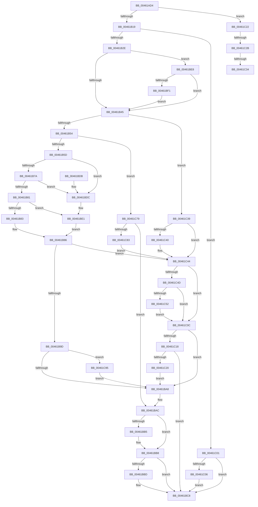

# RtlStringCbPrintfExW

- RVA: `0x00461AD4`–`0x00461CAF` (길이 `475` bytes)
- VA: `0x0000000140461AD4`
- 실행 섹션: `.text`
- PDB 이름 있음: `예`; PDB Function 태그: `예`
- unwind 정보 RVA: `0x000A9F48`
- 디코드: `140`개 명령, `475/475` bytes 표시
- 미해석 바이트: `0` (있으면 어셈블리에 `.byte`로 보존)

> 이 문서는 커널 이미지의 기계어와 PDB 기호를 분석해 생성했습니다. 4번과 5번은 함수 원형과 자료형을 바이너리 사용 방식에서 추정한 C 해석이며 원본 소스 복구 결과는 아닙니다.

## 1. Dependencies

- 직접 호출 지점: **3**; 고유 호출 대상: **3**
- 직접 호출자로 확인된 함수: **7**
- RIP 상대 이미지 참조: **1**

### Outgoing calls
- `0x00461B6F` → [vsnwprintf](../4F/vsnwprintf_function_004FEF30.md) (function, `0x004FEF30`)
- `0x00461C6A` → [RtlStringExHandleOtherFlagsW](../41/RtlStringExHandleOtherFlagsW_function_0041E3F0.md) (function, `0x0041E3F0`)
- `0x00461CA5` → [RtlStringExHandleFillBehindNullW](../5A/RtlStringExHandleFillBehindNullW_function_005A4F94.md) (function, `0x005A4F94`)

### Direct callers
- [RtlQueryPackageClaimsEx](../5E/RtlQueryPackageClaimsEx_function_005EDFE8.md) at `0x005EE0E1`
- [RtlQueryPackageClaimsEx](../5E/RtlQueryPackageClaimsEx_function_005EDFE8.md) at `0x005EE13E`
- [RtlQueryPackageClaimsEx](../5E/RtlQueryPackageClaimsEx_function_005EDFE8.md) at `0x005EE1B3`
- [WmipGenerateBinaryMofNotification](../../page/7B/WmipGenerateBinaryMofNotification_function_007B4348.md) at `0x007B44A9`
- [EtwpQueryPsmKey](../../page/7B/EtwpQueryPsmKey_function_007B8C40.md) at `0x007B8CDE`
- [EtwpQueryPsmKey](../../page/7B/EtwpQueryPsmKey_function_007B8C40.md) at `0x007B8D19`
- [PiNormalizeDeviceText](../../page/99/PiNormalizeDeviceText_function_0099A43C.md) at `0x0099A7B0`
- [ConvertDevpropcompkeyToString](../../page/AF/ConvertDevpropcompkeyToString_function_00AFA604.md) at `0x00AFA769`
- [ConvertDevpropertyToString](../../page/AF/ConvertDevpropertyToString_function_00AFA7B8.md) at `0x00AFAB86`
- [ConvertDevpropertyToString](../../page/AF/ConvertDevpropertyToString_function_00AFA7B8.md) at `0x00AFAD84`
- [ConvertDevpropertyToString](../../page/AF/ConvertDevpropertyToString_function_00AFA7B8.md) at `0x00AFAEA0`
- [PipCreateComputerId](../../init/C3/PipCreateComputerId_function_00C305F4.md) at `0x00C307A1`

### Static image references
- `0x00461BF1` → RVA `0x006C8EC0` (` ?? ::FNODOBFM::`string'`; read)

## 2. Other-region calls and transfers

- 다른 실행 섹션으로 향하는 call: **0**
- call이 아닌 외부 분기/꼬리 이동: **3**
  - `0x00461C25` → [sub_006F2682](../6F/Unknown_function_006F2682.md) (`tail-transfer`)
  - `0x00461C2E` → [sub_006F2682](../6F/Unknown_function_006F2682.md) (`tail-transfer`)
  - `0x00461C34` → [sub_006F2682 + 0xD](../6F/Unknown_function_006F2682.md) (`tail-transfer`)

## 3. Assembly (complete function range)

```asm
00461AD4  4C 89 4C 24 20                  mov qword ptr [rsp + 0x20], r9
00461AD9  4C 89 44 24 18                  mov qword ptr [rsp + 0x18], r8
00461ADE  55                              push rbp
00461ADF  53                              push rbx
00461AE0  56                              push rsi
00461AE1  57                              push rdi
00461AE2  41 54                           push r12
00461AE4  41 55                           push r13
00461AE6  41 56                           push r14
00461AE8  41 57                           push r15
00461AEA  48 8B EC                        mov rbp, rsp
00461AED  48 83 EC 48                     sub rsp, 0x48
00461AF1  44 8B 6D 68                     mov r13d, dword ptr [rbp + 0x68]
00461AF5  48 8B FA                        mov rdi, rdx
00461AF8  4C 8B F1                        mov r14, rcx
00461AFB  48 D1 EF                        shr rdi, 1
00461AFE  33 F6                           xor esi, esi
00461B00  41 8B CD                        mov ecx, r13d
00461B03  4C 8B E2                        mov r12, rdx
00461B06  8B DE                           mov ebx, esi
00461B08  BA 0D 00 00 C0                  mov edx, 0xc000000d
00461B0D  81 E1 00 01 00 00               and ecx, 0x100
00461B13  0F 85 09 01 00 00               jne 0x140461c22
00461B19  48 8D 47 FF                     lea rax, [rdi - 1]
00461B1D  48 3D FE FF FF 7F               cmp rax, 0x7ffffffe
00461B23  0F 47 DA                        cmova ebx, edx
00461B26  85 DB                           test ebx, ebx
00461B28  0F 88 D3 00 00 00               js 0x140461c01
00461B2E  4C 8B 45 70                     mov r8, qword ptr [rbp + 0x70]
00461B32  4D 8B FE                        mov r15, r14
00461B35  4C 89 75 E8                     mov qword ptr [rbp - 0x18], r14
00461B39  48 89 7D F0                     mov qword ptr [rbp - 0x10], rdi
00461B3D  85 C9                           test ecx, ecx
00461B3F  0F 85 A3 00 00 00               jne 0x140461be8
00461B45  8B DE                           mov ebx, esi
00461B47  41 F7 C5 00 E0 FF FF            test r13d, 0xffffe000
00461B4E  0F 85 E5 00 00 00               jne 0x140461c39
00461B54  48 85 FF                        test rdi, rdi
00461B57  0F 84 1C 01 00 00               je 0x140461c79
00461B5D  48 89 75 F0                     mov qword ptr [rbp - 0x10], rsi
00461B61  4C 8D 4D 78                     lea r9, [rbp + 0x78]
00461B65  48 8D 77 FF                     lea rsi, [rdi - 1]
00461B69  49 8B CE                        mov rcx, r14
00461B6C  48 8B D6                        mov rdx, rsi
00461B6F  E8 BC D3 09 00                  call 0x1404fef30
00461B74  33 C9                           xor ecx, ecx
00461B76  85 C0                           test eax, eax
00461B78  78 62                           js 0x140461bdc
00461B7A  48 98                           cdqe
00461B7C  48 3B C6                        cmp rax, rsi
00461B7F  77 5B                           ja 0x140461bdc
00461B81  74 5E                           je 0x140461be1
00461B83  48 8B F0                        mov rsi, rax
00461B86  48 2B FE                        sub rdi, rsi
00461B89  4D 8D 3C 76                     lea r15, [r14 + rsi*2]
00461B8D  4C 89 7D E8                     mov qword ptr [rbp - 0x18], r15
00461B91  48 89 7D F0                     mov qword ptr [rbp - 0x10], rdi
00461B95  85 DB                           test ebx, ebx
00461B97  0F 88 A7 00 00 00               js 0x140461c44
00461B9D  41 0F BA E5 09                  bt r13d, 9
00461BA2  0F 82 ED 00 00 00               jb 0x140461c95
00461BA8  4C 8B 4D 60                     mov r9, qword ptr [rbp + 0x60]
00461BAC  48 8B 45 58                     mov rax, qword ptr [rbp + 0x58]
00461BB0  48 85 C0                        test rax, rax
00461BB3  74 03                           je 0x140461bb8
00461BB5  4C 89 38                        mov qword ptr [rax], r15
00461BB8  4D 85 C9                        test r9, r9
00461BBB  74 0B                           je 0x140461bc8
00461BBD  41 83 E4 01                     and r12d, 1
00461BC1  49 8D 04 7C                     lea rax, [r12 + rdi*2]
00461BC5  49 89 01                        mov qword ptr [r9], rax
00461BC8  8B C3                           mov eax, ebx
00461BCA  48 83 C4 48                     add rsp, 0x48
00461BCE  41 5F                           pop r15
00461BD0  41 5E                           pop r14
00461BD2  41 5D                           pop r13
00461BD4  41 5C                           pop r12
00461BD6  5F                              pop rdi
00461BD7  5E                              pop rsi
00461BD8  5B                              pop rbx
00461BD9  5D                              pop rbp
00461BDA  C3                              ret
00461BDB  CC                              int3
00461BDC  BB 05 00 00 80                  mov ebx, 0x80000005
00461BE1  66 41 89 0C 76                  mov word ptr [r14 + rsi*2], cx
00461BE6  EB 9E                           jmp 0x140461b86
00461BE8  4D 85 C0                        test r8, r8
00461BEB  0F 85 54 FF FF FF               jne 0x140461b45
00461BF1  4C 8D 05 C8 72 26 00            lea r8, [rip + 0x2672c8]
00461BF8  4C 89 45 70                     mov qword ptr [rbp + 0x70], r8
00461BFC  E9 44 FF FF FF                  jmp 0x140461b45
00461C01  48 85 FF                        test rdi, rdi
00461C04  74 C2                           je 0x140461bc8
00461C06  66 41 89 36                     mov word ptr [r14], si
00461C0A  EB BC                           jmp 0x140461bc8
00461C0C  B9 00 00 00 80                  mov ecx, 0x80000000
00461C11  8D 04 0B                        lea eax, [rbx + rcx]
00461C14  85 C1                           test ecx, eax
00461C16  75 90                           jne 0x140461ba8
00461C18  81 FB 05 00 00 80               cmp ebx, 0x80000005
00461C1E  75 A8                           jne 0x140461bc8
00461C20  EB 86                           jmp 0x140461ba8
00461C22  4D 85 F6                        test r14, r14
00461C25  0F 85 57 0A 29 00               jne 0x1406f2682
00461C2B  48 85 FF                        test rdi, rdi
00461C2E  0F 84 4E 0A 29 00               je 0x1406f2682
00461C34  E9 56 0A 29 00                  jmp 0x1406f268f
00461C39  8B DA                           mov ebx, edx
00461C3B  48 85 FF                        test rdi, rdi
00461C3E  74 04                           je 0x140461c44
00461C40  66 41 89 36                     mov word ptr [r14], si
00461C44  41 F7 C5 00 1C 00 00            test r13d, 0x1c00
00461C4B  74 BF                           je 0x140461c0c
00461C4D  4D 85 E4                        test r12, r12
00461C50  74 BA                           je 0x140461c0c
00461C52  48 8D 45 F0                     lea rax, [rbp - 0x10]
00461C56  44 89 6C 24 28                  mov dword ptr [rsp + 0x28], r13d
00461C5B  4C 8D 4D E8                     lea r9, [rbp - 0x18]
00461C5F  48 89 44 24 20                  mov qword ptr [rsp + 0x20], rax
00461C64  49 8B D4                        mov rdx, r12
00461C67  49 8B CE                        mov rcx, r14
00461C6A  E8 81 C7 FB FF                  call 0x14041e3f0
00461C6F  4C 8B 7D E8                     mov r15, qword ptr [rbp - 0x18]
00461C73  48 8B 7D F0                     mov rdi, qword ptr [rbp - 0x10]
00461C77  EB 93                           jmp 0x140461c0c
00461C79  66 41 39 30                     cmp word ptr [r8], si
00461C7D  0F 84 29 FF FF FF               je 0x140461bac
00461C83  49 8B C6                        mov rax, r14
00461C86  48 F7 D8                        neg rax
00461C89  1B DB                           sbb ebx, ebx
00461C8B  81 E3 F8 FF FF BF               and ebx, 0xbffffff8
00461C91  03 DA                           add ebx, edx
00461C93  EB AF                           jmp 0x140461c44
00461C95  49 8B C4                        mov rax, r12
00461C98  45 8B C5                        mov r8d, r13d
00461C9B  83 E0 01                        and eax, 1
00461C9E  49 8B CF                        mov rcx, r15
00461CA1  48 8D 14 78                     lea rdx, [rax + rdi*2]
00461CA5  E8 EA 32 14 00                  call 0x1405a4f94
00461CAA  E9 F9 FE FF FF                  jmp 0x140461ba8
```

## 4. C-style interpretation (structured pseudocode)

```c
__int64 __fastcall RtlStringCbPrintfExW(__int64 a1, __int64 a2, __int64 a3, __int64 a4, unsigned int a5, __int64 a6, __int64 a7)
{
    __int64 result;
    __int64 v_r12;
    __int64 v_rbx;
    __int64 v_rdi;
    __int64 v_rsi;
    __int64 v_rsp;
    unsigned __int64 v_stack_m50;
    unsigned __int64 v_stack_m58;
    unsigned __int64 v_stack_p18;
    unsigned __int64 v_stack_p20;
    unsigned int v_stack_p28;
    unsigned __int64 v_stack_p30;

    v_stack_p20 = a4;
    v_stack_p18 = a3;
    v_rsp = (v_rsp) - (72);
    v_rdi = (a2) >> (1);
    v_rsi = 0;
    a1 = (unsigned int)(((unsigned int)((unsigned int)((unsigned int)(a5)))) & (256));
    if (condition_is_not_equal) goto loc_00461C22;
    v_rbx = 0;
    if ((v_rdi - 1) > 0x7FFFFFFEULL) { v_rbx = (unsigned int)((unsigned int)(0xC000000DULL)); }
    if (sign_flag) goto loc_00461C01;
    v_stack_m58 = a1;
    v_stack_m50 = v_rdi;
    if ((unsigned int)(a1) != 0) goto loc_00461BE8;
loc_00461B45:
    if ((((unsigned int)((unsigned int)(a5))) & (0xFFFFE000ULL)) != 0) goto loc_00461C39;
    if (v_rdi == 0) goto loc_00461C79;
    v_stack_m50 = 0;
    result = vsnwprintf(a1, v_rdi - 1, a6, a7);
    a1 = 0;
    if (sign_flag) goto loc_00461BDC;
    if (result > (v_rdi - 1)) goto loc_00461BDC;
    if (result == (v_rdi - 1)) goto loc_00461BE1;
loc_00461B86:
    v_rdi = (v_rdi) - (result);
    v_stack_m58 = a1 + result * 2;
    v_stack_m50 = v_rdi;
    if (sign_flag) goto loc_00461C44;
    if (condition_is_below) goto loc_00461C95;
loc_00461BA8:
loc_00461BAC:
    if (v_stack_p18 != 0) {
        *(unsigned __int64 *)(v_stack_p18) = a1 + result * 2;
    }
    result = v_stack_p18;
    v_r12 = a2;
    if (v_stack_p20 != 0) {
        v_r12 = (unsigned int)((a2) & (1));
        result = v_r12 + v_rdi * 2;
        *(unsigned __int64 *)(v_stack_p20) = result;
    }
    v_rsp = (v_rsp) + (72);
    return 0;
loc_00461BDC:
loc_00461BE1:
    *(unsigned __int16 *)(a1 + result * 2) = 0;
    goto loc_00461B86;
loc_00461BE8:
    if (a6 != 0) goto loc_00461B45;
    v_stack_p30 = v_rip + 2519752;
    goto loc_00461B45;
loc_00461C01:
    if (v_rdi == 0) goto loc_00461BC8;
    *(unsigned __int16 *)(a1) = (unsigned __int16)(result);
    goto loc_00461BC8;
loc_00461C0C:
    if ((((unsigned int)((unsigned int)(0x80000000ULL))) & ((unsigned int)((unsigned int)(0x80000005ULL) + (unsigned int)(0x80000000ULL) * 1))) != 0) goto loc_00461BA8;
    if (((unsigned int)((unsigned int)(0x80000005ULL))) != 0x80000005ULL) goto loc_00461BC8;
    goto loc_00461BA8;
loc_00461C22:
loc_00461C39:
    if (v_rdi != 0) {
        *(unsigned __int16 *)(a1) = (unsigned __int16)(result);
    }
    if ((((unsigned int)((unsigned int)(a5))) & (0x1C00ULL)) == 0) goto loc_00461C0C;
    if (v_r12 == 0) goto loc_00461C0C;
    v_stack_p28 = (unsigned int)((unsigned int)(a5));
    v_stack_p20 = v_stack_m50;
    result = RtlStringExHandleOtherFlagsW(0, v_r12, v_rip + 2519752, v_stack_m58);
    goto loc_00461C0C;
loc_00461C79:
    if ((*(unsigned __int16 *)(v_rip + 2519752)) == ((unsigned __int16)(result))) goto loc_00461BAC;
    result = -(0);
    v_rbx = (unsigned int)(((unsigned int)((unsigned int)(v_rdi - 1))) & (0xBFFFFFF8ULL));
    v_rbx = (unsigned int)((v_rbx) + ((unsigned int)(v_r12)));
    goto loc_00461C44;
loc_00461C95:
    result = (unsigned int)((v_r12) & (1));
    result = RtlStringExHandleFillBehindNullW(v_stack_m58, result + v_stack_m50 * 2, (unsigned int)((unsigned int)((unsigned int)(a5))), v_stack_m58);
    goto loc_00461BA8;
}
```

## 5. (Beta) C Style

```c
int64_t RtlStringCbPrintfExW(void *Arg1, void *Arg2, int64_t Arg3, int64_t Arg4, uint32_t Arg5, int64_t Arg6, int64_t Arg7)
{
    uint8_t *arg1 = (uint8_t *)Arg1;
    uint8_t *arg2 = (uint8_t *)Arg2;

    int64_t result;
    int64_t local_r12;
    int64_t local_rbx;
    int64_t local_rdi;
    int64_t local_rsi;
    int64_t local_rsp;
    uint64_t v_stack_m50;
    uint64_t v_stack_m58;
    uint64_t v_stack_p18;
    uint64_t v_stack_p20;
    uint32_t v_stack_p28;
    uint64_t v_stack_p30;

    v_stack_p20 = Arg4;
    v_stack_p18 = Arg3;
    local_rsp = (local_rsp) - (72);
    local_rdi = (Arg2) >> (1);
    local_rsi = 0;
    Arg1 = (uint32_t)(((uint32_t)((uint32_t)((uint32_t)(Arg5)))) & (256));
    if (condition_is_not_equal) goto loc_00461C22;
    local_rbx = 0;
    if ((local_rdi - 1) > 0x7FFFFFFEULL) { local_rbx = (uint32_t)((uint32_t)(0xC000000DULL)); }
    if (sign_flag) goto loc_00461C01;
    v_stack_m58 = Arg1;
    v_stack_m50 = local_rdi;
    if ((uint32_t)(Arg1) != 0) goto loc_00461BE8;
loc_00461B45:
    if ((((uint32_t)((uint32_t)(Arg5))) & (0xFFFFE000ULL)) != 0) goto loc_00461C39;
    if (local_rdi == 0) goto loc_00461C79;
    v_stack_m50 = 0;
    result = vsnwprintf(Arg1, local_rdi - 1, Arg6, Arg7);
    Arg1 = 0;
    if (sign_flag) goto loc_00461BDC;
    if (result > (local_rdi - 1)) goto loc_00461BDC;
    if (result == (local_rdi - 1)) goto loc_00461BE1;
loc_00461B86:
    local_rdi = (local_rdi) - (result);
    v_stack_m58 = Arg1 + result * 2;
    v_stack_m50 = local_rdi;
    if (sign_flag) goto loc_00461C44;
    if (condition_is_below) goto loc_00461C95;
loc_00461BA8:
loc_00461BAC:
    if (v_stack_p18 != 0) {
        *(void **)(v_stack_p18) = Arg1 + result * 2;
    }
    result = v_stack_p18;
    local_r12 = Arg2;
    if (v_stack_p20 != 0) {
        local_r12 = (uint32_t)((Arg2) & (1));
        result = local_r12 + local_rdi * 2;
        *(uint64_t *)(v_stack_p20) = result;
    }
    local_rsp = (local_rsp) + (72);
    return 0;
loc_00461BDC:
loc_00461BE1:
    *(uint16_t *)(arg1 + result * 2) = 0;
    goto loc_00461B86;
loc_00461BE8:
    if (Arg6 != 0) goto loc_00461B45;
    v_stack_p30 = v_rip + 2519752;
    goto loc_00461B45;
loc_00461C01:
    if (local_rdi == 0) goto loc_00461BC8;
    *(uint16_t *)(arg1) = (uint16_t)(result);
    goto loc_00461BC8;
loc_00461C0C:
    if ((((uint32_t)((uint32_t)(0x80000000ULL))) & ((uint32_t)((uint32_t)(0x80000005ULL) + (uint32_t)(0x80000000ULL) * 1))) != 0) goto loc_00461BA8;
    if (((uint32_t)((uint32_t)(0x80000005ULL))) != 0x80000005ULL) goto loc_00461BC8;
    goto loc_00461BA8;
loc_00461C22:
loc_00461C39:
    if (local_rdi != 0) {
        *(uint16_t *)(arg1) = (uint16_t)(result);
    }
    if ((((uint32_t)((uint32_t)(Arg5))) & (0x1C00ULL)) == 0) goto loc_00461C0C;
    if (local_r12 == 0) goto loc_00461C0C;
    v_stack_p28 = (uint32_t)((uint32_t)(Arg5));
    v_stack_p20 = v_stack_m50;
    result = RtlStringExHandleOtherFlagsW(0, local_r12, v_rip + 2519752, v_stack_m58);
    goto loc_00461C0C;
loc_00461C79:
    if ((*(uint16_t *)(v_rip + 0x2672C8)) == ((uint16_t)(result))) goto loc_00461BAC;
    result = -(0);
    local_rbx = (uint32_t)(((uint32_t)((uint32_t)(local_rdi - 1))) & (0xBFFFFFF8ULL));
    local_rbx = (uint32_t)((local_rbx) + ((uint32_t)(local_r12)));
    goto loc_00461C44;
loc_00461C95:
    result = (uint32_t)((local_r12) & (1));
    result = RtlStringExHandleFillBehindNullW(v_stack_m58, result + v_stack_m50 * 2, (uint32_t)((uint32_t)((uint32_t)(Arg5))), v_stack_m58);
    goto loc_00461BA8;
}
```

### 관측된 메모리 오프셋

구조체 형식이 확인되지 않은 접근은 인자 기준의 오프셋으로만 기록했습니다.

| 기준 인자 | 오프셋 표현 | 폭 (bit) | 접근 |
|---|---:|---:|---|
| `Arg1` | `+ 0x0` | `16` | `W` |
| `Arg1` | `+ 0x0 + rsi*2` | `16` | `W` |
| `Arg1` | `+ 0x0 + rsi*2` | `64` | `R` |
| `Arg2` | `+ 0x0 + rdi*2` | `64` | `R` |

## 6. Execution-region graph

[열기: 2D/3D 그래프와 함수 탐색 컨트롤 패널](../../../control-panel.html?section=text&rva=0x00461AD4&view=graph)

- 2D 그래프는 위에서 아래로 흐르고, 3D 그래프는 빈 공간을 드래그해 회전합니다. Shift+드래그는 이동, 휠은 확대·축소, 함수 노드 선택은 대상 보고서 이동입니다.

### Static fallback


