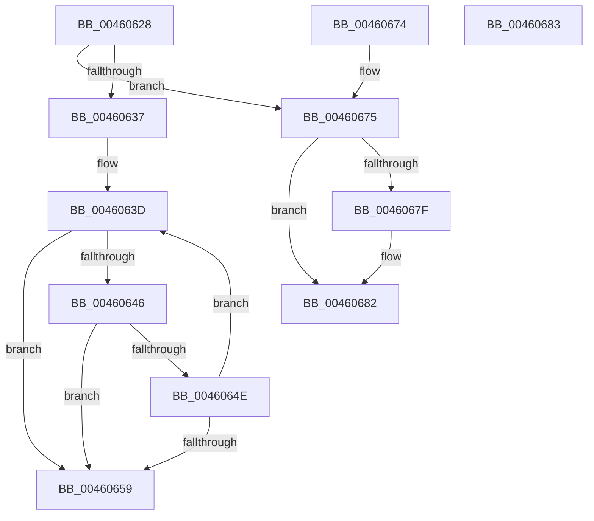

# RtlStringCchCopyA

- RVA: `0x00460628`–`0x00460684` (길이 `92` bytes)
- VA: `0x0000000140460628`
- 실행 섹션: `.text`
- PDB 이름 있음: `예`; PDB Function 태그: `아니요`
- unwind 정보 RVA: `0x000DB714`
- 디코드: `32`개 명령, `92/92` bytes 표시
- 미해석 바이트: `0` (있으면 어셈블리에 `.byte`로 보존)

> 이 문서는 커널 이미지의 기계어와 PDB 기호를 분석해 생성했습니다. 4번과 5번은 함수 원형과 자료형을 바이너리 사용 방식에서 추정한 C 해석이며 원본 소스 복구 결과는 아닙니다.

## 1. Dependencies

- 직접 호출 지점: **0**; 고유 호출 대상: **0**
- 직접 호출자로 확인된 함수: **13**
- RIP 상대 이미지 참조: **0**

### Outgoing calls
- 직접 디코드된 call 명령이 없습니다.

### Direct callers
- [EtwpCoverageAddToStringBuffer](EtwpCoverageAddToStringBuffer_function_004605E8.md) at `0x00460609`
- [CarCopyRuleViolationDetails](../61/CarCopyRuleViolationDetails_function_00618590.md) at `0x006186C1`
- [EtwpCoverageRecordAtHighIrql](../65/EtwpCoverageRecordAtHighIrql_function_00651C70.md) at `0x00651CC9`
- [WheaHwErrorReportSetSectionNameDeviceDriver](../65/WheaHwErrorReportSetSectionNameDeviceDriver_function_0065E760.md) at `0x0065E78E`
- [WheaReportFatalHwErrorDeviceDriverEx](../65/WheaReportFatalHwErrorDeviceDriverEx_function_0065E910.md) at `0x0065E9F8`
- [WheaReportHwErrorDeviceDriverEx](../65/WheaReportHwErrorDeviceDriverEx_function_0065EA30.md) at `0x0065EB17`
- [WheapInitErrorReportDeviceDriver](../65/WheapInitErrorReportDeviceDriver_function_0065ED88.md) at `0x0065EFED`
- [WheapCreateRecordFromGenericErrorData](../65/WheapCreateRecordFromGenericErrorData_function_0065FCE4.md) at `0x0065FEE3`
- [WheapCreateRecordFromGenericErrorData](../65/WheapCreateRecordFromGenericErrorData_function_0065FCE4.md) at `0x0065FF44`
- [WheapCreateRecordFromGenericErrorData](../65/WheapCreateRecordFromGenericErrorData_function_0065FCE4.md) at `0x0065FFDB`
- [WheaRemoveErrorSourceDeviceDriver](../../page/7D/WheaRemoveErrorSourceDeviceDriver_function_007D7060.md) at `0x007D7107`
- [AslpFileQueryExportName](../../page/82/AslpFileQueryExportName_function_00820EF8.md) at `0x008210B9`
- [HalpInitGenericErrorSourceEntry](../../pagelk/B5/HalpInitGenericErrorSourceEntry_function_00B5DF68.md) at `0x00B5E03A`
- [HalpInitGenericErrorSourceEntryV2](../../pagelk/B5/HalpInitGenericErrorSourceEntryV2_function_00B5E1D0.md) at `0x00B5E2B0`
- [EmpParseStrings](../../init/C2/EmpParseStrings_function_00C277E0.md) at `0x00C2792A`

### Static image references
- 디코드된 RIP-relative 메모리 참조가 없습니다.

## 2. Other-region calls and transfers

- 다른 실행 섹션으로 향하는 call: **0**
- 별도 외부 분기/꼬리 이동을 확인하지 못했습니다.

## 3. Assembly (complete function range)

```asm
00460628  48 8D 42 FF                     lea rax, [rdx - 1]
0046062C  41 B9 FE FF FF 7F               mov r9d, 0x7ffffffe
00460632  49 3B C1                        cmp rax, r9
00460635  77 3E                           ja 0x140460675
00460637  4C 2B CA                        sub r9, rdx
0046063A  4C 2B C1                        sub r8, rcx
0046063D  49 8D 04 11                     lea rax, [r9 + rdx]
00460641  48 85 C0                        test rax, rax
00460644  74 13                           je 0x140460659
00460646  41 8A 04 08                     mov al, byte ptr [r8 + rcx]
0046064A  84 C0                           test al, al
0046064C  74 0B                           je 0x140460659
0046064E  88 01                           mov byte ptr [rcx], al
00460650  48 FF C1                        inc rcx
00460653  48 83 EA 01                     sub rdx, 1
00460657  75 E4                           jne 0x14046063d
00460659  48 85 D2                        test rdx, rdx
0046065C  48 8D 41 FF                     lea rax, [rcx - 1]
00460660  48 0F 45 C1                     cmovne rax, rcx
00460664  48 F7 DA                        neg rdx
00460667  C6 00 00                        mov byte ptr [rax], 0
0046066A  1B C0                           sbb eax, eax
0046066C  F7 D0                           not eax
0046066E  25 05 00 00 80                  and eax, 0x80000005
00460673  C3                              ret
00460674  CC                              int3
00460675  B8 0D 00 00 C0                  mov eax, 0xc000000d
0046067A  48 85 D2                        test rdx, rdx
0046067D  74 03                           je 0x140460682
0046067F  C6 01 00                        mov byte ptr [rcx], 0
00460682  C3                              ret
00460683  CC                              int3
```

## 4. C-style interpretation (structured pseudocode)

```c
__int64 __fastcall RtlStringCchCopyA(__int64 a1, __int64 a2, __int64 a3)
{
    __int64 result;

    if ((a2 - 1) > ((unsigned int)(0x7FFFFFFEULL))) goto loc_00460675;
    a4 = ((unsigned int)(0x7FFFFFFEULL)) - (a2);
    a3 = (a3) - (a1);
loc_0046063D:
    if (a4 + a2 * 1 == 0) goto loc_00460659;
    if ((unsigned __int8)(*(unsigned __int8 *)(a3 + a1 * 1)) == 0) goto loc_00460659;
    *(unsigned __int8 *)(a1) = (unsigned __int8)(*(unsigned __int8 *)(a3 + a1 * 1));
    a1 = (a1) + 1;
    a2 = (a2) - (1);
    if (condition_is_not_equal) goto loc_0046063D;
loc_00460659:
    result = a1 - 1;
    if (a2 != 0) { result = a1; }
    a2 = -(a2);
    *(unsigned __int8 *)(result) = 0;
    result = (unsigned int)(~(result));
    result = (unsigned int)((result) & (0x80000005ULL));
    return result;
loc_00460675:
    if (a2 != 0) {
        *(unsigned __int8 *)(a1) = 0;
    }
    return (unsigned int)(0xC000000DULL);
}
```

## 5. (Beta) C Style

```c
int64_t RtlStringCchCopyA(void *Arg1, void *Arg2, void *Arg3)
{
    uint8_t *arg1 = (uint8_t *)Arg1;
    uint8_t *arg2 = (uint8_t *)Arg2;
    uint8_t *arg3 = (uint8_t *)Arg3;

    int64_t result;

    if ((Arg2 - 1) > ((uint32_t)(0x7FFFFFFEULL))) goto loc_00460675;
    a4 = ((uint32_t)(0x7FFFFFFEULL)) - (Arg2);
    Arg3 = (Arg3) - (Arg1);
loc_0046063D:
    if (a4 + Arg2 * 1 == 0) goto loc_00460659;
    if ((uint8_t)(*(uint8_t *)(arg3 + arg1 * 1)) == 0) goto loc_00460659;
    *(uint8_t *)(arg1) = (uint8_t)(*(uint8_t *)(arg3 + arg1 * 1));
    Arg1 = (Arg1) + 1;
    Arg2 = (Arg2) - (1);
    if (condition_is_not_equal) goto loc_0046063D;
loc_00460659:
    result = Arg1 - 1;
    if (Arg2 != NULL) { result = Arg1; }
    Arg2 = -(Arg2);
    *(uint8_t *)(result) = 0;
    result = (uint32_t)(~(result));
    result = (uint32_t)((result) & (0x80000005ULL));
    return result;
loc_00460675:
    if (Arg2 != NULL) {
        *(uint8_t *)(arg1) = 0;
    }
    return (uint32_t)(0xC000000DULL);
}
```

### 관측된 메모리 오프셋

구조체 형식이 확인되지 않은 접근은 인자 기준의 오프셋으로만 기록했습니다.

| 기준 인자 | 오프셋 표현 | 폭 (bit) | 접근 |
|---|---:|---:|---|
| `Arg1` | `+ 0x0` | `8` | `W` |
| `Arg2` | `- 0x1` | `64` | `R` |
| `Arg3` | `+ 0x0 + rcx*1` | `8` | `R` |

## 6. Execution-region graph

[열기: 2D/3D 그래프와 함수 탐색 컨트롤 패널](../../../control-panel.html?section=text&rva=0x00460628&view=graph)

- 2D 그래프는 위에서 아래로 흐르고, 3D 그래프는 빈 공간을 드래그해 회전합니다. Shift+드래그는 이동, 휠은 확대·축소, 함수 노드 선택은 대상 보고서 이동입니다.

### Static fallback


