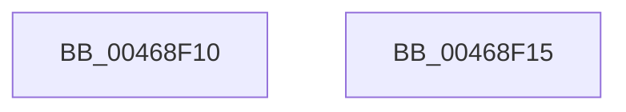

# RtlSubAuthorityCountSid

- RVA: `0x00468F10`–`0x00468F16` (길이 `6` bytes)
- VA: `0x0000000140468F10`
- 실행 섹션: `.text`
- PDB 이름 있음: `예`; PDB Function 태그: `아니요`
- unwind 정보 RVA: `0x000DB714`
- 디코드: `3`개 명령, `6/6` bytes 표시
- 미해석 바이트: `0` (있으면 어셈블리에 `.byte`로 보존)

> 이 문서는 커널 이미지의 기계어와 PDB 기호를 분석해 생성했습니다. 4번과 5번은 함수 원형과 자료형을 바이너리 사용 방식에서 추정한 C 해석이며 원본 소스 복구 결과는 아닙니다.

## 1. Dependencies

- 직접 호출 지점: **0**; 고유 호출 대상: **0**
- 직접 호출자로 확인된 함수: **15**
- RIP 상대 이미지 참조: **0**

### Outgoing calls
- 직접 디코드된 call 명령이 없습니다.

### Direct callers
- [RtlReplaceSidInSd](../../page/78/RtlReplaceSidInSd_function_0078E6E0.md) at `0x0078E718`
- [SeQueryInformationToken](../../page/8B/SeQueryInformationToken_function_008B5090.md) at `0x008B56E5`
- [SeQueryMandatoryLabel](../../page/8C/SeQueryMandatoryLabel_function_008C8D38.md) at `0x008C8D94`
- [sub_0092949C](../../page/92/Unknown_function_0092949C.md) at `0x009295D0`
- [sub_00929657](../../page/92/Unknown_function_00929657.md) at `0x00929671`
- [SepCopyTokenLoggingInformation](../../page/9A/SepCopyTokenLoggingInformation_function_009A8618.md) at `0x009A8697`
- [RtlEnumerateBoundaryDescriptorEntries](../../page/9C/RtlEnumerateBoundaryDescriptorEntries_function_009CA278.md) at `0x009CA387`
- [RtlpValidateSidBuffer](../../page/9C/RtlpValidateSidBuffer_function_009CA484.md) at `0x009CA498`
- [RtlIsElevatedRid](../../page/9D/RtlIsElevatedRid_function_009D4B30.md) at `0x009D4B4C`
- [RtlGetAppContainerSidType](../../page/A7/RtlGetAppContainerSidType_function_00A72160.md) at `0x00A721A0`
- [SepCheckCapabilities](../../page/AA/SepCheckCapabilities_function_00AA4A10.md) at `0x00AA4BA7`
- [SeSubProcessToken](../../page/AA/SeSubProcessToken_function_00AAD570.md) at `0x00AAD82E`
- [SeSubProcessToken](../../page/AA/SeSubProcessToken_function_00AAD570.md) at `0x00AADB6A`
- [NtCreateLowBoxToken](../../page/AB/NtCreateLowBoxToken_function_00AB9880.md) at `0x00AB9F5D`
- [NtCreateLowBoxToken](../../page/AB/NtCreateLowBoxToken_function_00AB9880.md) at `0x00AB9FD8`
- [NtQueryInformationToken](../../page/AE/NtQueryInformationToken_function_00AECDD0.md) at `0x00AEE8B7`
- [NtSetInformationToken](../../page/AF/NtSetInformationToken_function_00AF0530.md) at `0x00AF1982`
- [NtSetInformationToken](../../page/AF/NtSetInformationToken_function_00AF0530.md) at `0x00AF1A01`
- [NtSetInformationToken](../../page/AF/NtSetInformationToken_function_00AF0530.md) at `0x00AF1AC2`
- [NtSetInformationToken](../../page/AF/NtSetInformationToken_function_00AF0530.md) at `0x00AF1B3B`
- [NtSetInformationToken](../../page/AF/NtSetInformationToken_function_00AF0530.md) at `0x00AF1BBC`
- [NtSetInformationToken](../../page/AF/NtSetInformationToken_function_00AF0530.md) at `0x00AF1D77`

### Static image references
- 디코드된 RIP-relative 메모리 참조가 없습니다.

## 2. Other-region calls and transfers

- 다른 실행 섹션으로 향하는 call: **0**
- 별도 외부 분기/꼬리 이동을 확인하지 못했습니다.

## 3. Assembly (complete function range)

```asm
00468F10  48 8D 41 01                     lea rax, [rcx + 1]
00468F14  C3                              ret
00468F15  CC                              int3
```

## 4. C-style interpretation (structured pseudocode)

```c
__int64 __fastcall RtlSubAuthorityCountSid(__int64 a1)
{
    return a1 + 1;
}
```

## 5. (Beta) C Style

```c
void *RtlSubAuthorityCountSid(void *Arg1)
{
    uint8_t *arg1 = (uint8_t *)Arg1;

    return Arg1 + 1;
}
```

### 관측된 메모리 오프셋

구조체 형식이 확인되지 않은 접근은 인자 기준의 오프셋으로만 기록했습니다.

| 기준 인자 | 오프셋 표현 | 폭 (bit) | 접근 |
|---|---:|---:|---|
| `Arg1` | `+ 0x1` | `64` | `R` |

## 6. Execution-region graph

[열기: 2D/3D 그래프와 함수 탐색 컨트롤 패널](../../../control-panel.html?section=text&rva=0x00468F10&view=graph)

- 2D 그래프는 위에서 아래로 흐르고, 3D 그래프는 빈 공간을 드래그해 회전합니다. Shift+드래그는 이동, 휠은 확대·축소, 함수 노드 선택은 대상 보고서 이동입니다.

### Static fallback


