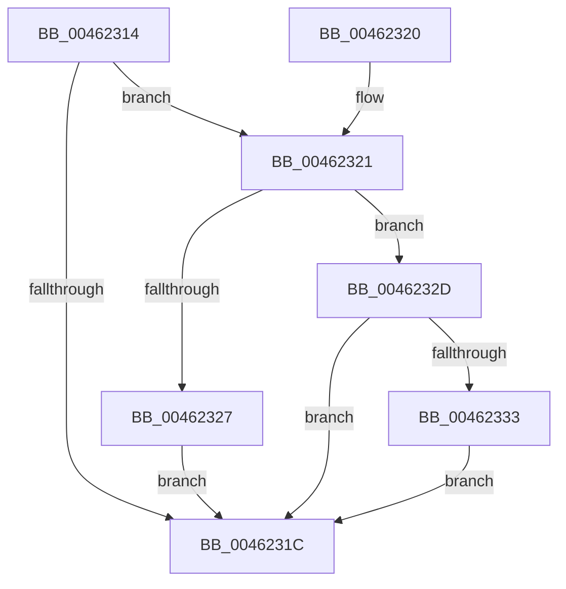

# RtlpGetContextFlagsLocation

- RVA: `0x00462314`–`0x00462340` (길이 `44` bytes)
- VA: `0x0000000140462314`
- 실행 섹션: `.text`
- PDB 이름 있음: `예`; PDB Function 태그: `아니요`
- unwind 정보 RVA: `0x000DB714`
- 디코드: `16`개 명령, `44/44` bytes 표시
- 미해석 바이트: `0` (있으면 어셈블리에 `.byte`로 보존)

> 이 문서는 커널 이미지의 기계어와 PDB 기호를 분석해 생성했습니다. 4번과 5번은 함수 원형과 자료형을 바이너리 사용 방식에서 추정한 C 해석이며 원본 소스 복구 결과는 아닙니다.

## 1. Dependencies

- 직접 호출 지점: **0**; 고유 호출 대상: **0**
- 직접 호출자로 확인된 함수: **2**
- RIP 상대 이미지 참조: **0**

### Outgoing calls
- 직접 디코드된 call 명령이 없습니다.

### Direct callers
- [RtlWow64GetCpuAreaInfo](../../page/8C/RtlWow64GetCpuAreaInfo_function_008CDE0C.md) at `0x008CDEC6`
- [RtlCopyContext](../../page/8D/RtlCopyContext_function_008D5940.md) at `0x008D5989`
- [RtlCopyContext](../../page/8D/RtlCopyContext_function_008D5940.md) at `0x008D5999`

### Static image references
- 디코드된 RIP-relative 메모리 참조가 없습니다.

## 2. Other-region calls and transfers

- 다른 실행 섹션으로 향하는 call: **0**
- 별도 외부 분기/꼬리 이동을 확인하지 못했습니다.

## 3. Assembly (complete function range)

```asm
00462314  33 C0                           xor eax, eax
00462316  0F BA E2 10                     bt edx, 0x10
0046231A  73 05                           jae 0x140462321
0046231C  48 8B C1                        mov rax, rcx
0046231F  C3                              ret
00462320  CC                              int3
00462321  0F BA E2 14                     bt edx, 0x14
00462325  73 06                           jae 0x14046232d
00462327  48 83 C1 30                     add rcx, 0x30
0046232B  EB EF                           jmp 0x14046231c
0046232D  0F BA E2 15                     bt edx, 0x15
00462331  72 E9                           jb 0x14046231c
00462333  0F BA E2 16                     bt edx, 0x16
00462337  48 0F 42 C1                     cmovb rax, rcx
0046233B  48 8B C8                        mov rcx, rax
0046233E  EB DC                           jmp 0x14046231c
```

## 4. C-style interpretation (structured pseudocode)

```c
__int64 __fastcall RtlpGetContextFlagsLocation(__int64 a1, int a2)
{
    __int64 result;

    result = 0;
    if (condition_is_above_or_equal) goto loc_00462321;
loc_0046231C:
    return a1;
loc_00462321:
    if (condition_is_above_or_equal) goto loc_0046232D;
    a1 = (a1) + (48);
    goto loc_0046231C;
loc_0046232D:
    if (condition_is_below) goto loc_0046231C;
    if (condition_is_below) { a1 = a1; }
    goto loc_0046231C;
}
```

## 5. (Beta) C Style

```c
int64_t RtlpGetContextFlagsLocation(int64_t Arg1, int32_t Arg2)
{
    int64_t result;

    result = 0;
    if (condition_is_above_or_equal) goto loc_00462321;
loc_0046231C:
    return Arg1;
loc_00462321:
    if (condition_is_above_or_equal) goto loc_0046232D;
    Arg1 = (Arg1) + (48);
    goto loc_0046231C;
loc_0046232D:
    if (condition_is_below) goto loc_0046231C;
    if (condition_is_below) { Arg1 = Arg1; }
    goto loc_0046231C;
}
```

## 6. Execution-region graph

[열기: 2D/3D 그래프와 함수 탐색 컨트롤 패널](../../../control-panel.html?section=text&rva=0x00462314&view=graph)

- 2D 그래프는 위에서 아래로 흐르고, 3D 그래프는 빈 공간을 드래그해 회전합니다. Shift+드래그는 이동, 휠은 확대·축소, 함수 노드 선택은 대상 보고서 이동입니다.

### Static fallback


