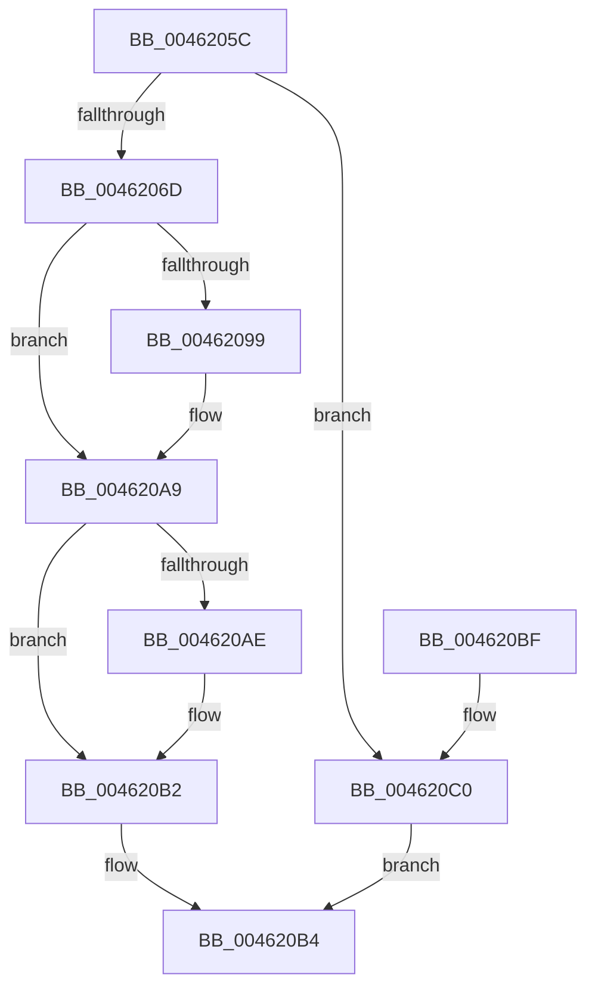

# RtlpHpAcquireLockShared

- RVA: `0x0046205C`–`0x004620C7` (길이 `107` bytes)
- VA: `0x000000014046205C`
- 실행 섹션: `.text`
- PDB 이름 있음: `예`; PDB Function 태그: `아니요`
- unwind 정보 RVA: `0x0006CF28`
- 디코드: `33`개 명령, `107/107` bytes 표시
- 미해석 바이트: `0` (있으면 어셈블리에 `.byte`로 보존)

> 이 문서는 커널 이미지의 기계어와 PDB 기호를 분석해 생성했습니다. 4번과 5번은 함수 원형과 자료형을 바이너리 사용 방식에서 추정한 C 해석이며 원본 소스 복구 결과는 아닙니다.

## 1. Dependencies

- 직접 호출 지점: **3**; 고유 호출 대상: **3**
- 직접 호출자로 확인된 함수: **3**
- RIP 상대 이미지 참조: **0**

### Outgoing calls
- `0x00462083` → [KeAbPreAcquire](../21/KeAbPreAcquire_function_00210230.md) (function, `0x00210230`)
- `0x004620A4` → [ExfAcquirePushLockSharedEx](../21/ExfAcquirePushLockSharedEx_function_0021044C.md) (function, `0x0021044C`)
- `0x004620C0` → [ExAcquireSpinLockShared](../24/ExAcquireSpinLockShared_function_0024DCE0.md) (function, `0x0024DCE0`)

### Direct callers
- [RtlpHpLfhOwnerCompact](../2E/RtlpHpLfhOwnerCompact_function_002E785C.md) at `0x002E7A57`
- [RtlpHpLfhSubsegmentReformatCheck](RtlpHpLfhSubsegmentReformatCheck_function_00461EA4.md) at `0x00461F81`
- [RtlpHpLargeLockAcquireShared](../4F/RtlpHpLargeLockAcquireShared_function_004FC78C.md) at `0x004FC79C`

### Static image references
- 디코드된 RIP-relative 메모리 참조가 없습니다.

## 2. Other-region calls and transfers

- 다른 실행 섹션으로 향하는 call: **0**
- 별도 외부 분기/꼬리 이동을 확인하지 못했습니다.

## 3. Assembly (complete function range)

```asm
0046205C  48 89 5C 24 08                  mov qword ptr [rsp + 8], rbx
00462061  57                              push rdi
00462062  48 83 EC 20                     sub rsp, 0x20
00462066  48 8B D9                        mov rbx, rcx
00462069  85 D2                           test edx, edx
0046206B  75 53                           jne 0x1404620c0
0046206D  65 48 8B 04 25 88 01 00 00      mov rax, qword ptr gs:[0x188]
00462076  45 33 C0                        xor r8d, r8d
00462079  33 D2                           xor edx, edx
0046207B  66 FF 88 E6 01 00 00            dec word ptr [rax + 0x1e6]
00462082  90                              nop
00462083  E8 A8 E1 DA FF                  call 0x140210230
00462088  48 8B F8                        mov rdi, rax
0046208B  B9 11 00 00 00                  mov ecx, 0x11
00462090  33 C0                           xor eax, eax
00462092  F0 48 0F B1 0B                  lock cmpxchg qword ptr [rbx], rcx
00462097  74 10                           je 0x1404620a9
00462099  4C 8B CB                        mov r9, rbx
0046209C  4C 8B C7                        mov r8, rdi
0046209F  33 D2                           xor edx, edx
004620A1  48 8B CB                        mov rcx, rbx
004620A4  E8 A3 E3 DA FF                  call 0x14021044c
004620A9  48 85 FF                        test rdi, rdi
004620AC  74 04                           je 0x1404620b2
004620AE  C6 47 0A 01                     mov byte ptr [rdi + 0xa], 1
004620B2  B0 FF                           mov al, 0xff
004620B4  48 8B 5C 24 30                  mov rbx, qword ptr [rsp + 0x30]
004620B9  48 83 C4 20                     add rsp, 0x20
004620BD  5F                              pop rdi
004620BE  C3                              ret
004620BF  CC                              int3
004620C0  E8 1B BC DE FF                  call 0x14024dce0
004620C5  EB ED                           jmp 0x1404620b4
```

## 4. C-style interpretation (structured pseudocode)

```c
__int64 __fastcall RtlpHpAcquireLockShared(__int64 a1, int a2, int a3)
{
    __int64 result;
    __int64 v_rsp;
    unsigned __int64 v_stack_p8;

    v_stack_p8 = v_rbx;
    v_rsp = (v_rsp) - (32);
    if (a2 != 0) goto loc_004620C0;
    a3 = 0;
    a2 = 0;
    result = KeAbPreAcquire(a1, a2, a3, a4);
    result = 0;
    if (!(condition_is_equal)) {
        a4 = a1;
        a3 = 0;
        a2 = 0;
        a1 = a1;
        result = ExfAcquirePushLockSharedEx(a1, a2, a3, a4);
    }
    if (result != 0) {
        *(unsigned __int8 *)(result + 10) = 1;
    }
loc_004620B4:
    v_rsp = (v_rsp) + (32);
    return 255;
loc_004620C0:
    result = ExAcquireSpinLockShared(a1, a2, a3, a4);
    goto loc_004620B4;
}
```

## 5. (Beta) C Style

```c
int64_t RtlpHpAcquireLockShared(void *Arg1, int32_t Arg2, int32_t Arg3)
{
    uint8_t *arg1 = (uint8_t *)Arg1;

    int64_t result;
    int64_t local_rsp;
    uint64_t v_stack_p8;

    v_stack_p8 = local_rbx;
    local_rsp = (local_rsp) - (32);
    if (Arg2 != 0) goto loc_004620C0;
    Arg3 = 0;
    Arg2 = 0;
    result = KeAbPreAcquire(Arg1, Arg2, Arg3, a4);
    result = 0;
    if (!(condition_is_equal)) {
        a4 = Arg1;
        Arg3 = 0;
        Arg2 = 0;
        Arg1 = Arg1;
        result = ExfAcquirePushLockSharedEx(Arg1, Arg2, Arg3, a4);
    }
    if (result != 0) {
        *(uint8_t *)(result + 0xA) = 1;
    }
loc_004620B4:
    local_rsp = (local_rsp) + (32);
    return 255;
loc_004620C0:
    result = ExAcquireSpinLockShared(Arg1, Arg2, Arg3, a4);
    goto loc_004620B4;
}
```

### 관측된 메모리 오프셋

구조체 형식이 확인되지 않은 접근은 인자 기준의 오프셋으로만 기록했습니다.

| 기준 인자 | 오프셋 표현 | 폭 (bit) | 접근 |
|---|---:|---:|---|
| `Arg1` | `+ 0x0` | `64` | `R` |

## 6. Execution-region graph

[열기: 2D/3D 그래프와 함수 탐색 컨트롤 패널](../../../control-panel.html?section=text&rva=0x0046205C&view=graph)

- 2D 그래프는 위에서 아래로 흐르고, 3D 그래프는 빈 공간을 드래그해 회전합니다. Shift+드래그는 이동, 휠은 확대·축소, 함수 노드 선택은 대상 보고서 이동입니다.

### Static fallback


