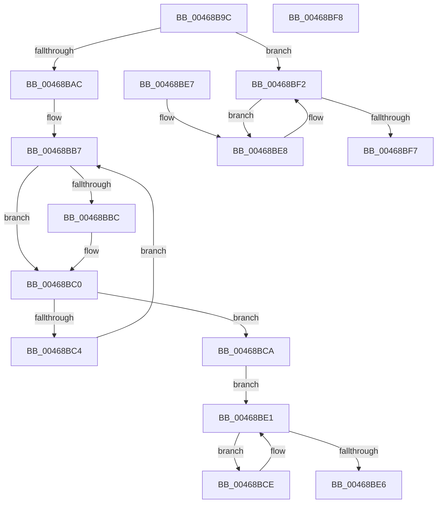

# RtlpHpLfhHeatMapDecayCounts

- RVA: `0x00468B9C`–`0x00468BF9` (길이 `93` bytes)
- VA: `0x0000000140468B9C`
- 실행 섹션: `.text`
- PDB 이름 있음: `예`; PDB Function 태그: `아니요`
- unwind 정보 RVA: `0x000DB714`
- 디코드: `32`개 명령, `93/93` bytes 표시
- 미해석 바이트: `0` (있으면 어셈블리에 `.byte`로 보존)

> 이 문서는 커널 이미지의 기계어와 PDB 기호를 분석해 생성했습니다. 4번과 5번은 함수 원형과 자료형을 바이너리 사용 방식에서 추정한 C 해석이며 원본 소스 복구 결과는 아닙니다.

## 1. Dependencies

- 직접 호출 지점: **0**; 고유 호출 대상: **0**
- 직접 호출자로 확인된 함수: **2**
- RIP 상대 이미지 참조: **0**

### Outgoing calls
- 직접 디코드된 call 명령이 없습니다.

### Direct callers
- [RtlpHpLfhHeatMapQuery](../2E/RtlpHpLfhHeatMapQuery_function_002E7790.md) at `0x002E77E6`
- [RtlpHpLfhSlotAllocateSlow](../2E/RtlpHpLfhSlotAllocateSlow_function_002E8FBC.md) at `0x002E974C`

### Static image references
- 디코드된 RIP-relative 메모리 참조가 없습니다.

## 2. Other-region calls and transfers

- 다른 실행 섹션으로 향하는 call: **0**
- 별도 외부 분기/꼬리 이동을 확인하지 못했습니다.

## 3. Assembly (complete function range)

```asm
00468B9C  8B 4C 24 28                     mov ecx, dword ptr [rsp + 0x28]
00468BA0  4D 8D 88 FC 00 00 00            lea r9, [r8 + 0xfc]
00468BA7  83 F9 1E                        cmp ecx, 0x1e
00468BAA  77 46                           ja 0x140468bf2
00468BAC  B8 03 00 00 00                  mov eax, 3
00468BB1  8A D1                           mov dl, cl
00468BB3  44 8D 50 FE                     lea r10d, [rax - 2]
00468BB7  F6 C2 01                        test dl, 1
00468BBA  74 04                           je 0x140468bc0
00468BBC  4C 0F AF D0                     imul r10, rax
00468BC0  D0 EA                           shr dl, 1
00468BC2  74 06                           je 0x140468bca
00468BC4  48 0F AF C0                     imul rax, rax
00468BC8  EB ED                           jmp 0x140468bb7
00468BCA  03 C9                           add ecx, ecx
00468BCC  EB 13                           jmp 0x140468be1
00468BCE  41 0F B7 10                     movzx edx, word ptr [r8]
00468BD2  49 0F AF D2                     imul rdx, r10
00468BD6  48 D3 EA                        shr rdx, cl
00468BD9  66 41 89 10                     mov word ptr [r8], dx
00468BDD  49 83 C0 02                     add r8, 2
00468BE1  4D 3B C1                        cmp r8, r9
00468BE4  72 E8                           jb 0x140468bce
00468BE6  C3                              ret
00468BE7  CC                              int3
00468BE8  33 C0                           xor eax, eax
00468BEA  66 41 89 00                     mov word ptr [r8], ax
00468BEE  49 83 C0 02                     add r8, 2
00468BF2  4D 3B C1                        cmp r8, r9
00468BF5  72 F1                           jb 0x140468be8
00468BF7  C3                              ret
00468BF8  CC                              int3
```

## 4. C-style interpretation (structured pseudocode)

```c
__int64 __fastcall RtlpHpLfhHeatMapDecayCounts(__int64 a1, __int64 a2, __int64 a3, __int64 a4, unsigned int a5)
{
    __int64 result;
    __int64 v_r10;

    if (((unsigned int)((unsigned int)(a5))) > 30) goto loc_00468BF2;
loc_00468BB7:
    v_r10 = 3 - 2;
    if ((((unsigned __int8)((unsigned __int8)((unsigned int)(a5)))) & (1)) != 0) {
        v_r10 = (3 - 2) * (3);
    }
    a2 = (unsigned __int8)(((unsigned __int8)((unsigned int)(a5))) >> (1));
    if (condition_is_equal) goto loc_00468BCA;
    result = (3) * (3);
    goto loc_00468BB7;
loc_00468BCA:
    a1 = (unsigned int)(((unsigned int)(a5)) + ((unsigned int)((unsigned int)(a5))));
    goto loc_00468BE1;
loc_00468BCE:
    a2 = (*(unsigned __int16 *)(a3)) * (v_r10);
    a2 = (a2) >> ((unsigned __int8)(a1));
    *(unsigned __int16 *)(a3) = (unsigned __int16)(a2);
    a3 = (a3) + (2);
loc_00468BE1:
    if (a3 < (a3 + 252)) goto loc_00468BCE;
    return result;
loc_00468BE8:
    result = 0;
    *(unsigned __int16 *)(a3) = 0;
    a3 = (a3) + (2);
loc_00468BF2:
    if (a3 < (a3 + 252)) goto loc_00468BE8;
    return result;
}
```

## 5. (Beta) C Style

```c
int64_t RtlpHpLfhHeatMapDecayCounts(int64_t Arg1, int64_t Arg2, void *Arg3, int64_t Arg4, uint32_t Arg5)
{
    uint8_t *arg3 = (uint8_t *)Arg3;

    int64_t result;
    int64_t local_r10;

    if (((uint32_t)((uint32_t)(Arg5))) > 30) goto loc_00468BF2;
loc_00468BB7:
    local_r10 = 3 - 2;
    if ((((uint8_t)((uint8_t)((uint32_t)(Arg5)))) & (1)) != 0) {
        local_r10 = (3 - 2) * (3);
    }
    Arg2 = (uint8_t)(((uint8_t)((uint32_t)(Arg5))) >> (1));
    if (condition_is_equal) goto loc_00468BCA;
    result = (3) * (3);
    goto loc_00468BB7;
loc_00468BCA:
    Arg1 = (uint32_t)(((uint32_t)(Arg5)) + ((uint32_t)((uint32_t)(Arg5))));
    goto loc_00468BE1;
loc_00468BCE:
    Arg2 = (*(uint16_t *)(arg3)) * (local_r10);
    Arg2 = (Arg2) >> ((uint8_t)(Arg1));
    *(uint16_t *)(arg3) = (uint16_t)(Arg2);
    Arg3 = (Arg3) + (2);
loc_00468BE1:
    if (Arg3 < (Arg3 + 252)) goto loc_00468BCE;
    return result;
loc_00468BE8:
    result = 0;
    *(uint16_t *)(arg3) = 0;
    Arg3 = (Arg3) + (2);
loc_00468BF2:
    if (Arg3 < (Arg3 + 252)) goto loc_00468BE8;
    return result;
}
```

### 관측된 메모리 오프셋

구조체 형식이 확인되지 않은 접근은 인자 기준의 오프셋으로만 기록했습니다.

| 기준 인자 | 오프셋 표현 | 폭 (bit) | 접근 |
|---|---:|---:|---|
| `Arg3` | `+ 0xFC` | `64` | `R` |

## 6. Execution-region graph

[열기: 2D/3D 그래프와 함수 탐색 컨트롤 패널](../../../control-panel.html?section=text&rva=0x00468B9C&view=graph)

- 2D 그래프는 위에서 아래로 흐르고, 3D 그래프는 빈 공간을 드래그해 회전합니다. Shift+드래그는 이동, 휠은 확대·축소, 함수 노드 선택은 대상 보고서 이동입니다.

### Static fallback


