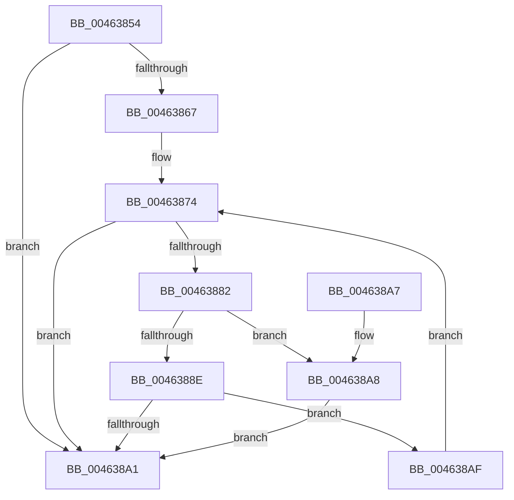

# RtlpHpLfhHeatMapUpdate

- RVA: `0x00463854`–`0x004638B4` (길이 `96` bytes)
- VA: `0x0000000140463854`
- 실행 섹션: `.text`
- PDB 이름 있음: `예`; PDB Function 태그: `아니요`
- unwind 정보 RVA: `0x000A78D8`
- 디코드: `29`개 명령, `96/96` bytes 표시
- 미해석 바이트: `0` (있으면 어셈블리에 `.byte`로 보존)

> 이 문서는 커널 이미지의 기계어와 PDB 기호를 분석해 생성했습니다. 4번과 5번은 함수 원형과 자료형을 바이너리 사용 방식에서 추정한 C 해석이며 원본 소스 복구 결과는 아닙니다.

## 1. Dependencies

- 직접 호출 지점: **0**; 고유 호출 대상: **0**
- 직접 호출자로 확인된 함수: **1**
- RIP 상대 이미지 참조: **0**

### Outgoing calls
- 직접 디코드된 call 명령이 없습니다.

### Direct callers
- [RtlpHpLfhSlotAllocateSlow](../2E/RtlpHpLfhSlotAllocateSlow_function_002E8FBC.md) at `0x002E9807`

### Static image references
- 디코드된 RIP-relative 메모리 참조가 없습니다.

## 2. Other-region calls and transfers

- 다른 실행 섹션으로 향하는 call: **0**
- 별도 외부 분기/꼬리 이동을 확인하지 못했습니다.

## 3. Assembly (complete function range)

```asm
00463854  48 89 5C 24 08                  mov qword ptr [rsp + 8], rbx
00463859  41 0F B6 00                     movzx eax, byte ptr [r8]
0046385D  4C 8B D9                        mov r11, rcx
00463860  D1 E8                           shr eax, 1
00463862  83 F8 7E                        cmp eax, 0x7e
00463865  73 3A                           jae 0x1404638a1
00463867  44 0F B7 04 42                  movzx r8d, word ptr [rdx + rax*2]
0046386C  BB FF FF 00 00                  mov ebx, 0xffff
00463871  44 8B D0                        mov r10d, eax
00463874  43 8D 0C 08                     lea ecx, [r8 + r9]
00463878  3B CB                           cmp ecx, ebx
0046387A  0F 43 CB                        cmovae ecx, ebx
0046387D  41 3B C8                        cmp ecx, r8d
00463880  74 1F                           je 0x1404638a1
00463882  49 8D 83 C0 00 00 00            lea rax, [r11 + 0xc0]
00463889  48 3B D0                        cmp rdx, rax
0046388C  75 1A                           jne 0x1404638a8
0046388E  41 0F B7 C0                     movzx eax, r8w
00463892  66 F0 42 0F B1 0C 52            lock cmpxchg word ptr [rdx + r10*2], cx
00463899  0F B7 C8                        movzx ecx, ax
0046389C  41 3B C8                        cmp ecx, r8d
0046389F  75 0E                           jne 0x1404638af
004638A1  48 8B 5C 24 08                  mov rbx, qword ptr [rsp + 8]
004638A6  C3                              ret
004638A7  CC                              int3
004638A8  66 42 89 0C 52                  mov word ptr [rdx + r10*2], cx
004638AD  EB F2                           jmp 0x1404638a1
004638AF  44 8B C1                        mov r8d, ecx
004638B2  EB C0                           jmp 0x140463874
```

## 4. C-style interpretation (structured pseudocode)

```c
__int64 __fastcall RtlpHpLfhHeatMapUpdate(__int64 a1, __int64 a2, __int64 a3, __int64 a4)
{
    __int64 result;
    unsigned __int64 v_stack_p8;

    v_stack_p8 = v_rbx;
    result = (unsigned int)((*(unsigned __int8 *)(a3)) >> (1));
    if (((unsigned int)(result)) >= 126) goto loc_004638A1;
loc_00463874:
    a1 = *(unsigned __int16 *)(a2 + result * 2) + a4 * 1;
    if (((unsigned int)(*(unsigned __int16 *)(a2 + result * 2) + a4 * 1)) >= ((unsigned int)((unsigned int)(0xFFFFULL)))) { a1 = (unsigned int)((unsigned int)(0xFFFFULL)); }
    if (((unsigned int)(a1)) == ((unsigned int)(*(unsigned __int16 *)(a2 + result * 2)))) goto loc_004638A1;
    if (a2 != (a1 + 192)) goto loc_004638A8;
    if (((unsigned int)((unsigned __int16)((unsigned __int16)(*(unsigned __int16 *)(a2 + result * 2))))) != ((unsigned int)(*(unsigned __int16 *)(a2 + result * 2)))) goto loc_004638AF;
loc_004638A1:
    return (unsigned __int16)(*(unsigned __int16 *)(a2 + result * 2));
loc_004638A8:
    *(unsigned __int16 *)(a2 + (unsigned int)((unsigned int)(result)) * 2) = (unsigned __int16)((unsigned __int16)((unsigned __int16)(*(unsigned __int16 *)(a2 + result * 2))));
    goto loc_004638A1;
loc_004638AF:
    goto loc_00463874;
}
```

## 5. (Beta) C Style

```c
int64_t RtlpHpLfhHeatMapUpdate(void *Arg1, void *Arg2, void *Arg3, int64_t Arg4)
{
    uint8_t *arg1 = (uint8_t *)Arg1;
    uint8_t *arg2 = (uint8_t *)Arg2;
    uint8_t *arg3 = (uint8_t *)Arg3;

    int64_t result;
    uint64_t v_stack_p8;

    v_stack_p8 = local_rbx;
    result = (uint32_t)((*(uint8_t *)(arg3)) >> (1));
    if (((uint32_t)(result)) >= 126) goto loc_004638A1;
loc_00463874:
    Arg1 = *(uint16_t *)(arg2 + result * 2) + Arg4 * 1;
    if (((uint32_t)(*(uint16_t *)(arg2 + result * 2) + Arg4 * 1)) >= ((uint32_t)((uint32_t)(0xFFFFULL)))) { Arg1 = (uint32_t)((uint32_t)(0xFFFFULL)); }
    if (((uint32_t)(Arg1)) == ((uint32_t)(*(uint16_t *)(arg2 + result * 2)))) goto loc_004638A1;
    if (Arg2 != (Arg1 + 192)) goto loc_004638A8;
    if (((uint32_t)((uint16_t)((uint16_t)(*(uint16_t *)(arg2 + result * 2))))) != ((uint32_t)(*(uint16_t *)(arg2 + result * 2)))) goto loc_004638AF;
loc_004638A1:
    return (uint16_t)(*(uint16_t *)(arg2 + result * 2));
loc_004638A8:
    *(uint16_t *)(arg2 + (uint32_t)((uint32_t)(result)) * 2) = (uint16_t)((uint16_t)((uint16_t)(*(uint16_t *)(arg2 + result * 2))));
    goto loc_004638A1;
loc_004638AF:
    goto loc_00463874;
}
```

### 관측된 메모리 오프셋

구조체 형식이 확인되지 않은 접근은 인자 기준의 오프셋으로만 기록했습니다.

| 기준 인자 | 오프셋 표현 | 폭 (bit) | 접근 |
|---|---:|---:|---|
| `Arg1` | `+ 0xC0` | `64` | `R` |
| `Arg2` | `+ 0x0 + rax*2` | `16` | `R` |
| `Arg3` | `+ 0x0` | `8` | `R` |

## 6. Execution-region graph

[열기: 2D/3D 그래프와 함수 탐색 컨트롤 패널](../../../control-panel.html?section=text&rva=0x00463854&view=graph)

- 2D 그래프는 위에서 아래로 흐르고, 3D 그래프는 빈 공간을 드래그해 회전합니다. Shift+드래그는 이동, 휠은 확대·축소, 함수 노드 선택은 대상 보고서 이동입니다.

### Static fallback


