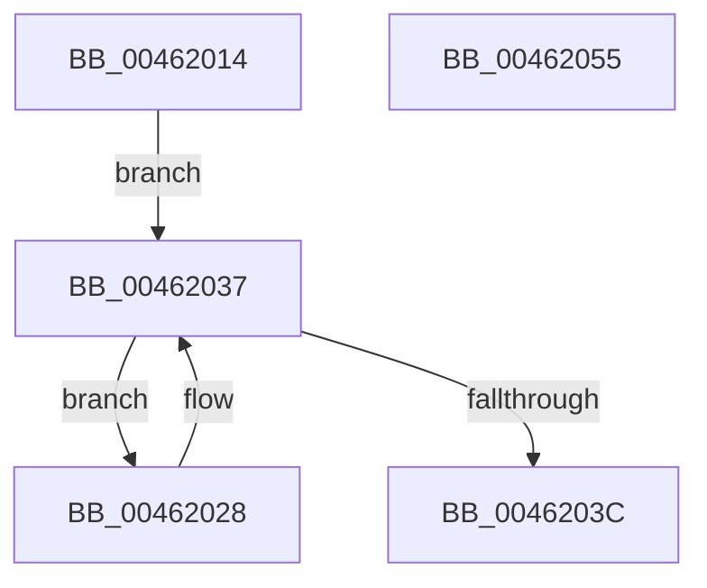

# RtlpHpLfhSubsegmentCountAllocatedBlocks

- RVA: `0x00462014`–`0x00462056` (길이 `66` bytes)
- VA: `0x0000000140462014`
- 실행 섹션: `.text`
- PDB 이름 있음: `예`; PDB Function 태그: `아니요`
- unwind 정보 RVA: `0x000DB714`
- 디코드: `22`개 명령, `66/66` bytes 표시
- 미해석 바이트: `0` (있으면 어셈블리에 `.byte`로 보존)

> 이 문서는 커널 이미지의 기계어와 PDB 기호를 분석해 생성했습니다. 4번과 5번은 함수 원형과 자료형을 바이너리 사용 방식에서 추정한 C 해석이며 원본 소스 복구 결과는 아닙니다.

## 1. Dependencies

- 직접 호출 지점: **0**; 고유 호출 대상: **0**
- 직접 호출자로 확인된 함수: **1**
- RIP 상대 이미지 참조: **0**

### Outgoing calls
- 직접 디코드된 call 명령이 없습니다.

### Direct callers
- [RtlpHpLfhSubsegmentReformatCheck](RtlpHpLfhSubsegmentReformatCheck_function_00461EA4.md) at `0x00461EEE`

### Static image references
- 디코드된 RIP-relative 메모리 참조가 없습니다.

## 2. Other-region calls and transfers

- 다른 실행 섹션으로 향하는 call: **0**
- 별도 외부 분기/꼬리 이동을 확인하지 못했습니다.

## 3. Assembly (complete function range)

```asm
00462014  0F B6 41 18                     movzx eax, byte ptr [rcx + 0x18]
00462018  4C 8D 41 40                     lea r8, [rcx + 0x40]
0046201C  83 C0 F8                        add eax, -8
0046201F  45 33 C9                        xor r9d, r9d
00462022  4D 8D 14 C0                     lea r10, [r8 + rax*8]
00462026  EB 0F                           jmp 0x140462037
00462028  49 8B 00                        mov rax, qword ptr [r8]
0046202B  F3 48 0F B8 D0                  popcnt rdx, rax
00462030  44 03 CA                        add r9d, edx
00462033  49 83 C0 08                     add r8, 8
00462037  4D 3B C2                        cmp r8, r10
0046203A  72 EC                           jb 0x140462028
0046203C  0F B6 51 25                     movzx edx, byte ptr [rcx + 0x25]
00462040  0F B7 49 22                     movzx ecx, word ptr [rcx + 0x22]
00462044  03 CA                           add ecx, edx
00462046  F7 D9                           neg ecx
00462048  83 E1 3F                        and ecx, 0x3f
0046204B  44 2B C9                        sub r9d, ecx
0046204E  44 2B CA                        sub r9d, edx
00462051  41 8B C1                        mov eax, r9d
00462054  C3                              ret
00462055  CC                              int3
```

## 4. C-style interpretation (structured pseudocode)

```c
__int64 __fastcall RtlpHpLfhSubsegmentCountAllocatedBlocks(__int64 a1, __int64 a2, __int64 a3, int a4)
{
    __int64 result;

    result = (unsigned int)((*(unsigned __int8 *)(a1 + 24)) + (-8));
    a4 = 0;
    goto loc_00462037;
loc_00462028:
    a4 = (unsigned int)((a4) + ((unsigned int)(a2)));
    a3 = (a1 + 64) + (8);
loc_00462037:
    if (a3 < (a1 + 64 + result * 8)) goto loc_00462028;
    a1 = (unsigned int)((*(unsigned __int16 *)(a1 + 34)) + ((unsigned int)(*(unsigned __int8 *)(a1 + 37))));
    a1 = (unsigned int)(-(a1));
    a1 = (unsigned int)((a1) & (63));
    a4 = (unsigned int)((a4) - ((unsigned int)(a1)));
    a4 = (unsigned int)((a4) - ((unsigned int)(*(unsigned __int8 *)(a1 + 37))));
    return (unsigned int)(a4);
}
```

## 5. (Beta) C Style

```c
int64_t RtlpHpLfhSubsegmentCountAllocatedBlocks(void *Arg1, int64_t Arg2, int64_t Arg3, int32_t Arg4)
{
    uint8_t *arg1 = (uint8_t *)Arg1;

    int64_t result;

    result = (uint32_t)((*(uint8_t *)(arg1 + 0x18)) + (-8));
    Arg4 = 0;
    goto loc_00462037;
loc_00462028:
    Arg4 = (uint32_t)((Arg4) + ((uint32_t)(Arg2)));
    Arg3 = (Arg1 + 64) + (8);
loc_00462037:
    if (Arg3 < (Arg1 + 64 + result * 8)) goto loc_00462028;
    Arg1 = (uint32_t)((*(uint16_t *)(arg1 + 0x22)) + ((uint32_t)(*(uint8_t *)(arg1 + 0x25))));
    Arg1 = (uint32_t)(-(Arg1));
    Arg1 = (uint32_t)((Arg1) & (63));
    Arg4 = (uint32_t)((Arg4) - ((uint32_t)(Arg1)));
    Arg4 = (uint32_t)((Arg4) - ((uint32_t)(*(uint8_t *)(arg1 + 0x25))));
    return (uint32_t)(Arg4);
}
```

### 관측된 메모리 오프셋

구조체 형식이 확인되지 않은 접근은 인자 기준의 오프셋으로만 기록했습니다.

| 기준 인자 | 오프셋 표현 | 폭 (bit) | 접근 |
|---|---:|---:|---|
| `Arg1` | `+ 0x0 + rax*8` | `64` | `R` |
| `Arg1` | `+ 0x18` | `8` | `R` |
| `Arg1` | `+ 0x22` | `16` | `R` |
| `Arg1` | `+ 0x25` | `8` | `R` |
| `Arg1` | `+ 0x40` | `64` | `R` |

## 6. Execution-region graph

[열기: 2D/3D 그래프와 함수 탐색 컨트롤 패널](../../../control-panel.html?section=text&rva=0x00462014&view=graph)

- 2D 그래프는 위에서 아래로 흐르고, 3D 그래프는 빈 공간을 드래그해 회전합니다. Shift+드래그는 이동, 휠은 확대·축소, 함수 노드 선택은 대상 보고서 이동입니다.

### Static fallback


