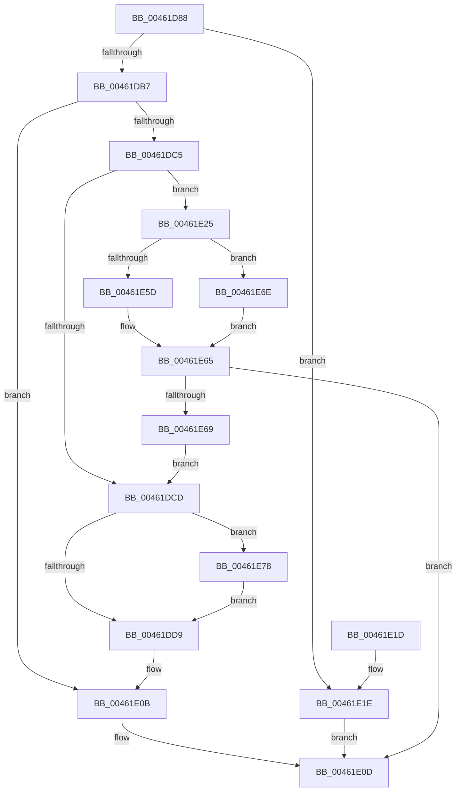

# RtlpHpLfhSubsegmentReformatAsSingle

- RVA: `0x00461D88`–`0x00461E9D` (길이 `277` bytes)
- VA: `0x0000000140461D88`
- 실행 섹션: `.text`
- PDB 이름 있음: `예`; PDB Function 태그: `아니요`
- unwind 정보 RVA: `0x000A9FC0`
- 디코드: `83`개 명령, `277/277` bytes 표시
- 미해석 바이트: `0` (있으면 어셈블리에 `.byte`로 보존)

> 이 문서는 커널 이미지의 기계어와 PDB 기호를 분석해 생성했습니다. 4번과 5번은 함수 원형과 자료형을 바이너리 사용 방식에서 추정한 C 해석이며 원본 소스 복구 결과는 아닙니다.

## 1. Dependencies

- 직접 호출 지점: **4**; 고유 호출 대상: **4**
- 직접 호출자로 확인된 함수: **1**
- RIP 상대 이미지 참조: **2**

### Outgoing calls
- `0x00461DAE` → [RtlpHpLfhSubsegmentReformatCheck](RtlpHpLfhSubsegmentReformatCheck_function_00461EA4.md) (function, `0x00461EA4`)
- `0x00461E60` → [RtlpHpSegLfhVsCommit](../32/RtlpHpSegLfhVsCommit_function_00325750.md) (function, `0x00325750`)
- `0x00461E71` → [guard_dispatch_icall](../6B/guard_dispatch_icall_function_006BAAD0.md) (function, `0x006BAAD0`)
- `0x00461E93` → [RtlpHpLfhContextUpdateFreeCommitCount](../49/RtlpHpLfhContextUpdateFreeCommitCount_function_00497E98.md) (function, `0x00497E98`)

### Direct callers
- [RtlpHpLfhBucketGetSubsegment](../2E/RtlpHpLfhBucketGetSubsegment_function_002E8474.md) at `0x002E8510`

### Static image references
- `0x00461E29` → RVA `0x00325750` (`RtlpHpSegLfhVsCommit`; read)
- `0x00461E44` → RVA `0x00E28300` (`.data`; read)

## 2. Other-region calls and transfers

- 다른 실행 섹션으로 향하는 call: **0**
- 별도 외부 분기/꼬리 이동을 확인하지 못했습니다.

## 3. Assembly (complete function range)

```asm
00461D88  48 8B C4                        mov rax, rsp
00461D8B  48 89 58 08                     mov qword ptr [rax + 8], rbx
00461D8F  48 89 68 10                     mov qword ptr [rax + 0x10], rbp
00461D93  57                              push rdi
00461D94  48 83 EC 30                     sub rsp, 0x30
00461D98  83 60 18 00                     and dword ptr [rax + 0x18], 0
00461D9C  4C 8D 48 20                     lea r9, [rax + 0x20]
00461DA0  83 60 20 00                     and dword ptr [rax + 0x20], 0
00461DA4  4C 8D 40 18                     lea r8, [rax + 0x18]
00461DA8  48 8B DA                        mov rbx, rdx
00461DAB  48 8B F9                        mov rdi, rcx
00461DAE  E8 F1 00 00 00                  call 0x140461ea4
00461DB3  85 C0                           test eax, eax
00461DB5  74 67                           je 0x140461e1e
00461DB7  0F B6 53 27                     movzx edx, byte ptr [rbx + 0x27]
00461DBB  BD 01 00 00 00                  mov ebp, 1
00461DC0  40 3A D5                        cmp dl, bpl
00461DC3  74 46                           je 0x140461e0b
00461DC5  8B 44 24 50                     mov eax, dword ptr [rsp + 0x50]
00461DC9  85 C0                           test eax, eax
00461DCB  75 58                           jne 0x140461e25
00461DCD  8B 44 24 58                     mov eax, dword ptr [rsp + 0x58]
00461DD1  85 C0                           test eax, eax
00461DD3  0F 85 9F 00 00 00               jne 0x140461e78
00461DD9  0F B7 4B 26                     movzx ecx, word ptr [rbx + 0x26]
00461DDD  8B C1                           mov eax, ecx
00461DDF  C1 E8 08                        shr eax, 8
00461DE2  C1 E0 0C                        shl eax, 0xc
00461DE5  D3 E0                           shl eax, cl
00461DE7  C1 E8 0C                        shr eax, 0xc
00461DEA  0F BC C0                        bsf eax, eax
00461DED  89 44 24 50                     mov dword ptr [rsp + 0x50], eax
00461DF1  88 44 24 50                     mov byte ptr [rsp + 0x50], al
00461DF5  40 88 6C 24 51                  mov byte ptr [rsp + 0x51], bpl
00461DFA  0F B7 44 24 50                  movzx eax, word ptr [rsp + 0x50]
00461DFF  66 89 43 26                     mov word ptr [rbx + 0x26], ax
00461E03  0F B6 43 18                     movzx eax, byte ptr [rbx + 0x18]
00461E07  66 89 2C C3                     mov word ptr [rbx + rax*8], bp
00461E0B  33 C0                           xor eax, eax
00461E0D  48 8B 5C 24 40                  mov rbx, qword ptr [rsp + 0x40]
00461E12  48 8B 6C 24 48                  mov rbp, qword ptr [rsp + 0x48]
00461E17  48 83 C4 30                     add rsp, 0x30
00461E1B  5F                              pop rdi
00461E1C  C3                              ret
00461E1D  CC                              int3
00461E1E  B8 76 04 00 C0                  mov eax, 0xc0000476
00461E23  EB E8                           jmp 0x140461e0d
00461E25  0F B6 4B 26                     movzx ecx, byte ptr [rbx + 0x26]
00461E29  4C 8D 0D 20 39 EC FF            lea r9, [rip - 0x13c6e0]
00461E30  44 8B C2                        mov r8d, edx
00461E33  44 2B C0                        sub r8d, eax
00461E36  C1 E0 0C                        shl eax, 0xc
00461E39  D3 E0                           shl eax, cl
00461E3B  8B D0                           mov edx, eax
00461E3D  48 8B 47 18                     mov rax, qword ptr [rdi + 0x18]
00461E41  48 03 D3                        add rdx, rbx
00461E44  48 33 05 B5 64 9C 00            xor rax, qword ptr [rip + 0x9c64b5]
00461E4B  41 C1 E0 0C                     shl r8d, 0xc
00461E4F  48 33 C7                        xor rax, rdi
00461E52  41 D3 E0                        shl r8d, cl
00461E55  48 8B 0F                        mov rcx, qword ptr [rdi]
00461E58  49 3B C1                        cmp rax, r9
00461E5B  75 11                           jne 0x140461e6e
00461E5D  45 33 C9                        xor r9d, r9d
00461E60  E8 EB 38 EC FF                  call 0x140325750
00461E65  85 C0                           test eax, eax
00461E67  78 A4                           js 0x140461e0d
00461E69  E9 5F FF FF FF                  jmp 0x140461dcd
00461E6E  45 33 C9                        xor r9d, r9d
00461E71  E8 5A 8C 25 00                  call 0x1406baad0
00461E76  EB ED                           jmp 0x140461e65
00461E78  8A 4B 26                        mov cl, byte ptr [rbx + 0x26]
00461E7B  F7 D8                           neg eax
00461E7D  C1 E0 0C                        shl eax, 0xc
00461E80  D3 E0                           shl eax, cl
00461E82  B9 00 10 00 00                  mov ecx, 0x1000
00461E87  99                              cdq
00461E88  F7 F9                           idiv ecx
00461E8A  48 8B D3                        mov rdx, rbx
00461E8D  48 8B CF                        mov rcx, rdi
00461E90  4C 63 C0                        movsxd r8, eax
00461E93  E8 00 60 03 00                  call 0x140497e98
00461E98  E9 3C FF FF FF                  jmp 0x140461dd9
```

## 4. C-style interpretation (structured pseudocode)

```c
__int64 __fastcall RtlpHpLfhSubsegmentReformatAsSingle(__int64 a1, __int64 a2)
{
    __int64 result;
    __int64 v_rsp;
    unsigned __int64 v_stack_p10;
    unsigned int v_stack_p18;
    unsigned __int8 v_stack_p19;
    unsigned int v_stack_p20;
    unsigned __int64 v_stack_p8;

    *(unsigned __int64 *)(v_rsp + 8) = v_rbx;
    *(unsigned __int64 *)(v_rsp + 16) = v_rbp;
    v_rsp = (v_rsp) - (48);
    result = RtlpHpLfhSubsegmentReformatCheck(a1, a2, v_rsp + 24, v_rsp + 32);
    if ((unsigned int)(result) == 0) goto loc_00461E1E;
    if (((unsigned __int8)(*(unsigned __int8 *)(a2 + 39))) == 1) goto loc_00461E0B;
    if ((unsigned int)((unsigned int)(v_stack_p18)) != 0) goto loc_00461E25;
loc_00461DCD:
    if ((unsigned int)((unsigned int)(v_stack_p20)) != 0) goto loc_00461E78;
loc_00461DD9:
    result = (unsigned int)(((unsigned int)((unsigned int)(*(unsigned __int16 *)(a2 + 38)))) >> (8));
    result = (unsigned int)((result) << (12));
    result = (unsigned int)((result) << ((unsigned __int8)(*(unsigned __int16 *)(a2 + 38))));
    result = (unsigned int)((result) >> (12));
    v_stack_p18 = (unsigned int)(result);
    v_stack_p18 = (unsigned __int8)(result);
    v_stack_p19 = 1;
    *(unsigned __int16 *)(a2 + 38) = (unsigned __int16)(v_stack_p18);
    *(unsigned __int16 *)(a2 + *(unsigned __int8 *)(a2 + 24) * 8) = 1;
loc_00461E0B:
    result = 0;
loc_00461E0D:
    v_rsp = (v_rsp) + (48);
    return result;
loc_00461E1E:
    goto loc_00461E0D;
loc_00461E25:
    a3 = (unsigned int)(((unsigned int)((unsigned int)(*(unsigned __int8 *)(a2 + 39)))) - ((unsigned int)((unsigned int)(0xC0000476ULL))));
    result = (unsigned int)(((unsigned int)(0xC0000476ULL)) << (12));
    result = (unsigned int)((result) << ((unsigned __int8)(*(unsigned __int8 *)(v_stack_p8 + 38))));
    a2 = ((unsigned int)((unsigned int)(result))) + (v_stack_p8);
    result = (*(unsigned __int64 *)(a1 + 24)) ^ (*(unsigned __int64 *)(v_rip + 10249397));
    a3 = (unsigned int)((a3) << (12));
    result = (result) ^ (a1);
    a3 = (unsigned int)((a3) << ((unsigned __int8)(*(unsigned __int8 *)(v_stack_p8 + 38))));
    if (result != (v_rip - 1296096)) goto loc_00461E6E;
    a4 = 0;
    result = RtlpHpSegLfhVsCommit(*(unsigned __int64 *)(a1), a2, a3, a4);
loc_00461E65:
    if (sign_flag) goto loc_00461E0D;
    goto loc_00461DCD;
loc_00461E6E:
    a4 = 0;
    result = guard_dispatch_icall(*(unsigned __int64 *)(a1), a2, a3, a4);
    goto loc_00461E65;
loc_00461E78:
    result = (unsigned int)(-(result));
    result = (unsigned int)((result) << (12));
    result = (unsigned int)((result) << ((unsigned __int8)(*(unsigned __int8 *)(v_stack_p8 + 38))));
    result = RtlpHpLfhContextUpdateFreeCommitCount(a1, v_stack_p8, (int)((unsigned int)(result)), a4);
    goto loc_00461DD9;
}
```

## 5. (Beta) C Style

```c
int64_t RtlpHpLfhSubsegmentReformatAsSingle(void *Arg1, void *Arg2)
{
    uint8_t *arg1 = (uint8_t *)Arg1;
    uint8_t *arg2 = (uint8_t *)Arg2;

    int64_t result;
    int64_t local_rsp;
    uint64_t v_stack_p10;
    uint32_t v_stack_p18;
    uint8_t v_stack_p19;
    uint32_t v_stack_p20;
    uint64_t v_stack_p8;

    *(uint64_t *)(local_rsp + 0x8) = local_rbx;
    *(uint64_t *)(local_rsp + 0x10) = local_rbp;
    local_rsp = (local_rsp) - (48);
    result = RtlpHpLfhSubsegmentReformatCheck(Arg1, Arg2, local_rsp + 24, local_rsp + 32);
    if ((uint32_t)(result) == 0) goto loc_00461E1E;
    if (((uint8_t)(*(uint8_t *)(arg2 + 0x27))) == 1) goto loc_00461E0B;
    if ((uint32_t)((uint32_t)(v_stack_p18)) != 0) goto loc_00461E25;
loc_00461DCD:
    if ((uint32_t)((uint32_t)(v_stack_p20)) != 0) goto loc_00461E78;
loc_00461DD9:
    result = (uint32_t)(((uint32_t)((uint32_t)(*(uint16_t *)(arg2 + 0x26)))) >> (8));
    result = (uint32_t)((result) << (12));
    result = (uint32_t)((result) << ((uint8_t)(*(uint16_t *)(arg2 + 0x26))));
    result = (uint32_t)((result) >> (12));
    v_stack_p18 = (uint32_t)(result);
    v_stack_p18 = (uint8_t)(result);
    v_stack_p19 = 1;
    *(uint16_t *)(arg2 + 0x26) = (uint16_t)(v_stack_p18);
    *(uint16_t *)(arg2 + *(uint8_t *)(arg2 + 0x18) * 8) = 1;
loc_00461E0B:
    result = 0;
loc_00461E0D:
    local_rsp = (local_rsp) + (48);
    return result;
loc_00461E1E:
    goto loc_00461E0D;
loc_00461E25:
    a3 = (uint32_t)(((uint32_t)((uint32_t)(*(uint8_t *)(arg2 + 0x27)))) - ((uint32_t)((uint32_t)(0xC0000476ULL))));
    result = (uint32_t)(((uint32_t)(0xC0000476ULL)) << (12));
    result = (uint32_t)((result) << ((uint8_t)(*(uint8_t *)(v_stack_p8 + 0x26))));
    Arg2 = ((uint32_t)((uint32_t)(result))) + (v_stack_p8);
    result = (*(uint64_t *)(arg1 + 0x18)) ^ (*(uint64_t *)(v_rip + 0x9C64B5));
    a3 = (uint32_t)((a3) << (12));
    result = (result) ^ (Arg1);
    a3 = (uint32_t)((a3) << ((uint8_t)(*(uint8_t *)(v_stack_p8 + 0x26))));
    if (result != (v_rip - 1296096)) goto loc_00461E6E;
    a4 = 0;
    result = RtlpHpSegLfhVsCommit(*(uint64_t *)(arg1), Arg2, a3, a4);
loc_00461E65:
    if (sign_flag) goto loc_00461E0D;
    goto loc_00461DCD;
loc_00461E6E:
    a4 = 0;
    result = guard_dispatch_icall(*(uint64_t *)(arg1), Arg2, a3, a4);
    goto loc_00461E65;
loc_00461E78:
    result = (uint32_t)(-(result));
    result = (uint32_t)((result) << (12));
    result = (uint32_t)((result) << ((uint8_t)(*(uint8_t *)(v_stack_p8 + 0x26))));
    result = RtlpHpLfhContextUpdateFreeCommitCount(Arg1, v_stack_p8, (int32_t)((uint32_t)(result)), a4);
    goto loc_00461DD9;
}
```

### 관측된 메모리 오프셋

구조체 형식이 확인되지 않은 접근은 인자 기준의 오프셋으로만 기록했습니다.

| 기준 인자 | 오프셋 표현 | 폭 (bit) | 접근 |
|---|---:|---:|---|
| `Arg1` | `+ 0x0` | `64` | `R` |
| `Arg1` | `+ 0x18` | `64` | `R` |
| `Arg2` | `+ 0x0 + rax*8` | `16` | `W` |
| `Arg2` | `+ 0x18` | `8` | `R` |
| `Arg2` | `+ 0x26` | `8` | `R` |
| `Arg2` | `+ 0x26` | `16` | `R` |
| `Arg2` | `+ 0x26` | `16` | `W` |
| `Arg2` | `+ 0x27` | `8` | `R` |

## 6. Execution-region graph

[열기: 2D/3D 그래프와 함수 탐색 컨트롤 패널](../../../control-panel.html?section=text&rva=0x00461D88&view=graph)

- 2D 그래프는 위에서 아래로 흐르고, 3D 그래프는 빈 공간을 드래그해 회전합니다. Shift+드래그는 이동, 휠은 확대·축소, 함수 노드 선택은 대상 보고서 이동입니다.

### Static fallback


