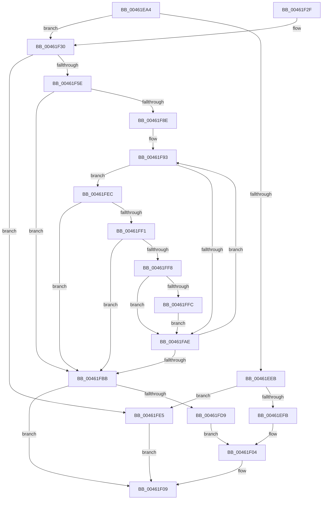

# RtlpHpLfhSubsegmentReformatCheck

- RVA: `0x00461EA4`–`0x0046200C` (길이 `360` bytes)
- VA: `0x0000000140461EA4`
- 실행 섹션: `.text`
- PDB 이름 있음: `예`; PDB Function 태그: `아니요`
- unwind 정보 RVA: `0x000A9FD4`
- 디코드: `107`개 명령, `360/360` bytes 표시
- 미해석 바이트: `0` (있으면 어셈블리에 `.byte`로 보존)

> 이 문서는 커널 이미지의 기계어와 PDB 기호를 분석해 생성했습니다. 4번과 5번은 함수 원형과 자료형을 바이너리 사용 방식에서 추정한 C 해석이며 원본 소스 복구 결과는 아닙니다.

## 1. Dependencies

- 직접 호출 지점: **6**; 고유 호출 대상: **6**
- 직접 호출자로 확인된 함수: **2**
- RIP 상대 이미지 참조: **1**

### Outgoing calls
- `0x00461EEE` → [RtlpHpLfhSubsegmentCountAllocatedBlocks](RtlpHpLfhSubsegmentCountAllocatedBlocks_function_00462014.md) (function, `0x00462014`)
- `0x00461F16` → [_security_check_cookie](../6A/_security_check_cookie_function_006AC640.md) (function, `0x006AC640`)
- `0x00461F3D` → [memset](../6C/memset_function_006C6C40.md) (function, `0x006C6C40`)
- `0x00461F51` → [RtlpHpLfhSubsegmentConstructCommitState](../2E/RtlpHpLfhSubsegmentConstructCommitState_function_002E7E9C.md) (function, `0x002E7E9C`)
- `0x00461F81` → [RtlpHpAcquireLockShared](RtlpHpAcquireLockShared_function_0046205C.md) (function, `0x0046205C`)
- `0x00461FCB` → [RtlpHpReleaseLockShared](../32/RtlpHpReleaseLockShared_function_003245B0.md) (function, `0x003245B0`)

### Direct callers
- [RtlpHpLfhSubsegmentReformatAsMulti](../2E/RtlpHpLfhSubsegmentReformatAsMulti_function_002E8814.md) at `0x002E8920`
- [RtlpHpLfhSubsegmentReformatAsSingle](RtlpHpLfhSubsegmentReformatAsSingle_function_00461D88.md) at `0x00461DAE`

### Static image references
- `0x00461EB8` → RVA `0x00E0A740` (`.data`; read)

## 2. Other-region calls and transfers

- 다른 실행 섹션으로 향하는 call: **0**
- 별도 외부 분기/꼬리 이동을 확인하지 못했습니다.

## 3. Assembly (complete function range)

```asm
00461EA4  40 53                           push rbx
00461EA6  55                              push rbp
00461EA7  56                              push rsi
00461EA8  57                              push rdi
00461EA9  41 54                           push r12
00461EAB  41 55                           push r13
00461EAD  41 56                           push r14
00461EAF  41 57                           push r15
00461EB1  48 81 EC C8 00 00 00            sub rsp, 0xc8
00461EB8  48 8B 05 81 88 9A 00            mov rax, qword ptr [rip + 0x9a8881]
00461EBF  48 33 C4                        xor rax, rsp
00461EC2  48 89 84 24 B0 00 00 00         mov qword ptr [rsp + 0xb0], rax
00461ECA  0F B7 5A 22                     movzx ebx, word ptr [rdx + 0x22]
00461ECE  4D 8B E1                        mov r12, r9
00461ED1  0F B7 42 20                     movzx eax, word ptr [rdx + 0x20]
00461ED5  4D 8B F8                        mov r15, r8
00461ED8  2B D8                           sub ebx, eax
00461EDA  48 89 4C 24 20                  mov qword ptr [rsp + 0x20], rcx
00461EDF  80 7A 27 01                     cmp byte ptr [rdx + 0x27], 1
00461EE3  48 8B FA                        mov rdi, rdx
00461EE6  48 8B F1                        mov rsi, rcx
00461EE9  75 45                           jne 0x140461f30
00461EEB  48 8B CA                        mov rcx, rdx
00461EEE  E8 21 01 00 00                  call 0x140462014
00461EF3  3B C3                           cmp eax, ebx
00461EF5  0F 82 EA 00 00 00               jb 0x140461fe5
00461EFB  33 DB                           xor ebx, ebx
00461EFD  41 89 1F                        mov dword ptr [r15], ebx
00461F00  41 89 1C 24                     mov dword ptr [r12], ebx
00461F04  BB 01 00 00 00                  mov ebx, 1
00461F09  8B C3                           mov eax, ebx
00461F0B  48 8B 8C 24 B0 00 00 00         mov rcx, qword ptr [rsp + 0xb0]
00461F13  48 33 CC                        xor rcx, rsp
00461F16  E8 25 A7 24 00                  call 0x1406ac640
00461F1B  48 81 C4 C8 00 00 00            add rsp, 0xc8
00461F22  41 5F                           pop r15
00461F24  41 5E                           pop r14
00461F26  41 5D                           pop r13
00461F28  41 5C                           pop r12
00461F2A  5F                              pop rdi
00461F2B  5E                              pop rsi
00461F2C  5D                              pop rbp
00461F2D  5B                              pop rbx
00461F2E  C3                              ret
00461F2F  CC                              int3
00461F30  33 D2                           xor edx, edx
00461F32  48 8D 4C 24 30                  lea rcx, [rsp + 0x30]
00461F37  41 B8 80 00 00 00               mov r8d, 0x80
00461F3D  E8 FE 4C 26 00                  call 0x1406c6c40
00461F42  4C 8D 47 40                     lea r8, [rdi + 0x40]
00461F46  48 8B D7                        mov rdx, rdi
00461F49  4C 8D 4C 24 30                  lea r9, [rsp + 0x30]
00461F4E  48 8B CE                        mov rcx, rsi
00461F51  E8 46 5F E8 FF                  call 0x1402e7e9c
00461F56  3B C3                           cmp eax, ebx
00461F58  0F 82 87 00 00 00               jb 0x140461fe5
00461F5E  0F B6 47 18                     movzx eax, byte ptr [rdi + 0x18]
00461F62  48 8D 4F 38                     lea rcx, [rdi + 0x38]
00461F66  33 DB                           xor ebx, ebx
00461F68  8B F3                           mov esi, ebx
00461F6A  8B EB                           mov ebp, ebx
00461F6C  4C 8D 34 C7                     lea r14, [rdi + rax*8]
00461F70  0F B6 47 27                     movzx eax, byte ptr [rdi + 0x27]
00461F74  4D 8D 2C 46                     lea r13, [r14 + rax*2]
00461F78  48 8B 44 24 20                  mov rax, qword ptr [rsp + 0x20]
00461F7D  0F B6 50 41                     movzx edx, byte ptr [rax + 0x41]
00461F81  E8 D6 00 00 00                  call 0x14046205c
00461F86  44 8A C8                        mov r9b, al
00461F89  4D 3B F5                        cmp r14, r13
00461F8C  73 2D                           jae 0x140461fbb
00461F8E  48 8D 54 24 30                  lea rdx, [rsp + 0x30]
00461F93  45 0F B7 06                     movzx r8d, word ptr [r14]
00461F97  8D 4D 01                        lea ecx, [rbp + 1]
00461F9A  66 45 85 C0                     test r8w, r8w
00461F9E  0F 45 CD                        cmovne ecx, ebp
00461FA1  8B E9                           mov ebp, ecx
00461FA3  8B C1                           mov eax, ecx
00461FA5  0F B7 0A                        movzx ecx, word ptr [rdx]
00461FA8  66 44 3B C1                     cmp r8w, cx
00461FAC  75 3E                           jne 0x140461fec
00461FAE  49 83 C6 02                     add r14, 2
00461FB2  48 83 C2 02                     add rdx, 2
00461FB6  4D 3B F5                        cmp r14, r13
00461FB9  72 D8                           jb 0x140461f93
00461FBB  48 8B 44 24 20                  mov rax, qword ptr [rsp + 0x20]
00461FC0  48 8D 4F 38                     lea rcx, [rdi + 0x38]
00461FC4  45 8A C1                        mov r8b, r9b
00461FC7  0F B6 50 41                     movzx edx, byte ptr [rax + 0x41]
00461FCB  E8 E0 25 EC FF                  call 0x1403245b0
00461FD0  4D 3B F5                        cmp r14, r13
00461FD3  0F 82 30 FF FF FF               jb 0x140461f09
00461FD9  41 89 37                        mov dword ptr [r15], esi
00461FDC  41 89 2C 24                     mov dword ptr [r12], ebp
00461FE0  E9 1F FF FF FF                  jmp 0x140461f04
00461FE5  33 DB                           xor ebx, ebx
00461FE7  E9 1D FF FF FF                  jmp 0x140461f09
00461FEC  66 85 C9                        test cx, cx
00461FEF  75 CA                           jne 0x140461fbb
00461FF1  66 41 83 F8 FF                  cmp r8w, -1
00461FF6  75 C3                           jne 0x140461fbb
00461FF8  85 F6                           test esi, esi
00461FFA  75 B2                           jne 0x140461fae
00461FFC  48 8D 4C 24 30                  lea rcx, [rsp + 0x30]
00462001  48 8B F2                        mov rsi, rdx
00462004  48 2B F1                        sub rsi, rcx
00462007  48 D1 FE                        sar rsi, 1
0046200A  EB A2                           jmp 0x140461fae
```

## 4. C-style interpretation (structured pseudocode)

```c
__int64 __fastcall RtlpHpLfhSubsegmentReformatCheck(__int64 a1, __int64 a2, __int64 a3, __int64 a4)
{
    __int64 result;
    __int64 v_r14;
    __int64 v_rbx;
    __int64 v_rsi;
    __int64 v_rsp;
    unsigned __int64 v_stack_m58;
    unsigned __int64 v_stack_mE8;
    unsigned __int64 v_stack_p20;
    unsigned __int64 v_stack_p30;

    v_rsp = (v_rsp) - (200);
    result = (*(unsigned __int64 *)(v_rip + 10127489)) ^ (v_rsp);
    v_stack_m58 = result;
    v_rbx = (unsigned int)((*(unsigned __int16 *)(a2 + 34)) - ((unsigned int)(*(unsigned __int16 *)(a2 + 32))));
    v_stack_mE8 = a1;
    if ((*(unsigned __int8 *)(a2 + 39)) != 1) goto loc_00461F30;
    result = RtlpHpLfhSubsegmentCountAllocatedBlocks(a2, a2, a3, a4);
    if (((unsigned int)(result)) < ((unsigned int)(v_rbx))) goto loc_00461FE5;
    v_rbx = 0;
    *(unsigned int *)(a3) = 0;
    *(unsigned int *)(a4) = 0;
loc_00461F04:
loc_00461F09:
    a1 = (v_stack_m58) ^ (v_rsp);
    result = _security_check_cookie(a1, a2, a3, a4);
    v_rsp = (v_rsp) + (200);
    return result;
loc_00461F30:
    a2 = 0;
    result = memset(v_stack_p30, a2, 128, a4);
    result = RtlpHpLfhSubsegmentConstructCommitState(a1, 0, a2 + 64, v_stack_p30);
    if (((unsigned int)(result)) < 1) goto loc_00461FE5;
    v_rbx = 0;
    result = RtlpHpAcquireLockShared(a2 + 56, *(unsigned __int8 *)(v_stack_p20 + 65), a2 + 64, v_stack_p30);
    if ((a2 + *(unsigned __int8 *)(a2 + 24) * 8) >= (a2 + *(unsigned __int8 *)(a2 + 24) * 8 + *(unsigned __int8 *)(a2 + 39) * 2)) goto loc_00461FBB;
loc_00461F93:
    a1 = 0 + 1;
    if ((unsigned __int16)(*(unsigned __int16 *)(a2 + *(unsigned __int8 *)(a2 + 24) * 8)) != 0) { a1 = 0; }
    if (((unsigned __int16)(*(unsigned __int16 *)(a2 + *(unsigned __int8 *)(a2 + 24) * 8))) != ((unsigned __int16)(*(unsigned __int16 *)(v_stack_p30)))) goto loc_00461FEC;
loc_00461FAE:
    v_r14 = (a2 + *(unsigned __int8 *)(a2 + 24) * 8) + (2);
    a2 = (v_stack_p30) + (2);
    if (v_r14 < (a2 + *(unsigned __int8 *)(a2 + 24) * 8 + *(unsigned __int8 *)(a2 + 39) * 2)) goto loc_00461F93;
loc_00461FBB:
    result = RtlpHpReleaseLockShared(a2 + 56, *(unsigned __int8 *)(v_stack_p20 + 65), (unsigned __int8)((unsigned __int8)(result)), (unsigned __int8)(result));
    if (v_r14 < (a2 + *(unsigned __int8 *)(a2 + 24) * 8 + *(unsigned __int8 *)(a2 + 39) * 2)) goto loc_00461F09;
    *(unsigned int *)(a3) = 0;
    *(unsigned int *)(a4) = (unsigned int)((unsigned int)((unsigned int)(a1)));
    goto loc_00461F04;
loc_00461FE5:
    v_rbx = 0;
    goto loc_00461F09;
loc_00461FEC:
    if ((unsigned __int16)(a2 + 56) != 0) goto loc_00461FBB;
    if (((unsigned __int16)((unsigned __int8)((unsigned __int8)(result)))) != -1) goto loc_00461FBB;
    if (0 != 0) goto loc_00461FAE;
    v_rsi = (*(unsigned __int8 *)(v_stack_p20 + 65)) - (v_stack_p30);
    v_rsi = (v_rsi) >> (1);
    goto loc_00461FAE;
}
```

## 5. (Beta) C Style

```c
int64_t RtlpHpLfhSubsegmentReformatCheck(int64_t Arg1, void *Arg2, void *Arg3, void *Arg4)
{
    uint8_t *arg2 = (uint8_t *)Arg2;
    uint8_t *arg3 = (uint8_t *)Arg3;
    uint8_t *arg4 = (uint8_t *)Arg4;

    int64_t result;
    int64_t local_r14;
    int64_t local_rbx;
    int64_t local_rsi;
    int64_t local_rsp;
    uint64_t v_stack_m58;
    uint64_t v_stack_mE8;
    uint64_t v_stack_p20;
    uint64_t v_stack_p30;

    local_rsp = (local_rsp) - (200);
    result = (*(uint64_t *)(v_rip + 0x9A8881)) ^ (local_rsp);
    v_stack_m58 = result;
    local_rbx = (uint32_t)((*(uint16_t *)(arg2 + 0x22)) - ((uint32_t)(*(uint16_t *)(arg2 + 0x20))));
    v_stack_mE8 = Arg1;
    if ((*(uint8_t *)(arg2 + 0x27)) != 1) goto loc_00461F30;
    result = RtlpHpLfhSubsegmentCountAllocatedBlocks(Arg2, Arg2, Arg3, Arg4);
    if (((uint32_t)(result)) < ((uint32_t)(local_rbx))) goto loc_00461FE5;
    local_rbx = 0;
    *(uint32_t *)(arg3) = 0;
    *(uint32_t *)(arg4) = 0;
loc_00461F04:
loc_00461F09:
    Arg1 = (v_stack_m58) ^ (local_rsp);
    result = _security_check_cookie(Arg1, Arg2, Arg3, Arg4);
    local_rsp = (local_rsp) + (200);
    return result;
loc_00461F30:
    Arg2 = 0;
    result = memset(v_stack_p30, Arg2, 128, Arg4);
    result = RtlpHpLfhSubsegmentConstructCommitState(Arg1, 0, Arg2 + 64, v_stack_p30);
    if (((uint32_t)(result)) < 1) goto loc_00461FE5;
    local_rbx = 0;
    result = RtlpHpAcquireLockShared(Arg2 + 56, *(uint8_t *)(v_stack_p20 + 0x41), Arg2 + 64, v_stack_p30);
    if ((Arg2 + *(uint8_t *)(arg2 + 0x18) * 8) >= (Arg2 + *(uint8_t *)(arg2 + 0x18) * 8 + *(uint8_t *)(arg2 + 0x27) * 2)) goto loc_00461FBB;
loc_00461F93:
    Arg1 = 0 + 1;
    if ((uint16_t)(*(uint16_t *)(arg2 + *(uint8_t *)(arg2 + 0x18) * 8)) != 0) { Arg1 = 0; }
    if (((uint16_t)(*(uint16_t *)(arg2 + *(uint8_t *)(arg2 + 0x18) * 8))) != ((uint16_t)(*(uint16_t *)(v_stack_p30)))) goto loc_00461FEC;
loc_00461FAE:
    local_r14 = (Arg2 + *(uint8_t *)(arg2 + 0x18) * 8) + (2);
    Arg2 = (v_stack_p30) + (2);
    if (local_r14 < (Arg2 + *(uint8_t *)(arg2 + 0x18) * 8 + *(uint8_t *)(arg2 + 0x27) * 2)) goto loc_00461F93;
loc_00461FBB:
    result = RtlpHpReleaseLockShared(Arg2 + 56, *(uint8_t *)(v_stack_p20 + 0x41), (uint8_t)((uint8_t)(result)), (uint8_t)(result));
    if (local_r14 < (Arg2 + *(uint8_t *)(arg2 + 0x18) * 8 + *(uint8_t *)(arg2 + 0x27) * 2)) goto loc_00461F09;
    *(uint32_t *)(arg3) = 0;
    *(uint32_t *)(arg4) = (uint32_t)((uint32_t)((uint32_t)(Arg1)));
    goto loc_00461F04;
loc_00461FE5:
    local_rbx = 0;
    goto loc_00461F09;
loc_00461FEC:
    if ((uint16_t)(Arg2 + 56) != 0) goto loc_00461FBB;
    if (((uint16_t)((uint8_t)((uint8_t)(result)))) != -1) goto loc_00461FBB;
    if (0 != 0) goto loc_00461FAE;
    local_rsi = (*(uint8_t *)(v_stack_p20 + 0x41)) - (v_stack_p30);
    local_rsi = (local_rsi) >> (1);
    goto loc_00461FAE;
}
```

### 관측된 메모리 오프셋

구조체 형식이 확인되지 않은 접근은 인자 기준의 오프셋으로만 기록했습니다.

| 기준 인자 | 오프셋 표현 | 폭 (bit) | 접근 |
|---|---:|---:|---|
| `Arg2` | `+ 0x0 + rax*2` | `64` | `R` |
| `Arg2` | `+ 0x0 + rax*8` | `64` | `R` |
| `Arg2` | `+ 0x18` | `8` | `R` |
| `Arg2` | `+ 0x20` | `16` | `R` |
| `Arg2` | `+ 0x22` | `16` | `R` |
| `Arg2` | `+ 0x27` | `8` | `R` |
| `Arg2` | `+ 0x38` | `64` | `R` |
| `Arg2` | `+ 0x40` | `64` | `R` |
| `Arg3` | `+ 0x0` | `32` | `W` |
| `Arg4` | `+ 0x0` | `32` | `W` |

## 6. Execution-region graph

[열기: 2D/3D 그래프와 함수 탐색 컨트롤 패널](../../../control-panel.html?section=text&rva=0x00461EA4&view=graph)

- 2D 그래프는 위에서 아래로 흐르고, 3D 그래프는 빈 공간을 드래그해 회전합니다. Shift+드래그는 이동, 휠은 확대·축소, 함수 노드 선택은 대상 보고서 이동입니다.

### Static fallback


