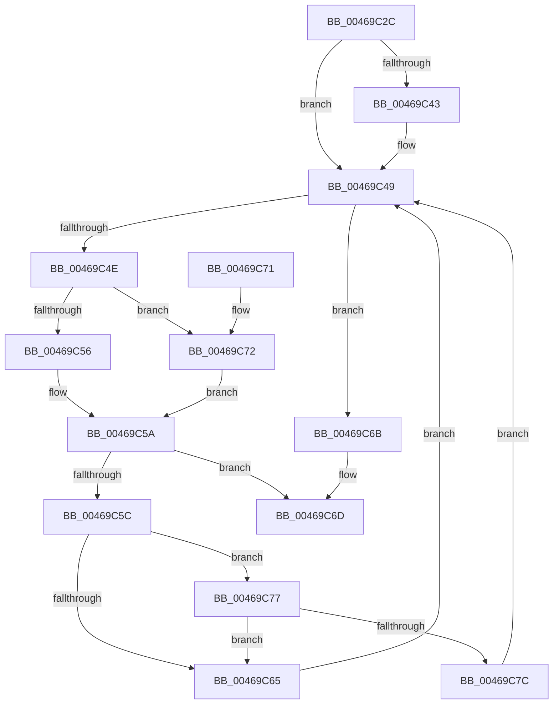

# SMKM_STORE&lt;SM_TRAITS&gt;::SmStFindVirtualLockedRegion

- RVA: `0x00469C2C`–`0x00469C81` (길이 `85` bytes)
- VA: `0x0000000140469C2C`
- 실행 섹션: `.text`
- PDB 이름 있음: `예`; PDB Function 태그: `아니요`
- unwind 정보 RVA: `0x000DB714`
- 디코드: `30`개 명령, `85/85` bytes 표시
- 미해석 바이트: `0` (있으면 어셈블리에 `.byte`로 보존)

> 이 문서는 커널 이미지의 기계어와 PDB 기호를 분석해 생성했습니다. 4번과 5번은 함수 원형과 자료형을 바이너리 사용 방식에서 추정한 C 해석이며 원본 소스 복구 결과는 아닙니다.

## 1. Dependencies

- 직접 호출 지점: **0**; 고유 호출 대상: **0**
- 직접 호출자로 확인된 함수: **2**
- RIP 상대 이미지 참조: **0**

### Outgoing calls
- 직접 디코드된 call 명령이 없습니다.

### Direct callers
- [sub_0034CD25](../34/Unknown_function_0034CD25.md) at `0x0034CD2F`
- [SMKM_STORE&lt;SM_TRAITS&gt;::SmStLockVirtualRegion](../4E/SMKM_STORE_SM_TRAITS_SmStLockVirtualRegion_function_004EAF8C.md) at `0x004EAFF5`

### Static image references
- 디코드된 RIP-relative 메모리 참조가 없습니다.

## 2. Other-region calls and transfers

- 다른 실행 섹션으로 향하는 call: **0**
- 별도 외부 분기/꼬리 이동을 확인하지 못했습니다.

## 3. Assembly (complete function range)

```asm
00469C2C  4C 8B 89 70 1B 00 00            mov r9, qword ptr [rcx + 0x1b70]
00469C33  41 83 CB FF                     or r11d, 0xffffffff
00469C37  49 8B C9                        mov rcx, r9
00469C3A  4D 8D 51 50                     lea r10, [r9 + 0x50]
00469C3E  41 3B D3                        cmp edx, r11d
00469C41  74 06                           je 0x140469c49
00469C43  8B C2                           mov eax, edx
00469C45  49 8D 0C C1                     lea rcx, [r9 + rax*8]
00469C49  49 3B CA                        cmp rcx, r10
00469C4C  73 1D                           jae 0x140469c6b
00469C4E  48 8B 01                        mov rax, qword ptr [rcx]
00469C51  48 85 C0                        test rax, rax
00469C54  74 1C                           je 0x140469c72
00469C56  4C 39 40 20                     cmp qword ptr [rax + 0x20], r8
00469C5A  74 11                           je 0x140469c6d
00469C5C  49 8D 41 40                     lea rax, [r9 + 0x40]
00469C60  48 3B C8                        cmp rcx, rax
00469C63  72 12                           jb 0x140469c77
00469C65  48 83 C1 08                     add rcx, 8
00469C69  EB DE                           jmp 0x140469c49
00469C6B  33 C9                           xor ecx, ecx
00469C6D  48 8B C1                        mov rax, rcx
00469C70  C3                              ret
00469C71  CC                              int3
00469C72  4D 85 C0                        test r8, r8
00469C75  EB E3                           jmp 0x140469c5a
00469C77  41 3B D3                        cmp edx, r11d
00469C7A  74 E9                           je 0x140469c65
00469C7C  48 8B C8                        mov rcx, rax
00469C7F  EB C8                           jmp 0x140469c49
```

## 4. C-style interpretation (structured pseudocode)

```c
__int64 __fastcall SMKM_STORE_SM_TRAITS___SmStFindVirtualLockedRegion(__int64 a1, int a2, __int64 a3)
{
    __int64 result;
    __int64 v_r11;

    v_r11 = (unsigned int)((v_r11) | (0xFFFFFFFFULL));
    if (a2 != ((unsigned int)(v_r11))) {
        result = a2;
        a1 = *(unsigned __int64 *)(a1 + 7024) + result * 8;
    }
    if (a1 >= (*(unsigned __int64 *)(a1 + 7024) + 80)) goto loc_00469C6B;
    if (*(unsigned __int64 *)(a1) == 0) goto loc_00469C72;
loc_00469C5A:
    if ((*(unsigned __int64 *)(*(unsigned __int64 *)(a1) + 32)) == a3) goto loc_00469C6D;
    if (a1 < (*(unsigned __int64 *)(a1 + 7024) + 64)) goto loc_00469C77;
loc_00469C65:
    a1 = (a1) + (8);
    goto loc_00469C49;
loc_00469C6B:
    a1 = 0;
loc_00469C6D:
    return 0;
loc_00469C72:
    goto loc_00469C5A;
loc_00469C77:
    if (a2 == ((unsigned int)(v_r11))) goto loc_00469C65;
    goto loc_00469C49;
}
```

## 5. (Beta) C Style

```c
int64_t SMKM_STORE_SM_TRAITS___SmStFindVirtualLockedRegion(void *Arg1, int32_t Arg2, int64_t Arg3)
{
    uint8_t *arg1 = (uint8_t *)Arg1;

    int64_t result;
    int64_t local_r11;

    local_r11 = (uint32_t)((local_r11) | (0xFFFFFFFFULL));
    if (Arg2 != ((uint32_t)(local_r11))) {
        result = Arg2;
        Arg1 = *(uint64_t *)(arg1 + 0x1B70) + result * 8;
    }
    if (Arg1 >= (*(uint64_t *)(arg1 + 0x1B70) + 80)) goto loc_00469C6B;
    if (*(uint64_t *)(arg1) == 0) goto loc_00469C72;
loc_00469C5A:
    if ((*(uint64_t *)(*(uint64_t *)(arg1) + 0x20)) == Arg3) goto loc_00469C6D;
    if (Arg1 < (*(uint64_t *)(arg1 + 0x1B70) + 64)) goto loc_00469C77;
loc_00469C65:
    Arg1 = (Arg1) + (8);
    goto loc_00469C49;
loc_00469C6B:
    Arg1 = 0;
loc_00469C6D:
    return 0;
loc_00469C72:
    goto loc_00469C5A;
loc_00469C77:
    if (Arg2 == ((uint32_t)(local_r11))) goto loc_00469C65;
    goto loc_00469C49;
}
```

### 관측된 메모리 오프셋

구조체 형식이 확인되지 않은 접근은 인자 기준의 오프셋으로만 기록했습니다.

| 기준 인자 | 오프셋 표현 | 폭 (bit) | 접근 |
|---|---:|---:|---|
| `Arg1` | `+ 0x1B70` | `64` | `R` |

## 6. Execution-region graph

[열기: 2D/3D 그래프와 함수 탐색 컨트롤 패널](../../../control-panel.html?section=text&rva=0x00469C2C&view=graph)

- 2D 그래프는 위에서 아래로 흐르고, 3D 그래프는 빈 공간을 드래그해 회전합니다. Shift+드래그는 이동, 휠은 확대·축소, 함수 노드 선택은 대상 보고서 이동입니다.

### Static fallback


