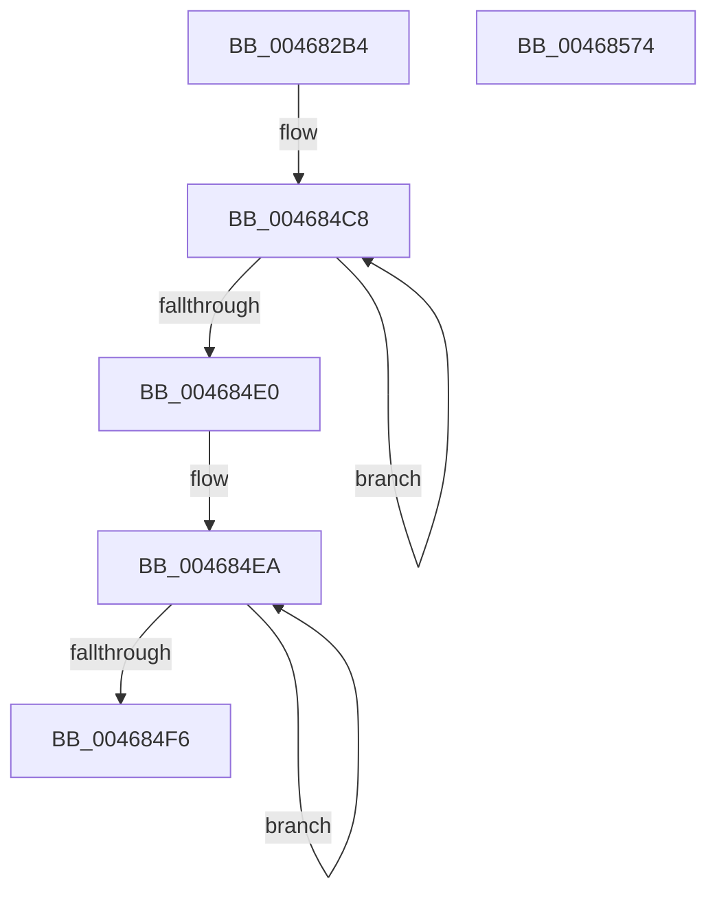

# ST_STORE&lt;SM_TRAITS&gt;::StDmInitialize

- RVA: `0x004682B4`–`0x00468575` (길이 `705` bytes)
- VA: `0x00000001404682B4`
- 실행 섹션: `.text`
- PDB 이름 있음: `예`; PDB Function 태그: `아니요`
- unwind 정보 RVA: `0x000AB064`
- 디코드: `148`개 명령, `705/705` bytes 표시
- 미해석 바이트: `0` (있으면 어셈블리에 `.byte`로 보존)

> 이 문서는 커널 이미지의 기계어와 PDB 기호를 분석해 생성했습니다. 4번과 5번은 함수 원형과 자료형을 바이너리 사용 방식에서 추정한 C 해석이며 원본 소스 복구 결과는 아닙니다.

## 1. Dependencies

- 직접 호출 지점: **6**; 고유 호출 대상: **3**
- 직접 호출자로 확인된 함수: **1**
- RIP 상대 이미지 참조: **1**

### Outgoing calls
- `0x004682E5` → [memset](../6C/memset_function_006C6C40.md) (function, `0x006C6C40`)
- `0x0046835E` → [SmHpChunkHeapInitialize](SmHpChunkHeapInitialize_function_0046857C.md) (function, `0x0046857C`)
- `0x00468378` → [memset](../6C/memset_function_006C6C40.md) (function, `0x006C6C40`)
- `0x004683CC` → [memset](../6C/memset_function_006C6C40.md) (function, `0x006C6C40`)
- `0x00468419` → [memset](../6C/memset_function_006C6C40.md) (function, `0x006C6C40`)
- `0x0046852D` → [KeQueryPerformanceCounter](../37/KeQueryPerformanceCounter_function_0037E7E0.md) (function, `0x0037E7E0`)

### Direct callers
- [ST_STORE&lt;SM_TRAITS&gt;::StInitialize](ST_STORE_SM_TRAITS_StInitialize_function_00468158.md) at `0x00468186`
- [ST_STORE&lt;SM_TRAITS&gt;::StInitialize](ST_STORE_SM_TRAITS_StInitialize_function_00468158.md) at `0x00468190`

### Static image references
- `0x004683A3` → RVA `0x00FC6AA0` (`ALMOSTRO`; read)

## 2. Other-region calls and transfers

- 다른 실행 섹션으로 향하는 call: **0**
- 별도 외부 분기/꼬리 이동을 확인하지 못했습니다.

## 3. Assembly (complete function range)

```asm
004682B4  48 89 5C 24 18                  mov qword ptr [rsp + 0x18], rbx
004682B9  48 89 6C 24 20                  mov qword ptr [rsp + 0x20], rbp
004682BE  56                              push rsi
004682BF  57                              push rdi
004682C0  41 54                           push r12
004682C2  41 56                           push r14
004682C4  41 57                           push r15
004682C6  48 83 EC 20                     sub rsp, 0x20
004682CA  48 83 64 24 58 00               and qword ptr [rsp + 0x58], 0
004682D0  48 8B EA                        mov rbp, rdx
004682D3  4C 8B F1                        mov r14, rcx
004682D6  33 D2                           xor edx, edx
004682D8  48 81 C1 C0 00 00 00            add rcx, 0xc0
004682DF  41 B8 50 08 00 00               mov r8d, 0x850
004682E5  E8 56 E9 25 00                  call 0x1406c6c40
004682EA  0F 57 C0                        xorps xmm0, xmm0
004682ED  C7 44 24 50 0C 00 00 00         mov dword ptr [rsp + 0x50], 0xc
004682F5  41 0F 11 06                     movups xmmword ptr [r14], xmm0
004682F9  33 C0                           xor eax, eax
004682FB  C7 44 24 54 04 00 00 00         mov dword ptr [rsp + 0x54], 4
00468303  49 89 46 10                     mov qword ptr [r14 + 0x10], rax
00468307  49 8D 8E C0 00 00 00            lea rcx, [r14 + 0xc0]
0046830E  41 0F 11 46 18                  movups xmmword ptr [r14 + 0x18], xmm0
00468313  48 8D 54 24 50                  lea rdx, [rsp + 0x50]
00468318  41 0F 11 46 28                  movups xmmword ptr [r14 + 0x28], xmm0
0046831D  49 89 46 38                     mov qword ptr [r14 + 0x38], rax
00468321  41 0F 11 46 40                  movups xmmword ptr [r14 + 0x40], xmm0
00468326  49 89 46 50                     mov qword ptr [r14 + 0x50], rax
0046832A  41 0F 11 46 58                  movups xmmword ptr [r14 + 0x58], xmm0
0046832F  41 0F 11 46 68                  movups xmmword ptr [r14 + 0x68], xmm0
00468334  49 89 46 78                     mov qword ptr [r14 + 0x78], rax
00468338  41 0F 11 86 80 00 00 00         movups xmmword ptr [r14 + 0x80], xmm0
00468340  49 89 86 90 00 00 00            mov qword ptr [r14 + 0x90], rax
00468347  41 0F 11 86 98 00 00 00         movups xmmword ptr [r14 + 0x98], xmm0
0046834F  41 0F 11 86 A8 00 00 00         movups xmmword ptr [r14 + 0xa8], xmm0
00468357  49 89 86 B8 00 00 00            mov qword ptr [r14 + 0xb8], rax
0046835E  E8 19 02 00 00                  call 0x14046857c
00468363  49 8D B6 D8 06 00 00            lea rsi, [r14 + 0x6d8]
0046836A  41 BF 60 00 00 00               mov r15d, 0x60
00468370  45 8B C7                        mov r8d, r15d
00468373  48 8B CE                        mov rcx, rsi
00468376  33 D2                           xor edx, edx
00468378  E8 C3 E8 25 00                  call 0x1406c6c40
0046837D  48 8D 46 40                     lea rax, [rsi + 0x40]
00468381  49 BC 20 03 00 00 80 F7 FF FF   movabs r12, 0xfffff78000000320
0046838B  48 89 40 08                     mov qword ptr [rax + 8], rax
0046838F  49 8D BE 60 07 00 00            lea rdi, [r14 + 0x760]
00468396  48 83 20 00                     and qword ptr [rax], 0
0046839A  45 8B C7                        mov r8d, r15d
0046839D  33 D2                           xor edx, edx
0046839F  49 8B 0C 24                     mov rcx, qword ptr [r12]
004683A3  8B 05 F7 E6 B5 00               mov eax, dword ptr [rip + 0xb5e6f7]
004683A9  48 C1 F9 0C                     sar rcx, 0xc
004683AD  8B C9                           mov ecx, ecx
004683AF  48 0F AF C8                     imul rcx, rax
004683B3  48 C1 F9 11                     sar rcx, 0x11
004683B7  89 4E 34                        mov dword ptr [rsi + 0x34], ecx
004683BA  48 8B CF                        mov rcx, rdi
004683BD  41 83 A6 38 07 00 00 00         and dword ptr [r14 + 0x738], 0
004683C5  49 89 AE 58 07 00 00            mov qword ptr [r14 + 0x758], rbp
004683CC  E8 6F E8 25 00                  call 0x1406c6c40
004683D1  48 8D 47 40                     lea rax, [rdi + 0x40]
004683D5  45 8B C7                        mov r8d, r15d
004683D8  48 89 40 08                     mov qword ptr [rax + 8], rax
004683DC  49 8D 9E E8 07 00 00            lea rbx, [r14 + 0x7e8]
004683E3  48 83 20 00                     and qword ptr [rax], 0
004683E7  33 D2                           xor edx, edx
004683E9  49 8B 0C 24                     mov rcx, qword ptr [r12]
004683ED  8B 05 AD E6 B5 00               mov eax, dword ptr [rip + 0xb5e6ad]
004683F3  48 C1 F9 0C                     sar rcx, 0xc
004683F7  8B C9                           mov ecx, ecx
004683F9  48 0F AF C8                     imul rcx, rax
004683FD  48 C1 F9 11                     sar rcx, 0x11
00468401  89 4F 34                        mov dword ptr [rdi + 0x34], ecx
00468404  48 8B CB                        mov rcx, rbx
00468407  41 C7 86 C0 07 00 00 01 00 00 00  mov dword ptr [r14 + 0x7c0], 1
00468412  49 89 AE E0 07 00 00            mov qword ptr [r14 + 0x7e0], rbp
00468419  E8 22 E8 25 00                  call 0x1406c6c40
0046841E  48 8D 43 40                     lea rax, [rbx + 0x40]
00468422  48 89 40 08                     mov qword ptr [rax + 8], rax
00468426  48 83 20 00                     and qword ptr [rax], 0
0046842A  49 8B 0C 24                     mov rcx, qword ptr [r12]
0046842E  8B 05 6C E6 B5 00               mov eax, dword ptr [rip + 0xb5e66c]
00468434  48 C1 F9 0C                     sar rcx, 0xc
00468438  8B C9                           mov ecx, ecx
0046843A  48 0F AF C8                     imul rcx, rax
0046843E  48 C1 F9 11                     sar rcx, 0x11
00468442  89 4B 34                        mov dword ptr [rbx + 0x34], ecx
00468445  41 C7 86 C0 07 00 00 02 00 00 00  mov dword ptr [r14 + 0x7c0], 2
00468450  49 83 A6 58 08 00 00 00         and qword ptr [r14 + 0x858], 0
00468458  45 8D 47 A1                     lea r8d, [r15 - 0x5f]
0046845C  49 83 A6 60 08 00 00 00         and qword ptr [r14 + 0x860], 0
00468464  41 8D 4F A6                     lea ecx, [r15 - 0x5a]
00468468  49 83 A6 50 08 00 00 00         and qword ptr [r14 + 0x850], 0
00468470  B8 00 00 00 20                  mov eax, 0x20000000
00468475  49 89 86 D0 07 00 00            mov qword ptr [r14 + 0x7d0], rax
0046847C  41 83 C9 FF                     or r9d, 0xffffffff
00468480  49 89 86 C8 07 00 00            mov qword ptr [r14 + 0x7c8], rax
00468487  49 8D 86 C8 05 00 00            lea rax, [r14 + 0x5c8]
0046848E  49 89 AE E0 07 00 00            mov qword ptr [r14 + 0x7e0], rbp
00468495  4D 89 86 48 07 00 00            mov qword ptr [r14 + 0x748], r8
0046849C  49 C7 86 50 07 00 00 FF FF FF 1F  mov qword ptr [r14 + 0x750], 0x1fffffff
004684A7  4D 89 86 40 07 00 00            mov qword ptr [r14 + 0x740], r8
004684AE  49 C7 86 D8 07 00 00 FF FF FF 3F  mov qword ptr [r14 + 0x7d8], 0x3fffffff
004684B9  49 89 76 10                     mov qword ptr [r14 + 0x10], rsi
004684BD  49 89 7E 50                     mov qword ptr [r14 + 0x50], rdi
004684C1  49 89 9E 90 00 00 00            mov qword ptr [r14 + 0x90], rbx
004684C8  33 D2                           xor edx, edx
004684CA  0F 57 C0                        xorps xmm0, xmm0
004684CD  0F 11 00                        movups xmmword ptr [rax], xmm0
004684D0  48 89 50 10                     mov qword ptr [rax + 0x10], rdx
004684D4  44 89 08                        mov dword ptr [rax], r9d
004684D7  48 8D 40 18                     lea rax, [rax + 0x18]
004684DB  49 2B C8                        sub rcx, r8
004684DE  75 E8                           jne 0x1404684c8
004684E0  49 8D 86 58 06 00 00            lea rax, [r14 + 0x658]
004684E7  8D 4A 08                        lea ecx, [rdx + 8]
004684EA  44 89 08                        mov dword ptr [rax], r9d
004684ED  48 8D 40 10                     lea rax, [rax + 0x10]
004684F1  49 2B C8                        sub rcx, r8
004684F4  75 F4                           jne 0x1404684ea
004684F6  41 8B 86 60 03 00 00            mov eax, dword ptr [r14 + 0x360]
004684FD  48 8D 4C 24 58                  lea rcx, [rsp + 0x58]
00468502  83 E0 FE                        and eax, 0xfffffffe
00468505  41 C7 86 68 03 00 00 04 00 00 00  mov dword ptr [r14 + 0x368], 4
00468510  83 C8 06                        or eax, 6
00468513  41 C6 86 08 03 00 00 02         mov byte ptr [r14 + 0x308], 2
0046851B  41 89 86 60 03 00 00            mov dword ptr [r14 + 0x360], eax
00468522  41 C7 86 70 05 00 00 EF D8 FF FF  mov dword ptr [r14 + 0x570], 0xffffd8ef
0046852D  E8 AE 62 F1 FF                  call 0x14037e7e0
00468532  48 69 4C 24 58 10 27 00 00      imul rcx, qword ptr [rsp + 0x58], 0x2710
0046853B  48 8B 5C 24 60                  mov rbx, qword ptr [rsp + 0x60]
00468540  48 B8 DB 34 B6 D7 82 DE 1B 43   movabs rax, 0x431bde82d7b634db
0046854A  48 8B 6C 24 68                  mov rbp, qword ptr [rsp + 0x68]
0046854F  48 F7 E9                        imul rcx
00468552  48 C1 FA 12                     sar rdx, 0x12
00468556  48 8B C2                        mov rax, rdx
00468559  48 C1 E8 3F                     shr rax, 0x3f
0046855D  48 03 D0                        add rdx, rax
00468560  41 89 96 60 05 00 00            mov dword ptr [r14 + 0x560], edx
00468567  48 83 C4 20                     add rsp, 0x20
0046856B  41 5F                           pop r15
0046856D  41 5E                           pop r14
0046856F  41 5C                           pop r12
00468571  5F                              pop rdi
00468572  5E                              pop rsi
00468573  C3                              ret
00468574  CC                              int3
```

## 4. C-style interpretation (structured pseudocode)

```c
__int64 __fastcall ST_STORE_SM_TRAITS___StDmInitialize(__int64 a1, __int64 a2, __int64 a3, int a4)
{
    __int64 result;
    __int64 v_rsp;
    unsigned __int64 v_stack_p10;
    unsigned __int64 v_stack_p18;
    unsigned __int64 v_stack_p20;
    unsigned int v_stack_p8;
    unsigned int v_stack_pC;

    v_stack_p18 = v_rbx;
    v_stack_p20 = v_rbp;
    v_rsp = (v_rsp) - (32);
    a2 = 0;
    a1 = (a1) + (192);
    result = memset(a1, a2, (unsigned int)(0x850ULL), a4);
    v_stack_p8 = 12;
    *(unsigned __int64 *)(a1) = v_xmm0;
    result = 0;
    v_stack_pC = 4;
    *(unsigned __int64 *)(a1 + 16) = 0;
    *(unsigned __int64 *)(a1 + 24) = v_xmm0;
    *(unsigned __int64 *)(a1 + 40) = v_xmm0;
    *(unsigned __int64 *)(a1 + 56) = 0;
    *(unsigned __int64 *)(a1 + 64) = v_xmm0;
    *(unsigned __int64 *)(a1 + 80) = 0;
    *(unsigned __int64 *)(a1 + 88) = v_xmm0;
    *(unsigned __int64 *)(a1 + 104) = v_xmm0;
    *(unsigned __int64 *)(a1 + 120) = 0;
    *(unsigned __int64 *)(a1 + 128) = v_xmm0;
    *(unsigned __int64 *)(a1 + 144) = 0;
    *(unsigned __int64 *)(a1 + 152) = v_xmm0;
    *(unsigned __int64 *)(a1 + 168) = v_xmm0;
    *(unsigned __int64 *)(a1 + 184) = 0;
    result = SmHpChunkHeapInitialize(a1 + 192, v_stack_p8, (unsigned int)(0x850ULL), a4);
    a2 = 0;
    result = memset(a1 + 1752, a2, 96, a4);
    *(unsigned __int64 *)(a1 + 1752 + 64 + 8) = a1 + 1752 + 64;
    a2 = 0;
    a1 = (*(unsigned __int64 *)(v_r12)) >> (12);
    a1 = ((unsigned int)((unsigned int)(a1))) * ((unsigned int)(*(unsigned int *)(v_rip + 11921143)));
    a1 = (a1) >> (17);
    *(unsigned int *)(a1 + 1752 + 52) = (unsigned int)(a1);
    *(unsigned __int64 *)(a1 + 1880) = 0;
    result = memset(a1 + 1888, a2, 96, a4);
    *(unsigned __int64 *)(a1 + 1888 + 64 + 8) = a1 + 1888 + 64;
    a2 = 0;
    a1 = (*(unsigned __int64 *)(v_r12)) >> (12);
    a1 = ((unsigned int)((unsigned int)(a1))) * ((unsigned int)(*(unsigned int *)(v_rip + 11921069)));
    a1 = (a1) >> (17);
    *(unsigned int *)(a1 + 1888 + 52) = (unsigned int)(a1);
    *(unsigned int *)(a1 + 1984) = 1;
    *(unsigned __int64 *)(a1 + 2016) = 0;
    result = memset(a1 + 2024, a2, 96, a4);
    *(unsigned __int64 *)(a1 + 2024 + 64 + 8) = a1 + 2024 + 64;
    a1 = (*(unsigned __int64 *)(v_r12)) >> (12);
    a1 = ((unsigned int)((unsigned int)(a1))) * ((unsigned int)(*(unsigned int *)(v_rip + 11921004)));
    a1 = (a1) >> (17);
    *(unsigned int *)(a1 + 2024 + 52) = (unsigned int)(a1);
    *(unsigned int *)(a1 + 1984) = 2;
    *(unsigned __int64 *)(a1 + 2000) = (unsigned int)(0x20000000ULL);
    a4 = (unsigned int)((a4) | (0xFFFFFFFFULL));
    *(unsigned __int64 *)(a1 + 1992) = (unsigned int)(0x20000000ULL);
    *(unsigned __int64 *)(a1 + 2016) = 0;
    *(unsigned __int64 *)(a1 + 1864) = 96 - 95;
    *(unsigned __int64 *)(a1 + 1872) = 0x1FFFFFFFULL;
    *(unsigned __int64 *)(a1 + 1856) = 96 - 95;
    *(unsigned __int64 *)(a1 + 2008) = 0x3FFFFFFFULL;
    *(unsigned __int64 *)(a1 + 16) = a1 + 1752;
    *(unsigned __int64 *)(a1 + 80) = a1 + 1888;
    *(unsigned __int64 *)(a1 + 144) = a1 + 2024;
loc_004684C8:
    a2 = 0;
    *(unsigned __int64 *)(a1 + 1480) = v_xmm0;
    *(unsigned __int64 *)(a1 + 1480 + 16) = 0;
    *(unsigned int *)(a1 + 1480) = a4;
    a1 = (96 - 90) - (96 - 95);
    if (condition_is_not_equal) goto loc_004684C8;
loc_004684EA:
    *(unsigned int *)(a1 + 1624) = a4;
    a1 = (a2 + 8) - (96 - 95);
    if (condition_is_not_equal) goto loc_004684EA;
    result = (unsigned int)(((unsigned int)(*(unsigned int *)(a1 + 864))) & (0xFFFFFFFEULL));
    *(unsigned int *)(a1 + 872) = 4;
    result = (unsigned int)((result) | (6));
    *(unsigned __int8 *)(a1 + 776) = 2;
    *(unsigned int *)(a1 + 864) = (unsigned int)(result);
    *(unsigned int *)(a1 + 1392) = 0xFFFFD8EFULL;
    result = KeQueryPerformanceCounter(v_stack_p10, a2, 96 - 95, a4);
    a1 = (v_stack_p10) * (v_stack_p10);
    a2 = (a2) >> (18);
    result = (a2) >> (63);
    a2 = (a2) + (result);
    *(unsigned int *)(a1 + 1376) = (unsigned int)(a2);
    v_rsp = (v_rsp) + (32);
    return result;
}
```

## 5. (Beta) C Style

```c
int64_t ST_STORE_SM_TRAITS___StDmInitialize(void *Arg1, int64_t Arg2, int64_t Arg3, int32_t Arg4)
{
    uint8_t *arg1 = (uint8_t *)Arg1;

    int64_t result;
    int64_t local_rsp;
    uint64_t v_stack_p10;
    uint64_t v_stack_p18;
    uint64_t v_stack_p20;
    uint32_t v_stack_p8;
    uint32_t v_stack_pC;

    v_stack_p18 = local_rbx;
    v_stack_p20 = local_rbp;
    local_rsp = (local_rsp) - (32);
    Arg2 = 0;
    Arg1 = (Arg1) + (192);
    result = memset(Arg1, Arg2, (uint32_t)(0x850ULL), Arg4);
    v_stack_p8 = 12;
    *(uint64_t *)(arg1) = v_xmm0;
    result = 0;
    v_stack_pC = 4;
    *(uint64_t *)(arg1 + 0x10) = 0;
    *(uint64_t *)(arg1 + 0x18) = v_xmm0;
    *(uint64_t *)(arg1 + 0x28) = v_xmm0;
    *(uint64_t *)(arg1 + 0x38) = 0;
    *(uint64_t *)(arg1 + 0x40) = v_xmm0;
    *(uint64_t *)(arg1 + 0x50) = 0;
    *(uint64_t *)(arg1 + 0x58) = v_xmm0;
    *(uint64_t *)(arg1 + 0x68) = v_xmm0;
    *(uint64_t *)(arg1 + 0x78) = 0;
    *(uint64_t *)(arg1 + 0x80) = v_xmm0;
    *(uint64_t *)(arg1 + 0x90) = 0;
    *(uint64_t *)(arg1 + 0x98) = v_xmm0;
    *(uint64_t *)(arg1 + 0xA8) = v_xmm0;
    *(uint64_t *)(arg1 + 0xB8) = 0;
    result = SmHpChunkHeapInitialize(Arg1 + 192, v_stack_p8, (uint32_t)(0x850ULL), Arg4);
    Arg2 = 0;
    result = memset(Arg1 + 1752, Arg2, 96, Arg4);
    *(void **)(arg1 + 0x6D8 + 0x40 + 0x8) = Arg1 + 1752 + 64;
    Arg2 = 0;
    Arg1 = (*(uint64_t *)(local_r12)) >> (12);
    Arg1 = ((uint32_t)((uint32_t)(Arg1))) * ((uint32_t)(*(uint32_t *)(v_rip + 0xB5E6F7)));
    Arg1 = (Arg1) >> (17);
    *(uint32_t *)(arg1 + 0x6D8 + 0x34) = (uint32_t)(Arg1);
    *(uint64_t *)(arg1 + 0x758) = 0;
    result = memset(Arg1 + 1888, Arg2, 96, Arg4);
    *(void **)(arg1 + 0x760 + 0x40 + 0x8) = Arg1 + 1888 + 64;
    Arg2 = 0;
    Arg1 = (*(uint64_t *)(local_r12)) >> (12);
    Arg1 = ((uint32_t)((uint32_t)(Arg1))) * ((uint32_t)(*(uint32_t *)(v_rip + 0xB5E6AD)));
    Arg1 = (Arg1) >> (17);
    *(uint32_t *)(arg1 + 0x760 + 0x34) = (uint32_t)(Arg1);
    *(uint32_t *)(arg1 + 0x7C0) = 1;
    *(uint64_t *)(arg1 + 0x7E0) = 0;
    result = memset(Arg1 + 2024, Arg2, 96, Arg4);
    *(void **)(arg1 + 0x7E8 + 0x40 + 0x8) = Arg1 + 2024 + 64;
    Arg1 = (*(uint64_t *)(local_r12)) >> (12);
    Arg1 = ((uint32_t)((uint32_t)(Arg1))) * ((uint32_t)(*(uint32_t *)(v_rip + 0xB5E66C)));
    Arg1 = (Arg1) >> (17);
    *(uint32_t *)(arg1 + 0x7E8 + 0x34) = (uint32_t)(Arg1);
    *(uint32_t *)(arg1 + 0x7C0) = 2;
    *(uint64_t *)(arg1 + 0x7D0) = (uint32_t)(0x20000000ULL);
    Arg4 = (uint32_t)((Arg4) | (0xFFFFFFFFULL));
    *(uint64_t *)(arg1 + 0x7C8) = (uint32_t)(0x20000000ULL);
    *(uint64_t *)(arg1 + 0x7E0) = 0;
    *(uint64_t *)(arg1 + 0x748) = 96 - 95;
    *(uint64_t *)(arg1 + 0x750) = 0x1FFFFFFFULL;
    *(uint64_t *)(arg1 + 0x740) = 96 - 95;
    *(uint64_t *)(arg1 + 0x7D8) = 0x3FFFFFFFULL;
    *(void **)(arg1 + 0x10) = Arg1 + 1752;
    *(void **)(arg1 + 0x50) = Arg1 + 1888;
    *(void **)(arg1 + 0x90) = Arg1 + 2024;
loc_004684C8:
    Arg2 = 0;
    *(uint64_t *)(arg1 + 0x5C8) = v_xmm0;
    *(uint64_t *)(arg1 + 0x5C8 + 0x10) = 0;
    *(uint32_t *)(arg1 + 0x5C8) = Arg4;
    Arg1 = (96 - 90) - (96 - 95);
    if (condition_is_not_equal) goto loc_004684C8;
loc_004684EA:
    *(uint32_t *)(arg1 + 0x658) = Arg4;
    Arg1 = (Arg2 + 8) - (96 - 95);
    if (condition_is_not_equal) goto loc_004684EA;
    result = (uint32_t)(((uint32_t)(*(uint32_t *)(arg1 + 0x360))) & (0xFFFFFFFEULL));
    *(uint32_t *)(arg1 + 0x368) = 4;
    result = (uint32_t)((result) | (6));
    *(uint8_t *)(arg1 + 0x308) = 2;
    *(uint32_t *)(arg1 + 0x360) = (uint32_t)(result);
    *(uint32_t *)(arg1 + 0x570) = 0xFFFFD8EFULL;
    result = KeQueryPerformanceCounter(v_stack_p10, Arg2, 96 - 95, Arg4);
    Arg1 = (v_stack_p10) * (v_stack_p10);
    Arg2 = (Arg2) >> (18);
    result = (Arg2) >> (63);
    Arg2 = (Arg2) + (result);
    *(uint32_t *)(arg1 + 0x560) = (uint32_t)(Arg2);
    local_rsp = (local_rsp) + (32);
    return result;
}
```

### 관측된 메모리 오프셋

구조체 형식이 확인되지 않은 접근은 인자 기준의 오프셋으로만 기록했습니다.

| 기준 인자 | 오프셋 표현 | 폭 (bit) | 접근 |
|---|---:|---:|---|
| `Arg1` | `+ 0x0` | `32` | `W` |
| `Arg1` | `+ 0x0` | `64` | `R/W` |
| `Arg1` | `+ 0x0` | `128` | `R` |
| `Arg1` | `+ 0x8` | `64` | `W` |
| `Arg1` | `+ 0x10` | `64` | `R` |
| `Arg1` | `+ 0x10` | `64` | `W` |
| `Arg1` | `+ 0x18` | `64` | `R` |
| `Arg1` | `+ 0x18` | `128` | `R` |
| `Arg1` | `+ 0x28` | `128` | `R` |
| `Arg1` | `+ 0x34` | `32` | `W` |
| `Arg1` | `+ 0x38` | `64` | `W` |
| `Arg1` | `+ 0x40` | `64` | `R` |
| `Arg1` | `+ 0x40` | `128` | `R` |
| `Arg1` | `+ 0x50` | `64` | `W` |
| `Arg1` | `+ 0x58` | `128` | `R` |
| `Arg1` | `+ 0x68` | `128` | `R` |
| `Arg1` | `+ 0x78` | `64` | `W` |
| `Arg1` | `+ 0x80` | `128` | `R` |
| `Arg1` | `+ 0x90` | `64` | `W` |
| `Arg1` | `+ 0x98` | `128` | `R` |
| `Arg1` | `+ 0xA8` | `128` | `R` |
| `Arg1` | `+ 0xB8` | `64` | `W` |
| `Arg1` | `+ 0xC0` | `64` | `R` |
| `Arg1` | `+ 0x308` | `8` | `W` |
| `Arg1` | `+ 0x360` | `32` | `R` |
| `Arg1` | `+ 0x360` | `32` | `W` |
| `Arg1` | `+ 0x368` | `32` | `W` |
| `Arg1` | `+ 0x560` | `32` | `W` |
| `Arg1` | `+ 0x570` | `32` | `W` |
| `Arg1` | `+ 0x5C8` | `64` | `R` |
| `Arg1` | `+ 0x658` | `64` | `R` |
| `Arg1` | `+ 0x6D8` | `64` | `R` |

추가 오프셋 15개는 표에서 생략했습니다.

## 6. Execution-region graph

[열기: 2D/3D 그래프와 함수 탐색 컨트롤 패널](../../../control-panel.html?section=text&rva=0x004682B4&view=graph)

- 2D 그래프는 위에서 아래로 흐르고, 3D 그래프는 빈 공간을 드래그해 회전합니다. Shift+드래그는 이동, 휠은 확대·축소, 함수 노드 선택은 대상 보고서 이동입니다.

### Static fallback


