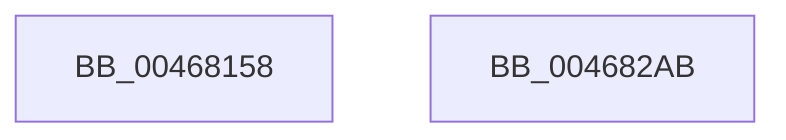

# ST_STORE&lt;SM_TRAITS&gt;::StInitialize

- RVA: `0x00468158`–`0x004682AC` (길이 `340` bytes)
- VA: `0x0000000140468158`
- 실행 섹션: `.text`
- PDB 이름 있음: `예`; PDB Function 태그: `아니요`
- unwind 정보 RVA: `0x0005CAAC`
- 디코드: `64`개 명령, `340/340` bytes 표시
- 미해석 바이트: `0` (있으면 어셈블리에 `.byte`로 보존)

> 이 문서는 커널 이미지의 기계어와 PDB 기호를 분석해 생성했습니다. 4번과 5번은 함수 원형과 자료형을 바이너리 사용 방식에서 추정한 C 해석이며 원본 소스 복구 결과는 아닙니다.

## 1. Dependencies

- 직접 호출 지점: **8**; 고유 호출 대상: **6**
- 직접 호출자로 확인된 함수: **1**
- RIP 상대 이미지 참조: **0**

### Outgoing calls
- `0x00468170` → [memset](../6C/memset_function_006C6C40.md) (function, `0x006C6C40`)
- `0x00468186` → [ST_STORE<SM_TRAITS>::StDmInitialize](ST_STORE_SM_TRAITS_StDmInitialize_function_004682B4.md) (function, `0x004682B4`)
- `0x00468190` → [ST_STORE<SM_TRAITS>::StDmInitialize](ST_STORE_SM_TRAITS_StDmInitialize_function_004682B4.md) (function, `0x004682B4`)
- `0x004681BD` → [SmCrEncInitialize](../../page/A9/SmCrEncInitialize_function_00A96290.md) (function, `0x00A96290`)
- `0x004681F1` → [memset](../6C/memset_function_006C6C40.md) (function, `0x006C6C40`)
- `0x00468268` → [StLcInitialize](StLcInitialize_function_00468AB8.md) (function, `0x00468AB8`)
- `0x00468274` → [ST_STORE<SM_TRAITS>::StLazyWorkMgrInitialize](ST_STORE_SM_TRAITS_StLazyWorkMgrInitialize_function_00468674.md) (function, `0x00468674`)
- `0x00468280` → [InitializeSListHead](InitializeSListHead_function_00468A90.md) (function, `0x00468A90`)

### Direct callers
- [SMKM_STORE&lt;SM_TRAITS&gt;::SmStInitialize](../4E/SMKM_STORE_SM_TRAITS_SmStInitialize_function_004EAE6C.md) at `0x004EAE95`

### Static image references
- 디코드된 RIP-relative 메모리 참조가 없습니다.

## 2. Other-region calls and transfers

- 다른 실행 섹션으로 향하는 call: **1**
  - `0x004681BD` → [SmCrEncInitialize](../../page/A9/SmCrEncInitialize_function_00A96290.md) (`.text` → `PAGE`)
- 별도 외부 분기/꼬리 이동을 확인하지 못했습니다.

## 3. Assembly (complete function range)

```asm
00468158  48 89 5C 24 08                  mov qword ptr [rsp + 8], rbx
0046815D  57                              push rdi
0046815E  48 83 EC 20                     sub rsp, 0x20
00468162  48 8B F9                        mov rdi, rcx
00468165  33 D2                           xor edx, edx
00468167  48 FF C1                        inc rcx
0046816A  41 B8 8F 1A 00 00               mov r8d, 0x1a8f
00468170  E8 CB EA 25 00                  call 0x1406c6c40
00468175  48 8D 9F 60 09 00 00            lea rbx, [rdi + 0x960]
0046817C  C6 07 02                        mov byte ptr [rdi], 2
0046817F  48 8B D3                        mov rdx, rbx
00468182  48 8D 4F 50                     lea rcx, [rdi + 0x50]
00468186  E8 29 01 00 00                  call 0x1404682b4
0046818B  33 D2                           xor edx, edx
0046818D  48 8B CB                        mov rcx, rbx
00468190  E8 1F 01 00 00                  call 0x1404682b4
00468195  0F 57 C0                        xorps xmm0, xmm0
00468198  48 8D 8F E0 12 00 00            lea rcx, [rdi + 0x12e0]
0046819F  0F 11 87 78 12 00 00            movups xmmword ptr [rdi + 0x1278], xmm0
004681A6  33 C0                           xor eax, eax
004681A8  0F 11 87 88 12 00 00            movups xmmword ptr [rdi + 0x1288], xmm0
004681AF  0F 11 87 98 12 00 00            movups xmmword ptr [rdi + 0x1298], xmm0
004681B6  48 89 87 A8 12 00 00            mov qword ptr [rdi + 0x12a8], rax
004681BD  E8 CE E0 62 00                  call 0x140a96290
004681C2  8B 87 78 13 00 00               mov eax, dword ptr [rdi + 0x1378]
004681C8  48 8D 8F B8 13 00 00            lea rcx, [rdi + 0x13b8]
004681CF  BB FE FF FF FF                  mov ebx, 0xfffffffe
004681D4  C7 87 80 13 00 00 03 00 00 00   mov dword ptr [rdi + 0x1380], 3
004681DE  23 C3                           and eax, ebx
004681E0  33 D2                           xor edx, edx
004681E2  83 C8 06                        or eax, 6
004681E5  41 B8 10 05 00 00               mov r8d, 0x510
004681EB  89 87 78 13 00 00               mov dword ptr [rdi + 0x1378], eax
004681F1  E8 4A EA 25 00                  call 0x1406c6c40
004681F6  4C 8D 87 E0 18 00 00            lea r8, [rdi + 0x18e0]
004681FD  48 8D 87 C8 13 00 00            lea rax, [rdi + 0x13c8]
00468204  48 89 87 B0 13 00 00            mov qword ptr [rdi + 0x13b0], rax
0046820B  48 8D 8F C8 18 00 00            lea rcx, [rdi + 0x18c8]
00468212  48 A1 08 00 00 00 80 F7 FF FF   movabs rax, qword ptr [0xfffff78000000008]
0046821C  48 05 00 46 C3 23               add rax, 0x23c34600
00468222  48 89 87 C0 13 00 00            mov qword ptr [rdi + 0x13c0], rax
00468229  49 C7 00 F4 01 00 00            mov qword ptr [r8], 0x1f4
00468230  49 C7 40 10 E8 03 00 00         mov qword ptr [r8 + 0x10], 0x3e8
00468238  49 C7 40 20 B8 0B 00 00         mov qword ptr [r8 + 0x20], 0xbb8
00468240  49 C7 40 30 88 13 00 00         mov qword ptr [r8 + 0x30], 0x1388
00468248  49 C7 40 40 10 27 00 00         mov qword ptr [r8 + 0x40], 0x2710
00468250  49 C7 40 50 20 4E 00 00         mov qword ptr [r8 + 0x50], 0x4e20
00468258  49 C7 40 60 50 C3 00 00         mov qword ptr [r8 + 0x60], 0xc350
00468260  49 C7 40 70 A0 86 01 00         mov qword ptr [r8 + 0x70], 0x186a0
00468268  E8 4B 08 00 00                  call 0x140468ab8
0046826D  48 8D 8F 68 19 00 00            lea rcx, [rdi + 0x1968]
00468274  E8 FB 03 00 00                  call 0x140468674
00468279  48 8D 8F D0 12 00 00            lea rcx, [rdi + 0x12d0]
00468280  E8 0B 08 00 00                  call 0x140468a90
00468285  8B 87 50 1A 00 00               mov eax, dword ptr [rdi + 0x1a50]
0046828B  23 C3                           and eax, ebx
0046828D  C7 87 58 1A 00 00 06 00 00 00   mov dword ptr [rdi + 0x1a58], 6
00468297  48 8B 5C 24 30                  mov rbx, qword ptr [rsp + 0x30]
0046829C  83 C8 06                        or eax, 6
0046829F  89 87 50 1A 00 00               mov dword ptr [rdi + 0x1a50], eax
004682A5  48 83 C4 20                     add rsp, 0x20
004682A9  5F                              pop rdi
004682AA  C3                              ret
004682AB  CC                              int3
```

## 4. C-style interpretation (structured pseudocode)

```c
__int64 __fastcall ST_STORE_SM_TRAITS___StInitialize(__int64 a1, int a2)
{
    __int64 result;
    __int64 v_rsp;
    unsigned __int64 v_stack_p8;

    v_stack_p8 = v_rbx;
    v_rsp = (v_rsp) - (32);
    a2 = 0;
    a1 = (a1) + 1;
    result = memset(a1, a2, (unsigned int)(0x1A8FULL), a4);
    *(unsigned __int8 *)(a1) = 2;
    result = ST_STORE_SM_TRAITS___StDmInitialize(a1 + 80, a1 + 2400, (unsigned int)(0x1A8FULL), a4);
    a2 = 0;
    result = ST_STORE_SM_TRAITS___StDmInitialize(a1 + 2400, a2, (unsigned int)(0x1A8FULL), a4);
    *(unsigned __int64 *)(a1 + 4728) = v_xmm0;
    result = 0;
    *(unsigned __int64 *)(a1 + 4744) = v_xmm0;
    *(unsigned __int64 *)(a1 + 4760) = v_xmm0;
    *(unsigned __int64 *)(a1 + 4776) = 0;
    result = SmCrEncInitialize(a1 + 4832, a2, (unsigned int)(0x1A8FULL), a4);
    *(unsigned int *)(a1 + 4992) = 3;
    result = (unsigned int)(((unsigned int)(*(unsigned int *)(a1 + 4984))) & ((unsigned int)((unsigned int)(0xFFFFFFFEULL))));
    a2 = 0;
    result = (unsigned int)((result) | (6));
    *(unsigned int *)(a1 + 4984) = (unsigned int)(result);
    result = memset(a1 + 5048, a2, (unsigned int)(0x510ULL), a4);
    *(unsigned __int64 *)(a1 + 5040) = a1 + 5064;
    result = (a1 + 5064) + (0x23C34600ULL);
    *(unsigned __int64 *)(a1 + 5056) = result;
    *(unsigned __int64 *)(a1 + 6368) = 500;
    *(unsigned __int64 *)(a1 + 6368 + 16) = 1000;
    *(unsigned __int64 *)(a1 + 6368 + 32) = 0xBB8ULL;
    *(unsigned __int64 *)(a1 + 6368 + 48) = 0x1388ULL;
    *(unsigned __int64 *)(a1 + 6368 + 64) = 0x2710ULL;
    *(unsigned __int64 *)(a1 + 6368 + 80) = 0x4E20ULL;
    *(unsigned __int64 *)(a1 + 6368 + 96) = 0xC350ULL;
    *(unsigned __int64 *)(a1 + 6368 + 112) = 0x186A0ULL;
    result = StLcInitialize(a1 + 6344, a2, a1 + 6368, a4);
    result = ST_STORE_SM_TRAITS___StLazyWorkMgrInitialize(a1 + 6504, a2, a1 + 6368, a4);
    result = InitializeSListHead(a1 + 4816, a2, a1 + 6368, a4);
    result = (unsigned int)(((unsigned int)(*(unsigned int *)(a1 + 6736))) & ((unsigned int)((unsigned int)(0xFFFFFFFEULL))));
    *(unsigned int *)(a1 + 6744) = 6;
    result = (unsigned int)((result) | (6));
    *(unsigned int *)(a1 + 6736) = (unsigned int)(result);
    v_rsp = (v_rsp) + (32);
    return result;
}
```

## 5. (Beta) C Style

```c
int64_t ST_STORE_SM_TRAITS___StInitialize(void *Arg1, int32_t Arg2)
{
    uint8_t *arg1 = (uint8_t *)Arg1;

    int64_t result;
    int64_t local_rsp;
    uint64_t v_stack_p8;

    v_stack_p8 = local_rbx;
    local_rsp = (local_rsp) - (32);
    Arg2 = 0;
    Arg1 = (Arg1) + 1;
    result = memset(Arg1, Arg2, (uint32_t)(0x1A8FULL), a4);
    *(uint8_t *)(arg1) = 2;
    result = ST_STORE_SM_TRAITS___StDmInitialize(Arg1 + 80, Arg1 + 2400, (uint32_t)(0x1A8FULL), a4);
    Arg2 = 0;
    result = ST_STORE_SM_TRAITS___StDmInitialize(Arg1 + 2400, Arg2, (uint32_t)(0x1A8FULL), a4);
    *(uint64_t *)(arg1 + 0x1278) = v_xmm0;
    result = 0;
    *(uint64_t *)(arg1 + 0x1288) = v_xmm0;
    *(uint64_t *)(arg1 + 0x1298) = v_xmm0;
    *(uint64_t *)(arg1 + 0x12A8) = 0;
    result = SmCrEncInitialize(Arg1 + 4832, Arg2, (uint32_t)(0x1A8FULL), a4);
    *(uint32_t *)(arg1 + 0x1380) = 3;
    result = (uint32_t)(((uint32_t)(*(uint32_t *)(arg1 + 0x1378))) & ((uint32_t)((uint32_t)(0xFFFFFFFEULL))));
    Arg2 = 0;
    result = (uint32_t)((result) | (6));
    *(uint32_t *)(arg1 + 0x1378) = (uint32_t)(result);
    result = memset(Arg1 + 5048, Arg2, (uint32_t)(0x510ULL), a4);
    *(void **)(arg1 + 0x13B0) = Arg1 + 5064;
    result = (Arg1 + 5064) + (0x23C34600ULL);
    *(uint64_t *)(arg1 + 0x13C0) = result;
    *(uint64_t *)(arg1 + 0x18E0) = 500;
    *(uint64_t *)(arg1 + 0x18E0 + 0x10) = 1000;
    *(uint64_t *)(arg1 + 0x18E0 + 0x20) = 0xBB8ULL;
    *(uint64_t *)(arg1 + 0x18E0 + 0x30) = 0x1388ULL;
    *(uint64_t *)(arg1 + 0x18E0 + 0x40) = 0x2710ULL;
    *(uint64_t *)(arg1 + 0x18E0 + 0x50) = 0x4E20ULL;
    *(uint64_t *)(arg1 + 0x18E0 + 0x60) = 0xC350ULL;
    *(uint64_t *)(arg1 + 0x18E0 + 0x70) = 0x186A0ULL;
    result = StLcInitialize(Arg1 + 6344, Arg2, Arg1 + 6368, a4);
    result = ST_STORE_SM_TRAITS___StLazyWorkMgrInitialize(Arg1 + 6504, Arg2, Arg1 + 6368, a4);
    result = InitializeSListHead(Arg1 + 4816, Arg2, Arg1 + 6368, a4);
    result = (uint32_t)(((uint32_t)(*(uint32_t *)(arg1 + 0x1A50))) & ((uint32_t)((uint32_t)(0xFFFFFFFEULL))));
    *(uint32_t *)(arg1 + 0x1A58) = 6;
    result = (uint32_t)((result) | (6));
    *(uint32_t *)(arg1 + 0x1A50) = (uint32_t)(result);
    local_rsp = (local_rsp) + (32);
    return result;
}
```

### 관측된 메모리 오프셋

구조체 형식이 확인되지 않은 접근은 인자 기준의 오프셋으로만 기록했습니다.

| 기준 인자 | 오프셋 표현 | 폭 (bit) | 접근 |
|---|---:|---:|---|
| `Arg1` | `+ 0x0` | `8` | `W` |
| `Arg1` | `+ 0x0` | `64` | `W` |
| `Arg1` | `+ 0x10` | `64` | `W` |
| `Arg1` | `+ 0x20` | `64` | `W` |
| `Arg1` | `+ 0x30` | `64` | `W` |
| `Arg1` | `+ 0x40` | `64` | `W` |
| `Arg1` | `+ 0x50` | `64` | `R` |
| `Arg1` | `+ 0x50` | `64` | `W` |
| `Arg1` | `+ 0x60` | `64` | `W` |
| `Arg1` | `+ 0x70` | `64` | `W` |
| `Arg1` | `+ 0x960` | `64` | `R` |
| `Arg1` | `+ 0x1278` | `128` | `R` |
| `Arg1` | `+ 0x1288` | `128` | `R` |
| `Arg1` | `+ 0x1298` | `128` | `R` |
| `Arg1` | `+ 0x12A8` | `64` | `W` |
| `Arg1` | `+ 0x12D0` | `64` | `R` |
| `Arg1` | `+ 0x12E0` | `64` | `R` |
| `Arg1` | `+ 0x1378` | `32` | `R` |
| `Arg1` | `+ 0x1378` | `32` | `W` |
| `Arg1` | `+ 0x1380` | `32` | `W` |
| `Arg1` | `+ 0x13B0` | `64` | `W` |
| `Arg1` | `+ 0x13B8` | `64` | `R` |
| `Arg1` | `+ 0x13C0` | `64` | `W` |
| `Arg1` | `+ 0x13C8` | `64` | `R` |
| `Arg1` | `+ 0x18C8` | `64` | `R` |
| `Arg1` | `+ 0x18E0` | `64` | `R` |
| `Arg1` | `+ 0x1968` | `64` | `R` |
| `Arg1` | `+ 0x1A50` | `32` | `R` |
| `Arg1` | `+ 0x1A50` | `32` | `W` |
| `Arg1` | `+ 0x1A58` | `32` | `W` |

## 6. Execution-region graph

[열기: 2D/3D 그래프와 함수 탐색 컨트롤 패널](../../../control-panel.html?section=text&rva=0x00468158&view=graph)

- 2D 그래프는 위에서 아래로 흐르고, 3D 그래프는 빈 공간을 드래그해 회전합니다. Shift+드래그는 이동, 휠은 확대·축소, 함수 노드 선택은 대상 보고서 이동입니다.

### Static fallback


