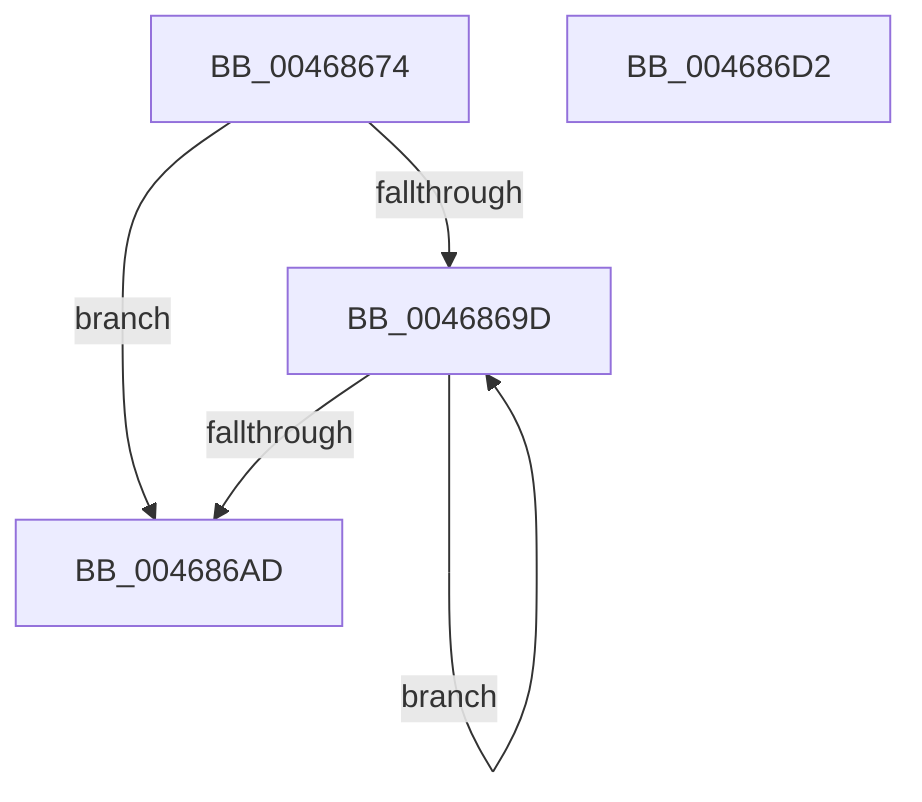

# ST_STORE&lt;SM_TRAITS&gt;::StLazyWorkMgrInitialize

- RVA: `0x00468674`–`0x004686D3` (길이 `95` bytes)
- VA: `0x0000000140468674`
- 실행 섹션: `.text`
- PDB 이름 있음: `예`; PDB Function 태그: `아니요`
- unwind 정보 RVA: `0x0005CF00`
- 디코드: `26`개 명령, `95/95` bytes 표시
- 미해석 바이트: `0` (있으면 어셈블리에 `.byte`로 보존)

> 이 문서는 커널 이미지의 기계어와 PDB 기호를 분석해 생성했습니다. 4번과 5번은 함수 원형과 자료형을 바이너리 사용 방식에서 추정한 C 해석이며 원본 소스 복구 결과는 아닙니다.

## 1. Dependencies

- 직접 호출 지점: **1**; 고유 호출 대상: **1**
- 직접 호출자로 확인된 함수: **1**
- RIP 상대 이미지 참조: **0**

### Outgoing calls
- `0x00468685` → [memset](../6C/memset_function_006C6C40.md) (function, `0x006C6C40`)

### Direct callers
- [ST_STORE&lt;SM_TRAITS&gt;::StInitialize](ST_STORE_SM_TRAITS_StInitialize_function_00468158.md) at `0x00468274`

### Static image references
- 디코드된 RIP-relative 메모리 참조가 없습니다.

## 2. Other-region calls and transfers

- 다른 실행 섹션으로 향하는 call: **0**
- 별도 외부 분기/꼬리 이동을 확인하지 못했습니다.

## 3. Assembly (complete function range)

```asm
00468674  40 53                           push rbx
00468676  48 83 EC 20                     sub rsp, 0x20
0046867A  33 D2                           xor edx, edx
0046867C  41 B8 E8 00 00 00               mov r8d, 0xe8
00468682  48 8B D9                        mov rbx, rcx
00468685  E8 B6 E5 25 00                  call 0x1406c6c40
0046868A  48 8D 8B A8 00 00 00            lea rcx, [rbx + 0xa8]
00468691  48 83 CA FF                     or rdx, 0xffffffffffffffff
00468695  48 8B C3                        mov rax, rbx
00468698  48 3B D9                        cmp rbx, rcx
0046869B  73 10                           jae 0x1404686ad
0046869D  48 89 10                        mov qword ptr [rax], rdx
004686A0  48 89 50 08                     mov qword ptr [rax + 8], rdx
004686A4  48 83 C0 18                     add rax, 0x18
004686A8  48 3B C1                        cmp rax, rcx
004686AB  72 F0                           jb 0x14046869d
004686AD  8B 83 C0 00 00 00               mov eax, dword ptr [rbx + 0xc0]
004686B3  83 E0 FE                        and eax, 0xfffffffe
004686B6  48 89 11                        mov qword ptr [rcx], rdx
004686B9  83 C8 06                        or eax, 6
004686BC  C7 83 C8 00 00 00 05 00 00 00   mov dword ptr [rbx + 0xc8], 5
004686C6  89 83 C0 00 00 00               mov dword ptr [rbx + 0xc0], eax
004686CC  48 83 C4 20                     add rsp, 0x20
004686D0  5B                              pop rbx
004686D1  C3                              ret
004686D2  CC                              int3
```

## 4. C-style interpretation (structured pseudocode)

```c
__int64 __fastcall ST_STORE_SM_TRAITS___StLazyWorkMgrInitialize(__int64 a1, int a2)
{
    __int64 result;
    __int64 v_rsp;

    v_rsp = (v_rsp) - (32);
    a2 = 0;
    result = memset(a1, a2, 232, a4);
    a2 = (a2) | (-1);
    if (a1 >= (a1 + 168)) goto loc_004686AD;
loc_0046869D:
    *(unsigned __int64 *)(a1) = a2;
    *(unsigned __int64 *)(a1 + 8) = a2;
    result = (a1) + (24);
    if (result < (a1 + 168)) goto loc_0046869D;
loc_004686AD:
    result = (unsigned int)(((unsigned int)(*(unsigned int *)(a1 + 192))) & (0xFFFFFFFEULL));
    *(unsigned __int64 *)(a1 + 168) = a2;
    result = (unsigned int)((result) | (6));
    *(unsigned int *)(a1 + 200) = 5;
    *(unsigned int *)(a1 + 192) = (unsigned int)(result);
    v_rsp = (v_rsp) + (32);
    return result;
}
```

## 5. (Beta) C Style

```c
int64_t ST_STORE_SM_TRAITS___StLazyWorkMgrInitialize(void *Arg1, int32_t Arg2)
{
    uint8_t *arg1 = (uint8_t *)Arg1;

    int64_t result;
    int64_t local_rsp;

    local_rsp = (local_rsp) - (32);
    Arg2 = 0;
    result = memset(Arg1, Arg2, 232, a4);
    Arg2 = (Arg2) | (-1);
    if (Arg1 >= (Arg1 + 168)) goto loc_004686AD;
loc_0046869D:
    *(uint64_t *)(arg1) = Arg2;
    *(uint64_t *)(arg1 + 0x8) = Arg2;
    result = (Arg1) + (24);
    if (result < (Arg1 + 168)) goto loc_0046869D;
loc_004686AD:
    result = (uint32_t)(((uint32_t)(*(uint32_t *)(arg1 + 0xC0))) & (0xFFFFFFFEULL));
    *(uint64_t *)(arg1 + 0xA8) = Arg2;
    result = (uint32_t)((result) | (6));
    *(uint32_t *)(arg1 + 0xC8) = 5;
    *(uint32_t *)(arg1 + 0xC0) = (uint32_t)(result);
    local_rsp = (local_rsp) + (32);
    return result;
}
```

### 관측된 메모리 오프셋

구조체 형식이 확인되지 않은 접근은 인자 기준의 오프셋으로만 기록했습니다.

| 기준 인자 | 오프셋 표현 | 폭 (bit) | 접근 |
|---|---:|---:|---|
| `Arg1` | `+ 0x0` | `64` | `W` |
| `Arg1` | `+ 0xA8` | `64` | `R` |

## 6. Execution-region graph

[열기: 2D/3D 그래프와 함수 탐색 컨트롤 패널](../../../control-panel.html?section=text&rva=0x00468674&view=graph)

- 2D 그래프는 위에서 아래로 흐르고, 3D 그래프는 빈 공간을 드래그해 회전합니다. Shift+드래그는 이동, 휠은 확대·축소, 함수 노드 선택은 대상 보고서 이동입니다.

### Static fallback


