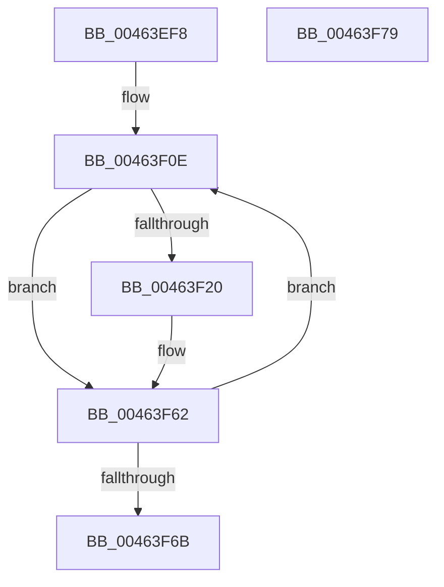

# SepConvertTokenPrivileges

- RVA: `0x00463EF8`–`0x00463F7A` (길이 `130` bytes)
- VA: `0x0000000140463EF8`
- 실행 섹션: `.text`
- PDB 이름 있음: `예`; PDB Function 태그: `아니요`
- unwind 정보 RVA: `0x000AA828`
- 디코드: `37`개 명령, `130/130` bytes 표시
- 미해석 바이트: `0` (있으면 어셈블리에 `.byte`로 보존)

> 이 문서는 커널 이미지의 기계어와 PDB 기호를 분석해 생성했습니다. 4번과 5번은 함수 원형과 자료형을 바이너리 사용 방식에서 추정한 C 해석이며 원본 소스 복구 결과는 아닙니다.

## 1. Dependencies

- 직접 호출 지점: **0**; 고유 호출 대상: **0**
- 직접 호출자로 확인된 함수: **2**
- RIP 상대 이미지 참조: **0**

### Outgoing calls
- 직접 디코드된 call 명령이 없습니다.

### Direct callers
- [SeQueryInformationToken](../../page/8B/SeQueryInformationToken_function_008B5090.md) at `0x008B5292`
- [NtQueryInformationToken](../../page/AE/NtQueryInformationToken_function_00AECDD0.md) at `0x00AED1ED`

### Static image references
- 디코드된 RIP-relative 메모리 참조가 없습니다.

## 2. Other-region calls and transfers

- 다른 실행 섹션으로 향하는 call: **0**
- 별도 외부 분기/꼬리 이동을 확인하지 못했습니다.

## 3. Assembly (complete function range)

```asm
00463EF8  48 89 5C 24 08                  mov qword ptr [rsp + 8], rbx
00463EFD  48 89 7C 24 18                  mov qword ptr [rsp + 0x18], rdi
00463F02  45 33 DB                        xor r11d, r11d
00463F05  48 8B DA                        mov rbx, rdx
00463F08  45 33 C9                        xor r9d, r9d
00463F0B  48 8B F9                        mov rdi, rcx
00463F0E  41 8B C9                        mov ecx, r9d
00463F11  41 BA 01 00 00 00               mov r10d, 1
00463F17  49 D3 E2                        shl r10, cl
00463F1A  4C 85 57 40                     test qword ptr [rdi + 0x40], r10
00463F1E  74 42                           je 0x140463f62
00463F20  4F 8D 04 5B                     lea r8, [r11 + r11*2]
00463F24  49 63 C1                        movsxd rax, r9d
00463F27  89 44 24 10                     mov dword ptr [rsp + 0x10], eax
00463F2B  BA 00 00 00 00                  mov edx, 0
00463F30  48 C1 E8 20                     shr rax, 0x20
00463F34  89 44 24 14                     mov dword ptr [rsp + 0x14], eax
00463F38  48 8B 44 24 10                  mov rax, qword ptr [rsp + 0x10]
00463F3D  4A 89 44 83 04                  mov qword ptr [rbx + r8*4 + 4], rax
00463F42  4C 85 57 50                     test qword ptr [rdi + 0x50], r10
00463F46  48 8B 47 48                     mov rax, qword ptr [rdi + 0x48]
00463F4A  0F 95 C2                        setne dl
00463F4D  49 23 C2                        and rax, r10
00463F50  48 F7 D8                        neg rax
00463F53  1B C9                           sbb ecx, ecx
00463F55  83 E1 02                        and ecx, 2
00463F58  0B D1                           or edx, ecx
00463F5A  42 89 54 83 0C                  mov dword ptr [rbx + r8*4 + 0xc], edx
00463F5F  41 FF C3                        inc r11d
00463F62  41 FF C1                        inc r9d
00463F65  41 83 F9 24                     cmp r9d, 0x24
00463F69  76 A3                           jbe 0x140463f0e
00463F6B  48 8B 7C 24 18                  mov rdi, qword ptr [rsp + 0x18]
00463F70  44 89 1B                        mov dword ptr [rbx], r11d
00463F73  48 8B 5C 24 08                  mov rbx, qword ptr [rsp + 8]
00463F78  C3                              ret
00463F79  CC                              int3
```

## 4. C-style interpretation (structured pseudocode)

```c
__int64 __fastcall SepConvertTokenPrivileges(__int64 a1, __int64 a2, __int64 a3, int a4)
{
    __int64 result;
    __int64 v_r10;
    __int64 v_r11;
    unsigned int v_stack_p10;
    unsigned int v_stack_p14;
    unsigned __int64 v_stack_p18;
    unsigned __int64 v_stack_p8;

    v_stack_p8 = v_rbx;
    v_stack_p18 = v_rdi;
    v_r11 = 0;
    a4 = 0;
loc_00463F0E:
    v_r10 = (1) << (0);
    if (((*(unsigned __int64 *)(a1 + 64)) & (v_r10)) != 0) {
        a3 = v_r11 + v_r11 * 2;
        result = (int)(0);
        v_stack_p10 = (unsigned int)(result);
        a2 = 0;
        result = (result) >> (32);
        v_stack_p14 = (unsigned int)(result);
        result = v_stack_p10;
        *(unsigned __int64 *)(a2 + a3 * 4 + 4) = result;
        result = *(unsigned __int64 *)(a1 + 72);
        a2 = (((*(unsigned __int64 *)(a1 + 80)) & (v_r10)) != 0) ? 1 : 0;
        result = (result) & (v_r10);
        result = -(result);
        a1 = (unsigned int)((0) & (2));
        a2 = (unsigned int)((a2) | ((unsigned int)(a1)));
        *(unsigned int *)(a2 + a3 * 4 + 12) = (unsigned int)(a2);
        v_r11 = (unsigned int)((v_r11) + 1);
    }
    a4 = (unsigned int)((a4) + 1);
    if (a4 <= 36) goto loc_00463F0E;
    *(unsigned int *)(a2) = (unsigned int)(v_r11);
    return result;
}
```

## 5. (Beta) C Style

```c
int64_t SepConvertTokenPrivileges(void *Arg1, void *Arg2, int64_t Arg3, int32_t Arg4)
{
    uint8_t *arg1 = (uint8_t *)Arg1;
    uint8_t *arg2 = (uint8_t *)Arg2;

    int64_t result;
    int64_t local_r10;
    int64_t local_r11;
    uint32_t v_stack_p10;
    uint32_t v_stack_p14;
    uint64_t v_stack_p18;
    uint64_t v_stack_p8;

    v_stack_p8 = local_rbx;
    v_stack_p18 = local_rdi;
    local_r11 = 0;
    Arg4 = 0;
loc_00463F0E:
    local_r10 = (1) << (0);
    if (((*(uint64_t *)(arg1 + 0x40)) & (local_r10)) != 0) {
        Arg3 = local_r11 + local_r11 * 2;
        result = (int32_t)(0);
        v_stack_p10 = (uint32_t)(result);
        Arg2 = 0;
        result = (result) >> (32);
        v_stack_p14 = (uint32_t)(result);
        result = v_stack_p10;
        *(uint64_t *)(arg2 + Arg3 * 4 + 0x4) = result;
        result = *(uint64_t *)(arg1 + 0x48);
        Arg2 = (((*(uint64_t *)(arg1 + 0x50)) & (local_r10)) != 0) ? 1 : 0;
        result = (result) & (local_r10);
        result = -(result);
        Arg1 = (uint32_t)((0) & (2));
        Arg2 = (uint32_t)((Arg2) | ((uint32_t)(Arg1)));
        *(uint32_t *)(arg2 + Arg3 * 4 + 0xC) = (uint32_t)(Arg2);
        local_r11 = (uint32_t)((local_r11) + 1);
    }
    Arg4 = (uint32_t)((Arg4) + 1);
    if (Arg4 <= 36) goto loc_00463F0E;
    *(uint32_t *)(arg2) = (uint32_t)(local_r11);
    return result;
}
```

### 관측된 메모리 오프셋

구조체 형식이 확인되지 않은 접근은 인자 기준의 오프셋으로만 기록했습니다.

| 기준 인자 | 오프셋 표현 | 폭 (bit) | 접근 |
|---|---:|---:|---|
| `Arg1` | `+ 0x40` | `64` | `R` |
| `Arg1` | `+ 0x48` | `64` | `R` |
| `Arg1` | `+ 0x50` | `64` | `R` |
| `Arg2` | `+ 0x0` | `32` | `W` |
| `Arg2` | `+ 0x4 + r8*4` | `64` | `W` |
| `Arg2` | `+ 0xC + r8*4` | `32` | `W` |

## 6. Execution-region graph

[열기: 2D/3D 그래프와 함수 탐색 컨트롤 패널](../../../control-panel.html?section=text&rva=0x00463EF8&view=graph)

- 2D 그래프는 위에서 아래로 흐르고, 3D 그래프는 빈 공간을 드래그해 회전합니다. Shift+드래그는 이동, 휠은 확대·축소, 함수 노드 선택은 대상 보고서 이동입니다.

### Static fallback


