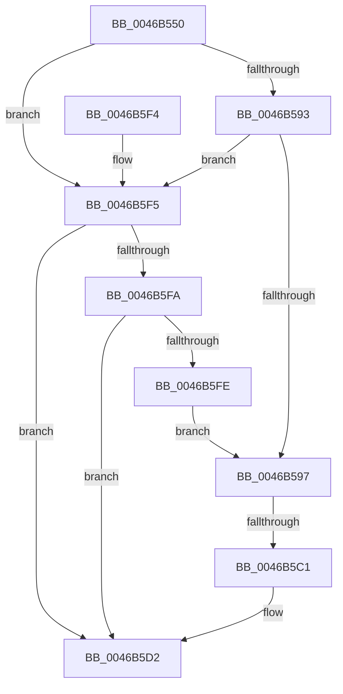

# SepExamineGlobalSaclEx

- RVA: `0x0046B550`–`0x0046B600` (길이 `176` bytes)
- VA: `0x000000014046B550`
- 실행 섹션: `.text`
- PDB 이름 있음: `예`; PDB Function 태그: `예`
- unwind 정보 RVA: `0x000AB4A0`
- 디코드: `48`개 명령, `176/176` bytes 표시
- 미해석 바이트: `0` (있으면 어셈블리에 `.byte`로 보존)

> 이 문서는 커널 이미지의 기계어와 PDB 기호를 분석해 생성했습니다. 4번과 5번은 함수 원형과 자료형을 바이너리 사용 방식에서 추정한 C 해석이며 원본 소스 복구 결과는 아닙니다.

## 1. Dependencies

- 직접 호출 지점: **4**; 고유 호출 대상: **4**
- 직접 호출자로 확인된 함수: **1**
- RIP 상대 이미지 참조: **1**

### Outgoing calls
- `0x0046B59F` → [SepRmAcquireGlobalSaclReadLock](SepRmAcquireGlobalSaclReadLock_function_0046B608.md) (function, `0x0046B608`)
- `0x0046B5B4` → [SepRmGlobalSaclFind](../../page/97/SepRmGlobalSaclFind_function_00973DD4.md) (function, `0x00973DD4`)
- `0x0046B5C8` → [ExReleaseResourceLite](../25/ExReleaseResourceLite_function_0025FA10.md) (function, `0x0025FA10`)
- `0x0046B5CD` → [KeLeaveCriticalRegion](../25/KeLeaveCriticalRegion_function_0025D8B0.md) (function, `0x0025D8B0`)

### Direct callers
- [SepAccessCheckAndAuditAlarm](../../page/A1/SepAccessCheckAndAuditAlarm_function_00A1AF4C.md) at `0x00A1D255`

### Static image references
- `0x0046B5C1` → RVA `0x00E68100` (`.data`; read)

## 2. Other-region calls and transfers

- 다른 실행 섹션으로 향하는 call: **1**
  - `0x0046B5B4` → [SepRmGlobalSaclFind](../../page/97/SepRmGlobalSaclFind_function_00973DD4.md) (`.text` → `PAGE`)
- call이 아닌 외부 분기/꼬리 이동: **1**
  - `0x0046B5BB` → [sub_006F3118](../6F/Unknown_function_006F3118.md) (`tail-transfer`)

## 3. Assembly (complete function range)

```asm
0046B550  48 8B C4                        mov rax, rsp
0046B553  48 89 58 08                     mov qword ptr [rax + 8], rbx
0046B557  48 89 68 10                     mov qword ptr [rax + 0x10], rbp
0046B55B  48 89 70 18                     mov qword ptr [rax + 0x18], rsi
0046B55F  48 89 78 20                     mov qword ptr [rax + 0x20], rdi
0046B563  41 54                           push r12
0046B565  41 56                           push r14
0046B567  41 57                           push r15
0046B569  48 81 EC 80 00 00 00            sub rsp, 0x80
0046B570  48 8B B4 24 F8 00 00 00         mov rsi, qword ptr [rsp + 0xf8]
0046B578  33 DB                           xor ebx, ebx
0046B57A  48 8B BC 24 00 01 00 00         mov rdi, qword ptr [rsp + 0x100]
0046B582  45 8B F1                        mov r14d, r9d
0046B585  4D 8B F8                        mov r15, r8
0046B588  4C 8B E2                        mov r12, rdx
0046B58B  48 8B E9                        mov rbp, rcx
0046B58E  48 85 F6                        test rsi, rsi
0046B591  74 62                           je 0x14046b5f5
0046B593  38 1E                           cmp byte ptr [rsi], bl
0046B595  75 5E                           jne 0x14046b5f5
0046B597  48 89 9C 24 F8 00 00 00         mov qword ptr [rsp + 0xf8], rbx
0046B59F  E8 64 00 00 00                  call 0x14046b608
0046B5A4  45 33 C9                        xor r9d, r9d
0046B5A7  48 8D 8C 24 F8 00 00 00         lea rcx, [rsp + 0xf8]
0046B5AF  4C 8B C5                        mov r8, rbp
0046B5B2  33 D2                           xor edx, edx
0046B5B4  E8 1B 88 50 00                  call 0x140973dd4
0046B5B9  85 C0                           test eax, eax
0046B5BB  0F 89 57 7B 28 00               jns 0x1406f3118
0046B5C1  48 8D 0D 38 CB 9F 00            lea rcx, [rip + 0x9fcb38]
0046B5C8  E8 43 44 DF FF                  call 0x14025fa10
0046B5CD  E8 DE 22 DF FF                  call 0x14025d8b0
0046B5D2  4C 8D 9C 24 80 00 00 00         lea r11, [rsp + 0x80]
0046B5DA  49 8B 5B 20                     mov rbx, qword ptr [r11 + 0x20]
0046B5DE  49 8B 6B 28                     mov rbp, qword ptr [r11 + 0x28]
0046B5E2  49 8B 73 30                     mov rsi, qword ptr [r11 + 0x30]
0046B5E6  49 8B 7B 38                     mov rdi, qword ptr [r11 + 0x38]
0046B5EA  49 8B E3                        mov rsp, r11
0046B5ED  41 5F                           pop r15
0046B5EF  41 5E                           pop r14
0046B5F1  41 5C                           pop r12
0046B5F3  C3                              ret
0046B5F4  CC                              int3
0046B5F5  48 85 FF                        test rdi, rdi
0046B5F8  74 D8                           je 0x14046b5d2
0046B5FA  38 1F                           cmp byte ptr [rdi], bl
0046B5FC  75 D4                           jne 0x14046b5d2
0046B5FE  EB 97                           jmp 0x14046b597
```

## 4. C-style interpretation (structured pseudocode)

```c
__int64 __fastcall SepExamineGlobalSaclEx(__int64 a1, __int64 a2, __int64 a3, int a4, __int64 a5, __int64 a6, __int64 a7, __int64 a8, __int64 a9, __int64 a10, __int64 a11, __int64 a12, __int64 a13)
{
    __int64 result;
    __int64 v_rbx;
    __int64 v_rsp;
    unsigned __int64 v_stack_m18;
    unsigned __int64 v_stack_p60;

    *(unsigned __int64 *)(v_rsp + 8) = v_rbx;
    *(unsigned __int64 *)(v_rsp + 16) = v_rbp;
    *(unsigned __int64 *)(v_rsp + 24) = v_rsi;
    *(unsigned __int64 *)(v_rsp + 32) = v_rdi;
    v_rsp = (v_rsp) - (128);
    v_rbx = 0;
    if (a12 == 0) goto loc_0046B5F5;
    if ((*(unsigned __int8 *)(a12)) != 0) goto loc_0046B5F5;
loc_0046B597:
    v_stack_p60 = 0;
    result = SepRmAcquireGlobalSaclReadLock(a1, a2, a3, a4);
    a4 = 0;
    a2 = 0;
    result = SepRmGlobalSaclFind(a12, a2, a1, a4);
    result = ExReleaseResourceLite(v_rip + 10472248, a2, a1, a4);
    result = KeLeaveCriticalRegion(v_rip + 10472248, a2, a1, a4);
loc_0046B5D2:
    return result;
loc_0046B5F5:
    if (*(unsigned __int64 *)(v_stack_m18 + 56) == 0) goto loc_0046B5D2;
    if ((*(unsigned __int8 *)(*(unsigned __int64 *)(v_stack_m18 + 56))) != ((unsigned __int8)(*(unsigned __int64 *)(v_stack_m18 + 32)))) goto loc_0046B5D2;
    goto loc_0046B597;
}
```

## 5. (Beta) C Style

```c
int64_t SepExamineGlobalSaclEx(int64_t Arg1, int64_t Arg2, int64_t Arg3, int32_t Arg4, uint64_t Arg5, uint64_t Arg6, uint64_t Arg7, uint64_t Arg8, uint64_t Arg9, uint64_t Arg10, uint64_t Arg11, int64_t Arg12, int64_t Arg13)
{
    int64_t result;
    int64_t local_rbx;
    int64_t local_rsp;
    uint64_t v_stack_m18;
    uint64_t v_stack_p60;

    *(uint64_t *)(local_rsp + 0x8) = local_rbx;
    *(uint64_t *)(local_rsp + 0x10) = local_rbp;
    *(uint64_t *)(local_rsp + 0x18) = local_rsi;
    *(uint64_t *)(local_rsp + 0x20) = local_rdi;
    local_rsp = (local_rsp) - (128);
    local_rbx = 0;
    if (Arg12 == 0) goto loc_0046B5F5;
    if ((*(uint8_t *)(Arg12)) != 0) goto loc_0046B5F5;
loc_0046B597:
    v_stack_p60 = 0;
    result = SepRmAcquireGlobalSaclReadLock(Arg1, Arg2, Arg3, Arg4);
    Arg4 = 0;
    Arg2 = 0;
    result = SepRmGlobalSaclFind(Arg12, Arg2, Arg1, Arg4);
    result = ExReleaseResourceLite(v_rip + 10472248, Arg2, Arg1, Arg4);
    result = KeLeaveCriticalRegion(v_rip + 10472248, Arg2, Arg1, Arg4);
loc_0046B5D2:
    return result;
loc_0046B5F5:
    if (*(uint64_t *)(v_stack_m18 + 0x38) == 0) goto loc_0046B5D2;
    if ((*(uint8_t *)(*(uint64_t *)(v_stack_m18 + 0x38))) != ((uint8_t)(*(uint64_t *)(v_stack_m18 + 0x20)))) goto loc_0046B5D2;
    goto loc_0046B597;
}
```

## 6. Execution-region graph

[열기: 2D/3D 그래프와 함수 탐색 컨트롤 패널](../../../control-panel.html?section=text&rva=0x0046B550&view=graph)

- 2D 그래프는 위에서 아래로 흐르고, 3D 그래프는 빈 공간을 드래그해 회전합니다. Shift+드래그는 이동, 휠은 확대·축소, 함수 노드 선택은 대상 보고서 이동입니다.

### Static fallback


