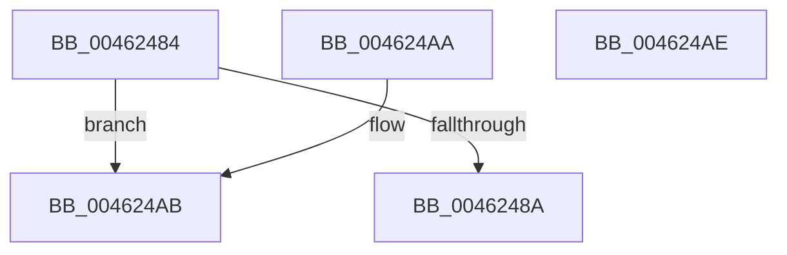

# SepLpacCausedAccessFailure

- RVA: `0x00462484`–`0x004624AF` (길이 `43` bytes)
- VA: `0x0000000140462484`
- 실행 섹션: `.text`
- PDB 이름 있음: `예`; PDB Function 태그: `아니요`
- unwind 정보 RVA: `0x000DB714`
- 디코드: `16`개 명령, `43/43` bytes 표시
- 미해석 바이트: `0` (있으면 어셈블리에 `.byte`로 보존)

> 이 문서는 커널 이미지의 기계어와 PDB 기호를 분석해 생성했습니다. 4번과 5번은 함수 원형과 자료형을 바이너리 사용 방식에서 추정한 C 해석이며 원본 소스 복구 결과는 아닙니다.

## 1. Dependencies

- 직접 호출 지점: **0**; 고유 호출 대상: **0**
- 직접 호출자로 확인된 함수: **4**
- RIP 상대 이미지 참조: **0**

### Outgoing calls
- 직접 디코드된 call 명령이 없습니다.

### Direct callers
- [SeAccessCheckWithHint](../3A/SeAccessCheckWithHint_function_003A6C30.md) at `0x003A76C7`
- [SeAccessCheckByType](../44/SeAccessCheckByType_function_00440BC8.md) at `0x004426A0`
- [SepCommonAccessCheckEx](../47/SepCommonAccessCheckEx_function_0047602C.md) at `0x004772DC`
- [SepAccessCheckAndAuditAlarm](../../page/A1/SepAccessCheckAndAuditAlarm_function_00A1AF4C.md) at `0x00A1CF8E`

### Static image references
- 디코드된 RIP-relative 메모리 참조가 없습니다.

## 2. Other-region calls and transfers

- 다른 실행 섹션으로 향하는 call: **0**
- 별도 외부 분기/꼬리 이동을 확인하지 못했습니다.

## 3. Assembly (complete function range)

```asm
00462484  80 79 18 00                     cmp byte ptr [rcx + 0x18], 0
00462488  74 21                           je 0x1404624ab
0046248A  44 8B 41 08                     mov r8d, dword ptr [rcx + 8]
0046248E  44 0B 41 04                     or r8d, dword ptr [rcx + 4]
00462492  8B 41 10                        mov eax, dword ptr [rcx + 0x10]
00462495  41 0F BA E8 19                  bts r8d, 0x19
0046249A  41 F7 D0                        not r8d
0046249D  44 23 C2                        and r8d, edx
004624A0  41 23 C0                        and eax, r8d
004624A3  41 3B C0                        cmp eax, r8d
004624A6  0F 94 C0                        sete al
004624A9  C3                              ret
004624AA  CC                              int3
004624AB  32 C0                           xor al, al
004624AD  C3                              ret
004624AE  CC                              int3
```

## 4. C-style interpretation (structured pseudocode)

```c
__int64 __fastcall SepLpacCausedAccessFailure(__int64 a1, int a2)
{
    __int64 result;

    if ((*(unsigned __int8 *)(a1 + 24)) == 0) goto loc_004624AB;
    a3 = (unsigned int)(((unsigned int)(*(unsigned int *)(a1 + 8))) | (*(unsigned int *)(a1 + 4)));
    a3 = (unsigned int)(~(a3));
    a3 = (unsigned int)((a3) & (a2));
    result = (unsigned int)(((unsigned int)(*(unsigned int *)(a1 + 16))) & ((unsigned int)(a3)));
    result = (((unsigned int)(result)) == ((unsigned int)(a3))) ? 1 : 0;
    return result;
loc_004624AB:
    result = 0;
    return result;
}
```

## 5. (Beta) C Style

```c
int64_t SepLpacCausedAccessFailure(void *Arg1, int32_t Arg2)
{
    uint8_t *arg1 = (uint8_t *)Arg1;

    int64_t result;

    if ((*(uint8_t *)(arg1 + 0x18)) == 0) goto loc_004624AB;
    a3 = (uint32_t)(((uint32_t)(*(uint32_t *)(arg1 + 0x8))) | (*(uint32_t *)(arg1 + 0x4)));
    a3 = (uint32_t)(~(a3));
    a3 = (uint32_t)((a3) & (Arg2));
    result = (uint32_t)(((uint32_t)(*(uint32_t *)(arg1 + 0x10))) & ((uint32_t)(a3)));
    result = (((uint32_t)(result)) == ((uint32_t)(a3))) ? 1 : 0;
    return result;
loc_004624AB:
    result = 0;
    return result;
}
```

### 관측된 메모리 오프셋

구조체 형식이 확인되지 않은 접근은 인자 기준의 오프셋으로만 기록했습니다.

| 기준 인자 | 오프셋 표현 | 폭 (bit) | 접근 |
|---|---:|---:|---|
| `Arg1` | `+ 0x4` | `32` | `R` |
| `Arg1` | `+ 0x8` | `32` | `R` |
| `Arg1` | `+ 0x10` | `32` | `R` |
| `Arg1` | `+ 0x18` | `8` | `R` |

## 6. Execution-region graph

[열기: 2D/3D 그래프와 함수 탐색 컨트롤 패널](../../../control-panel.html?section=text&rva=0x00462484&view=graph)

- 2D 그래프는 위에서 아래로 흐르고, 3D 그래프는 빈 공간을 드래그해 회전합니다. Shift+드래그는 이동, 휠은 확대·축소, 함수 노드 선택은 대상 보고서 이동입니다.

### Static fallback


