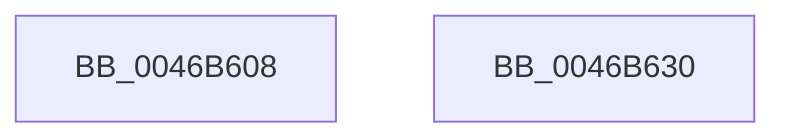

# SepRmAcquireGlobalSaclReadLock

- RVA: `0x0046B608`–`0x0046B631` (길이 `41` bytes)
- VA: `0x000000014046B608`
- 실행 섹션: `.text`
- PDB 이름 있음: `예`; PDB Function 태그: `아니요`
- unwind 정보 RVA: `0x0005C788`
- 디코드: `10`개 명령, `41/41` bytes 표시
- 미해석 바이트: `0` (있으면 어셈블리에 `.byte`로 보존)

> 이 문서는 커널 이미지의 기계어와 PDB 기호를 분석해 생성했습니다. 4번과 5번은 함수 원형과 자료형을 바이너리 사용 방식에서 추정한 C 해석이며 원본 소스 복구 결과는 아닙니다.

## 1. Dependencies

- 직접 호출 지점: **1**; 고유 호출 대상: **1**
- 직접 호출자로 확인된 함수: **5**
- RIP 상대 이미지 참조: **1**

### Outgoing calls
- `0x0046B626` → [ExAcquireResourceSharedLite](../21/ExAcquireResourceSharedLite_function_00211BC0.md) (function, `0x00211BC0`)

### Direct callers
- [SepExamineGlobalSaclEx](SepExamineGlobalSaclEx_function_0046B550.md) at `0x0046B59F`
- [sub_0086E95E](../../page/86/Unknown_function_0086E95E.md) at `0x0086E9BB`
- [SeExamineGlobalSacl](../../page/97/SeExamineGlobalSacl_function_00973C98.md) at `0x00973CD4`
- [SepRmGlobalSaclFind](../../page/97/SepRmGlobalSaclFind_function_00973DD4.md) at `0x00973E91`
- [SeMaximumAuditMaskFromGlobalSacl](../../page/A8/SeMaximumAuditMaskFromGlobalSacl_function_00A832DC.md) at `0x00A83306`

### Static image references
- `0x0046B615` → RVA `0x00E68100` (`.data`; read)

## 2. Other-region calls and transfers

- 다른 실행 섹션으로 향하는 call: **0**
- 별도 외부 분기/꼬리 이동을 확인하지 못했습니다.

## 3. Assembly (complete function range)

```asm
0046B608  48 83 EC 28                     sub rsp, 0x28
0046B60C  65 48 8B 04 25 88 01 00 00      mov rax, qword ptr gs:[0x188]
0046B615  48 8D 0D E4 CA 9F 00            lea rcx, [rip + 0x9fcae4]
0046B61C  B2 01                           mov dl, 1
0046B61E  66 FF 88 E4 01 00 00            dec word ptr [rax + 0x1e4]
0046B625  90                              nop
0046B626  E8 95 65 DA FF                  call 0x140211bc0
0046B62B  48 83 C4 28                     add rsp, 0x28
0046B62F  C3                              ret
0046B630  CC                              int3
```

## 4. C-style interpretation (structured pseudocode)

```c
__int64 __fastcall SepRmAcquireGlobalSaclReadLock(void)
{
    __int64 result;
    __int64 v_rsp;

    v_rsp = (v_rsp) - (40);
    result = ExAcquireResourceSharedLite(v_rip + 10472164, 1, a3, a4);
    v_rsp = (v_rsp) + (40);
    return result;
}
```

## 5. (Beta) C Style

```c
void SepRmAcquireGlobalSaclReadLock(void)
{
    int64_t result;
    int64_t local_rsp;

    local_rsp = (local_rsp) - (40);
    result = ExAcquireResourceSharedLite(v_rip + 10472164, 1, a3, a4);
    local_rsp = (local_rsp) + (40);
    return result;
}
```

## 6. Execution-region graph

[열기: 2D/3D 그래프와 함수 탐색 컨트롤 패널](../../../control-panel.html?section=text&rva=0x0046B608&view=graph)

- 2D 그래프는 위에서 아래로 흐르고, 3D 그래프는 빈 공간을 드래그해 회전합니다. Shift+드래그는 이동, 휠은 확대·축소, 함수 노드 선택은 대상 보고서 이동입니다.

### Static fallback


