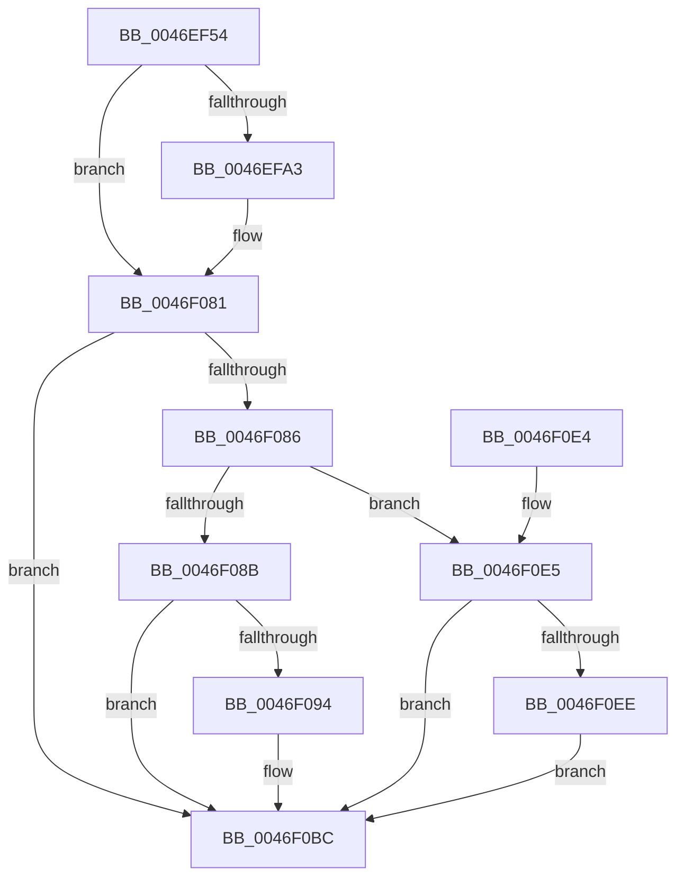

# SetFailureLocation

- RVA: `0x0046EF54`–`0x0046F119` (길이 `453` bytes)
- VA: `0x000000014046EF54`
- 실행 섹션: `.text`
- PDB 이름 있음: `예`; PDB Function 태그: `아니요`
- unwind 정보 RVA: `0x000ABBE4`
- 디코드: `114`개 명령, `453/453` bytes 표시
- 미해석 바이트: `0` (있으면 어셈블리에 `.byte`로 보존)

> 이 문서는 커널 이미지의 기계어와 PDB 기호를 분석해 생성했습니다. 4번과 5번은 함수 원형과 자료형을 바이너리 사용 방식에서 추정한 C 해석이며 원본 소스 복구 결과는 아닙니다.

## 1. Dependencies

- 직접 호출 지점: **2**; 고유 호출 대상: **2**
- 직접 호출자로 확인된 함수: **53**
- RIP 상대 이미지 참조: **8**

### Outgoing calls
- `0x0046F07C` → [EtwWriteEx](../25/EtwWriteEx_function_0025F0D0.md) (function, `0x0025F0D0`)
- `0x0046F0C3` → [_security_check_cookie](../6A/_security_check_cookie_function_006AC640.md) (function, `0x006AC640`)

### Direct callers
- [CmpLoadKeyCommon](CmpLoadKeyCommon_function_0046E9F8.md) at `0x0046EBE6`
- [CmpLoadKeyCommon](CmpLoadKeyCommon_function_0046E9F8.md) at `0x0046EC87`
- [CmpDoFileRead](../48/CmpDoFileRead_function_00485658.md) at `0x00485849`
- [CmpLoadHiveThread](../../page/7D/CmpLoadHiveThread_function_007DB040.md) at `0x007DB1E8`
- [CmpLoadHiveThread](../../page/7D/CmpLoadHiveThread_function_007DB040.md) at `0x007DB6DF`
- [CmpLoadHiveThread](../../page/7D/CmpLoadHiveThread_function_007DB040.md) at `0x007DB72F`
- [CmpLoadHiveThread](../../page/7D/CmpLoadHiveThread_function_007DB040.md) at `0x007DB93F`
- [CmpMountPreloadedHives](../../page/7D/CmpMountPreloadedHives_function_007DBE18.md) at `0x007DC19A`
- [CmpMountPreloadedHives](../../page/7D/CmpMountPreloadedHives_function_007DBE18.md) at `0x007DC1E7`
- [CmpMountPreloadedHives](../../page/7D/CmpMountPreloadedHives_function_007DBE18.md) at `0x007DC51A`
- [CmpBuildMachineHiveCache](../../page/7E/CmpBuildMachineHiveCache_function_007E8B74.md) at `0x007E8C86`
- [CmpBuildMachineHiveCache](../../page/7E/CmpBuildMachineHiveCache_function_007E8B74.md) at `0x007E8CEE`
- [CmpHiveCacheSubscribePnpNotifications](../../page/7E/CmpHiveCacheSubscribePnpNotifications_function_007E8D2C.md) at `0x007E8DD3`
- [CmpMachineHiveCacheClaimEntry](../../page/7E/CmpMachineHiveCacheClaimEntry_function_007E8DFC.md) at `0x007E8E40`
- [CmpMachineHiveCachePopulateEntry](../../page/7E/CmpMachineHiveCachePopulateEntry_function_007E8E88.md) at `0x007E8F0B`
- [CmpRecoverFlushProtocolStateFromFiles](../../page/7E/CmpRecoverFlushProtocolStateFromFiles_function_007EE4B0.md) at `0x007EE4E4`
- [HvRecoverFlushProtocolStateFromFiles](../../page/7E/HvRecoverFlushProtocolStateFromFiles_function_007EF224.md) at `0x007EF2CF`
- [HvRecoverFlushProtocolStateFromFiles](../../page/7E/HvRecoverFlushProtocolStateFromFiles_function_007EF224.md) at `0x007EF41A`
- [HvpMapHiveImage](../../page/7E/HvpMapHiveImage_function_007EF8D0.md) at `0x007EF9E7`
- [HvpMapHiveImage](../../page/7E/HvpMapHiveImage_function_007EF8D0.md) at `0x007EFA24`
- [HvpBuildMapForMemoryBackedHive](../../page/7F/HvpBuildMapForMemoryBackedHive_function_007F3B4C.md) at `0x007F3C6B`
- [HvpBuildMapForMemoryBackedHive](../../page/7F/HvpBuildMapForMemoryBackedHive_function_007F3B4C.md) at `0x007F3CE6`
- [HvpBuildMapForMemoryBackedHive](../../page/7F/HvpBuildMapForMemoryBackedHive_function_007F3B4C.md) at `0x007F3D1C`
- [CmpHiveCacheAcknowledgeOplockBreak](../../page/7F/CmpHiveCacheAcknowledgeOplockBreak_function_007F585C.md) at `0x007F5945`
- [CmpHiveCacheClaimHiveEntry](../../page/7F/CmpHiveCacheClaimHiveEntry_function_007F5970.md) at `0x007F59DE`
- [CmpHiveCacheClaimHiveEntry](../../page/7F/CmpHiveCacheClaimHiveEntry_function_007F5970.md) at `0x007F5A1F`
- [CmpHiveCacheCreateHiveEntry](../../page/7F/CmpHiveCacheCreateHiveEntry_function_007F5A68.md) at `0x007F5AA1`
- [CmpHiveCacheCreateHiveEntry](../../page/7F/CmpHiveCacheCreateHiveEntry_function_007F5A68.md) at `0x007F5ACE`
- [CmpHiveCachePnpNotificationCallback](../../page/7F/CmpHiveCachePnpNotificationCallback_function_007F5D80.md) at `0x007F5E5F`
- [CmpHiveCachePopulateHiveEntry](../../page/7F/CmpHiveCachePopulateHiveEntry_function_007F5EB4.md) at `0x007F5F67`
- [CmpHiveCachePopulateHiveEntryThread](../../page/7F/CmpHiveCachePopulateHiveEntryThread_function_007F5FD0.md) at `0x007F6085`
- [CmpHiveCachePopulateHiveEntryThread](../../page/7F/CmpHiveCachePopulateHiveEntryThread_function_007F5FD0.md) at `0x007F60E7`
- [CmpRequestOplockOnHiveFile](../../page/7F/CmpRequestOplockOnHiveFile_function_007F63E8.md) at `0x007F65BB`
- [sub_0085AC29](../../page/85/Unknown_function_0085AC29.md) at `0x0085AD06`
- [sub_0085AE2B](../../page/85/Unknown_function_0085AE2B.md) at `0x0085AE65`
- [sub_0085AE2B](../../page/85/Unknown_function_0085AE2B.md) at `0x0085AEA6`
- [sub_0085AE2B](../../page/85/Unknown_function_0085AE2B.md) at `0x0085AF88`
- [CmLoadAppKey](../../page/87/CmLoadAppKey_function_00876FFC.md) at `0x0087732F`
- [CmLoadAppKey](../../page/87/CmLoadAppKey_function_00876FFC.md) at `0x008774CA`
- [CmLoadAppKey](../../page/87/CmLoadAppKey_function_00876FFC.md) at `0x00877B14`
- [CmLoadAppKey](../../page/87/CmLoadAppKey_function_00876FFC.md) at `0x00877B6A`
- [CmpLinkHiveToMaster](../../page/87/CmpLinkHiveToMaster_function_00877D6C.md) at `0x00878086`
- [CmpLinkHiveToMaster](../../page/87/CmpLinkHiveToMaster_function_00877D6C.md) at `0x00878177`
- [CmLoadKey](../../page/87/CmLoadKey_function_008787CC.md) at `0x00878E84`
- [CmLoadKey](../../page/87/CmLoadKey_function_008787CC.md) at `0x00878F8E`
- [CmLoadKey](../../page/87/CmLoadKey_function_008787CC.md) at `0x00879047`
- [CmpInitHiveFromFile](../../page/87/CmpInitHiveFromFile_function_008794D4.md) at `0x008796B6`
- [CmpInitHiveFromFile](../../page/87/CmpInitHiveFromFile_function_008794D4.md) at `0x00879A1A`
- [CmpOpenHiveFiles](../../page/87/CmpOpenHiveFiles_function_00879A68.md) at `0x00879B64`
- [CmpOpenHiveFiles](../../page/87/CmpOpenHiveFiles_function_00879A68.md) at `0x00879D04`
- [CmpOpenHiveFiles](../../page/87/CmpOpenHiveFiles_function_00879A68.md) at `0x00879D34`
- [CmpCreateHive](../../page/87/CmpCreateHive_function_00879DF0.md) at `0x0087A2DB`
- [CmpCreateHive](../../page/87/CmpCreateHive_function_00879DF0.md) at `0x0087A417`
- [CmpCreateHive](../../page/87/CmpCreateHive_function_00879DF0.md) at `0x0087A516`
- [CmpOpenHiveFile](../../page/87/CmpOpenHiveFile_function_0087A71C.md) at `0x0087A945`
- [CmpOpenHiveFile](../../page/87/CmpOpenHiveFile_function_0087A71C.md) at `0x0087A996`
- [CmpOpenHiveFile](../../page/87/CmpOpenHiveFile_function_0087A71C.md) at `0x0087AB67`
- [CmpOpenHiveFile](../../page/87/CmpOpenHiveFile_function_0087A71C.md) at `0x0087AB99`
- [CmpGetCompleteFileName](../../page/87/CmpGetCompleteFileName_function_0087ADDC.md) at `0x0087AE9A`
- [HvHiveStartMemoryBacked](../../page/87/HvHiveStartMemoryBacked_function_0087BF38.md) at `0x0087C0D0`
- [HvHiveStartMemoryBacked](../../page/87/HvHiveStartMemoryBacked_function_0087BF38.md) at `0x0087C5D4`
- [CmCheckRegistry](../../page/96/CmCheckRegistry_function_0096D2F4.md) at `0x0096D3A7`
- [CmCheckRegistry](../../page/96/CmCheckRegistry_function_0096D2F4.md) at `0x0096D511`
- [HvCheckHive](../../page/96/HvCheckHive_function_0096D550.md) at `0x0096D6D9`
- [HvCheckHive](../../page/96/HvCheckHive_function_0096D550.md) at `0x0096D70E`
- [HvCheckHive](../../page/96/HvCheckHive_function_0096D550.md) at `0x0096D74D`
- [HvCheckBin](../../page/96/HvCheckBin_function_0096D790.md) at `0x0096D925`
- [HvCheckBin](../../page/96/HvCheckBin_function_0096D790.md) at `0x0096D9E7`
- [HvCheckBin](../../page/96/HvCheckBin_function_0096D790.md) at `0x0096DA1B`
- [HvCheckBin](../../page/96/HvCheckBin_function_0096D790.md) at `0x0096DA7B`
- [HvCheckBin](../../page/96/HvCheckBin_function_0096D790.md) at `0x0096DAAE`
- [CmpValidateHiveSecurityDescriptors](../../page/96/CmpValidateHiveSecurityDescriptors_function_0096DAFC.md) at `0x0096DD70`
- [CmpValidateHiveSecurityDescriptors](../../page/96/CmpValidateHiveSecurityDescriptors_function_0096DAFC.md) at `0x0096DDA9`
- [CmpValidateHiveSecurityDescriptors](../../page/96/CmpValidateHiveSecurityDescriptors_function_0096DAFC.md) at `0x0096DEB8`
- [CmpValidateHiveSecurityDescriptors](../../page/96/CmpValidateHiveSecurityDescriptors_function_0096DAFC.md) at `0x0096DF2D`
- [CmpCheckLeaf](../../page/96/CmpCheckLeaf_function_0096E5BC.md) at `0x0096E7EA`
- [sub_0096ED4F](../../page/96/Unknown_function_0096ED4F.md) at `0x0096ED6D`
- [sub_0096ED94](../../page/96/Unknown_function_0096ED94.md) at `0x0096EDAB`
- [CmpCheckKey](../../page/96/CmpCheckKey_function_0096EE2C.md) at `0x0096F41B`
- [CmpCheckKey](../../page/96/CmpCheckKey_function_0096EE2C.md) at `0x0096F605`
- [CmpCheckKey](../../page/96/CmpCheckKey_function_0096EE2C.md) at `0x0096F6D7`
- [CmpCheckKey](../../page/96/CmpCheckKey_function_0096EE2C.md) at `0x0096F79E`
- [CmpCheckKey](../../page/96/CmpCheckKey_function_0096EE2C.md) at `0x0096F801`
- [CmpCheckKey](../../page/96/CmpCheckKey_function_0096EE2C.md) at `0x0096F824`
- [CmpCheckKey](../../page/96/CmpCheckKey_function_0096EE2C.md) at `0x0096F936`
- [CmpCheckKey](../../page/96/CmpCheckKey_function_0096EE2C.md) at `0x0096F9AC`
- [CmpCheckKey](../../page/96/CmpCheckKey_function_0096EE2C.md) at `0x0096F9F1`
- [CmpCheckKey](../../page/96/CmpCheckKey_function_0096EE2C.md) at `0x0096FA77`
- [CmpCheckKey](../../page/96/CmpCheckKey_function_0096EE2C.md) at `0x0096FB32`
- [CmpCheckKey](../../page/96/CmpCheckKey_function_0096EE2C.md) at `0x0096FB68`
- [CmpCheckKey](../../page/96/CmpCheckKey_function_0096EE2C.md) at `0x0096FC84`
- [CmpCheckKey](../../page/96/CmpCheckKey_function_0096EE2C.md) at `0x0096FCE6`
- [CmpCheckKey](../../page/96/CmpCheckKey_function_0096EE2C.md) at `0x0096FD1A`
- [CmpCheckKey](../../page/96/CmpCheckKey_function_0096EE2C.md) at `0x0096FD7F`
- [CmpCheckKey](../../page/96/CmpCheckKey_function_0096EE2C.md) at `0x0096FEC3`
- [CmpCheckKey](../../page/96/CmpCheckKey_function_0096EE2C.md) at `0x0096FF09`
- [CmpCheckKey](../../page/96/CmpCheckKey_function_0096EE2C.md) at `0x00970077`
- [CmpCheckKey](../../page/96/CmpCheckKey_function_0096EE2C.md) at `0x009700EE`
- [CmpCheckKey](../../page/96/CmpCheckKey_function_0096EE2C.md) at `0x0097015F`
- [CmpCheckKey](../../page/96/CmpCheckKey_function_0096EE2C.md) at `0x00970842`
- [CmpCheckKey](../../page/96/CmpCheckKey_function_0096EE2C.md) at `0x00970ABA`
- [CmpCheckKey](../../page/96/CmpCheckKey_function_0096EE2C.md) at `0x00970B34`
- [CmpCheckValueList](../../page/97/CmpCheckValueList_function_00970F6C.md) at `0x0097132A`
- [CmpCheckValueList](../../page/97/CmpCheckValueList_function_00970F6C.md) at `0x0097139B`
- [CmpCheckValueList](../../page/97/CmpCheckValueList_function_00970F6C.md) at `0x009714A0`
- [CmpCheckValueList](../../page/97/CmpCheckValueList_function_00970F6C.md) at `0x009714CA`
- [CmpCheckValueList](../../page/97/CmpCheckValueList_function_00970F6C.md) at `0x00971535`
- [CmpCheckValueList](../../page/97/CmpCheckValueList_function_00970F6C.md) at `0x009715A4`
- [CmpCheckValueList](../../page/97/CmpCheckValueList_function_00970F6C.md) at `0x00971608`
- [CmpCheckValueList](../../page/97/CmpCheckValueList_function_00970F6C.md) at `0x009718A4`
- [CmpCheckValueList](../../page/97/CmpCheckValueList_function_00970F6C.md) at `0x0097191B`
- [CmpCheckValueList](../../page/97/CmpCheckValueList_function_00970F6C.md) at `0x009719D7`
- [CmpCheckValueList](../../page/97/CmpCheckValueList_function_00970F6C.md) at `0x00971A08`
- [CmpCheckValueList](../../page/97/CmpCheckValueList_function_00970F6C.md) at `0x00971AB0`
- [CmpCheckValueList](../../page/97/CmpCheckValueList_function_00970F6C.md) at `0x00971B47`
- [CmpCheckValueList](../../page/97/CmpCheckValueList_function_00970F6C.md) at `0x00971CD9`
- [CmpCheckValueList](../../page/97/CmpCheckValueList_function_00970F6C.md) at `0x00971D25`
- [CmpCheckValueList](../../page/97/CmpCheckValueList_function_00970F6C.md) at `0x00971D54`
- [CmpCheckValueList](../../page/97/CmpCheckValueList_function_00970F6C.md) at `0x00971D93`
- [CmpCheckValueList](../../page/97/CmpCheckValueList_function_00970F6C.md) at `0x00971DDE`
- [HvpPerformLogFileRecovery](../../page/9B/HvpPerformLogFileRecovery_function_009B7994.md) at `0x009B7A34`
- [HvpPerformLogFileRecovery](../../page/9B/HvpPerformLogFileRecovery_function_009B7994.md) at `0x009B7A70`
- [HvpPerformLogFileRecovery](../../page/9B/HvpPerformLogFileRecovery_function_009B7994.md) at `0x009B7BA4`
- [HvHiveStartFileBacked](../../page/9B/HvHiveStartFileBacked_function_009B7E20.md) at `0x009B7FC0`
- [HvLoadHive](../../page/9B/HvLoadHive_function_009B8138.md) at `0x009B844C`
- [HvLoadHive](../../page/9B/HvLoadHive_function_009B8138.md) at `0x009B84A4`
- [HvLoadHive](../../page/9B/HvLoadHive_function_009B8138.md) at `0x009B865E`
- [HvpInitMap](../../page/9B/HvpInitMap_function_009B8A68.md) at `0x009B8BC9`
- [HvpInitMap](../../page/9B/HvpInitMap_function_009B8A68.md) at `0x009B8C51`
- [HvpInitMap](../../page/9B/HvpInitMap_function_009B8A68.md) at `0x009B8CB8`
- [HvpInitMap](../../page/9B/HvpInitMap_function_009B8A68.md) at `0x009B8CD9`
- [HvpRemapAndEnlistHiveBins](../../page/9B/HvpRemapAndEnlistHiveBins_function_009B8E0C.md) at `0x009B8FFC`
- [HvpRemapAndEnlistHiveBins](../../page/9B/HvpRemapAndEnlistHiveBins_function_009B8E0C.md) at `0x009B9162`
- [HvpRemapAndEnlistHiveBins](../../page/9B/HvpRemapAndEnlistHiveBins_function_009B8E0C.md) at `0x009B91A4`
- [HvpRemapAndEnlistHiveBins](../../page/9B/HvpRemapAndEnlistHiveBins_function_009B8E0C.md) at `0x009B9332`
- [sub_00B17DB0](../../page/B1/Unknown_function_00B17DB0.md) at `0x00B17DFA`
- [sub_00B17DB0](../../page/B1/Unknown_function_00B17DB0.md) at `0x00B17E7B`
- [sub_00B1802A](../../page/B1/Unknown_function_00B1802A.md) at `0x00B18042`
- [sub_00B28A98](../../page/B2/Unknown_function_00B28A98.md) at `0x00B28AF9`
- [sub_00B28C32](../../page/B2/Unknown_function_00B28C32.md) at `0x00B28C49`
- [sub_00B28C32](../../page/B2/Unknown_function_00B28C32.md) at `0x00B28CA3`
- [sub_00B28CFC](../../page/B2/Unknown_function_00B28CFC.md) at `0x00B28D3C`
- [sub_00B28CFC](../../page/B2/Unknown_function_00B28CFC.md) at `0x00B28D93`
- [sub_00B28CFC](../../page/B2/Unknown_function_00B28CFC.md) at `0x00B28DEC`
- [sub_00B28E18](../../page/B2/Unknown_function_00B28E18.md) at `0x00B28EE8`
- [sub_00B28F1E](../../page/B2/Unknown_function_00B28F1E.md) at `0x00B28F4E`
- [sub_00B28F1E](../../page/B2/Unknown_function_00B28F1E.md) at `0x00B28FC3`
- [sub_00B28F1E](../../page/B2/Unknown_function_00B28F1E.md) at `0x00B29056`
- [sub_00B28F1E](../../page/B2/Unknown_function_00B28F1E.md) at `0x00B29146`
- [sub_00B2E0F0](../../page/B2/Unknown_function_00B2E0F0.md) at `0x00B2E168`
- [sub_00B2E0F0](../../page/B2/Unknown_function_00B2E0F0.md) at `0x00B2E1B1`
- [sub_00B2E0F0](../../page/B2/Unknown_function_00B2E0F0.md) at `0x00B2E3A3`
- [sub_00B2E0F0](../../page/B2/Unknown_function_00B2E0F0.md) at `0x00B2E3C2`
- [sub_00B49062](../../page/B4/Unknown_function_00B49062.md) at `0x00B49151`
- [sub_00B49062](../../page/B4/Unknown_function_00B49062.md) at `0x00B491B9`

### Static image references
- `0x0046EF72` → RVA `0x00E0A740` (`.data`; read)
- `0x0046EF80` → RVA `0x00E09F58` (`.data`; read)
- `0x0046EFE0` → RVA `0x00057341` (`.rdata`; read)
- `0x0046EFEA` → RVA `0x00E09F60` (`.data`; read)
- `0x0046EFFE` → RVA `0x00043590` (`.rdata`; read)
- `0x0046F02C` → RVA `0x0005734B` (`.rdata`; read)
- `0x0046F037` → RVA `0x0005BCFD` (`.rdata`; read)
- `0x0046F058` → RVA `0x00E09F78` (`.data`; read)

## 2. Other-region calls and transfers

- 다른 실행 섹션으로 향하는 call: **0**
- 별도 외부 분기/꼬리 이동을 확인하지 못했습니다.

## 3. Assembly (complete function range)

```asm
0046EF54  48 89 5C 24 10                  mov qword ptr [rsp + 0x10], rbx
0046EF59  48 89 74 24 18                  mov qword ptr [rsp + 0x18], rsi
0046EF5E  55                              push rbp
0046EF5F  57                              push rdi
0046EF60  41 55                           push r13
0046EF62  41 56                           push r14
0046EF64  41 57                           push r15
0046EF66  48 8D 6C 24 D1                  lea rbp, [rsp - 0x2f]
0046EF6B  48 81 EC E0 00 00 00            sub rsp, 0xe0
0046EF72  48 8B 05 C7 B7 99 00            mov rax, qword ptr [rip + 0x99b7c7]
0046EF79  48 33 C4                        xor rax, rsp
0046EF7C  48 89 45 1F                     mov qword ptr [rbp + 0x1f], rax
0046EF80  83 3D D1 AF 99 00 05            cmp dword ptr [rip + 0x99afd1], 5
0046EF87  41 8B F9                        mov edi, r9d
0046EF8A  44 8B 75 7F                     mov r14d, dword ptr [rbp + 0x7f]
0046EF8E  41 8B F0                        mov esi, r8d
0046EF91  44 8B FA                        mov r15d, edx
0046EF94  48 8B D9                        mov rbx, rcx
0046EF97  41 BD 01 00 00 00               mov r13d, 1
0046EF9D  0F 86 DE 00 00 00               jbe 0x14046f081
0046EFA3  83 65 EB 00                     and dword ptr [rbp - 0x15], 0
0046EFA7  41 8D 4D 03                     lea ecx, [r13 + 3]
0046EFAB  83 65 FB 00                     and dword ptr [rbp - 5], 0
0046EFAF  48 8D 45 8F                     lea rax, [rbp - 0x71]
0046EFB3  83 65 0B 00                     and dword ptr [rbp + 0xb], 0
0046EFB7  48 8D 55 A7                     lea rdx, [rbp - 0x59]
0046EFBB  83 65 1B 00                     and dword ptr [rbp + 0x1b], 0
0046EFBF  48 83 65 AF 00                  and qword ptr [rbp - 0x51], 0
0046EFC4  48 89 45 DF                     mov qword ptr [rbp - 0x21], rax
0046EFC8  48 8D 45 93                     lea rax, [rbp - 0x6d]
0046EFCC  48 89 45 EF                     mov qword ptr [rbp - 0x11], rax
0046EFD0  48 8D 45 97                     lea rax, [rbp - 0x69]
0046EFD4  48 89 45 FF                     mov qword ptr [rbp - 1], rax
0046EFD8  48 8D 45 9B                     lea rax, [rbp - 0x65]
0046EFDC  48 89 45 0F                     mov qword ptr [rbp + 0xf], rax
0046EFE0  0F B7 05 5A 83 BE FF            movzx eax, word ptr [rip - 0x417ca6]
0046EFE7  89 45 AB                        mov dword ptr [rbp - 0x55], eax
0046EFEA  48 8B 05 6F AF 99 00            mov rax, qword ptr [rip + 0x99af6f]
0046EFF1  48 89 45 BF                     mov qword ptr [rbp - 0x41], rax
0046EFF5  89 4D F7                        mov dword ptr [rbp - 9], ecx
0046EFF8  89 4D 07                        mov dword ptr [rbp + 7], ecx
0046EFFB  89 4D 17                        mov dword ptr [rbp + 0x17], ecx
0046EFFE  48 8D 0D 8B 45 BD FF            lea rcx, [rip - 0x42ba75]
0046F005  44 89 45 93                     mov dword ptr [rbp - 0x6d], r8d
0046F009  45 33 C0                        xor r8d, r8d
0046F00C  44 89 4D 97                     mov dword ptr [rbp - 0x69], r9d
0046F010  45 33 C9                        xor r9d, r9d
0046F013  44 88 7D 8F                     mov byte ptr [rbp - 0x71], r15b
0046F017  44 89 6D E7                     mov dword ptr [rbp - 0x19], r13d
0046F01B  44 89 75 9B                     mov dword ptr [rbp - 0x65], r14d
0046F01F  C7 45 A7 00 00 00 0B            mov dword ptr [rbp - 0x59], 0xb000000
0046F026  0F B7 00                        movzx eax, word ptr [rax]
0046F029  89 45 C7                        mov dword ptr [rbp - 0x39], eax
0046F02C  48 8D 05 18 83 BE FF            lea rax, [rip - 0x417ce8]
0046F033  48 89 45 CF                     mov qword ptr [rbp - 0x31], rax
0046F037  48 8D 05 BF CC BE FF            lea rax, [rip - 0x413341]
0046F03E  2B C1                           sub eax, ecx
0046F040  C7 45 CB 02 00 00 00            mov dword ptr [rbp - 0x35], 2
0046F047  C7 45 D7 4A 00 00 00            mov dword ptr [rbp - 0x29], 0x4a
0046F04E  44 89 6D DB                     mov dword ptr [rbp - 0x25], r13d
0046F052  89 45 9F                        mov dword ptr [rbp - 0x61], eax
0046F055  8B 45 9F                        mov eax, dword ptr [rbp - 0x61]
0046F058  48 8B 0D 19 AF 99 00            mov rcx, qword ptr [rip + 0x99af19]
0046F05F  48 8D 45 BF                     lea rax, [rbp - 0x41]
0046F063  48 89 44 24 38                  mov qword ptr [rsp + 0x38], rax
0046F068  C7 44 24 30 06 00 00 00         mov dword ptr [rsp + 0x30], 6
0046F070  48 83 64 24 28 00               and qword ptr [rsp + 0x28], 0
0046F076  48 83 64 24 20 00               and qword ptr [rsp + 0x20], 0
0046F07C  E8 4F 00 DF FF                  call 0x14025f0d0
0046F081  48 85 DB                        test rbx, rbx
0046F084  74 36                           je 0x14046f0bc
0046F086  45 85 FF                        test r15d, r15d
0046F089  75 5A                           jne 0x14046f0e5
0046F08B  0F B7 43 08                     movzx eax, word ptr [rbx + 8]
0046F08F  83 F8 08                        cmp eax, 8
0046F092  73 28                           jae 0x14046f0bc
0046F094  49 03 C5                        add rax, r13
0046F097  48 8D 04 40                     lea rax, [rax + rax*2]
0046F09B  89 34 83                        mov dword ptr [rbx + rax*4], esi
0046F09E  0F B7 43 08                     movzx eax, word ptr [rbx + 8]
0046F0A2  48 8D 0C 40                     lea rcx, [rax + rax*2]
0046F0A6  89 7C 8B 10                     mov dword ptr [rbx + rcx*4 + 0x10], edi
0046F0AA  0F B7 43 08                     movzx eax, word ptr [rbx + 8]
0046F0AE  48 8D 0C 40                     lea rcx, [rax + rax*2]
0046F0B2  44 89 74 8B 14                  mov dword ptr [rbx + rcx*4 + 0x14], r14d
0046F0B7  66 44 01 6B 08                  add word ptr [rbx + 8], r13w
0046F0BC  48 8B 4D 1F                     mov rcx, qword ptr [rbp + 0x1f]
0046F0C0  48 33 CC                        xor rcx, rsp
0046F0C3  E8 78 D5 23 00                  call 0x1406ac640
0046F0C8  4C 8D 9C 24 E0 00 00 00         lea r11, [rsp + 0xe0]
0046F0D0  49 8B 5B 38                     mov rbx, qword ptr [r11 + 0x38]
0046F0D4  49 8B 73 40                     mov rsi, qword ptr [r11 + 0x40]
0046F0D8  49 8B E3                        mov rsp, r11
0046F0DB  41 5F                           pop r15
0046F0DD  41 5E                           pop r14
0046F0DF  41 5D                           pop r13
0046F0E1  5F                              pop rdi
0046F0E2  5D                              pop rbp
0046F0E3  C3                              ret
0046F0E4  CC                              int3
0046F0E5  0F B7 43 0A                     movzx eax, word ptr [rbx + 0xa]
0046F0E9  83 F8 08                        cmp eax, 8
0046F0EC  73 CE                           jae 0x14046f0bc
0046F0EE  48 83 C0 09                     add rax, 9
0046F0F2  48 8D 04 40                     lea rax, [rax + rax*2]
0046F0F6  89 34 83                        mov dword ptr [rbx + rax*4], esi
0046F0F9  0F B7 43 0A                     movzx eax, word ptr [rbx + 0xa]
0046F0FD  48 8D 0C 40                     lea rcx, [rax + rax*2]
0046F101  89 7C 8B 70                     mov dword ptr [rbx + rcx*4 + 0x70], edi
0046F105  0F B7 43 0A                     movzx eax, word ptr [rbx + 0xa]
0046F109  48 8D 0C 40                     lea rcx, [rax + rax*2]
0046F10D  44 89 74 8B 74                  mov dword ptr [rbx + rcx*4 + 0x74], r14d
0046F112  66 44 01 6B 0A                  add word ptr [rbx + 0xa], r13w
0046F117  EB A3                           jmp 0x14046f0bc
```

## 4. C-style interpretation (structured pseudocode)

```c
__int64 __fastcall SetFailureLocation(__int64 a1, int a2, int a3, int a4, unsigned int a5)
{
    __int64 result;
    __int64 v_rsp;
    unsigned __int64 v_stack_m28;
    unsigned __int64 v_stack_m38;
    unsigned int v_stack_m3C;
    unsigned int v_stack_m40;
    unsigned __int64 v_stack_m48;
    unsigned int v_stack_m4C;
    unsigned int v_stack_m50;
    unsigned __int64 v_stack_m57;
    unsigned __int64 v_stack_m58;
    unsigned int v_stack_m5C;
    unsigned int v_stack_m60;
    unsigned __int64 v_stack_m68;
    unsigned int v_stack_m6C;
    unsigned int v_stack_m70;
    unsigned __int64 v_stack_m78;
    unsigned int v_stack_m7C;
    unsigned int v_stack_m80;
    unsigned __int64 v_stack_m88;
    unsigned int v_stack_m8C;
    unsigned int v_stack_m90;
    unsigned __int64 v_stack_m98;
    unsigned __int64 v_stack_mA8;
    unsigned int v_stack_mAC;
    unsigned __int64 v_stack_mB0;
    unsigned int v_stack_mB8;
    unsigned __int64 v_stack_mBC;
    unsigned __int64 v_stack_mC0;
    unsigned __int64 v_stack_mC4;
    unsigned __int64 v_stack_mC8;
    unsigned __int64 v_stack_mD0;
    unsigned int v_stack_mD8;
    unsigned __int64 v_stack_mE0;
    unsigned __int64 v_stack_mE8;
    unsigned __int64 v_stack_p10;
    unsigned __int64 v_stack_p18;

    v_stack_p10 = v_rbx;
    v_stack_p18 = v_rsi;
    v_rsp = (v_rsp) - (224);
    result = (*(unsigned __int64 *)(v_rip + 10074055)) ^ (v_rsp);
    v_stack_m38 = result;
    if ((*(unsigned int *)(v_rip + 10072017)) >= = 5) {
        a1 = 1 + 3;
        result = v_stack_mC8;
        a2 = v_stack_mB0;
        v_stack_m78 = result;
        result = v_stack_mC4;
        v_stack_m68 = result;
        result = v_stack_mC0;
        v_stack_m58 = result;
        result = v_stack_mBC;
        v_stack_m48 = result;
        result = *(unsigned __int16 *)(v_rip - 4291750);
        v_stack_mAC = (unsigned int)(result);
        result = *(unsigned __int64 *)(v_rip + 10071919);
        v_stack_m98 = result;
        v_stack_m60 = (unsigned int)(a1);
        v_stack_m50 = (unsigned int)(a1);
        v_stack_m40 = (unsigned int)(a1);
        a1 = v_rip - 4373109;
        v_stack_mC4 = a3;
        a3 = 0;
        v_stack_mC0 = a4;
        a4 = 0;
        v_stack_mC8 = (unsigned __int8)((unsigned int)(a2));
        v_stack_m70 = 1;
        v_stack_mBC = (unsigned int)((unsigned int)(a5));
        v_stack_mB0 = 0xB000000ULL;
        result = *(unsigned __int16 *)(result);
        v_stack_m90 = (unsigned int)(result);
        result = v_rip - 4291816;
        v_stack_m88 = result;
        result = v_rip - 4272961;
        result = (unsigned int)((result) - ((unsigned int)(a1)));
        v_stack_m8C = 2;
        v_stack_m80 = 74;
        v_stack_m7C = 1;
        v_stack_mB8 = (unsigned int)(result);
        result = v_stack_mB8;
        a1 = *(unsigned __int64 *)(v_rip + 10071833);
        result = v_stack_m98;
        v_stack_mD0 = result;
        v_stack_mD8 = 6;
        result = EtwWriteEx(a1, a2, a3, a4);
    }
    if (a1 == 0) goto loc_0046F0BC;
    if ((unsigned int)((unsigned int)(a2)) != 0) goto loc_0046F0E5;
    result = *(unsigned __int16 *)(a1 + 8);
    if (((unsigned int)(*(unsigned __int16 *)(a1 + 8))) < 8) {
        result = (*(unsigned __int16 *)(a1 + 8)) + (1);
        result = result + result * 2;
        *(unsigned int *)(a1 + result * 4) = (unsigned int)((unsigned int)(a3));
        result = *(unsigned __int16 *)(a1 + 8);
        a1 = result + result * 2;
        *(unsigned int *)(a1 + a1 * 4 + 16) = (unsigned int)((unsigned int)(a4));
        result = *(unsigned __int16 *)(a1 + 8);
        a1 = result + result * 2;
        *(unsigned int *)(a1 + a1 * 4 + 20) = (unsigned int)((unsigned int)(a5));
    }
    a1 = (v_stack_m38) ^ (v_rsp);
    result = _security_check_cookie(a1, a2, a3, a4);
    return result;
loc_0046F0E5:
    if (((unsigned int)(*(unsigned __int16 *)(*(unsigned __int64 *)(v_stack_m28 + 56) + 10))) >= 8) goto loc_0046F0BC;
    result = (*(unsigned __int16 *)(*(unsigned __int64 *)(v_stack_m28 + 56) + 10)) + (9);
    *(unsigned int *)(*(unsigned __int64 *)(v_stack_m28 + 56) + result + result * 2 * 4) = (unsigned int)(*(unsigned __int64 *)(v_stack_m28 + 64));
    *(unsigned int *)(*(unsigned __int64 *)(v_stack_m28 + 56) + *(unsigned __int16 *)(*(unsigned __int64 *)(v_stack_m28 + 56) + 10) + *(unsigned __int16 *)(*(unsigned __int64 *)(v_stack_m28 + 56) + 10) * 2 * 4 + 112) = (unsigned int)((unsigned int)(a4));
    *(unsigned int *)(*(unsigned __int64 *)(v_stack_m28 + 56) + *(unsigned __int16 *)(*(unsigned __int64 *)(v_stack_m28 + 56) + 10) + *(unsigned __int16 *)(*(unsigned __int64 *)(v_stack_m28 + 56) + 10) * 2 * 4 + 116) = (unsigned int)((unsigned int)(a5));
    goto loc_0046F0BC;
}
```

## 5. (Beta) C Style

```c
int64_t SetFailureLocation(int64_t Arg1, int32_t Arg2, int32_t Arg3, int32_t Arg4, uint32_t Arg5)
{
    int64_t result;
    int64_t local_rsp;
    uint64_t v_stack_m28;
    uint64_t v_stack_m38;
    uint32_t v_stack_m3C;
    uint32_t v_stack_m40;
    uint64_t v_stack_m48;
    uint32_t v_stack_m4C;
    uint32_t v_stack_m50;
    uint64_t v_stack_m57;
    uint64_t v_stack_m58;
    uint32_t v_stack_m5C;
    uint32_t v_stack_m60;
    uint64_t v_stack_m68;
    uint32_t v_stack_m6C;
    uint32_t v_stack_m70;
    uint64_t v_stack_m78;
    uint32_t v_stack_m7C;
    uint32_t v_stack_m80;
    uint64_t v_stack_m88;
    uint32_t v_stack_m8C;
    uint32_t v_stack_m90;
    uint64_t v_stack_m98;
    uint64_t v_stack_mA8;
    uint32_t v_stack_mAC;
    uint64_t v_stack_mB0;
    uint32_t v_stack_mB8;
    uint64_t v_stack_mBC;
    uint64_t v_stack_mC0;
    uint64_t v_stack_mC4;
    uint64_t v_stack_mC8;
    uint64_t v_stack_mD0;
    uint32_t v_stack_mD8;
    uint64_t v_stack_mE0;
    uint64_t v_stack_mE8;
    uint64_t v_stack_p10;
    uint64_t v_stack_p18;

    v_stack_p10 = local_rbx;
    v_stack_p18 = local_rsi;
    local_rsp = (local_rsp) - (224);
    result = (*(uint64_t *)(v_rip + 0x99B7C7)) ^ (local_rsp);
    v_stack_m38 = result;
    if ((*(uint32_t *)(v_rip + 0x99AFD1)) >= = 5) {
        Arg1 = 1 + 3;
        result = v_stack_mC8;
        Arg2 = v_stack_mB0;
        v_stack_m78 = result;
        result = v_stack_mC4;
        v_stack_m68 = result;
        result = v_stack_mC0;
        v_stack_m58 = result;
        result = v_stack_mBC;
        v_stack_m48 = result;
        result = *(uint16_t *)(v_rip - 0x417CA6);
        v_stack_mAC = (uint32_t)(result);
        result = *(uint64_t *)(v_rip + 0x99AF6F);
        v_stack_m98 = result;
        v_stack_m60 = (uint32_t)(Arg1);
        v_stack_m50 = (uint32_t)(Arg1);
        v_stack_m40 = (uint32_t)(Arg1);
        Arg1 = v_rip - 4373109;
        v_stack_mC4 = Arg3;
        Arg3 = 0;
        v_stack_mC0 = Arg4;
        Arg4 = 0;
        v_stack_mC8 = (uint8_t)((uint32_t)(Arg2));
        v_stack_m70 = 1;
        v_stack_mBC = (uint32_t)((uint32_t)(Arg5));
        v_stack_mB0 = 0xB000000ULL;
        result = *(uint16_t *)(result);
        v_stack_m90 = (uint32_t)(result);
        result = v_rip - 4291816;
        v_stack_m88 = result;
        result = v_rip - 4272961;
        result = (uint32_t)((result) - ((uint32_t)(Arg1)));
        v_stack_m8C = 2;
        v_stack_m80 = 74;
        v_stack_m7C = 1;
        v_stack_mB8 = (uint32_t)(result);
        result = v_stack_mB8;
        Arg1 = *(uint64_t *)(v_rip + 0x99AF19);
        result = v_stack_m98;
        v_stack_mD0 = result;
        v_stack_mD8 = 6;
        result = EtwWriteEx(Arg1, Arg2, Arg3, Arg4);
    }
    if (Arg1 == 0) goto loc_0046F0BC;
    if ((uint32_t)((uint32_t)(Arg2)) != 0) goto loc_0046F0E5;
    result = *(uint16_t *)(Arg1 + 0x8);
    if (((uint32_t)(*(uint16_t *)(Arg1 + 0x8))) < 8) {
        result = (*(uint16_t *)(Arg1 + 0x8)) + (1);
        result = result + result * 2;
        *(uint32_t *)(Arg1 + result * 4) = (uint32_t)((uint32_t)(Arg3));
        result = *(uint16_t *)(Arg1 + 0x8);
        Arg1 = result + result * 2;
        *(uint32_t *)(Arg1 + Arg1 * 4 + 0x10) = (uint32_t)((uint32_t)(Arg4));
        result = *(uint16_t *)(Arg1 + 0x8);
        Arg1 = result + result * 2;
        *(uint32_t *)(Arg1 + Arg1 * 4 + 0x14) = (uint32_t)((uint32_t)(Arg5));
    }
    Arg1 = (v_stack_m38) ^ (local_rsp);
    result = _security_check_cookie(Arg1, Arg2, Arg3, Arg4);
    return result;
loc_0046F0E5:
    if (((uint32_t)(*(uint16_t *)(*(uint64_t *)(v_stack_m28 + 0x38) + 0xA))) >= 8) goto loc_0046F0BC;
    result = (*(uint16_t *)(*(uint64_t *)(v_stack_m28 + 0x38) + 0xA)) + (9);
    *(uint32_t *)(*(uint64_t *)(v_stack_m28 + 0x38) + result + result * 2 * 4) = (uint32_t)(*(uint64_t *)(v_stack_m28 + 0x40));
    *(uint32_t *)(*(uint64_t *)(v_stack_m28 + 0x38) + *(uint16_t *)(*(uint64_t *)(v_stack_m28 + 0x38) + 0xA) + *(uint16_t *)(*(uint64_t *)(v_stack_m28 + 0x38) + 0xA) * 2 * 4 + 0x70) = (uint32_t)((uint32_t)(Arg4));
    *(uint32_t *)(*(uint64_t *)(v_stack_m28 + 0x38) + *(uint16_t *)(*(uint64_t *)(v_stack_m28 + 0x38) + 0xA) + *(uint16_t *)(*(uint64_t *)(v_stack_m28 + 0x38) + 0xA) * 2 * 4 + 0x74) = (uint32_t)((uint32_t)(Arg5));
    goto loc_0046F0BC;
}
```

## 6. Execution-region graph

[열기: 2D/3D 그래프와 함수 탐색 컨트롤 패널](../../../control-panel.html?section=text&rva=0x0046EF54&view=graph)

- 2D 그래프는 위에서 아래로 흐르고, 3D 그래프는 빈 공간을 드래그해 회전합니다. Shift+드래그는 이동, 휠은 확대·축소, 함수 노드 선택은 대상 보고서 이동입니다.

### Static fallback


