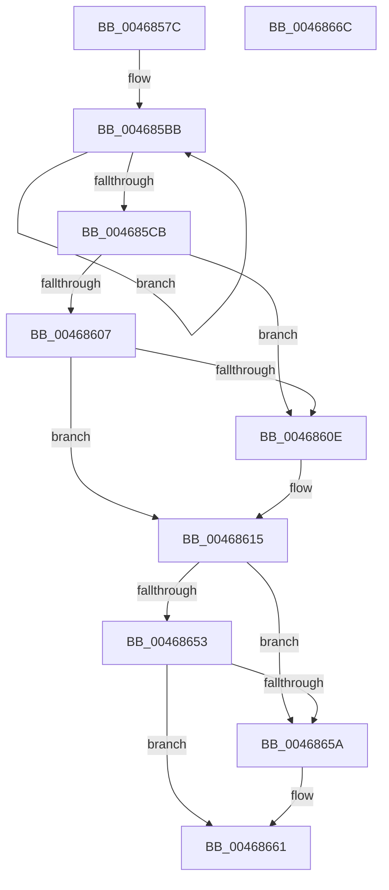

# SmHpChunkHeapInitialize

- RVA: `0x0046857C`–`0x0046866D` (길이 `241` bytes)
- VA: `0x000000014046857C`
- 실행 섹션: `.text`
- PDB 이름 있음: `예`; PDB Function 태그: `아니요`
- unwind 정보 RVA: `0x0005CAAC`
- 디코드: `63`개 명령, `241/241` bytes 표시
- 미해석 바이트: `0` (있으면 어셈블리에 `.byte`로 보존)

> 이 문서는 커널 이미지의 기계어와 PDB 기호를 분석해 생성했습니다. 4번과 5번은 함수 원형과 자료형을 바이너리 사용 방식에서 추정한 C 해석이며 원본 소스 복구 결과는 아닙니다.

## 1. Dependencies

- 직접 호출 지점: **1**; 고유 호출 대상: **1**
- 직접 호출자로 확인된 함수: **3**
- RIP 상대 이미지 참조: **0**

### Outgoing calls
- `0x00468594` → [memset](../6C/memset_function_006C6C40.md) (function, `0x006C6C40`)

### Direct callers
- [ST_STORE&lt;SM_TRAITS&gt;::StDmCleanup](../3A/ST_STORE_SM_TRAITS_StDmCleanup_function_003AF8D4.md) at `0x003AFB83`
- [ST_STORE&lt;SM_TRAITS&gt;::StDmStart](../3B/ST_STORE_SM_TRAITS_StDmStart_function_003B25C8.md) at `0x003B28B1`
- [ST_STORE&lt;SM_TRAITS&gt;::StDmInitialize](ST_STORE_SM_TRAITS_StDmInitialize_function_004682B4.md) at `0x0046835E`

### Static image references
- 디코드된 RIP-relative 메모리 참조가 없습니다.

## 2. Other-region calls and transfers

- 다른 실행 섹션으로 향하는 call: **0**
- 별도 외부 분기/꼬리 이동을 확인하지 못했습니다.

## 3. Assembly (complete function range)

```asm
0046857C  48 89 5C 24 08                  mov qword ptr [rsp + 8], rbx
00468581  57                              push rdi
00468582  48 83 EC 20                     sub rsp, 0x20
00468586  48 8B FA                        mov rdi, rdx
00468589  41 B8 38 02 00 00               mov r8d, 0x238
0046858F  33 D2                           xor edx, edx
00468591  48 8B D9                        mov rbx, rcx
00468594  E8 A7 E6 25 00                  call 0x1406c6c40
00468599  48 8B 07                        mov rax, qword ptr [rdi]
0046859C  41 BA 01 00 00 00               mov r10d, 1
004685A2  48 89 83 10 01 00 00            mov qword ptr [rbx + 0x110], rax
004685A9  48 8D 83 20 01 00 00            lea rax, [rbx + 0x120]
004685B0  44 89 93 00 01 00 00            mov dword ptr [rbx + 0x100], r10d
004685B7  41 8D 4A 0F                     lea ecx, [r10 + 0xf]
004685BB  48 89 40 08                     mov qword ptr [rax + 8], rax
004685BF  48 89 00                        mov qword ptr [rax], rax
004685C2  48 83 C0 10                     add rax, 0x10
004685C6  49 2B CA                        sub rcx, r10
004685C9  75 F0                           jne 0x1404685bb
004685CB  8B 47 04                        mov eax, dword ptr [rdi + 4]
004685CE  33 D2                           xor edx, edx
004685D0  41 83 C8 FF                     or r8d, 0xffffffff
004685D4  44 89 83 20 02 00 00            mov dword ptr [rbx + 0x220], r8d
004685DB  44 8D 48 17                     lea r9d, [rax + 0x17]
004685DF  F7 D8                           neg eax
004685E1  44 23 C8                        and r9d, eax
004685E4  B8 00 10 00 00                  mov eax, 0x1000
004685E9  41 2B C1                        sub eax, r9d
004685EC  F7 37                           div dword ptr [rdi]
004685EE  89 83 24 02 00 00               mov dword ptr [rbx + 0x224], eax
004685F4  0F BD C0                        bsr eax, eax
004685F7  89 83 08 01 00 00               mov dword ptr [rbx + 0x108], eax
004685FD  8B 93 24 02 00 00               mov edx, dword ptr [rbx + 0x224]
00468603  85 D2                           test edx, edx
00468605  74 07                           je 0x14046860e
00468607  8D 42 FF                        lea eax, [rdx - 1]
0046860A  85 C2                           test edx, eax
0046860C  74 07                           je 0x140468615
0046860E  44 01 93 08 01 00 00            add dword ptr [rbx + 0x108], r10d
00468615  8B 8B 08 01 00 00               mov ecx, dword ptr [rbx + 0x108]
0046861B  41 8B C2                        mov eax, r10d
0046861E  D3 E0                           shl eax, cl
00468620  41 D3 E8                        shr r8d, cl
00468623  41 2B C2                        sub eax, r10d
00468626  89 83 0C 01 00 00               mov dword ptr [rbx + 0x10c], eax
0046862C  8D 4A 0F                        lea ecx, [rdx + 0xf]
0046862F  C1 E9 04                        shr ecx, 4
00468632  0F BD C1                        bsr eax, ecx
00468635  44 89 83 04 01 00 00            mov dword ptr [rbx + 0x104], r8d
0046863C  44 89 8B 18 01 00 00            mov dword ptr [rbx + 0x118], r9d
00468643  89 93 2C 02 00 00               mov dword ptr [rbx + 0x22c], edx
00468649  89 83 28 02 00 00               mov dword ptr [rbx + 0x228], eax
0046864F  85 C9                           test ecx, ecx
00468651  74 07                           je 0x14046865a
00468653  8D 41 FF                        lea eax, [rcx - 1]
00468656  85 C1                           test ecx, eax
00468658  74 07                           je 0x140468661
0046865A  44 01 93 28 02 00 00            add dword ptr [rbx + 0x228], r10d
00468661  48 8B 5C 24 30                  mov rbx, qword ptr [rsp + 0x30]
00468666  48 83 C4 20                     add rsp, 0x20
0046866A  5F                              pop rdi
0046866B  C3                              ret
0046866C  CC                              int3
```

## 4. C-style interpretation (structured pseudocode)

```c
__int64 __fastcall SmHpChunkHeapInitialize(__int64 a1, __int64 a2)
{
    __int64 result;
    __int64 v_rsp;
    unsigned __int64 v_stack_p8;

    v_stack_p8 = v_rbx;
    v_rsp = (v_rsp) - (32);
    a2 = 0;
    result = memset(a1, a2, 568, a4);
    *(unsigned __int64 *)(a1 + 272) = *(unsigned __int64 *)(a2);
    *(unsigned int *)(a1 + 256) = 1;
loc_004685BB:
    *(unsigned __int64 *)(a1 + 288 + 8) = a1 + 288;
    *(unsigned __int64 *)(a1 + 288) = a1 + 288;
    result = (a1 + 288) + (16);
    a1 = (1 + 15) - (1);
    if (condition_is_not_equal) goto loc_004685BB;
    a2 = 0;
    a3 = (unsigned int)((568) | (0xFFFFFFFFULL));
    *(unsigned int *)(a1 + 544) = (unsigned int)(a3);
    result = (unsigned int)(-((unsigned int)(*(unsigned int *)(a2 + 4))));
    a4 = (unsigned int)(((unsigned int)(*(unsigned int *)(a2 + 4)) + 23) & ((unsigned int)(result)));
    result = (unsigned int)(((unsigned int)(0x1000ULL)) - ((unsigned int)(a4)));
    *(unsigned int *)(a1 + 548) = (unsigned int)(result);
    *(unsigned int *)(a1 + 264) = (unsigned int)(result);
    if ((unsigned int)((unsigned int)(*(unsigned int *)(a1 + 548))) == 0) goto loc_0046860E;
    if ((((unsigned int)((unsigned int)(*(unsigned int *)(a1 + 548)))) & ((unsigned int)((unsigned int)(*(unsigned int *)(a1 + 548)) - 1))) != 0) {
    }
    result = (unsigned int)((1) << ((unsigned __int8)((unsigned int)(*(unsigned int *)(a1 + 264)))));
    a3 = (unsigned int)((a3) >> ((unsigned __int8)((unsigned int)(*(unsigned int *)(a1 + 264)))));
    result = (unsigned int)((result) - (1));
    *(unsigned int *)(a1 + 268) = (unsigned int)(result);
    a1 = (unsigned int)(((unsigned int)(*(unsigned int *)(a1 + 548)) + 15) >> (4));
    *(unsigned int *)(a1 + 260) = (unsigned int)(a3);
    *(unsigned int *)(a1 + 280) = (unsigned int)(a4);
    *(unsigned int *)(a1 + 556) = (unsigned int)((unsigned int)(*(unsigned int *)(a1 + 548)));
    *(unsigned int *)(a1 + 552) = (unsigned int)(result);
    if ((unsigned int)(a1) == 0) goto loc_0046865A;
    if ((((unsigned int)(a1)) & ((unsigned int)(a1 - 1))) != 0) {
    }
    v_rsp = (v_rsp) + (32);
    return a1 - 1;
}
```

## 5. (Beta) C Style

```c
void *SmHpChunkHeapInitialize(void *Arg1, void *Arg2)
{
    uint8_t *arg1 = (uint8_t *)Arg1;
    uint8_t *arg2 = (uint8_t *)Arg2;

    int64_t result;
    int64_t local_rsp;
    uint64_t v_stack_p8;

    v_stack_p8 = local_rbx;
    local_rsp = (local_rsp) - (32);
    Arg2 = 0;
    result = memset(Arg1, Arg2, 568, a4);
    *(uint64_t *)(arg1 + 0x110) = *(uint64_t *)(arg2);
    *(uint32_t *)(arg1 + 0x100) = 1;
loc_004685BB:
    *(void **)(arg1 + 0x120 + 0x8) = Arg1 + 288;
    *(void **)(arg1 + 0x120) = Arg1 + 288;
    result = (Arg1 + 288) + (16);
    Arg1 = (1 + 15) - (1);
    if (condition_is_not_equal) goto loc_004685BB;
    Arg2 = 0;
    a3 = (uint32_t)((568) | (0xFFFFFFFFULL));
    *(uint32_t *)(arg1 + 0x220) = (uint32_t)(a3);
    result = (uint32_t)(-((uint32_t)(*(uint32_t *)(arg2 + 0x4))));
    a4 = (uint32_t)(((uint32_t)(*(uint32_t *)(arg2 + 0x4)) + 23) & ((uint32_t)(result)));
    result = (uint32_t)(((uint32_t)(0x1000ULL)) - ((uint32_t)(a4)));
    *(uint32_t *)(arg1 + 0x224) = (uint32_t)(result);
    *(uint32_t *)(arg1 + 0x108) = (uint32_t)(result);
    if ((uint32_t)((uint32_t)(*(uint32_t *)(arg1 + 0x224))) == 0) goto loc_0046860E;
    if ((((uint32_t)((uint32_t)(*(uint32_t *)(arg1 + 0x224)))) & ((uint32_t)((uint32_t)(*(uint32_t *)(arg1 + 0x224)) - 1))) != 0) {
    }
    result = (uint32_t)((1) << ((uint8_t)((uint32_t)(*(uint32_t *)(arg1 + 0x108)))));
    a3 = (uint32_t)((a3) >> ((uint8_t)((uint32_t)(*(uint32_t *)(arg1 + 0x108)))));
    result = (uint32_t)((result) - (1));
    *(uint32_t *)(arg1 + 0x10C) = (uint32_t)(result);
    Arg1 = (uint32_t)(((uint32_t)(*(uint32_t *)(arg1 + 0x224)) + 15) >> (4));
    *(uint32_t *)(arg1 + 0x104) = (uint32_t)(a3);
    *(uint32_t *)(arg1 + 0x118) = (uint32_t)(a4);
    *(uint32_t *)(arg1 + 0x22C) = (uint32_t)((uint32_t)(*(uint32_t *)(arg1 + 0x224)));
    *(uint32_t *)(arg1 + 0x228) = (uint32_t)(result);
    if ((uint32_t)(Arg1) == 0) goto loc_0046865A;
    if ((((uint32_t)(Arg1)) & ((uint32_t)(Arg1 - 1))) != 0) {
    }
    local_rsp = (local_rsp) + (32);
    return Arg1 - 1;
}
```

### 관측된 메모리 오프셋

구조체 형식이 확인되지 않은 접근은 인자 기준의 오프셋으로만 기록했습니다.

| 기준 인자 | 오프셋 표현 | 폭 (bit) | 접근 |
|---|---:|---:|---|
| `Arg1` | `+ 0x0` | `64` | `W` |
| `Arg1` | `+ 0x8` | `64` | `W` |
| `Arg1` | `+ 0x100` | `32` | `W` |
| `Arg1` | `+ 0x104` | `32` | `W` |
| `Arg1` | `+ 0x108` | `32` | `R` |
| `Arg1` | `+ 0x108` | `32` | `R/W` |
| `Arg1` | `+ 0x108` | `32` | `W` |
| `Arg1` | `+ 0x10C` | `32` | `W` |
| `Arg1` | `+ 0x110` | `64` | `W` |
| `Arg1` | `+ 0x118` | `32` | `W` |
| `Arg1` | `+ 0x120` | `64` | `R` |
| `Arg1` | `+ 0x220` | `32` | `W` |
| `Arg1` | `+ 0x224` | `32` | `R` |
| `Arg1` | `+ 0x224` | `32` | `W` |
| `Arg1` | `+ 0x228` | `32` | `R/W` |
| `Arg1` | `+ 0x228` | `32` | `W` |
| `Arg1` | `+ 0x22C` | `32` | `W` |
| `Arg2` | `+ 0x0` | `32` | `R` |
| `Arg2` | `+ 0x0` | `64` | `R` |
| `Arg2` | `+ 0x4` | `32` | `R` |

## 6. Execution-region graph

[열기: 2D/3D 그래프와 함수 탐색 컨트롤 패널](../../../control-panel.html?section=text&rva=0x0046857C&view=graph)

- 2D 그래프는 위에서 아래로 흐르고, 3D 그래프는 빈 공간을 드래그해 회전합니다. Shift+드래그는 이동, 휠은 확대·축소, 함수 노드 선택은 대상 보고서 이동입니다.

### Static fallback


