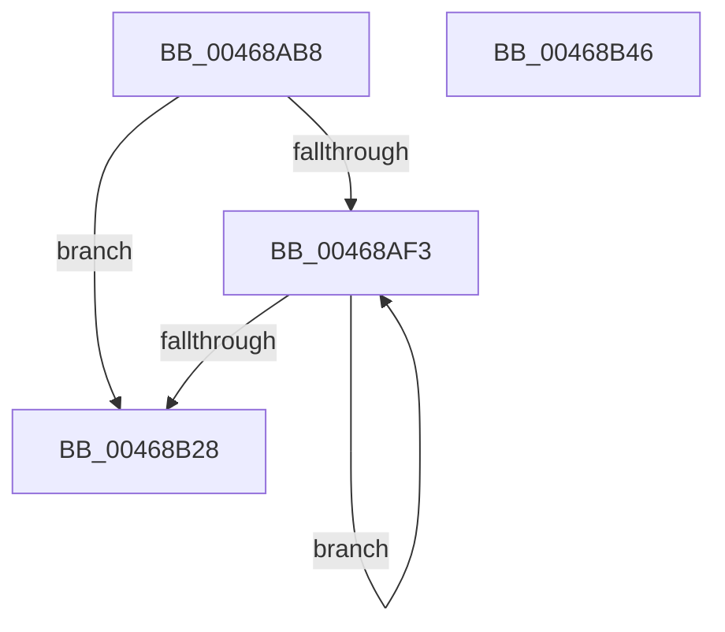

# StLcInitialize

- RVA: `0x00468AB8`–`0x00468B47` (길이 `143` bytes)
- VA: `0x0000000140468AB8`
- 실행 섹션: `.text`
- PDB 이름 있음: `예`; PDB Function 태그: `아니요`
- unwind 정보 RVA: `0x00068D5C`
- 디코드: `38`개 명령, `143/143` bytes 표시
- 미해석 바이트: `0` (있으면 어셈블리에 `.byte`로 보존)

> 이 문서는 커널 이미지의 기계어와 PDB 기호를 분석해 생성했습니다. 4번과 5번은 함수 원형과 자료형을 바이너리 사용 방식에서 추정한 C 해석이며 원본 소스 복구 결과는 아닙니다.

## 1. Dependencies

- 직접 호출 지점: **1**; 고유 호출 대상: **1**
- 직접 호출자로 확인된 함수: **1**
- RIP 상대 이미지 참조: **0**

### Outgoing calls
- `0x00468ADF` → [KeQueryPerformanceCounter](../37/KeQueryPerformanceCounter_function_0037E7E0.md) (function, `0x0037E7E0`)

### Direct callers
- [ST_STORE&lt;SM_TRAITS&gt;::StInitialize](ST_STORE_SM_TRAITS_StInitialize_function_00468158.md) at `0x00468268`

### Static image references
- 디코드된 RIP-relative 메모리 참조가 없습니다.

## 2. Other-region calls and transfers

- 다른 실행 섹션으로 향하는 call: **0**
- 별도 외부 분기/꼬리 이동을 확인하지 못했습니다.

## 3. Assembly (complete function range)

```asm
00468AB8  48 89 5C 24 10                  mov qword ptr [rsp + 0x10], rbx
00468ABD  57                              push rdi
00468ABE  48 83 EC 20                     sub rsp, 0x20
00468AC2  48 83 64 24 30 00               and qword ptr [rsp + 0x30], 0
00468AC8  0F 57 C0                        xorps xmm0, xmm0
00468ACB  0F 11 01                        movups xmmword ptr [rcx], xmm0
00468ACE  33 C0                           xor eax, eax
00468AD0  48 8B D9                        mov rbx, rcx
00468AD3  48 89 41 10                     mov qword ptr [rcx + 0x10], rax
00468AD7  49 8B F8                        mov rdi, r8
00468ADA  48 8D 4C 24 30                  lea rcx, [rsp + 0x30]
00468ADF  E8 FC 5C F1 FF                  call 0x14037e7e0
00468AE4  4C 8D 8F 80 00 00 00            lea r9, [rdi + 0x80]
00468AEB  4C 8B C7                        mov r8, rdi
00468AEE  49 3B F9                        cmp rdi, r9
00468AF1  73 35                           jae 0x140468b28
00468AF3  41 8B 08                        mov ecx, dword ptr [r8]
00468AF6  48 B8 DB 34 B6 D7 82 DE 1B 43   movabs rax, 0x431bde82d7b634db
00468B00  48 0F AF 4C 24 30               imul rcx, qword ptr [rsp + 0x30]
00468B06  41 83 60 08 00                  and dword ptr [r8 + 8], 0
00468B0B  48 F7 E9                        imul rcx
00468B0E  48 C1 FA 12                     sar rdx, 0x12
00468B12  48 8B C2                        mov rax, rdx
00468B15  48 C1 E8 3F                     shr rax, 0x3f
00468B19  48 03 D0                        add rdx, rax
00468B1C  49 89 10                        mov qword ptr [r8], rdx
00468B1F  49 83 C0 10                     add r8, 0x10
00468B23  4D 3B C1                        cmp r8, r9
00468B26  72 CB                           jb 0x140468af3
00468B28  49 83 49 F0 FF                  or qword ptr [r9 - 0x10], 0xffffffffffffffff
00468B2D  C7 43 08 08 00 00 00            mov dword ptr [rbx + 8], 8
00468B34  48 89 7B 10                     mov qword ptr [rbx + 0x10], rdi
00468B38  48 89 3B                        mov qword ptr [rbx], rdi
00468B3B  48 8B 5C 24 38                  mov rbx, qword ptr [rsp + 0x38]
00468B40  48 83 C4 20                     add rsp, 0x20
00468B44  5F                              pop rdi
00468B45  C3                              ret
00468B46  CC                              int3
```

## 4. C-style interpretation (structured pseudocode)

```c
__int64 __fastcall StLcInitialize(__int64 a1, __int64 a2, __int64 a3)
{
    __int64 result;
    __int64 v_rsp;
    unsigned __int64 v_stack_p10;
    unsigned __int64 v_stack_p8;

    v_stack_p10 = v_rbx;
    v_rsp = (v_rsp) - (32);
    *(unsigned __int64 *)(a1) = v_xmm0;
    result = 0;
    *(unsigned __int64 *)(a1 + 16) = 0;
    result = KeQueryPerformanceCounter(v_stack_p8, a2, a3, a4);
    if (a3 >= (a3 + 128)) goto loc_00468B28;
loc_00468AF3:
    a1 = ((unsigned int)(*(unsigned int *)(a3))) * (v_stack_p8);
    a2 = (a2) >> (18);
    result = (a2) >> (63);
    a2 = (a2) + (result);
    *(unsigned __int64 *)(a3) = a2;
    a3 = (a3) + (16);
    if (a3 < (a3 + 128)) goto loc_00468AF3;
loc_00468B28:
    *(unsigned int *)(a1 + 8) = 8;
    *(unsigned __int64 *)(a1 + 16) = a3;
    *(unsigned __int64 *)(a1) = a3;
    v_rsp = (v_rsp) + (32);
    return result;
}
```

## 5. (Beta) C Style

```c
int64_t StLcInitialize(void *Arg1, int64_t Arg2, void *Arg3)
{
    uint8_t *arg1 = (uint8_t *)Arg1;
    uint8_t *arg3 = (uint8_t *)Arg3;

    int64_t result;
    int64_t local_rsp;
    uint64_t v_stack_p10;
    uint64_t v_stack_p8;

    v_stack_p10 = local_rbx;
    local_rsp = (local_rsp) - (32);
    *(uint64_t *)(arg1) = v_xmm0;
    result = 0;
    *(uint64_t *)(arg1 + 0x10) = 0;
    result = KeQueryPerformanceCounter(v_stack_p8, Arg2, Arg3, a4);
    if (Arg3 >= (Arg3 + 128)) goto loc_00468B28;
loc_00468AF3:
    Arg1 = ((uint32_t)(*(uint32_t *)(arg3))) * (v_stack_p8);
    Arg2 = (Arg2) >> (18);
    result = (Arg2) >> (63);
    Arg2 = (Arg2) + (result);
    *(uint64_t *)(arg3) = Arg2;
    Arg3 = (Arg3) + (16);
    if (Arg3 < (Arg3 + 128)) goto loc_00468AF3;
loc_00468B28:
    *(uint32_t *)(arg1 + 0x8) = 8;
    *(void **)(arg1 + 0x10) = Arg3;
    *(void **)(arg1) = Arg3;
    local_rsp = (local_rsp) + (32);
    return result;
}
```

### 관측된 메모리 오프셋

구조체 형식이 확인되지 않은 접근은 인자 기준의 오프셋으로만 기록했습니다.

| 기준 인자 | 오프셋 표현 | 폭 (bit) | 접근 |
|---|---:|---:|---|
| `Arg1` | `+ 0x0` | `64` | `W` |
| `Arg1` | `+ 0x0` | `128` | `R` |
| `Arg1` | `+ 0x8` | `32` | `W` |
| `Arg1` | `+ 0x10` | `64` | `W` |
| `Arg3` | `- 0x10` | `64` | `R/W` |
| `Arg3` | `+ 0x80` | `64` | `R` |

## 6. Execution-region graph

[열기: 2D/3D 그래프와 함수 탐색 컨트롤 패널](../../../control-panel.html?section=text&rva=0x00468AB8&view=graph)

- 2D 그래프는 위에서 아래로 흐르고, 3D 그래프는 빈 공간을 드래그해 회전합니다. Shift+드래그는 이동, 휠은 확대·축소, 함수 노드 선택은 대상 보고서 이동입니다.

### Static fallback


