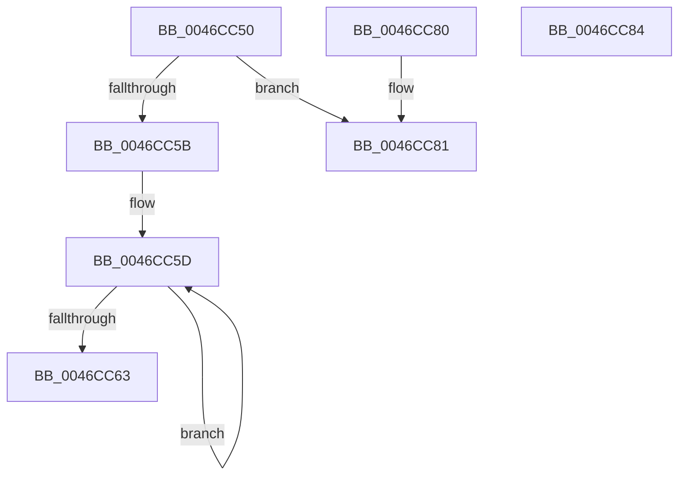

# VerSetConditionMask

- RVA: `0x0046CC50`–`0x0046CC85` (길이 `53` bytes)
- VA: `0x000000014046CC50`
- 실행 섹션: `.text`
- PDB 이름 있음: `예`; PDB Function 태그: `아니요`
- unwind 정보 RVA: `0x000DB714`
- 디코드: `20`개 명령, `53/53` bytes 표시
- 미해석 바이트: `0` (있으면 어셈블리에 `.byte`로 보존)

> 이 문서는 커널 이미지의 기계어와 PDB 기호를 분석해 생성했습니다. 4번과 5번은 함수 원형과 자료형을 바이너리 사용 방식에서 추정한 C 해석이며 원본 소스 복구 결과는 아닙니다.

## 1. Dependencies

- 직접 호출 지점: **0**; 고유 호출 대상: **0**
- 직접 호출자로 확인된 함수: **2**
- RIP 상대 이미지 참조: **0**

### Outgoing calls
- 직접 디코드된 call 명령이 없습니다.

### Direct callers
- [WdipSemLoadScenarioTable](../../page/7B/WdipSemLoadScenarioTable_function_007B02D8.md) at `0x007B057E`
- [AslpFileGetVersionBlock](../../page/81/AslpFileGetVersionBlock_function_0081FA50.md) at `0x0081FC0D`
- [AslpFileGetVersionBlock](../../page/81/AslpFileGetVersionBlock_function_0081FA50.md) at `0x0081FC1B`

### Static image references
- 디코드된 RIP-relative 메모리 참조가 없습니다.

## 2. Other-region calls and transfers

- 다른 실행 섹션으로 향하는 call: **0**
- 별도 외부 분기/꼬리 이동을 확인하지 못했습니다.

## 3. Assembly (complete function range)

```asm
0046CC50  41 80 E0 07                     and r8b, 7
0046CC54  4C 8B C9                        mov r9, rcx
0046CC57  85 D2                           test edx, edx
0046CC59  74 26                           je 0x14046cc81
0046CC5B  33 C0                           xor eax, eax
0046CC5D  FF C0                           inc eax
0046CC5F  D1 EA                           shr edx, 1
0046CC61  75 FA                           jne 0x14046cc5d
0046CC63  FF C8                           dec eax
0046CC65  8D 0C 40                        lea ecx, [rax + rax*2]
0046CC68  41 0F B6 C0                     movzx eax, r8b
0046CC6C  48 D3 E0                        shl rax, cl
0046CC6F  48 B9 00 00 00 00 00 00 00 80   movabs rcx, 0x8000000000000000
0046CC79  49 0B C1                        or rax, r9
0046CC7C  48 0B C1                        or rax, rcx
0046CC7F  C3                              ret
0046CC80  CC                              int3
0046CC81  33 C0                           xor eax, eax
0046CC83  C3                              ret
0046CC84  CC                              int3
```

## 4. C-style interpretation (structured pseudocode)

```c
__int64 __fastcall VerSetConditionMask(__int64 a1, int a2, unsigned __int8 a3)
{
    __int64 result;

    a3 = (unsigned __int8)((a3) & (7));
    if (a2 == 0) goto loc_0046CC81;
    result = 0;
loc_0046CC5D:
    result = (unsigned int)((result) + 1);
    a2 = (unsigned int)((a2) >> (1));
    if (condition_is_not_equal) goto loc_0046CC5D;
    result = (unsigned int)((result) - 1);
    result = (a3) << ((unsigned __int8)(result + result * 2));
    result = (result) | (a1);
    result = (result) | (result + result * 2);
    return result;
loc_0046CC81:
    result = 0;
    return result;
}
```

## 5. (Beta) C Style

```c
int64_t VerSetConditionMask(int64_t Arg1, int32_t Arg2, uint8_t Arg3)
{
    int64_t result;

    Arg3 = (uint8_t)((Arg3) & (7));
    if (Arg2 == 0) goto loc_0046CC81;
    result = 0;
loc_0046CC5D:
    result = (uint32_t)((result) + 1);
    Arg2 = (uint32_t)((Arg2) >> (1));
    if (condition_is_not_equal) goto loc_0046CC5D;
    result = (uint32_t)((result) - 1);
    result = (Arg3) << ((uint8_t)(result + result * 2));
    result = (result) | (Arg1);
    result = (result) | (result + result * 2);
    return result;
loc_0046CC81:
    result = 0;
    return result;
}
```

## 6. Execution-region graph

[열기: 2D/3D 그래프와 함수 탐색 컨트롤 패널](../../../control-panel.html?section=text&rva=0x0046CC50&view=graph)

- 2D 그래프는 위에서 아래로 흐르고, 3D 그래프는 빈 공간을 드래그해 회전합니다. Shift+드래그는 이동, 휠은 확대·축소, 함수 노드 선택은 대상 보고서 이동입니다.

### Static fallback


