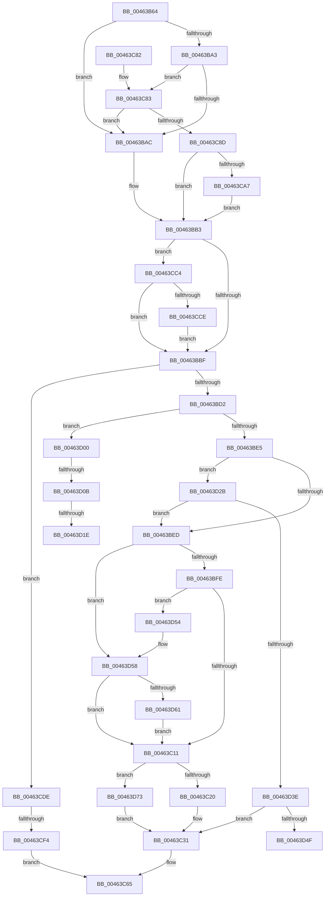

# VmpInsertInvalidateListRange

- RVA: `0x00463B64`–`0x00463D7E` (길이 `538` bytes)
- VA: `0x0000000140463B64`
- 실행 섹션: `.text`
- PDB 이름 있음: `예`; PDB Function 태그: `예`
- unwind 정보 RVA: `0x000AA7A8`
- 디코드: `138`개 명령, `538/538` bytes 표시
- 미해석 바이트: `0` (있으면 어셈블리에 `.byte`로 보존)

> 이 문서는 커널 이미지의 기계어와 PDB 기호를 분석해 생성했습니다. 4번과 5번은 함수 원형과 자료형을 바이너리 사용 방식에서 추정한 C 해석이며 원본 소스 복구 결과는 아닙니다.

## 1. Dependencies

- 직접 호출 지점: **3**; 고유 호출 대상: **2**
- 직접 호출자로 확인된 함수: **3**
- RIP 상대 이미지 참조: **1**

### Outgoing calls
- `0x00463CBA` → [VmpLogTbFlushSlatInvalidateInsert](../64/VmpLogTbFlushSlatInvalidateInsert_function_0064DF50.md) (function, `0x0064DF50`)
- `0x00463CD4` → [VmpProcessInvalidateList](../42/VmpProcessInvalidateList_function_00428A54.md) (function, `0x00428A54`)
- `0x00463D67` → [VmpProcessInvalidateList](../42/VmpProcessInvalidateList_function_00428A54.md) (function, `0x00428A54`)

### Direct callers
- [VmpFlushTb](../31/VmpFlushTb_function_00311BD0.md) at `0x00311CD9`
- [VmpFlushTb](../31/VmpFlushTb_function_00311BD0.md) at `0x00311E53`
- [VmpFlushTb](../31/VmpFlushTb_function_00311BD0.md) at `0x00311F02`
- [sub_00314541](../31/Unknown_function_00314541.md) at `0x0031455F`
- [VmpInvalidateSlatBatched](../48/VmpInvalidateSlatBatched_function_00489300.md) at `0x00489416`

### Static image references
- `0x00463B8B` → RVA `0x00F02458` (`.data`; read)

## 2. Other-region calls and transfers

- 다른 실행 섹션으로 향하는 call: **0**
- call이 아닌 외부 분기/꼬리 이동: **5**
  - `0x00463CEE` → [sub_006F2C26](../6F/Unknown_function_006F2C26.md) (`tail-transfer`)
  - `0x00463D05` → [sub_006F2C26 + 0x11](../6F/Unknown_function_006F2C26.md) (`tail-transfer`)
  - `0x00463D18` → [sub_006F2C26 + 0x28](../6F/Unknown_function_006F2C26.md) (`tail-transfer`)
  - `0x00463D26` → [sub_006F2C26 + 0x14](../6F/Unknown_function_006F2C26.md) (`tail-transfer`)
  - `0x00463D4F` → [sub_006F2C26 + 0x28](../6F/Unknown_function_006F2C26.md) (`tail-transfer`)

## 3. Assembly (complete function range)

```asm
00463B64  48 89 5C 24 08                  mov qword ptr [rsp + 8], rbx
00463B69  48 89 6C 24 10                  mov qword ptr [rsp + 0x10], rbp
00463B6E  48 89 74 24 18                  mov qword ptr [rsp + 0x18], rsi
00463B73  57                              push rdi
00463B74  41 54                           push r12
00463B76  41 55                           push r13
00463B78  41 56                           push r14
00463B7A  41 57                           push r15
00463B7C  48 83 EC 30                     sub rsp, 0x30
00463B80  4C 8B BC 24 80 00 00 00         mov r15, qword ptr [rsp + 0x80]
00463B88  4C 8B E9                        mov r13, rcx
00463B8B  48 8B 0D C6 E8 A9 00            mov rcx, qword ptr [rip + 0xa9e8c6]
00463B92  45 33 F6                        xor r14d, r14d
00463B95  4D 8B D1                        mov r10, r9
00463B98  49 8B E8                        mov rbp, r8
00463B9B  48 8B DA                        mov rbx, rdx
00463B9E  48 85 C9                        test rcx, rcx
00463BA1  74 09                           je 0x140463bac
00463BA3  44 39 31                        cmp dword ptr [rcx], r14d
00463BA6  0F 87 D7 00 00 00               ja 0x140463c83
00463BAC  8B BC 24 88 00 00 00            mov edi, dword ptr [rsp + 0x88]
00463BB3  0F B7 43 06                     movzx eax, word ptr [rbx + 6]
00463BB7  3B C7                           cmp eax, edi
00463BB9  0F 85 05 01 00 00               jne 0x140463cc4
00463BBF  8B 43 04                        mov eax, dword ptr [rbx + 4]
00463BC2  48 8D 73 10                     lea rsi, [rbx + 0x10]
00463BC6  48 8D 7B 08                     lea rdi, [rbx + 8]
00463BCA  A8 02                           test al, 2
00463BCC  0F 85 0C 01 00 00               jne 0x140463cde
00463BD2  8B 43 04                        mov eax, dword ptr [rbx + 4]
00463BD5  83 E0 01                        and eax, 1
00463BD8  49 81 FF FF 0F 00 00            cmp r15, 0xfff
00463BDF  0F 87 1B 01 00 00               ja 0x140463d00
00463BE5  85 C0                           test eax, eax
00463BE7  0F 85 3E 01 00 00               jne 0x140463d2b
00463BED  8B 13                           mov edx, dword ptr [rbx]
00463BEF  48 8B F7                        mov rsi, rdi
00463BF2  81 FA 00 02 00 00               cmp edx, 0x200
00463BF8  0F 84 5A 01 00 00               je 0x140463d58
00463BFE  48 8B 0F                        mov rcx, qword ptr [rdi]
00463C01  49 03 CF                        add rcx, r15
00463C04  48 81 F9 FF 00 00 00            cmp rcx, 0xff
00463C0B  0F 83 43 01 00 00               jae 0x140463d54
00463C11  48 8B FE                        mov rdi, rsi
00463C14  8B 43 04                        mov eax, dword ptr [rbx + 4]
00463C17  4C 39 36                        cmp qword ptr [rsi], r14
00463C1A  0F 85 53 01 00 00               jne 0x140463d73
00463C20  83 C8 01                        or eax, 1
00463C23  89 43 04                        mov dword ptr [rbx + 4], eax
00463C26  8B 84 24 88 00 00 00            mov eax, dword ptr [rsp + 0x88]
00463C2D  66 89 43 06                     mov word ptr [rbx + 6], ax
00463C31  8B CA                           mov ecx, edx
00463C33  48 C1 E5 0C                     shl rbp, 0xc
00463C37  8B 44 CB 10                     mov eax, dword ptr [rbx + rcx*8 + 0x10]
00463C3B  25 FF 0F 00 00                  and eax, 0xfff
00463C40  48 0B C5                        or rax, rbp
00463C43  48 89 44 CB 10                  mov qword ptr [rbx + rcx*8 + 0x10], rax
00463C48  49 8B C7                        mov rax, r15
00463C4B  8B 0B                           mov ecx, dword ptr [rbx]
00463C4D  48 33 44 CB 10                  xor rax, qword ptr [rbx + rcx*8 + 0x10]
00463C52  48 25 00 F0 FF FF               and rax, 0xfffffffffffff000
00463C58  49 33 C7                        xor rax, r15
00463C5B  48 89 44 CB 10                  mov qword ptr [rbx + rcx*8 + 0x10], rax
00463C60  FF 03                           inc dword ptr [rbx]
00463C62  4C 01 3F                        add qword ptr [rdi], r15
00463C65  48 8B 5C 24 60                  mov rbx, qword ptr [rsp + 0x60]
00463C6A  48 8B 6C 24 68                  mov rbp, qword ptr [rsp + 0x68]
00463C6F  48 8B 74 24 70                  mov rsi, qword ptr [rsp + 0x70]
00463C74  48 83 C4 30                     add rsp, 0x30
00463C78  41 5F                           pop r15
00463C7A  41 5E                           pop r14
00463C7C  41 5D                           pop r13
00463C7E  41 5C                           pop r12
00463C80  5F                              pop rdi
00463C81  C3                              ret
00463C82  CC                              int3
00463C83  F6 41 10 02                     test byte ptr [rcx + 0x10], 2
00463C87  0F 84 1F FF FF FF               je 0x140463bac
00463C8D  48 8B 49 18                     mov rcx, qword ptr [rcx + 0x18]
00463C91  8B BC 24 88 00 00 00            mov edi, dword ptr [rsp + 0x88]
00463C98  48 8B C1                        mov rax, rcx
00463C9B  83 E0 02                        and eax, 2
00463C9E  48 3B C1                        cmp rax, rcx
00463CA1  0F 85 0C FF FF FF               jne 0x140463bb3
00463CA7  49 8B 45 68                     mov rax, qword ptr [r13 + 0x68]
00463CAB  4D 8B CF                        mov r9, r15
00463CAE  48 89 44 24 28                  mov qword ptr [rsp + 0x28], rax
00463CB3  49 8B D2                        mov rdx, r10
00463CB6  89 7C 24 20                     mov dword ptr [rsp + 0x20], edi
00463CBA  E8 91 A2 1E 00                  call 0x14064df50
00463CBF  E9 EF FE FF FF                  jmp 0x140463bb3
00463CC4  4C 39 73 08                     cmp qword ptr [rbx + 8], r14
00463CC8  0F 84 F1 FE FF FF               je 0x140463bbf
00463CCE  48 8B D3                        mov rdx, rbx
00463CD1  49 8B CD                        mov rcx, r13
00463CD4  E8 7B 4D FC FF                  call 0x140428a54
00463CD9  E9 E1 FE FF FF                  jmp 0x140463bbf
00463CDE  48 8B 06                        mov rax, qword ptr [rsi]
00463CE1  48 8B 0F                        mov rcx, qword ptr [rdi]
00463CE4  48 C1 E8 0C                     shr rax, 0xc
00463CE8  48 03 C1                        add rax, rcx
00463CEB  48 3B E8                        cmp rbp, rax
00463CEE  0F 85 32 EF 28 00               jne 0x1406f2c26
00463CF4  4A 8D 04 39                     lea rax, [rcx + r15]
00463CF8  48 89 07                        mov qword ptr [rdi], rax
00463CFB  E9 65 FF FF FF                  jmp 0x140463c65
00463D00  4C 8B F7                        mov r14, rdi
00463D03  85 C0                           test eax, eax
00463D05  0F 84 2C EF 28 00               je 0x1406f2c37
00463D0B  48 8B 06                        mov rax, qword ptr [rsi]
00463D0E  48 C1 E8 0C                     shr rax, 0xc
00463D12  48 03 07                        add rax, qword ptr [rdi]
00463D15  48 3B E8                        cmp rbp, rax
00463D18  0F 84 30 EF 28 00               je 0x1406f2c4e
00463D1E  4C 8D 63 10                     lea r12, [rbx + 0x10]
00463D22  4C 8D 73 08                     lea r14, [rbx + 8]
00463D26  E9 0F EF 28 00                  jmp 0x1406f2c3a
00463D2B  48 8B 06                        mov rax, qword ptr [rsi]
00463D2E  48 C1 E8 0C                     shr rax, 0xc
00463D32  48 03 07                        add rax, qword ptr [rdi]
00463D35  48 3B E8                        cmp rbp, rax
00463D38  0F 85 AF FE FF FF               jne 0x140463bed
00463D3E  8B 13                           mov edx, dword ptr [rbx]
00463D40  4C 8B F7                        mov r14, rdi
00463D43  81 FA 00 02 00 00               cmp edx, 0x200
00463D49  0F 85 E2 FE FF FF               jne 0x140463c31
00463D4F  E9 FA EE 28 00                  jmp 0x1406f2c4e
00463D54  48 8D 73 08                     lea rsi, [rbx + 8]
00463D58  4C 39 37                        cmp qword ptr [rdi], r14
00463D5B  0F 84 B0 FE FF FF               je 0x140463c11
00463D61  48 8B D3                        mov rdx, rbx
00463D64  49 8B CD                        mov rcx, r13
00463D67  E8 E8 4C FC FF                  call 0x140428a54
00463D6C  8B 13                           mov edx, dword ptr [rbx]
00463D6E  E9 9E FE FF FF                  jmp 0x140463c11
00463D73  83 E0 FE                        and eax, 0xfffffffe
00463D76  89 43 04                        mov dword ptr [rbx + 4], eax
00463D79  E9 B3 FE FF FF                  jmp 0x140463c31
```

## 4. C-style interpretation (structured pseudocode)

```c
__int64 __fastcall VmpInsertInvalidateListRange(__int64 a1, __int64 a2, __int64 a3, __int64 a4, __int64 a5, unsigned int a6)
{
    __int64 result;
    __int64 v_r14;
    __int64 v_rbp;
    __int64 v_rsp;
    unsigned __int64 v_stack_p10;
    unsigned __int64 v_stack_p18;
    unsigned int v_stack_p20;
    unsigned __int64 v_stack_p28;
    unsigned __int64 v_stack_p8;

    v_stack_p8 = v_rbx;
    v_stack_p10 = v_rbp;
    v_stack_p18 = v_rsi;
    v_rsp = (v_rsp) - (48);
    v_r14 = 0;
    if (*(unsigned __int64 *)(v_rip + 11135174) == 0) goto loc_00463BAC;
    if ((*(unsigned int *)(*(unsigned __int64 *)(v_rip + 11135174))) > 0) goto loc_00463C83;
loc_00463BAC:
loc_00463BB3:
    if (((unsigned int)(*(unsigned __int16 *)(a2 + 6))) != ((unsigned int)((unsigned int)(a6)))) goto loc_00463CC4;
loc_00463BBF:
    if ((((unsigned __int8)((unsigned int)(*(unsigned int *)(a2 + 4)))) & (2)) != 0) goto loc_00463CDE;
    result = (unsigned int)(((unsigned int)(*(unsigned int *)(a2 + 4))) & (1));
    if (a5 > 0xFFFULL) goto loc_00463D00;
    if ((unsigned int)(result) != 0) goto loc_00463D2B;
loc_00463BED:
    if (((unsigned int)((unsigned int)(*(unsigned int *)(a2)))) == 512) goto loc_00463D58;
    a1 = (*(unsigned __int64 *)(a2 + 8)) + (a5);
    if (a1 >= 255) goto loc_00463D54;
loc_00463C11:
    if ((*(unsigned __int64 *)(a2 + 8)) != 0) goto loc_00463D73;
    result = (unsigned int)(((unsigned int)(*(unsigned int *)(a2 + 4))) | (1));
    *(unsigned int *)(a2 + 4) = (unsigned int)(result);
    *(unsigned __int16 *)(a2 + 6) = (unsigned __int16)((unsigned int)(a6));
loc_00463C31:
    v_rbp = (a3) << (12);
    result = (unsigned int)(((unsigned int)(*(unsigned int *)(a2 + (unsigned int)((unsigned int)((unsigned int)(*(unsigned int *)(a2)))) * 8 + 16))) & (0xFFFULL));
    result = (result) | (v_rbp);
    *(unsigned __int64 *)(a2 + (unsigned int)((unsigned int)((unsigned int)(*(unsigned int *)(a2)))) * 8 + 16) = result;
    result = (a5) ^ (*(unsigned __int64 *)(a2 + (unsigned int)(*(unsigned int *)(a2)) * 8 + 16));
    result = (result) & (0xFFFFFFFFFFFFF000ULL);
    result = (result) ^ (a5);
    *(unsigned __int64 *)(a2 + (unsigned int)(*(unsigned int *)(a2)) * 8 + 16) = result;
loc_00463C65:
    v_rsp = (v_rsp) + (48);
    return result;
loc_00463C83:
    if (((*(unsigned __int8 *)((unsigned int)(*(unsigned int *)(a2)) + 16)) & (2)) == 0) goto loc_00463BAC;
    result = (unsigned int)((*(unsigned __int64 *)((unsigned int)(*(unsigned int *)(a2)) + 24)) & (2));
    if (result != (*(unsigned __int64 *)((unsigned int)(*(unsigned int *)(a2)) + 24))) goto loc_00463BB3;
    v_stack_p28 = *(unsigned __int64 *)(a1 + 104);
    v_stack_p20 = (unsigned int)((unsigned int)(a6));
    result = VmpLogTbFlushSlatInvalidateInsert(*(unsigned __int64 *)((unsigned int)(*(unsigned int *)(a2)) + 24), a4, a3, a5);
    goto loc_00463BB3;
loc_00463CC4:
    if ((*(unsigned __int64 *)(v_stack_p8 + 8)) == 0) goto loc_00463BBF;
    result = VmpProcessInvalidateList(a1, v_stack_p8, a3, a5);
    goto loc_00463BBF;
loc_00463CDE:
    result = (*(unsigned __int64 *)(v_stack_p18)) >> (12);
    result = (result) + (*(unsigned __int64 *)((unsigned int)(a6)));
    *(unsigned __int64 *)((unsigned int)(a6)) = *(unsigned __int64 *)((unsigned int)(a6)) + a5 * 1;
    goto loc_00463C65;
loc_00463D00:
    result = (*(unsigned __int64 *)(v_stack_p18)) >> (12);
    result = (result) + (*(unsigned __int64 *)((unsigned int)(a6)));
loc_00463D2B:
    result = (*(unsigned __int64 *)(v_stack_p18)) >> (12);
    result = (result) + (*(unsigned __int64 *)((unsigned int)(a6)));
    if (v_stack_p10 != result) goto loc_00463BED;
    if (((unsigned int)((unsigned int)(*(unsigned int *)(v_stack_p8)))) != 512) goto loc_00463C31;
loc_00463D54:
loc_00463D58:
    if ((*(unsigned __int64 *)((unsigned int)(a6))) == ((unsigned int)(a6))) goto loc_00463C11;
    result = VmpProcessInvalidateList(a1, v_stack_p8, a3, a5);
    goto loc_00463C11;
loc_00463D73:
    result = (unsigned int)((result) & (0xFFFFFFFEULL));
    *(unsigned int *)(v_stack_p8 + 4) = (unsigned int)(result);
    goto loc_00463C31;
}
```

## 5. (Beta) C Style

```c
int64_t VmpInsertInvalidateListRange(void *Arg1, void *Arg2, int64_t Arg3, int64_t Arg4, int64_t Arg5, uint32_t Arg6)
{
    uint8_t *arg1 = (uint8_t *)Arg1;
    uint8_t *arg2 = (uint8_t *)Arg2;

    int64_t result;
    int64_t local_r14;
    int64_t local_rbp;
    int64_t local_rsp;
    uint64_t v_stack_p10;
    uint64_t v_stack_p18;
    uint32_t v_stack_p20;
    uint64_t v_stack_p28;
    uint64_t v_stack_p8;

    v_stack_p8 = local_rbx;
    v_stack_p10 = local_rbp;
    v_stack_p18 = local_rsi;
    local_rsp = (local_rsp) - (48);
    local_r14 = 0;
    if (*(uint64_t *)(v_rip + 0xA9E8C6) == 0) goto loc_00463BAC;
    if ((*(uint32_t *)(*(uint64_t *)(v_rip + 0xA9E8C6))) > 0) goto loc_00463C83;
loc_00463BAC:
loc_00463BB3:
    if (((uint32_t)(*(uint16_t *)(arg2 + 0x6))) != ((uint32_t)((uint32_t)(Arg6)))) goto loc_00463CC4;
loc_00463BBF:
    if ((((uint8_t)((uint32_t)(*(uint32_t *)(arg2 + 0x4)))) & (2)) != 0) goto loc_00463CDE;
    result = (uint32_t)(((uint32_t)(*(uint32_t *)(arg2 + 0x4))) & (1));
    if (Arg5 > 0xFFFULL) goto loc_00463D00;
    if ((uint32_t)(result) != 0) goto loc_00463D2B;
loc_00463BED:
    if (((uint32_t)((uint32_t)(*(uint32_t *)(arg2)))) == 512) goto loc_00463D58;
    Arg1 = (*(uint64_t *)(arg2 + 0x8)) + (Arg5);
    if (Arg1 >= 255) goto loc_00463D54;
loc_00463C11:
    if ((*(uint64_t *)(arg2 + 0x8)) != 0) goto loc_00463D73;
    result = (uint32_t)(((uint32_t)(*(uint32_t *)(arg2 + 0x4))) | (1));
    *(uint32_t *)(arg2 + 0x4) = (uint32_t)(result);
    *(uint16_t *)(arg2 + 0x6) = (uint16_t)((uint32_t)(Arg6));
loc_00463C31:
    local_rbp = (Arg3) << (12);
    result = (uint32_t)(((uint32_t)(*(uint32_t *)(arg2 + (uint32_t)((uint32_t)((uint32_t)(*(uint32_t *)(arg2)))) * 8 + 0x10))) & (0xFFFULL));
    result = (result) | (local_rbp);
    *(uint64_t *)(arg2 + (uint32_t)((uint32_t)((uint32_t)(*(uint32_t *)(arg2)))) * 8 + 0x10) = result;
    result = (Arg5) ^ (*(uint64_t *)(arg2 + (uint32_t)(*(uint32_t *)(arg2)) * 8 + 0x10));
    result = (result) & (0xFFFFFFFFFFFFF000ULL);
    result = (result) ^ (Arg5);
    *(uint64_t *)(arg2 + (uint32_t)(*(uint32_t *)(arg2)) * 8 + 0x10) = result;
loc_00463C65:
    local_rsp = (local_rsp) + (48);
    return result;
loc_00463C83:
    if (((*(uint8_t *)((uint32_t)(*(uint32_t *)(arg2)) + 0x10)) & (2)) == 0) goto loc_00463BAC;
    result = (uint32_t)((*(uint64_t *)((uint32_t)(*(uint32_t *)(arg2)) + 0x18)) & (2));
    if (result != (*(uint64_t *)((uint32_t)(*(uint32_t *)(arg2)) + 0x18))) goto loc_00463BB3;
    v_stack_p28 = *(uint64_t *)(arg1 + 0x68);
    v_stack_p20 = (uint32_t)((uint32_t)(Arg6));
    result = VmpLogTbFlushSlatInvalidateInsert(*(uint64_t *)((uint32_t)(*(uint32_t *)(arg2)) + 0x18), Arg4, Arg3, Arg5);
    goto loc_00463BB3;
loc_00463CC4:
    if ((*(uint64_t *)(v_stack_p8 + 0x8)) == 0) goto loc_00463BBF;
    result = VmpProcessInvalidateList(Arg1, v_stack_p8, Arg3, Arg5);
    goto loc_00463BBF;
loc_00463CDE:
    result = (*(uint64_t *)(v_stack_p18)) >> (12);
    result = (result) + (*(uint64_t *)((uint32_t)(Arg6)));
    *(uint64_t *)((uint32_t)(Arg6)) = *(uint64_t *)((uint32_t)(Arg6)) + Arg5 * 1;
    goto loc_00463C65;
loc_00463D00:
    result = (*(uint64_t *)(v_stack_p18)) >> (12);
    result = (result) + (*(uint64_t *)((uint32_t)(Arg6)));
loc_00463D2B:
    result = (*(uint64_t *)(v_stack_p18)) >> (12);
    result = (result) + (*(uint64_t *)((uint32_t)(Arg6)));
    if (v_stack_p10 != result) goto loc_00463BED;
    if (((uint32_t)((uint32_t)(*(uint32_t *)(v_stack_p8)))) != 512) goto loc_00463C31;
loc_00463D54:
loc_00463D58:
    if ((*(uint64_t *)((uint32_t)(Arg6))) == ((uint32_t)(Arg6))) goto loc_00463C11;
    result = VmpProcessInvalidateList(Arg1, v_stack_p8, Arg3, Arg5);
    goto loc_00463C11;
loc_00463D73:
    result = (uint32_t)((result) & (0xFFFFFFFEULL));
    *(uint32_t *)(v_stack_p8 + 0x4) = (uint32_t)(result);
    goto loc_00463C31;
}
```

### 관측된 메모리 오프셋

구조체 형식이 확인되지 않은 접근은 인자 기준의 오프셋으로만 기록했습니다.

| 기준 인자 | 오프셋 표현 | 폭 (bit) | 접근 |
|---|---:|---:|---|
| `Arg1` | `+ 0x68` | `64` | `R` |
| `Arg2` | `+ 0x0` | `32` | `R` |
| `Arg2` | `+ 0x0` | `32` | `R/W` |
| `Arg2` | `+ 0x0` | `64` | `R` |
| `Arg2` | `+ 0x0` | `64` | `R/W` |
| `Arg2` | `+ 0x0` | `64` | `W` |
| `Arg2` | `+ 0x4` | `32` | `R` |
| `Arg2` | `+ 0x4` | `32` | `W` |
| `Arg2` | `+ 0x6` | `16` | `R` |
| `Arg2` | `+ 0x6` | `16` | `W` |
| `Arg2` | `+ 0x8` | `64` | `R` |
| `Arg2` | `+ 0x10` | `64` | `R` |
| `Arg2` | `+ 0x10 + rcx*8` | `32` | `R` |
| `Arg2` | `+ 0x10 + rcx*8` | `64` | `R` |
| `Arg2` | `+ 0x10 + rcx*8` | `64` | `W` |

## 6. Execution-region graph

[열기: 2D/3D 그래프와 함수 탐색 컨트롤 패널](../../../control-panel.html?section=text&rva=0x00463B64&view=graph)

- 2D 그래프는 위에서 아래로 흐르고, 3D 그래프는 빈 공간을 드래그해 회전합니다. Shift+드래그는 이동, 휠은 확대·축소, 함수 노드 선택은 대상 보고서 이동입니다.

### Static fallback


