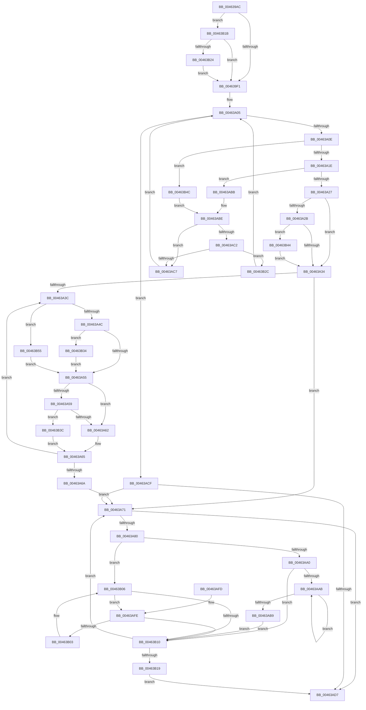

# VmpInvalidateOutstandingFaults

- RVA: `0x004639AC`–`0x00463B5E` (길이 `434` bytes)
- VA: `0x00000001404639AC`
- 실행 섹션: `.text`
- PDB 이름 있음: `예`; PDB Function 태그: `아니요`
- unwind 정보 RVA: `0x000AA78C`
- 디코드: `122`개 명령, `434/434` bytes 표시
- 미해석 바이트: `0` (있으면 어셈블리에 `.byte`로 보존)

> 이 문서는 커널 이미지의 기계어와 PDB 기호를 분석해 생성했습니다. 4번과 5번은 함수 원형과 자료형을 바이너리 사용 방식에서 추정한 C 해석이며 원본 소스 복구 결과는 아닙니다.

## 1. Dependencies

- 직접 호출 지점: **2**; 고유 호출 대상: **2**
- 직접 호출자로 확인된 함수: **3**
- RIP 상대 이미지 참조: **0**

### Outgoing calls
- `0x004639DB` → [ExAcquireSpinLockSharedAtDpcLevel](../24/ExAcquireSpinLockSharedAtDpcLevel_function_00248E30.md) (function, `0x00248E30`)
- `0x00463ADA` → [ExReleaseSpinLockSharedFromDpcLevel](../24/ExReleaseSpinLockSharedFromDpcLevel_function_0024A590.md) (function, `0x0024A590`)

### Direct callers
- [VmpFlushTb](../31/VmpFlushTb_function_00311BD0.md) at `0x00311CE7`
- [VmpFlushTb](../31/VmpFlushTb_function_00311BD0.md) at `0x00311E61`
- [VmpFlushTb](../31/VmpFlushTb_function_00311BD0.md) at `0x00311F11`
- [sub_00314541](../31/Unknown_function_00314541.md) at `0x0031456D`
- [VmpInvalidateSlatBatched](../48/VmpInvalidateSlatBatched_function_00489300.md) at `0x004893F5`

### Static image references
- 디코드된 RIP-relative 메모리 참조가 없습니다.

## 2. Other-region calls and transfers

- 다른 실행 섹션으로 향하는 call: **0**
- 별도 외부 분기/꼬리 이동을 확인하지 못했습니다.

## 3. Assembly (complete function range)

```asm
004639AC  48 8B C4                        mov rax, rsp
004639AF  48 89 58 08                     mov qword ptr [rax + 8], rbx
004639B3  48 89 68 10                     mov qword ptr [rax + 0x10], rbp
004639B7  48 89 70 18                     mov qword ptr [rax + 0x18], rsi
004639BB  48 89 78 20                     mov qword ptr [rax + 0x20], rdi
004639BF  41 56                           push r14
004639C1  48 83 EC 20                     sub rsp, 0x20
004639C5  48 8D 69 60                     lea rbp, [rcx + 0x60]
004639C9  48 8B D9                        mov rbx, rcx
004639CC  4D 8D 70 FF                     lea r14, [r8 - 1]
004639D0  48 8B CD                        mov rcx, rbp
004639D3  48 8B FA                        mov rdi, rdx
004639D6  4C 03 F2                        add r14, rdx
004639D9  33 F6                           xor esi, esi
004639DB  E8 50 54 DE FF                  call 0x140248e30
004639E0  48 83 C3 50                     add rbx, 0x50
004639E4  F6 43 08 01                     test byte ptr [rbx + 8], 1
004639E8  48 8B 0B                        mov rcx, qword ptr [rbx]
004639EB  0F 85 2A 01 00 00               jne 0x140463b1b
004639F1  0F B6 53 08                     movzx edx, byte ptr [rbx + 8]
004639F5  49 BA FF FF FF FF FF FF 0F 00   movabs r10, 0xfffffffffffff
004639FF  83 E2 01                        and edx, 1
00463A02  45 33 C9                        xor r9d, r9d
00463A05  48 85 C9                        test rcx, rcx
00463A08  0F 84 C1 00 00 00               je 0x140463acf
00463A0E  4C 8B 41 18                     mov r8, qword ptr [rcx + 0x18]
00463A12  4D 23 C2                        and r8, r10
00463A15  49 3B F8                        cmp rdi, r8
00463A18  0F 87 2E 01 00 00               ja 0x140463b4c
00463A1E  48 8B 01                        mov rax, qword ptr [rcx]
00463A21  0F 82 94 00 00 00               jb 0x140463abb
00463A27  85 D2                           test edx, edx
00463A29  74 09                           je 0x140463a34
00463A2B  48 85 C0                        test rax, rax
00463A2E  0F 85 10 01 00 00               jne 0x140463b44
00463A34  45 33 C9                        xor r9d, r9d
00463A37  48 85 C0                        test rax, rax
00463A3A  74 35                           je 0x140463a71
00463A3C  4C 8B 40 18                     mov r8, qword ptr [rax + 0x18]
00463A40  4D 23 C2                        and r8, r10
00463A43  49 3B F8                        cmp rdi, r8
00463A46  0F 87 09 01 00 00               ja 0x140463b55
00463A4C  4C 8B 00                        mov r8, qword ptr [rax]
00463A4F  0F 83 DF 00 00 00               jae 0x140463b34
00463A55  85 D2                           test edx, edx
00463A57  74 09                           je 0x140463a62
00463A59  4D 85 C0                        test r8, r8
00463A5C  0F 85 DA 00 00 00               jne 0x140463b3c
00463A62  49 8B C0                        mov rax, r8
00463A65  48 85 C0                        test rax, rax
00463A68  75 D2                           jne 0x140463a3c
00463A6A  4D 85 C9                        test r9, r9
00463A6D  49 0F 45 C9                     cmovne rcx, r9
00463A71  48 8B 51 18                     mov rdx, qword ptr [rcx + 0x18]
00463A75  48 8B C2                        mov rax, rdx
00463A78  49 23 C2                        and rax, r10
00463A7B  49 3B C6                        cmp rax, r14
00463A7E  77 57                           ja 0x140463ad7
00463A80  48 B8 00 00 00 00 00 00 10 00   movabs rax, 0x10000000000000
00463A8A  48 FF C6                        inc rsi
00463A8D  48 0B D0                        or rdx, rax
00463A90  48 89 51 18                     mov qword ptr [rcx + 0x18], rdx
00463A94  48 8B D1                        mov rdx, rcx
00463A97  48 8B 41 08                     mov rax, qword ptr [rcx + 8]
00463A9B  48 85 C0                        test rax, rax
00463A9E  74 66                           je 0x140463b06
00463AA0  48 8B 10                        mov rdx, qword ptr [rax]
00463AA3  48 8B C8                        mov rcx, rax
00463AA6  48 85 D2                        test rdx, rdx
00463AA9  74 65                           je 0x140463b10
00463AAB  48 8B 02                        mov rax, qword ptr [rdx]
00463AAE  48 8B CA                        mov rcx, rdx
00463AB1  48 8B D0                        mov rdx, rax
00463AB4  48 85 C0                        test rax, rax
00463AB7  75 F2                           jne 0x140463aab
00463AB9  EB 55                           jmp 0x140463b10
00463ABB  4C 8B C9                        mov r9, rcx
00463ABE  85 D2                           test edx, edx
00463AC0  74 05                           je 0x140463ac7
00463AC2  48 85 C0                        test rax, rax
00463AC5  75 65                           jne 0x140463b2c
00463AC7  48 8B C8                        mov rcx, rax
00463ACA  E9 36 FF FF FF                  jmp 0x140463a05
00463ACF  49 8B C9                        mov rcx, r9
00463AD2  4D 85 C9                        test r9, r9
00463AD5  75 9A                           jne 0x140463a71
00463AD7  48 8B CD                        mov rcx, rbp
00463ADA  E8 B1 6A DE FF                  call 0x14024a590
00463ADF  48 8B 5C 24 30                  mov rbx, qword ptr [rsp + 0x30]
00463AE4  48 8B C6                        mov rax, rsi
00463AE7  48 8B 74 24 40                  mov rsi, qword ptr [rsp + 0x40]
00463AEC  48 8B 6C 24 38                  mov rbp, qword ptr [rsp + 0x38]
00463AF1  48 8B 7C 24 48                  mov rdi, qword ptr [rsp + 0x48]
00463AF6  48 83 C4 20                     add rsp, 0x20
00463AFA  41 5E                           pop r14
00463AFC  C3                              ret
00463AFD  CC                              int3
00463AFE  48 39 11                        cmp qword ptr [rcx], rdx
00463B01  74 0D                           je 0x140463b10
00463B03  48 8B D1                        mov rdx, rcx
00463B06  48 8B 49 10                     mov rcx, qword ptr [rcx + 0x10]
00463B0A  48 83 E1 FC                     and rcx, 0xfffffffffffffffc
00463B0E  75 EE                           jne 0x140463afe
00463B10  48 85 C9                        test rcx, rcx
00463B13  0F 85 58 FF FF FF               jne 0x140463a71
00463B19  EB BC                           jmp 0x140463ad7
00463B1B  48 85 C9                        test rcx, rcx
00463B1E  0F 84 CD FE FF FF               je 0x1404639f1
00463B24  48 33 CB                        xor rcx, rbx
00463B27  E9 C5 FE FF FF                  jmp 0x1404639f1
00463B2C  48 33 C8                        xor rcx, rax
00463B2F  E9 D1 FE FF FF                  jmp 0x140463a05
00463B34  4C 8B C8                        mov r9, rax
00463B37  E9 19 FF FF FF                  jmp 0x140463a55
00463B3C  49 33 C0                        xor rax, r8
00463B3F  E9 21 FF FF FF                  jmp 0x140463a65
00463B44  48 33 C1                        xor rax, rcx
00463B47  E9 E8 FE FF FF                  jmp 0x140463a34
00463B4C  48 8B 41 08                     mov rax, qword ptr [rcx + 8]
00463B50  E9 69 FF FF FF                  jmp 0x140463abe
00463B55  4C 8B 40 08                     mov r8, qword ptr [rax + 8]
00463B59  E9 F7 FE FF FF                  jmp 0x140463a55
```

## 4. C-style interpretation (structured pseudocode)

```c
__int64 __fastcall VmpInvalidateOutstandingFaults(__int64 a1, __int64 a2, __int64 a3, int a4)
{
    __int64 result;
    __int64 v_r14;
    __int64 v_rbx;
    __int64 v_rsi;
    __int64 v_rsp;
    unsigned __int64 v_stack_p10;
    unsigned __int64 v_stack_p18;
    unsigned __int64 v_stack_p20;
    unsigned __int64 v_stack_p8;

    *(unsigned __int64 *)(v_rsp + 8) = v_rbx;
    *(unsigned __int64 *)(v_rsp + 16) = v_rbp;
    *(unsigned __int64 *)(v_rsp + 24) = v_rsi;
    *(unsigned __int64 *)(v_rsp + 32) = v_rdi;
    v_rsp = (v_rsp) - (32);
    v_r14 = (a3 - 1) + (a2);
    v_rsi = 0;
    result = ExAcquireSpinLockSharedAtDpcLevel(a1 + 96, a2, a3, a4);
    v_rbx = (a1) + (80);
    if (((*(unsigned __int8 *)(v_rbx + 8)) & (1)) != 0) goto loc_00463B1B;
loc_004639F1:
    a2 = (unsigned int)((*(unsigned __int8 *)(v_rbx + 8)) & (1));
    a4 = 0;
loc_00463A05:
    if (*(unsigned __int64 *)(v_rbx) == 0) goto loc_00463ACF;
    a3 = (*(unsigned __int64 *)(*(unsigned __int64 *)(v_rbx) + 24)) & (v_r10);
    if (a2 > a3) goto loc_00463B4C;
    if (a2 < a3) goto loc_00463ABB;
    if ((unsigned int)(a2) == 0) goto loc_00463A34;
    if (*(unsigned __int64 *)(*(unsigned __int64 *)(v_rbx)) != 0) goto loc_00463B44;
loc_00463A34:
    a4 = 0;
    if (*(unsigned __int64 *)(*(unsigned __int64 *)(v_rbx)) == 0) goto loc_00463A71;
loc_00463A3C:
    a3 = (*(unsigned __int64 *)(*(unsigned __int64 *)(*(unsigned __int64 *)(v_rbx)) + 24)) & (v_r10);
    if (a2 > a3) goto loc_00463B55;
    if (a2 >= a3) goto loc_00463B34;
loc_00463A55:
    if ((unsigned int)(a2) == 0) goto loc_00463A62;
    if (*(unsigned __int64 *)(*(unsigned __int64 *)(*(unsigned __int64 *)(v_rbx))) != 0) goto loc_00463B3C;
loc_00463A62:
loc_00463A65:
    if (*(unsigned __int64 *)(*(unsigned __int64 *)(*(unsigned __int64 *)(v_rbx))) != 0) goto loc_00463A3C;
    a1 = *(unsigned __int64 *)(v_rbx);
    if (0 != 0) { a1 = 0; }
loc_00463A71:
    result = (*(unsigned __int64 *)(a1 + 24)) & (v_r10);
    if (result > v_r14) goto loc_00463AD7;
    v_rsi = (v_rsi) + 1;
    a2 = (*(unsigned __int64 *)(a1 + 24)) | (result);
    *(unsigned __int64 *)(a1 + 24) = a2;
    if (*(unsigned __int64 *)(a1 + 8) == 0) goto loc_00463B06;
    if (*(unsigned __int64 *)(*(unsigned __int64 *)(a1 + 8)) == 0) goto loc_00463B10;
loc_00463AAB:
    if (*(unsigned __int64 *)(*(unsigned __int64 *)(*(unsigned __int64 *)(a1 + 8))) != 0) goto loc_00463AAB;
    goto loc_00463B10;
loc_00463ABB:
loc_00463ABE:
    if ((unsigned int)(*(unsigned __int64 *)(*(unsigned __int64 *)(*(unsigned __int64 *)(a1 + 8)))) == 0) goto loc_00463AC7;
    if (*(unsigned __int64 *)(*(unsigned __int64 *)(*(unsigned __int64 *)(a1 + 8))) != 0) goto loc_00463B2C;
loc_00463AC7:
    goto loc_00463A05;
loc_00463ACF:
    if (*(unsigned __int64 *)(*(unsigned __int64 *)(a1 + 8)) != 0) goto loc_00463A71;
loc_00463AD7:
    result = ExReleaseSpinLockSharedFromDpcLevel(a1 + 96, *(unsigned __int64 *)(*(unsigned __int64 *)(*(unsigned __int64 *)(a1 + 8))), *(unsigned __int64 *)(*(unsigned __int64 *)(*(unsigned __int64 *)(v_rbx))), *(unsigned __int64 *)(*(unsigned __int64 *)(a1 + 8)));
    v_rsp = (v_rsp) + (32);
    return v_rsi;
loc_00463AFE:
    if ((*(unsigned __int64 *)(a1 + 96)) == (*(unsigned __int64 *)(*(unsigned __int64 *)(*(unsigned __int64 *)(a1 + 8))))) goto loc_00463B10;
loc_00463B06:
    a1 = (*(unsigned __int64 *)(a1 + 96 + 16)) & (-4);
    if (condition_is_not_equal) goto loc_00463AFE;
loc_00463B10:
    if (a1 != 0) goto loc_00463A71;
    goto loc_00463AD7;
loc_00463B1B:
    if (a1 == 0) goto loc_004639F1;
    a1 = (a1) ^ (v_stack_p8);
    goto loc_004639F1;
loc_00463B2C:
    a1 = (a1) ^ (v_rsi);
    goto loc_00463A05;
loc_00463B34:
    goto loc_00463A55;
loc_00463B3C:
    result = (v_rsi) ^ (*(unsigned __int64 *)(*(unsigned __int64 *)(*(unsigned __int64 *)(v_rbx))));
    goto loc_00463A65;
loc_00463B44:
    result = (result) ^ (a1);
    goto loc_00463A34;
loc_00463B4C:
    goto loc_00463ABE;
loc_00463B55:
    goto loc_00463A55;
}
```

## 5. (Beta) C Style

```c
int64_t VmpInvalidateOutstandingFaults(void *Arg1, int64_t Arg2, void *Arg3, int32_t Arg4)
{
    uint8_t *arg1 = (uint8_t *)Arg1;
    uint8_t *arg3 = (uint8_t *)Arg3;

    int64_t result;
    int64_t local_r14;
    int64_t local_rbx;
    int64_t local_rsi;
    int64_t local_rsp;
    uint64_t v_stack_p10;
    uint64_t v_stack_p18;
    uint64_t v_stack_p20;
    uint64_t v_stack_p8;

    *(uint64_t *)(local_rsp + 0x8) = local_rbx;
    *(uint64_t *)(local_rsp + 0x10) = local_rbp;
    *(uint64_t *)(local_rsp + 0x18) = local_rsi;
    *(uint64_t *)(local_rsp + 0x20) = local_rdi;
    local_rsp = (local_rsp) - (32);
    local_r14 = (Arg3 - 1) + (Arg2);
    local_rsi = 0;
    result = ExAcquireSpinLockSharedAtDpcLevel(Arg1 + 96, Arg2, Arg3, Arg4);
    local_rbx = (Arg1) + (80);
    if (((*(uint8_t *)(local_rbx + 0x8)) & (1)) != 0) goto loc_00463B1B;
loc_004639F1:
    Arg2 = (uint32_t)((*(uint8_t *)(local_rbx + 0x8)) & (1));
    Arg4 = 0;
loc_00463A05:
    if (*(uint64_t *)(local_rbx) == 0) goto loc_00463ACF;
    Arg3 = (*(uint64_t *)(*(uint64_t *)(local_rbx) + 0x18)) & (local_r10);
    if (Arg2 > Arg3) goto loc_00463B4C;
    if (Arg2 < Arg3) goto loc_00463ABB;
    if ((uint32_t)(Arg2) == 0) goto loc_00463A34;
    if (*(uint64_t *)(*(uint64_t *)(local_rbx)) != 0) goto loc_00463B44;
loc_00463A34:
    Arg4 = 0;
    if (*(uint64_t *)(*(uint64_t *)(local_rbx)) == 0) goto loc_00463A71;
loc_00463A3C:
    Arg3 = (*(uint64_t *)(*(uint64_t *)(*(uint64_t *)(local_rbx)) + 0x18)) & (local_r10);
    if (Arg2 > Arg3) goto loc_00463B55;
    if (Arg2 >= Arg3) goto loc_00463B34;
loc_00463A55:
    if ((uint32_t)(Arg2) == 0) goto loc_00463A62;
    if (*(uint64_t *)(*(uint64_t *)(*(uint64_t *)(local_rbx))) != 0) goto loc_00463B3C;
loc_00463A62:
loc_00463A65:
    if (*(uint64_t *)(*(uint64_t *)(*(uint64_t *)(local_rbx))) != 0) goto loc_00463A3C;
    Arg1 = *(uint64_t *)(local_rbx);
    if (0 != 0) { Arg1 = 0; }
loc_00463A71:
    result = (*(uint64_t *)(arg1 + 0x18)) & (local_r10);
    if (result > local_r14) goto loc_00463AD7;
    local_rsi = (local_rsi) + 1;
    Arg2 = (*(uint64_t *)(arg1 + 0x18)) | (result);
    *(uint64_t *)(arg1 + 0x18) = Arg2;
    if (*(uint64_t *)(arg1 + 0x8) == 0) goto loc_00463B06;
    if (*(uint64_t *)(*(uint64_t *)(arg1 + 0x8)) == 0) goto loc_00463B10;
loc_00463AAB:
    if (*(uint64_t *)(*(uint64_t *)(*(uint64_t *)(arg1 + 0x8))) != 0) goto loc_00463AAB;
    goto loc_00463B10;
loc_00463ABB:
loc_00463ABE:
    if ((uint32_t)(*(uint64_t *)(*(uint64_t *)(*(uint64_t *)(arg1 + 0x8)))) == 0) goto loc_00463AC7;
    if (*(uint64_t *)(*(uint64_t *)(*(uint64_t *)(arg1 + 0x8))) != 0) goto loc_00463B2C;
loc_00463AC7:
    goto loc_00463A05;
loc_00463ACF:
    if (*(uint64_t *)(*(uint64_t *)(arg1 + 0x8)) != 0) goto loc_00463A71;
loc_00463AD7:
    result = ExReleaseSpinLockSharedFromDpcLevel(Arg1 + 96, *(uint64_t *)(*(uint64_t *)(*(uint64_t *)(arg1 + 0x8))), *(uint64_t *)(*(uint64_t *)(*(uint64_t *)(local_rbx))), *(uint64_t *)(*(uint64_t *)(arg1 + 0x8)));
    local_rsp = (local_rsp) + (32);
    return local_rsi;
loc_00463AFE:
    if ((*(uint64_t *)(arg1 + 0x60)) == (*(uint64_t *)(*(uint64_t *)(*(uint64_t *)(arg1 + 0x8))))) goto loc_00463B10;
loc_00463B06:
    Arg1 = (*(uint64_t *)(arg1 + 0x60 + 0x10)) & (-4);
    if (condition_is_not_equal) goto loc_00463AFE;
loc_00463B10:
    if (Arg1 != NULL) goto loc_00463A71;
    goto loc_00463AD7;
loc_00463B1B:
    if (Arg1 == NULL) goto loc_004639F1;
    Arg1 = (Arg1) ^ (v_stack_p8);
    goto loc_004639F1;
loc_00463B2C:
    Arg1 = (Arg1) ^ (local_rsi);
    goto loc_00463A05;
loc_00463B34:
    goto loc_00463A55;
loc_00463B3C:
    result = (local_rsi) ^ (*(uint64_t *)(*(uint64_t *)(*(uint64_t *)(local_rbx))));
    goto loc_00463A65;
loc_00463B44:
    result = (result) ^ (Arg1);
    goto loc_00463A34;
loc_00463B4C:
    goto loc_00463ABE;
loc_00463B55:
    goto loc_00463A55;
}
```

### 관측된 메모리 오프셋

구조체 형식이 확인되지 않은 접근은 인자 기준의 오프셋으로만 기록했습니다.

| 기준 인자 | 오프셋 표현 | 폭 (bit) | 접근 |
|---|---:|---:|---|
| `Arg1` | `+ 0x0` | `64` | `R` |
| `Arg1` | `+ 0x8` | `8` | `R` |
| `Arg1` | `+ 0x60` | `64` | `R` |
| `Arg3` | `- 0x1` | `64` | `R` |

## 6. Execution-region graph

[열기: 2D/3D 그래프와 함수 탐색 컨트롤 패널](../../../control-panel.html?section=text&rva=0x004639AC&view=graph)

- 2D 그래프는 위에서 아래로 흐르고, 3D 그래프는 빈 공간을 드래그해 회전합니다. Shift+드래그는 이동, 휠은 확대·축소, 함수 노드 선택은 대상 보고서 이동입니다.

### Static fallback


