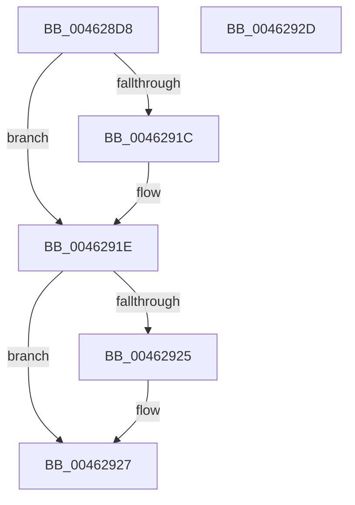

# VmpInvalidateSingleGpaRange

- RVA: `0x004628D8`–`0x0046292E` (길이 `86` bytes)
- VA: `0x00000001404628D8`
- 실행 섹션: `.text`
- PDB 이름 있음: `예`; PDB Function 태그: `아니요`
- unwind 정보 RVA: `0x000AA39C`
- 디코드: `27`개 명령, `86/86` bytes 표시
- 미해석 바이트: `0` (있으면 어셈블리에 `.byte`로 보존)

> 이 문서는 커널 이미지의 기계어와 PDB 기호를 분석해 생성했습니다. 4번과 5번은 함수 원형과 자료형을 바이너리 사용 방식에서 추정한 C 해석이며 원본 소스 복구 결과는 아닙니다.

## 1. Dependencies

- 직접 호출 지점: **1**; 고유 호출 대상: **1**
- 직접 호출자로 확인된 함수: **1**
- RIP 상대 이미지 참조: **0**

### Outgoing calls
- `0x00462913` → [HvlMapGpaPages](HvlMapGpaPages_function_00462934.md) (function, `0x00462934`)

### Direct callers
- [sub_006EDF40](../6E/Unknown_function_006EDF40.md) at `0x006EDF95`
- [sub_006EDF40](../6E/Unknown_function_006EDF40.md) at `0x006EDFC5`
- [sub_006EDF40](../6E/Unknown_function_006EDF40.md) at `0x006EDFE0`

### Static image references
- 디코드된 RIP-relative 메모리 참조가 없습니다.

## 2. Other-region calls and transfers

- 다른 실행 섹션으로 향하는 call: **0**
- 별도 외부 분기/꼬리 이동을 확인하지 못했습니다.

## 3. Assembly (complete function range)

```asm
004628D8  4C 8B DC                        mov r11, rsp
004628DB  53                              push rbx
004628DC  48 83 EC 30                     sub rsp, 0x30
004628E0  49 83 63 18 00                  and qword ptr [r11 + 0x18], 0
004628E5  49 8B D8                        mov rbx, r8
004628E8  41 8B C1                        mov eax, r9d
004628EB  C1 E0 1F                        shl eax, 0x1f
004628EE  05 00 00 01 01                  add eax, 0x1010000
004628F3  44 8B C0                        mov r8d, eax
004628F6  41 0F BA E8 0F                  bts r8d, 0xf
004628FB  41 F6 C1 02                     test r9b, 2
004628FF  4C 8B CB                        mov r9, rbx
00462902  44 0F 44 C0                     cmove r8d, eax
00462906  49 8D 43 18                     lea rax, [r11 + 0x18]
0046290A  49 89 43 F0                     mov qword ptr [r11 - 0x10], rax
0046290E  49 83 63 E8 00                  and qword ptr [r11 - 0x18], 0
00462913  E8 1C 00 00 00                  call 0x140462934
00462918  85 C0                           test eax, eax
0046291A  79 02                           jns 0x14046291e
0046291C  CD 2C                           int 0x2c
0046291E  48 39 5C 24 50                  cmp qword ptr [rsp + 0x50], rbx
00462923  74 02                           je 0x140462927
00462925  CD 2C                           int 0x2c
00462927  48 83 C4 30                     add rsp, 0x30
0046292B  5B                              pop rbx
0046292C  C3                              ret
0046292D  CC                              int3
```

## 4. C-style interpretation (structured pseudocode)

```c
__int64 __fastcall VmpInvalidateSingleGpaRange(__int64 a1, __int64 a2, __int64 a3, int a4)
{
    __int64 result;
    __int64 v_rsp;
    unsigned __int64 v_stack_p18;

    v_rsp = (v_rsp) - (48);
    result = (unsigned int)(((unsigned int)(a4)) << (31));
    result = (unsigned int)((result) + (0x1010000ULL));
    a3 = (unsigned int)((unsigned int)(result));
    if ((((unsigned __int8)(a4)) & (2)) == 0) { a3 = (unsigned int)(result); }
    *(unsigned __int64 *)(v_rsp - 16) = v_rsp + 24;
    result = HvlMapGpaPages(a1, a2, a3, a3);
    if (sign_flag) {
    }
    if (v_stack_p18 != a3) {
    }
    v_rsp = (v_rsp) + (48);
    return result;
}
```

## 5. (Beta) C Style

```c
int64_t VmpInvalidateSingleGpaRange(int64_t Arg1, int64_t Arg2, int64_t Arg3, int32_t Arg4)
{
    int64_t result;
    int64_t local_rsp;
    uint64_t v_stack_p18;

    local_rsp = (local_rsp) - (48);
    result = (uint32_t)(((uint32_t)(Arg4)) << (31));
    result = (uint32_t)((result) + (0x1010000ULL));
    Arg3 = (uint32_t)((uint32_t)(result));
    if ((((uint8_t)(Arg4)) & (2)) == 0) { Arg3 = (uint32_t)(result); }
    *(uint64_t *)(local_rsp - 0x10) = local_rsp + 24;
    result = HvlMapGpaPages(Arg1, Arg2, Arg3, Arg3);
    if (sign_flag) {
    }
    if (v_stack_p18 != Arg3) {
    }
    local_rsp = (local_rsp) + (48);
    return result;
}
```

## 6. Execution-region graph

[열기: 2D/3D 그래프와 함수 탐색 컨트롤 패널](../../../control-panel.html?section=text&rva=0x004628D8&view=graph)

- 2D 그래프는 위에서 아래로 흐르고, 3D 그래프는 빈 공간을 드래그해 회전합니다. Shift+드래그는 이동, 휠은 확대·축소, 함수 노드 선택은 대상 보고서 이동입니다.

### Static fallback


