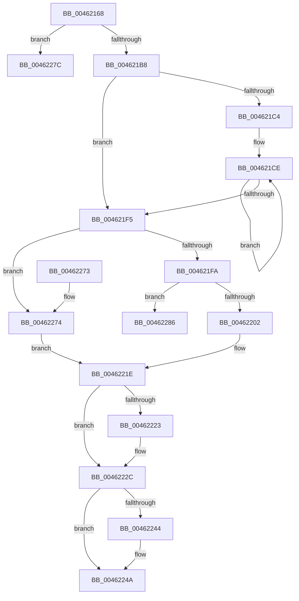

# VslFastFlushSecureRangeList

- RVA: `0x00462168`–`0x0046228D` (길이 `293` bytes)
- VA: `0x0000000140462168`
- 실행 섹션: `.text`
- PDB 이름 있음: `예`; PDB Function 태그: `예`
- unwind 정보 RVA: `0x000AA080`
- 디코드: `75`개 명령, `293/293` bytes 표시
- 미해석 바이트: `0` (있으면 어셈블리에 `.byte`로 보존)

> 이 문서는 커널 이미지의 기계어와 PDB 기호를 분석해 생성했습니다. 4번과 5번은 함수 원형과 자료형을 바이너리 사용 방식에서 추정한 C 해석이며 원본 소스 복구 결과는 아닙니다.

## 1. Dependencies

- 직접 호출 지점: **3**; 고유 호출 대상: **3**
- 직접 호출자로 확인된 함수: **3**
- RIP 상대 이미지 참조: **1**

### Outgoing calls
- `0x004621A7` → [memset](../6C/memset_function_006C6C40.md) (function, `0x006C6C40`)
- `0x0046223B` → [VslpEnterIumSecureMode](../23/VslpEnterIumSecureMode_function_00235E50.md) (function, `0x00235E50`)
- `0x00462255` → [_security_check_cookie](../6A/_security_check_cookie_function_006AC640.md) (function, `0x006AC640`)

### Direct callers
- [HvlpFastFlushListTbEx](../30/HvlpFastFlushListTbEx_function_00306784.md) at `0x003068DB`
- [sub_00312FB1](../31/Unknown_function_00312FB1.md) at `0x00312FC3`
- [HvlpSecureFlushLargeRangeList](../6A/HvlpSecureFlushLargeRangeList_function_006A7C38.md) at `0x006A7CB7`

### Static image references
- `0x0046217F` → RVA `0x00E0A740` (`.data`; read)

## 2. Other-region calls and transfers

- 다른 실행 섹션으로 향하는 call: **0**
- call이 아닌 외부 분기/꼬리 이동: **2**
  - `0x00462281` → [sub_006F2696](../6F/Unknown_function_006F2696.md) (`tail-transfer`)
  - `0x00462288` → [sub_006F2696](../6F/Unknown_function_006F2696.md) (`tail-transfer`)

## 3. Assembly (complete function range)

```asm
00462168  48 89 5C 24 08                  mov qword ptr [rsp + 8], rbx
0046216D  48 89 6C 24 10                  mov qword ptr [rsp + 0x10], rbp
00462172  48 89 74 24 18                  mov qword ptr [rsp + 0x18], rsi
00462177  57                              push rdi
00462178  48 81 EC A0 00 00 00            sub rsp, 0xa0
0046217F  48 8B 05 BA 85 9A 00            mov rax, qword ptr [rip + 0x9a85ba]
00462186  48 33 C4                        xor rax, rsp
00462189  48 89 84 24 90 00 00 00         mov qword ptr [rsp + 0x90], rax
00462191  48 8B F2                        mov rsi, rdx
00462194  41 8B D8                        mov ebx, r8d
00462197  33 D2                           xor edx, edx
00462199  8B E9                           mov ebp, ecx
0046219B  48 8D 4C 24 20                  lea rcx, [rsp + 0x20]
004621A0  49 8B F9                        mov rdi, r9
004621A3  44 8D 42 68                     lea r8d, [rdx + 0x68]
004621A7  E8 94 4A 26 00                  call 0x1406c6c40
004621AC  44 0F 20 C0                     mov rax, cr8
004621B0  3C 02                           cmp al, 2
004621B2  0F 87 C4 00 00 00               ja 0x14046227c
004621B8  33 D2                           xor edx, edx
004621BA  32 C9                           xor cl, cl
004621BC  44 8D 5A 01                     lea r11d, [rdx + 1]
004621C0  85 DB                           test ebx, ebx
004621C2  74 31                           je 0x1404621f5
004621C4  4C 8D 44 24 30                  lea r8, [rsp + 0x30]
004621C9  44 8B CB                        mov r9d, ebx
004621CC  8B D3                           mov edx, ebx
004621CE  48 8B 06                        mov rax, qword ptr [rsi]
004621D1  49 BA FF FF FE FF FF 7F 00 00   movabs r10, 0x7ffffffeffff
004621DB  49 3B C2                        cmp rax, r10
004621DE  0F B6 C9                        movzx ecx, cl
004621E1  49 89 00                        mov qword ptr [r8], rax
004621E4  48 8D 76 08                     lea rsi, [rsi + 8]
004621E8  41 0F 46 CB                     cmovbe ecx, r11d
004621EC  4D 8D 40 08                     lea r8, [r8 + 8]
004621F0  4D 2B CB                        sub r9, r11
004621F3  75 D9                           jne 0x1404621ce
004621F5  41 3B EB                        cmp ebp, r11d
004621F8  75 7A                           jne 0x140462274
004621FA  84 C9                           test cl, cl
004621FC  0F 84 84 00 00 00               je 0x140462286
00462202  65 48 8B 04 25 88 01 00 00      mov rax, qword ptr gs:[0x188]
0046220B  48 8B 88 B8 00 00 00            mov rcx, qword ptr [rax + 0xb8]
00462212  48 8B 81 70 01 00 00            mov rax, qword ptr [rcx + 0x170]
00462219  48 89 44 24 28                  mov qword ptr [rsp + 0x28], rax
0046221E  83 FA 0B                        cmp edx, 0xb
00462221  73 09                           jae 0x14046222c
00462223  8D 42 01                        lea eax, [rdx + 1]
00462226  48 83 64 C4 28 00               and qword ptr [rsp + rax*8 + 0x28], 0
0046222C  BA F1 00 00 00                  mov edx, 0xf1
00462231  4C 8D 4C 24 20                  lea r9, [rsp + 0x20]
00462236  45 33 C0                        xor r8d, r8d
00462239  B1 02                           mov cl, 2
0046223B  E8 10 3C DD FF                  call 0x140235e50
00462240  85 C0                           test eax, eax
00462242  78 06                           js 0x14046224a
00462244  8A 4C 24 30                     mov cl, byte ptr [rsp + 0x30]
00462248  88 0F                           mov byte ptr [rdi], cl
0046224A  48 8B 8C 24 90 00 00 00         mov rcx, qword ptr [rsp + 0x90]
00462252  48 33 CC                        xor rcx, rsp
00462255  E8 E6 A3 24 00                  call 0x1406ac640
0046225A  4C 8D 9C 24 A0 00 00 00         lea r11, [rsp + 0xa0]
00462262  49 8B 5B 10                     mov rbx, qword ptr [r11 + 0x10]
00462266  49 8B 6B 18                     mov rbp, qword ptr [r11 + 0x18]
0046226A  49 8B 73 20                     mov rsi, qword ptr [r11 + 0x20]
0046226E  49 8B E3                        mov rsp, r11
00462271  5F                              pop rdi
00462272  C3                              ret
00462273  CC                              int3
00462274  48 83 64 24 28 00               and qword ptr [rsp + 0x28], 0
0046227A  EB A2                           jmp 0x14046221e
0046227C  B8 FF 00 00 00                  mov eax, 0xff
00462281  E9 10 04 29 00                  jmp 0x1406f2696
00462286  33 C0                           xor eax, eax
00462288  E9 09 04 29 00                  jmp 0x1406f2696
```

## 4. C-style interpretation (structured pseudocode)

```c
__int64 __fastcall VslFastFlushSecureRangeList(int a1, __int64 a2, int a3, __int64 a4)
{
    __int64 result;
    __int64 v_rsp;
    unsigned __int64 v_stack_m18;
    unsigned __int64 v_stack_m78;
    unsigned __int64 v_stack_m8;
    unsigned __int64 v_stack_m80;
    unsigned __int64 v_stack_m88;
    unsigned __int64 v_stack_p10;
    unsigned __int64 v_stack_p18;
    unsigned __int64 v_stack_p8;

    v_stack_p8 = v_rbx;
    v_stack_p10 = v_rbp;
    v_stack_p18 = v_rsi;
    v_rsp = (v_rsp) - (160);
    result = (*(unsigned __int64 *)(v_rip + 10126778)) ^ (v_rsp);
    v_stack_m18 = result;
    a2 = 0;
    result = memset(v_stack_m88, a2, a2 + 104, a4);
    if (((unsigned __int8)(v_cr8)) > 2) goto loc_0046227C;
    a2 = 0;
    a1 = 0;
    if ((unsigned int)((unsigned int)(a3)) == 0) goto loc_004621F5;
loc_004621CE:
    *(unsigned __int64 *)(v_stack_m78) = *(unsigned __int64 *)(a2);
    a1 = 0;
    if ((*(unsigned __int64 *)(a2)) <= v_r10) { a1 = (unsigned int)(a2 + 1); }
    a4 = ((unsigned int)((unsigned int)((unsigned int)(a3)))) - (a2 + 1);
    if (condition_is_not_equal) goto loc_004621CE;
loc_004621F5:
    if (((unsigned int)((unsigned int)(a1))) != ((unsigned int)(a2 + 1))) goto loc_00462274;
    if ((unsigned __int8)(a1) == 0) goto loc_00462286;
    v_stack_m80 = *(unsigned __int64 *)(*(unsigned __int64 *)(*(unsigned __int64 *)(gs_base + (0 + 392)) + 184) + 368);
loc_0046221E:
    result = *(unsigned __int64 *)(*(unsigned __int64 *)(*(unsigned __int64 *)(gs_base + (0 + 392)) + 184) + 368);
    if (((unsigned int)((unsigned int)((unsigned int)((unsigned int)(a3))))) < 11) {
        result = (unsigned int)((unsigned int)((unsigned int)(a3))) + 1;
    }
    a3 = 0;
    result = VslpEnterIumSecureMode(2, 241, a3, v_stack_m88);
    if (!(sign_flag)) {
        a1 = v_stack_m78;
        *(unsigned __int8 *)(a4) = (unsigned __int8)(a1);
    }
    a1 = (v_stack_m18) ^ (v_rsp);
    result = _security_check_cookie(a1, 241, a3, v_stack_m88);
    return result;
loc_00462274:
    goto loc_0046221E;
loc_0046227C:
loc_00462286:
    result = 0;
}
```

## 5. (Beta) C Style

```c
int64_t VslFastFlushSecureRangeList(int32_t Arg1, void *Arg2, int32_t Arg3, void *Arg4)
{
    uint8_t *arg2 = (uint8_t *)Arg2;
    uint8_t *arg4 = (uint8_t *)Arg4;

    int64_t result;
    int64_t local_rsp;
    uint64_t v_stack_m18;
    uint64_t v_stack_m78;
    uint64_t v_stack_m8;
    uint64_t v_stack_m80;
    uint64_t v_stack_m88;
    uint64_t v_stack_p10;
    uint64_t v_stack_p18;
    uint64_t v_stack_p8;

    v_stack_p8 = local_rbx;
    v_stack_p10 = local_rbp;
    v_stack_p18 = local_rsi;
    local_rsp = (local_rsp) - (160);
    result = (*(uint64_t *)(v_rip + 0x9A85BA)) ^ (local_rsp);
    v_stack_m18 = result;
    Arg2 = 0;
    result = memset(v_stack_m88, Arg2, Arg2 + 104, Arg4);
    if (((uint8_t)(v_cr8)) > 2) goto loc_0046227C;
    Arg2 = 0;
    Arg1 = 0;
    if ((uint32_t)((uint32_t)(Arg3)) == 0) goto loc_004621F5;
loc_004621CE:
    *(uint64_t *)(v_stack_m78) = *(uint64_t *)(arg2);
    Arg1 = 0;
    if ((*(uint64_t *)(arg2)) <= local_r10) { Arg1 = (uint32_t)(Arg2 + 1); }
    Arg4 = ((uint32_t)((uint32_t)((uint32_t)(Arg3)))) - (Arg2 + 1);
    if (condition_is_not_equal) goto loc_004621CE;
loc_004621F5:
    if (((uint32_t)((uint32_t)(Arg1))) != ((uint32_t)(Arg2 + 1))) goto loc_00462274;
    if ((uint8_t)(Arg1) == 0) goto loc_00462286;
    v_stack_m80 = *(uint64_t *)(*(uint64_t *)(*(uint64_t *)(gs_base + (0 + 0x188)) + 0xB8) + 0x170);
loc_0046221E:
    result = *(uint64_t *)(*(uint64_t *)(*(uint64_t *)(gs_base + (0 + 0x188)) + 0xB8) + 0x170);
    if (((uint32_t)((uint32_t)((uint32_t)((uint32_t)(Arg3))))) < 11) {
        result = (uint32_t)((uint32_t)((uint32_t)(Arg3))) + 1;
    }
    Arg3 = 0;
    result = VslpEnterIumSecureMode(2, 241, Arg3, v_stack_m88);
    if (!(sign_flag)) {
        Arg1 = v_stack_m78;
        *(uint8_t *)(arg4) = (uint8_t)(Arg1);
    }
    Arg1 = (v_stack_m18) ^ (local_rsp);
    result = _security_check_cookie(Arg1, 241, Arg3, v_stack_m88);
    return result;
loc_00462274:
    goto loc_0046221E;
loc_0046227C:
loc_00462286:
    result = 0;
}
```

### 관측된 메모리 오프셋

구조체 형식이 확인되지 않은 접근은 인자 기준의 오프셋으로만 기록했습니다.

| 기준 인자 | 오프셋 표현 | 폭 (bit) | 접근 |
|---|---:|---:|---|
| `Arg2` | `+ 0x0` | `64` | `R` |
| `Arg2` | `+ 0x8` | `64` | `R` |
| `Arg4` | `+ 0x0` | `8` | `W` |

## 6. Execution-region graph

[열기: 2D/3D 그래프와 함수 탐색 컨트롤 패널](../../../control-panel.html?section=text&rva=0x00462168&view=graph)

- 2D 그래프는 위에서 아래로 흐르고, 3D 그래프는 빈 공간을 드래그해 회전합니다. Shift+드래그는 이동, 휠은 확대·축소, 함수 노드 선택은 대상 보고서 이동입니다.

### Static fallback


