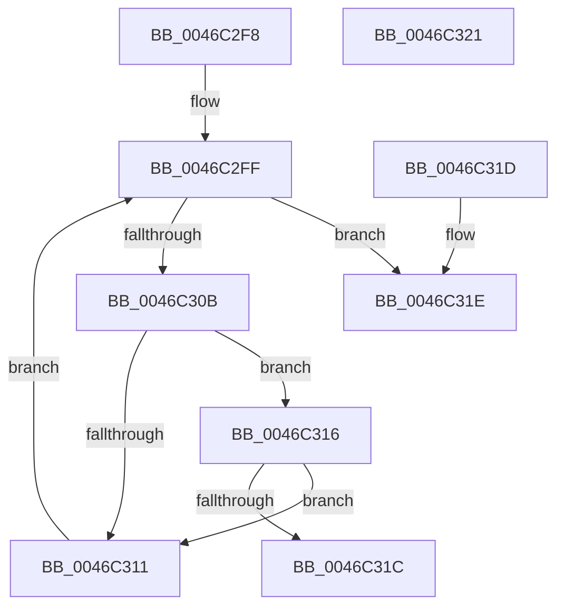

# WmipDoFindRegEntryByDevice

- RVA: `0x0046C2F8`–`0x0046C322` (길이 `42` bytes)
- VA: `0x000000014046C2F8`
- 실행 섹션: `.text`
- PDB 이름 있음: `예`; PDB Function 태그: `아니요`
- unwind 정보 RVA: `0x000DB714`
- 디코드: `15`개 명령, `42/42` bytes 표시
- 미해석 바이트: `0` (있으면 어셈블리에 `.byte`로 보존)

> 이 문서는 커널 이미지의 기계어와 PDB 기호를 분석해 생성했습니다. 4번과 5번은 함수 원형과 자료형을 바이너리 사용 방식에서 추정한 C 해석이며 원본 소스 복구 결과는 아닙니다.

## 1. Dependencies

- 직접 호출 지점: **0**; 고유 호출 대상: **0**
- 직접 호출자로 확인된 함수: **2**
- RIP 상대 이미지 참조: **1**

### Outgoing calls
- 직접 디코드된 call 명령이 없습니다.

### Direct callers
- [WmipFindRegEntryByDevice](WmipFindRegEntryByDevice_function_0046C22C.md) at `0x0046C261`
- [IoWMIDeviceObjectToProviderId](IoWMIDeviceObjectToProviderId_function_0046C2B0.md) at `0x0046C2CB`

### Static image references
- `0x0046C2F8` → RVA `0x00E09148` (`.data`; read)

## 2. Other-region calls and transfers

- 다른 실행 섹션으로 향하는 call: **0**
- 별도 외부 분기/꼬리 이동을 확인하지 못했습니다.

## 3. Assembly (complete function range)

```asm
0046C2F8  48 8B 05 49 CE 99 00            mov rax, qword ptr [rip + 0x99ce49]
0046C2FF  48 8D 15 42 CE 99 00            lea rdx, [rip + 0x99ce42]
0046C306  48 3B C2                        cmp rax, rdx
0046C309  74 13                           je 0x14046c31e
0046C30B  48 39 48 10                     cmp qword ptr [rax + 0x10], rcx
0046C30F  74 05                           je 0x14046c316
0046C311  48 8B 00                        mov rax, qword ptr [rax]
0046C314  EB E9                           jmp 0x14046c2ff
0046C316  83 78 30 00                     cmp dword ptr [rax + 0x30], 0
0046C31A  7C F5                           jl 0x14046c311
0046C31C  C3                              ret
0046C31D  CC                              int3
0046C31E  33 C0                           xor eax, eax
0046C320  C3                              ret
0046C321  CC                              int3
```

## 4. C-style interpretation (structured pseudocode)

```c
__int64 __fastcall WmipDoFindRegEntryByDevice(__int64 a1)
{
    __int64 result;

loc_0046C2FF:
    if ((*(unsigned __int64 *)(v_rip + 10079817)) == (v_rip + 10079810)) goto loc_0046C31E;
    if ((*(unsigned __int64 *)(*(unsigned __int64 *)(v_rip + 10079817) + 16)) == a1) goto loc_0046C316;
loc_0046C311:
    goto loc_0046C2FF;
loc_0046C316:
    if ((*(unsigned int *)(*(unsigned __int64 *)(*(unsigned __int64 *)(v_rip + 10079817)) + 48)) < 0) goto loc_0046C311;
    return *(unsigned __int64 *)(*(unsigned __int64 *)(v_rip + 10079817));
loc_0046C31E:
    result = 0;
    return result;
}
```

## 5. (Beta) C Style

```c
int64_t WmipDoFindRegEntryByDevice(int64_t Arg1)
{
    int64_t result;

loc_0046C2FF:
    if ((*(uint64_t *)(v_rip + 0x99CE49)) == (v_rip + 10079810)) goto loc_0046C31E;
    if ((*(uint64_t *)(*(uint64_t *)(v_rip + 0x99CE49) + 0x10)) == Arg1) goto loc_0046C316;
loc_0046C311:
    goto loc_0046C2FF;
loc_0046C316:
    if ((*(uint32_t *)(*(uint64_t *)(*(uint64_t *)(v_rip + 0x99CE49)) + 0x30)) < 0) goto loc_0046C311;
    return *(uint64_t *)(*(uint64_t *)(v_rip + 0x99CE49));
loc_0046C31E:
    result = 0;
    return result;
}
```

## 6. Execution-region graph

[열기: 2D/3D 그래프와 함수 탐색 컨트롤 패널](../../../control-panel.html?section=text&rva=0x0046C2F8&view=graph)

- 2D 그래프는 위에서 아래로 흐르고, 3D 그래프는 빈 공간을 드래그해 회전합니다. Shift+드래그는 이동, 휠은 확대·축소, 함수 노드 선택은 대상 보고서 이동입니다.

### Static fallback


