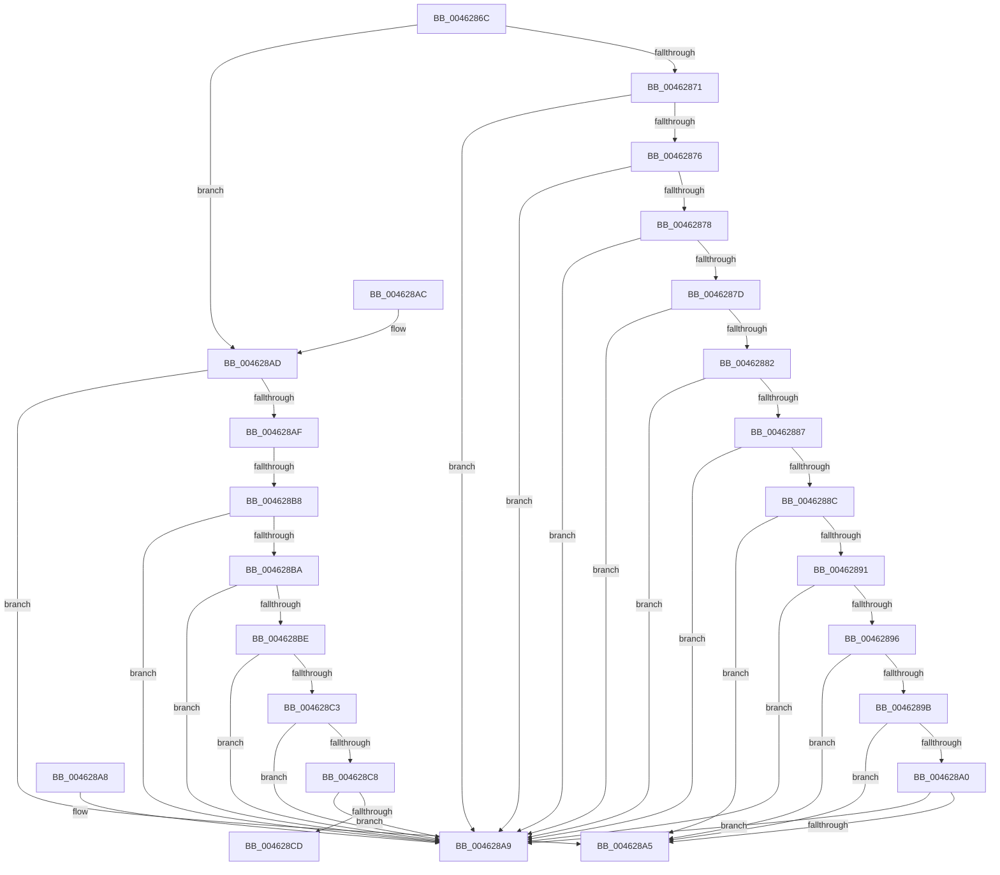

# _CmClassPropertyRead

- RVA: `0x0046286C`–`0x004628D2` (길이 `102` bytes)
- VA: `0x000000014046286C`
- 실행 섹션: `.text`
- PDB 이름 있음: `예`; PDB Function 태그: `예`
- unwind 정보 RVA: `0x000DB714`
- 디코드: `42`개 명령, `102/102` bytes 표시
- 미해석 바이트: `0` (있으면 어셈블리에 `.byte`로 보존)

> 이 문서는 커널 이미지의 기계어와 PDB 기호를 분석해 생성했습니다. 4번과 5번은 함수 원형과 자료형을 바이너리 사용 방식에서 추정한 C 해석이며 원본 소스 복구 결과는 아닙니다.

## 1. Dependencies

- 직접 호출 지점: **0**; 고유 호출 대상: **0**
- 직접 호출자로 확인된 함수: **3**
- RIP 상대 이미지 참조: **0**

### Outgoing calls
- 직접 디코드된 call 명령이 없습니다.

### Direct callers
- [CmSetInstallerClassRegPropWorker](../../page/82/CmSetInstallerClassRegPropWorker_function_0082ABF4.md) at `0x0082AC68`
- [PiPnpRtlCmActionCallback](../../page/8E/PiPnpRtlCmActionCallback_function_008EF110.md) at `0x008EF656`
- [CmGetInstallerClassRegPropWorker](../../page/99/CmGetInstallerClassRegPropWorker_function_00994AF4.md) at `0x00994B7F`

### Static image references
- 디코드된 RIP-relative 메모리 참조가 없습니다.

## 2. Other-region calls and transfers

- 다른 실행 섹션으로 향하는 call: **0**
- call이 아닌 외부 분기/꼬리 이동: **2**
  - `0x004628B2` → `0x006F280C` (`tail-transfer`)
  - `0x004628CD` → `0x006F2830` (`tail-transfer`)

## 3. Assembly (complete function range)

```asm
0046286C  83 F9 13                        cmp ecx, 0x13
0046286F  7E 3C                           jle 0x1404628ad
00462871  83 F9 1D                        cmp ecx, 0x1d
00462874  7F 33                           jg 0x1404628a9
00462876  74 31                           je 0x1404628a9
00462878  83 E9 14                        sub ecx, 0x14
0046287B  74 2C                           je 0x1404628a9
0046287D  83 E9 01                        sub ecx, 1
00462880  74 27                           je 0x1404628a9
00462882  83 E9 01                        sub ecx, 1
00462885  74 22                           je 0x1404628a9
00462887  83 E9 01                        sub ecx, 1
0046288A  74 1D                           je 0x1404628a9
0046288C  83 E9 01                        sub ecx, 1
0046288F  74 14                           je 0x1404628a5
00462891  83 E9 01                        sub ecx, 1
00462894  74 13                           je 0x1404628a9
00462896  83 E9 01                        sub ecx, 1
00462899  74 0A                           je 0x1404628a5
0046289B  83 E9 01                        sub ecx, 1
0046289E  74 05                           je 0x1404628a5
004628A0  83 F9 01                        cmp ecx, 1
004628A3  75 04                           jne 0x1404628a9
004628A5  B0 01                           mov al, 1
004628A7  C3                              ret
004628A8  CC                              int3
004628A9  32 C0                           xor al, al
004628AB  C3                              ret
004628AC  CC                              int3
004628AD  74 F6                           je 0x1404628a5
004628AF  83 F9 09                        cmp ecx, 9
004628B2  0F 8F 54 FF 28 00               jg 0x1406f280c
004628B8  74 EF                           je 0x1404628a9
004628BA  85 C9                           test ecx, ecx
004628BC  74 EB                           je 0x1404628a9
004628BE  83 E9 01                        sub ecx, 1
004628C1  74 E6                           je 0x1404628a9
004628C3  83 E9 01                        sub ecx, 1
004628C6  74 E1                           je 0x1404628a9
004628C8  83 E9 01                        sub ecx, 1
004628CB  74 DC                           je 0x1404628a9
004628CD  E9 5E FF 28 00                  jmp 0x1406f2830
```

## 4. C-style interpretation (structured pseudocode)

```c
__int64 __fastcall _CmClassPropertyRead(int a1)
{
    __int64 result;

    if (a1 <= 19) goto loc_004628AD;
    if (a1 > 29) goto loc_004628A9;
    if (a1 == 29) goto loc_004628A9;
    a1 = (unsigned int)((a1) - (20));
    if (condition_is_equal) goto loc_004628A9;
    a1 = (unsigned int)((a1) - (1));
    if (condition_is_equal) goto loc_004628A9;
    a1 = (unsigned int)((a1) - (1));
    if (condition_is_equal) goto loc_004628A9;
    a1 = (unsigned int)((a1) - (1));
    if (condition_is_equal) goto loc_004628A9;
    a1 = (unsigned int)((a1) - (1));
    if (condition_is_equal) goto loc_004628A5;
    a1 = (unsigned int)((a1) - (1));
    if (condition_is_equal) goto loc_004628A9;
    a1 = (unsigned int)((a1) - (1));
    if (condition_is_equal) goto loc_004628A5;
    a1 = (unsigned int)((a1) - (1));
    if (condition_is_equal) goto loc_004628A5;
    if (a1 != 1) goto loc_004628A9;
loc_004628A5:
    return 1;
loc_004628A9:
    result = 0;
    return result;
loc_004628AD:
    if (condition_is_equal) goto loc_004628A5;
    if (a1 == 9) goto loc_004628A9;
    if (a1 == 0) goto loc_004628A9;
    a1 = (unsigned int)((a1) - (1));
    if (condition_is_equal) goto loc_004628A9;
    a1 = (unsigned int)((a1) - (1));
    if (condition_is_equal) goto loc_004628A9;
    a1 = (unsigned int)((a1) - (1));
    if (condition_is_equal) goto loc_004628A9;
}
```

## 5. (Beta) C Style

```c
int64_t _CmClassPropertyRead(int32_t Arg1)
{
    int64_t result;

    if (Arg1 <= 19) goto loc_004628AD;
    if (Arg1 > 29) goto loc_004628A9;
    if (Arg1 == 29) goto loc_004628A9;
    Arg1 = (uint32_t)((Arg1) - (20));
    if (condition_is_equal) goto loc_004628A9;
    Arg1 = (uint32_t)((Arg1) - (1));
    if (condition_is_equal) goto loc_004628A9;
    Arg1 = (uint32_t)((Arg1) - (1));
    if (condition_is_equal) goto loc_004628A9;
    Arg1 = (uint32_t)((Arg1) - (1));
    if (condition_is_equal) goto loc_004628A9;
    Arg1 = (uint32_t)((Arg1) - (1));
    if (condition_is_equal) goto loc_004628A5;
    Arg1 = (uint32_t)((Arg1) - (1));
    if (condition_is_equal) goto loc_004628A9;
    Arg1 = (uint32_t)((Arg1) - (1));
    if (condition_is_equal) goto loc_004628A5;
    Arg1 = (uint32_t)((Arg1) - (1));
    if (condition_is_equal) goto loc_004628A5;
    if (Arg1 != 1) goto loc_004628A9;
loc_004628A5:
    return 1;
loc_004628A9:
    result = 0;
    return result;
loc_004628AD:
    if (condition_is_equal) goto loc_004628A5;
    if (Arg1 == 9) goto loc_004628A9;
    if (Arg1 == 0) goto loc_004628A9;
    Arg1 = (uint32_t)((Arg1) - (1));
    if (condition_is_equal) goto loc_004628A9;
    Arg1 = (uint32_t)((Arg1) - (1));
    if (condition_is_equal) goto loc_004628A9;
    Arg1 = (uint32_t)((Arg1) - (1));
    if (condition_is_equal) goto loc_004628A9;
}
```

## 6. Execution-region graph

[열기: 2D/3D 그래프와 함수 탐색 컨트롤 패널](../../../control-panel.html?section=text&rva=0x0046286C&view=graph)

- 2D 그래프는 위에서 아래로 흐르고, 3D 그래프는 빈 공간을 드래그해 회전합니다. Shift+드래그는 이동, 휠은 확대·축소, 함수 노드 선택은 대상 보고서 이동입니다.

### Static fallback


