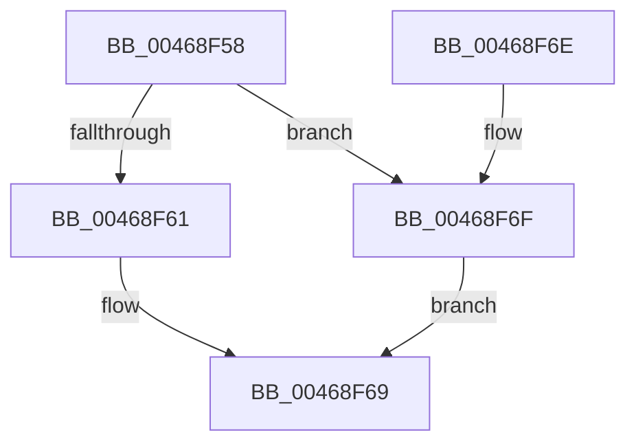

# crc32

- RVA: `0x00468F58`–`0x00468F73` (길이 `27` bytes)
- VA: `0x0000000140468F58`
- 실행 섹션: `.text`
- PDB 이름 있음: `예`; PDB Function 태그: `아니요`
- unwind 정보 RVA: `0x00069B1C`
- 디코드: `10`개 명령, `27/27` bytes 표시
- 미해석 바이트: `0` (있으면 어셈블리에 `.byte`로 보존)

> 이 문서는 커널 이미지의 기계어와 PDB 기호를 분석해 생성했습니다. 4번과 5번은 함수 원형과 자료형을 바이너리 사용 방식에서 추정한 C 해석이며 원본 소스 복구 결과는 아닙니다.

## 1. Dependencies

- 직접 호출 지점: **1**; 고유 호출 대상: **1**
- 직접 호출자로 확인된 함수: **8**
- RIP 상대 이미지 참조: **0**

### Outgoing calls
- `0x00468F64` → [crc32_z](crc32_z_function_00468F7C.md) (function, `0x00468F7C`)

### Direct callers
- [ST_STORE&lt;SM_TRAITS&gt;::StDmpSinglePageAdd](../20/ST_STORE_SM_TRAITS_StDmpSinglePageAdd_function_0020502C.md) at `0x002053D5`
- [RtlComputeCrc32](RtlComputeCrc32_function_00468F40.md) at `0x00468F44`
- [SC_GPT::ReadEntries](../6A/SC_GPT_ReadEntries_function_006A3360.md) at `0x006A33BA`
- [SC_GPT::ReadHeader](../6A/SC_GPT_ReadHeader_function_006A33E8.md) at `0x006A348B`
- [SC_GPT::VerifyPartitionTable](../6A/SC_GPT_VerifyPartitionTable_function_006A3804.md) at `0x006A3A5C`
- [SC_GPT::WritePartitionTable](../6A/SC_GPT_WritePartitionTable_function_006A3AD4.md) at `0x006A3E2A`
- [SC_GPT::WritePartitionTable](../6A/SC_GPT_WritePartitionTable_function_006A3AD4.md) at `0x006A3E3E`
- [SC_GPT::WritePartitionTable](../6A/SC_GPT_WritePartitionTable_function_006A3AD4.md) at `0x006A3EDB`
- [sub_006E6614](../6E/Unknown_function_006E6614.md) at `0x006E6635`
- [sub_006E6614](../6E/Unknown_function_006E6614.md) at `0x006E6646`
- [sub_006E6614](../6E/Unknown_function_006E6614.md) at `0x006E6653`
- [ExpSingleStringCheck](../../init/C5/ExpSingleStringCheck_function_00C5189C.md) at `0x00C518C2`

### Static image references
- 디코드된 RIP-relative 메모리 참조가 없습니다.

## 2. Other-region calls and transfers

- 다른 실행 섹션으로 향하는 call: **0**
- 별도 외부 분기/꼬리 이동을 확인하지 못했습니다.

## 3. Assembly (complete function range)

```asm
00468F58  48 83 EC 28                     sub rsp, 0x28
00468F5C  48 85 D2                        test rdx, rdx
00468F5F  74 0E                           je 0x140468f6f
00468F61  45 8B C0                        mov r8d, r8d
00468F64  E8 13 00 00 00                  call 0x140468f7c
00468F69  48 83 C4 28                     add rsp, 0x28
00468F6D  C3                              ret
00468F6E  CC                              int3
00468F6F  33 C0                           xor eax, eax
00468F71  EB F6                           jmp 0x140468f69
```

## 4. C-style interpretation (structured pseudocode)

```c
__int64 __fastcall crc32(__int64 a1, __int64 a2, int a3)
{
    __int64 result;
    __int64 v_rsp;

    v_rsp = (v_rsp) - (40);
    if (a2 == 0) goto loc_00468F6F;
    result = crc32_z(a1, a2, (unsigned int)(a3), a4);
loc_00468F69:
    v_rsp = (v_rsp) + (40);
    return result;
loc_00468F6F:
    result = 0;
    goto loc_00468F69;
}
```

## 5. (Beta) C Style

```c
int64_t crc32(int64_t Arg1, int64_t Arg2, int32_t Arg3)
{
    int64_t result;
    int64_t local_rsp;

    local_rsp = (local_rsp) - (40);
    if (Arg2 == 0) goto loc_00468F6F;
    result = crc32_z(Arg1, Arg2, (uint32_t)(Arg3), a4);
loc_00468F69:
    local_rsp = (local_rsp) + (40);
    return result;
loc_00468F6F:
    result = 0;
    goto loc_00468F69;
}
```

## 6. Execution-region graph

[열기: 2D/3D 그래프와 함수 탐색 컨트롤 패널](../../../control-panel.html?section=text&rva=0x00468F58&view=graph)

- 2D 그래프는 위에서 아래로 흐르고, 3D 그래프는 빈 공간을 드래그해 회전합니다. Shift+드래그는 이동, 휠은 확대·축소, 함수 노드 선택은 대상 보고서 이동입니다.

### Static fallback


