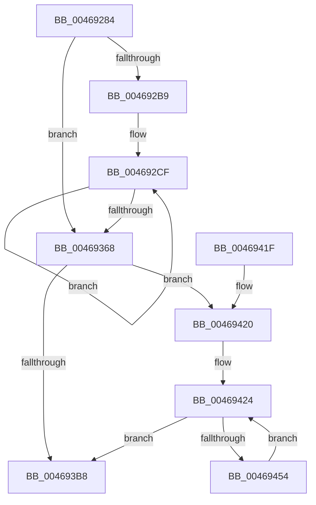

# crc32_sse42_simd_

- RVA: `0x00469284`–`0x00469456` (길이 `466` bytes)
- VA: `0x0000000140469284`
- 실행 섹션: `.text`
- PDB 이름 있음: `예`; PDB Function 태그: `아니요`
- unwind 정보 RVA: `0x000AB144`
- 디코드: `105`개 명령, `466/466` bytes 표시
- 미해석 바이트: `0` (있으면 어셈블리에 `.byte`로 보존)

> 이 문서는 커널 이미지의 기계어와 PDB 기호를 분석해 생성했습니다. 4번과 5번은 함수 원형과 자료형을 바이너리 사용 방식에서 추정한 C 해석이며 원본 소스 복구 결과는 아닙니다.

## 1. Dependencies

- 직접 호출 지점: **0**; 고유 호출 대상: **0**
- 직접 호출자로 확인된 함수: **1**
- RIP 상대 이미지 참조: **5**

### Outgoing calls
- 직접 디코드된 call 명령이 없습니다.

### Direct callers
- [crc32_z](crc32_z_function_00468F7C.md) at `0x00468FC4`

### Static image references
- `0x004692B9` → RVA `0x00019EA0` (`.rdata`; read)
- `0x00469368` → RVA `0x00019A90` (`.rdata`; read)
- `0x004693B8` → RVA `0x00019A60` (`.rdata`; read)
- `0x004693C4` → RVA `0x00019A80` (`.rdata`; read)
- `0x004693FA` → RVA `0x00019A70` (`.rdata`; read)

## 2. Other-region calls and transfers

- 다른 실행 섹션으로 향하는 call: **0**
- 별도 외부 분기/꼬리 이동을 확인하지 못했습니다.

## 3. Assembly (complete function range)

```asm
00469284  48 83 EC 18                     sub rsp, 0x18
00469288  F3 0F 6F 01                     movdqu xmm0, xmmword ptr [rcx]
0046928C  48 83 EA 40                     sub rdx, 0x40
00469290  F3 0F 6F 59 10                  movdqu xmm3, xmmword ptr [rcx + 0x10]
00469295  F3 0F 6F 69 20                  movdqu xmm5, xmmword ptr [rcx + 0x20]
0046929A  0F 29 34 24                     movaps xmmword ptr [rsp], xmm6
0046929E  F3 0F 6F 71 30                  movdqu xmm6, xmmword ptr [rcx + 0x30]
004692A3  48 83 C1 40                     add rcx, 0x40
004692A7  66 41 0F 6E D0                  movd xmm2, r8d
004692AC  0F 57 D0                        xorps xmm2, xmm0
004692AF  48 83 FA 40                     cmp rdx, 0x40
004692B3  0F 82 AF 00 00 00               jb 0x140469368
004692B9  66 0F 6F 25 DF 0B BB FF         movdqa xmm4, xmmword ptr [rip - 0x44f421]
004692C1  4C 8B C2                        mov r8, rdx
004692C4  49 C1 E8 06                     shr r8, 6
004692C8  49 6B C0 C0                     imul rax, r8, -0x40
004692CC  48 03 D0                        add rdx, rax
004692CF  66 0F 6F CA                     movdqa xmm1, xmm2
004692D3  66 0F 3A 44 CC 11               pclmulqdq xmm1, xmm4, 0x11
004692D9  66 0F 3A 44 D4 00               pclmulqdq xmm2, xmm4, 0
004692DF  66 0F 6F C2                     movdqa xmm0, xmm2
004692E3  66 0F 6F D1                     movdqa xmm2, xmm1
004692E7  F3 0F 6F 09                     movdqu xmm1, xmmword ptr [rcx]
004692EB  0F 57 D0                        xorps xmm2, xmm0
004692EE  0F 57 D1                        xorps xmm2, xmm1
004692F1  66 0F 6F CB                     movdqa xmm1, xmm3
004692F5  66 0F 3A 44 CC 11               pclmulqdq xmm1, xmm4, 0x11
004692FB  66 0F 3A 44 DC 00               pclmulqdq xmm3, xmm4, 0
00469301  66 0F 6F C3                     movdqa xmm0, xmm3
00469305  66 0F 6F D9                     movdqa xmm3, xmm1
00469309  F3 0F 6F 49 10                  movdqu xmm1, xmmword ptr [rcx + 0x10]
0046930E  0F 57 D8                        xorps xmm3, xmm0
00469311  0F 57 D9                        xorps xmm3, xmm1
00469314  66 0F 6F CD                     movdqa xmm1, xmm5
00469318  66 0F 3A 44 CC 11               pclmulqdq xmm1, xmm4, 0x11
0046931E  66 0F 3A 44 EC 00               pclmulqdq xmm5, xmm4, 0
00469324  66 0F 6F C5                     movdqa xmm0, xmm5
00469328  66 0F 6F E9                     movdqa xmm5, xmm1
0046932C  F3 0F 6F 49 20                  movdqu xmm1, xmmword ptr [rcx + 0x20]
00469331  0F 57 E8                        xorps xmm5, xmm0
00469334  0F 57 E9                        xorps xmm5, xmm1
00469337  66 0F 6F CE                     movdqa xmm1, xmm6
0046933B  66 0F 3A 44 F4 00               pclmulqdq xmm6, xmm4, 0
00469341  66 0F 6F C6                     movdqa xmm0, xmm6
00469345  66 0F 3A 44 CC 11               pclmulqdq xmm1, xmm4, 0x11
0046934B  66 0F 6F F1                     movdqa xmm6, xmm1
0046934F  F3 0F 6F 49 30                  movdqu xmm1, xmmword ptr [rcx + 0x30]
00469354  48 83 C1 40                     add rcx, 0x40
00469358  0F 57 F0                        xorps xmm6, xmm0
0046935B  0F 57 F1                        xorps xmm6, xmm1
0046935E  49 83 E8 01                     sub r8, 1
00469362  0F 85 67 FF FF FF               jne 0x1404692cf
00469368  66 0F 6F 25 20 07 BB FF         movdqa xmm4, xmmword ptr [rip - 0x44f8e0]
00469370  66 0F 6F CA                     movdqa xmm1, xmm2
00469374  66 0F 3A 44 D4 00               pclmulqdq xmm2, xmm4, 0
0046937A  66 0F 3A 44 CC 11               pclmulqdq xmm1, xmm4, 0x11
00469380  0F 57 CB                        xorps xmm1, xmm3
00469383  0F 57 CA                        xorps xmm1, xmm2
00469386  66 0F 6F C1                     movdqa xmm0, xmm1
0046938A  66 0F 3A 44 C4 11               pclmulqdq xmm0, xmm4, 0x11
00469390  0F 57 C5                        xorps xmm0, xmm5
00469393  66 0F 3A 44 CC 00               pclmulqdq xmm1, xmm4, 0
00469399  0F 57 C1                        xorps xmm0, xmm1
0046939C  66 0F 6F D0                     movdqa xmm2, xmm0
004693A0  66 0F 3A 44 D4 11               pclmulqdq xmm2, xmm4, 0x11
004693A6  0F 57 D6                        xorps xmm2, xmm6
004693A9  66 0F 3A 44 C4 00               pclmulqdq xmm0, xmm4, 0
004693AF  0F 57 D0                        xorps xmm2, xmm0
004693B2  48 83 FA 10                     cmp rdx, 0x10
004693B6  73 68                           jae 0x140469420
004693B8  66 0F 6F 1D A0 06 BB FF         movdqa xmm3, xmmword ptr [rip - 0x44f960]
004693C0  66 0F 6F CA                     movdqa xmm1, xmm2
004693C4  F3 0F 7E 05 B4 06 BB FF         movq xmm0, qword ptr [rip - 0x44f94c]
004693CC  0F 28 34 24                     movaps xmm6, xmmword ptr [rsp]
004693D0  66 0F 3A 44 CC 10               pclmulqdq xmm1, xmm4, 0x10
004693D6  66 0F 73 DA 08                  psrldq xmm2, 8
004693DB  0F 57 CA                        xorps xmm1, xmm2
004693DE  66 0F 6F D1                     movdqa xmm2, xmm1
004693E2  66 0F 73 D9 04                  psrldq xmm1, 4
004693E7  0F 54 D3                        andps xmm2, xmm3
004693EA  66 0F 3A 44 D0 00               pclmulqdq xmm2, xmm0, 0
004693F0  0F 57 D1                        xorps xmm2, xmm1
004693F3  66 0F 6F CA                     movdqa xmm1, xmm2
004693F7  0F 54 CB                        andps xmm1, xmm3
004693FA  66 0F 3A 44 0D 6C 06 BB FF 10   pclmulqdq xmm1, xmmword ptr [rip - 0x44f994], 0x10
00469404  0F 54 CB                        andps xmm1, xmm3
00469407  66 0F 3A 44 0D 5F 06 BB FF 00   pclmulqdq xmm1, xmmword ptr [rip - 0x44f9a1], 0
00469411  0F 57 CA                        xorps xmm1, xmm2
00469414  66 0F 3A 16 C8 01               pextrd eax, xmm1, 1
0046941A  48 83 C4 18                     add rsp, 0x18
0046941E  C3                              ret
0046941F  CC                              int3
00469420  48 C1 EA 04                     shr rdx, 4
00469424  66 0F 6F CA                     movdqa xmm1, xmm2
00469428  F3 0F 6F 01                     movdqu xmm0, xmmword ptr [rcx]
0046942C  48 8D 49 10                     lea rcx, [rcx + 0x10]
00469430  66 0F 3A 44 D4 00               pclmulqdq xmm2, xmm4, 0
00469436  66 0F 3A 44 CC 11               pclmulqdq xmm1, xmm4, 0x11
0046943C  0F 57 C8                        xorps xmm1, xmm0
0046943F  66 0F 6F C2                     movdqa xmm0, xmm2
00469443  66 0F 6F D1                     movdqa xmm2, xmm1
00469447  0F 57 D0                        xorps xmm2, xmm0
0046944A  48 83 EA 01                     sub rdx, 1
0046944E  0F 84 64 FF FF FF               je 0x1404693b8
00469454  EB CE                           jmp 0x140469424
```

## 4. C-style interpretation (structured pseudocode)

```c
__int64 __fastcall crc32_sse42_simd_(__int64 a1, __int64 a2, int a3)
{
    __int64 result;
    __int64 v_rsp;
    unsigned __int64 v_stack_m18;

    v_rsp = (v_rsp) - (24);
    a2 = (a2) - (64);
    v_stack_m18 = v_xmm6;
    a1 = (a1) + (64);
    if (a2 < 64) goto loc_00469368;
    a3 = (a2) >> (6);
    result = (result) * (a3);
    a2 = (a2) + (result);
loc_004692CF:
    a1 = (a1) + (64);
    a3 = (a3) - (1);
    if (condition_is_not_equal) goto loc_004692CF;
loc_00469368:
    if (a2 >= 16) goto loc_00469420;
loc_004693B8:
    v_rsp = (v_rsp) + (24);
    return result;
loc_00469420:
    a2 = (a2) >> (4);
loc_00469424:
    a2 = (a2) - (1);
    if (condition_is_equal) goto loc_004693B8;
    goto loc_00469424;
}
```

## 5. (Beta) C Style

```c
int64_t crc32_sse42_simd_(void *Arg1, int64_t Arg2, int32_t Arg3)
{
    uint8_t *arg1 = (uint8_t *)Arg1;

    int64_t result;
    int64_t local_rsp;
    uint64_t v_stack_m18;

    local_rsp = (local_rsp) - (24);
    Arg2 = (Arg2) - (64);
    v_stack_m18 = v_xmm6;
    Arg1 = (Arg1) + (64);
    if (Arg2 < 64) goto loc_00469368;
    Arg3 = (Arg2) >> (6);
    result = (result) * (Arg3);
    Arg2 = (Arg2) + (result);
loc_004692CF:
    Arg1 = (Arg1) + (64);
    Arg3 = (Arg3) - (1);
    if (condition_is_not_equal) goto loc_004692CF;
loc_00469368:
    if (Arg2 >= 16) goto loc_00469420;
loc_004693B8:
    local_rsp = (local_rsp) + (24);
    return result;
loc_00469420:
    Arg2 = (Arg2) >> (4);
loc_00469424:
    Arg2 = (Arg2) - (1);
    if (condition_is_equal) goto loc_004693B8;
    goto loc_00469424;
}
```

### 관측된 메모리 오프셋

구조체 형식이 확인되지 않은 접근은 인자 기준의 오프셋으로만 기록했습니다.

| 기준 인자 | 오프셋 표현 | 폭 (bit) | 접근 |
|---|---:|---:|---|
| `Arg1` | `+ 0x0` | `128` | `R` |
| `Arg1` | `+ 0x10` | `64` | `R` |
| `Arg1` | `+ 0x10` | `128` | `R` |
| `Arg1` | `+ 0x20` | `128` | `R` |
| `Arg1` | `+ 0x30` | `128` | `R` |

## 6. Execution-region graph

[열기: 2D/3D 그래프와 함수 탐색 컨트롤 패널](../../../control-panel.html?section=text&rva=0x00469284&view=graph)

- 2D 그래프는 위에서 아래로 흐르고, 3D 그래프는 빈 공간을 드래그해 회전합니다. Shift+드래그는 이동, 휠은 확대·축소, 함수 노드 선택은 대상 보고서 이동입니다.

### Static fallback


