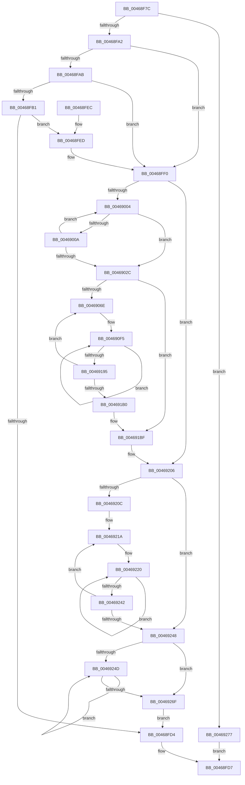

# crc32_z

- RVA: `0x00468F7C`–`0x0046927E` (길이 `770` bytes)
- VA: `0x0000000140468F7C`
- 실행 섹션: `.text`
- PDB 이름 있음: `예`; PDB Function 태그: `아니요`
- unwind 정보 RVA: `0x000AB128`
- 디코드: `197`개 명령, `770/770` bytes 표시
- 미해석 바이트: `0` (있으면 어셈블리에 `.byte`로 보존)

> 이 문서는 커널 이미지의 기계어와 PDB 기호를 분석해 생성했습니다. 4번과 5번은 함수 원형과 자료형을 바이너리 사용 방식에서 추정한 C 해석이며 원본 소스 복구 결과는 아닙니다.

## 1. Dependencies

- 직접 호출 지점: **6**; 고유 호출 대상: **2**
- 직접 호출자로 확인된 함수: **1**
- RIP 상대 이미지 참조: **2**

### Outgoing calls
- `0x00468FC4` → [crc32_sse42_simd_](crc32_sse42_simd__function_00469284.md) (function, `0x00469284`)
- `0x004691C5` → [crc_word](crc_word_function_0046945C.md) (function, `0x0046945C`)
- `0x004691D2` → [crc_word](crc_word_function_0046945C.md) (function, `0x0046945C`)
- `0x004691DF` → [crc_word](crc_word_function_0046945C.md) (function, `0x0046945C`)
- `0x004691EC` → [crc_word](crc_word_function_0046945C.md) (function, `0x0046945C`)
- `0x004691FA` → [crc_word](crc_word_function_0046945C.md) (function, `0x0046945C`)

### Direct callers
- [crc32](crc32_function_00468F58.md) at `0x00468F64`

### Static image references
- `0x00468FA2` → RVA `0x00E67B40` (`.data`; read)
- `0x00468FF0` → RVA `0x00000000` (`image boundary/outside`; read)

## 2. Other-region calls and transfers

- 다른 실행 섹션으로 향하는 call: **0**
- 별도 외부 분기/꼬리 이동을 확인하지 못했습니다.

## 3. Assembly (complete function range)

```asm
00468F7C  48 89 5C 24 08                  mov qword ptr [rsp + 8], rbx
00468F81  55                              push rbp
00468F82  56                              push rsi
00468F83  57                              push rdi
00468F84  41 54                           push r12
00468F86  41 55                           push r13
00468F88  41 56                           push r14
00468F8A  41 57                           push r15
00468F8C  48 83 EC 30                     sub rsp, 0x30
00468F90  4D 8B D0                        mov r10, r8
00468F93  4C 8B DA                        mov r11, rdx
00468F96  44 8B C9                        mov r9d, ecx
00468F99  48 85 D2                        test rdx, rdx
00468F9C  0F 84 D5 02 00 00               je 0x140469277
00468FA2  83 3D 97 EB 9F 00 00            cmp dword ptr [rip + 0x9feb97], 0
00468FA9  74 45                           je 0x140468ff0
00468FAB  49 83 F8 40                     cmp r8, 0x40
00468FAF  72 3F                           jb 0x140468ff0
00468FB1  49 8B D8                        mov rbx, r8
00468FB4  41 F7 D1                        not r9d
00468FB7  48 83 E3 F0                     and rbx, 0xfffffffffffffff0
00468FBB  45 8B C1                        mov r8d, r9d
00468FBE  48 8B D3                        mov rdx, rbx
00468FC1  49 8B CB                        mov rcx, r11
00468FC4  E8 BB 02 00 00                  call 0x140469284
00468FC9  44 8B C8                        mov r9d, eax
00468FCC  41 F7 D1                        not r9d
00468FCF  4C 2B D3                        sub r10, rbx
00468FD2  75 19                           jne 0x140468fed
00468FD4  41 8B C1                        mov eax, r9d
00468FD7  48 8B 5C 24 70                  mov rbx, qword ptr [rsp + 0x70]
00468FDC  48 83 C4 30                     add rsp, 0x30
00468FE0  41 5F                           pop r15
00468FE2  41 5E                           pop r14
00468FE4  41 5D                           pop r13
00468FE6  41 5C                           pop r12
00468FE8  5F                              pop rdi
00468FE9  5E                              pop rsi
00468FEA  5D                              pop rbp
00468FEB  C3                              ret
00468FEC  CC                              int3
00468FED  4C 03 DB                        add r11, rbx
00468FF0  4C 8D 3D 09 70 B9 FF            lea r15, [rip - 0x468ff7]
00468FF7  41 F7 D1                        not r9d
00468FFA  49 83 FA 17                     cmp r10, 0x17
00468FFE  0F 82 02 02 00 00               jb 0x140469206
00469004  41 F6 C3 03                     test r11b, 3
00469008  74 22                           je 0x14046902c
0046900A  41 0F B6 0B                     movzx ecx, byte ptr [r11]
0046900E  41 8B C1                        mov eax, r9d
00469011  48 33 C8                        xor rcx, rax
00469014  41 C1 E9 08                     shr r9d, 8
00469018  0F B6 C1                        movzx eax, cl
0046901B  49 FF C3                        inc r11
0046901E  45 33 8C 87 A0 9A 01 00         xor r9d, dword ptr [r15 + rax*4 + 0x19aa0]
00469026  49 83 EA 01                     sub r10, 1
0046902A  75 D8                           jne 0x140469004
0046902C  48 B8 CD CC CC CC CC CC CC CC   movabs rax, 0xcccccccccccccccd
00469036  33 FF                           xor edi, edi
00469038  49 F7 E2                        mul r10
0046903B  33 F6                           xor esi, esi
0046903D  33 ED                           xor ebp, ebp
0046903F  48 8B DA                        mov rbx, rdx
00469042  45 33 F6                        xor r14d, r14d
00469045  48 C1 EB 04                     shr rbx, 4
00469049  48 8D 04 9B                     lea rax, [rbx + rbx*4]
0046904D  48 C1 E0 02                     shl rax, 2
00469051  4C 2B D0                        sub r10, rax
00469054  48 83 EB 01                     sub rbx, 1
00469058  4C 89 94 24 80 00 00 00         mov qword ptr [rsp + 0x80], r10
00469060  48 89 9C 24 88 00 00 00         mov qword ptr [rsp + 0x88], rbx
00469068  0F 84 51 01 00 00               je 0x1404691bf
0046906E  45 33 0B                        xor r9d, dword ptr [r11]
00469071  48 8D 15 88 6F B9 FF            lea rdx, [rip - 0x469078]
00469078  41 33 7B 04                     xor edi, dword ptr [r11 + 4]
0046907C  41 BC 01 00 00 00               mov r12d, 1
00469082  41 33 73 08                     xor esi, dword ptr [r11 + 8]
00469086  41 33 6B 0C                     xor ebp, dword ptr [r11 + 0xc]
0046908A  45 33 73 10                     xor r14d, dword ptr [r11 + 0x10]
0046908E  41 0F B6 C1                     movzx eax, r9b
00469092  49 83 C3 14                     add r11, 0x14
00469096  45 8B E9                        mov r13d, r9d
00469099  44 8B D7                        mov r10d, edi
0046909C  8B DE                           mov ebx, esi
0046909E  45 8B 8C 87 50 49 03 00         mov r9d, dword ptr [r15 + rax*4 + 0x34950]
004690A6  40 0F B6 C7                     movzx eax, dil
004690AA  4C 89 5C 24 78                  mov qword ptr [rsp + 0x78], r11
004690AF  41 8B BC 87 50 49 03 00         mov edi, dword ptr [r15 + rax*4 + 0x34950]
004690B7  40 0F B6 C6                     movzx eax, sil
004690BB  41 8B B4 87 50 49 03 00         mov esi, dword ptr [r15 + rax*4 + 0x34950]
004690C3  8B C5                           mov eax, ebp
004690C5  48 89 44 24 20                  mov qword ptr [rsp + 0x20], rax
004690CA  4C 8B 5C 24 20                  mov r11, qword ptr [rsp + 0x20]
004690CF  40 0F B6 C5                     movzx eax, bpl
004690D3  41 8B AC 87 50 49 03 00         mov ebp, dword ptr [r15 + rax*4 + 0x34950]
004690DB  41 8B C6                        mov eax, r14d
004690DE  48 89 44 24 28                  mov qword ptr [rsp + 0x28], rax
004690E3  41 0F B6 C6                     movzx eax, r14b
004690E7  45 8B B4 87 50 49 03 00         mov r14d, dword ptr [r15 + rax*4 + 0x34950]
004690EF  41 BF 00 01 00 00               mov r15d, 0x100
004690F5  42 8D 04 E5 00 00 00 00         lea eax, [r12*8]
004690FD  41 FF C4                        inc r12d
00469100  4C 63 C0                        movsxd r8, eax
00469103  49 8B C5                        mov rax, r13
00469106  49 8B C8                        mov rcx, r8
00469109  48 D3 E8                        shr rax, cl
0046910C  0F B6 C8                        movzx ecx, al
0046910F  49 8B C2                        mov rax, r10
00469112  49 03 CF                        add rcx, r15
00469115  44 33 8C 8A 50 49 03 00         xor r9d, dword ptr [rdx + rcx*4 + 0x34950]
0046911D  49 8B C8                        mov rcx, r8
00469120  48 D3 E8                        shr rax, cl
00469123  0F B6 C8                        movzx ecx, al
00469126  48 8B C3                        mov rax, rbx
00469129  49 03 CF                        add rcx, r15
0046912C  33 BC 8A 50 49 03 00            xor edi, dword ptr [rdx + rcx*4 + 0x34950]
00469133  49 8B C8                        mov rcx, r8
00469136  48 D3 E8                        shr rax, cl
00469139  0F B6 D0                        movzx edx, al
0046913C  48 8D 05 BD 6E B9 FF            lea rax, [rip - 0x469143]
00469143  49 03 D7                        add rdx, r15
00469146  33 B4 90 50 49 03 00            xor esi, dword ptr [rax + rdx*4 + 0x34950]
0046914D  49 8B C3                        mov rax, r11
00469150  48 D3 E8                        shr rax, cl
00469153  0F B6 D0                        movzx edx, al
00469156  48 8D 05 A3 6E B9 FF            lea rax, [rip - 0x46915d]
0046915D  49 03 D7                        add rdx, r15
00469160  33 AC 90 50 49 03 00            xor ebp, dword ptr [rax + rdx*4 + 0x34950]
00469167  48 8D 15 92 6E B9 FF            lea rdx, [rip - 0x46916e]
0046916E  48 8B 44 24 28                  mov rax, qword ptr [rsp + 0x28]
00469173  48 D3 E8                        shr rax, cl
00469176  0F B6 C8                        movzx ecx, al
00469179  49 03 CF                        add rcx, r15
0046917C  49 81 C7 00 01 00 00            add r15, 0x100
00469183  44 33 B4 8A 50 49 03 00         xor r14d, dword ptr [rdx + rcx*4 + 0x34950]
0046918B  41 83 FC 04                     cmp r12d, 4
0046918F  0F 8C 60 FF FF FF               jl 0x1404690f5
00469195  48 83 AC 24 88 00 00 00 01      sub qword ptr [rsp + 0x88], 1
0046919E  4C 8D 3D 5B 6E B9 FF            lea r15, [rip - 0x4691a5]
004691A5  4C 8B 5C 24 78                  mov r11, qword ptr [rsp + 0x78]
004691AA  0F 85 BE FE FF FF               jne 0x14046906e
004691B0  4C 8B 94 24 80 00 00 00         mov r10, qword ptr [rsp + 0x80]
004691B8  4C 8D 3D 41 6E B9 FF            lea r15, [rip - 0x4691bf]
004691BF  45 33 0B                        xor r9d, dword ptr [r11]
004691C2  41 8B C9                        mov ecx, r9d
004691C5  E8 92 02 00 00                  call 0x14046945c
004691CA  41 33 43 04                     xor eax, dword ptr [r11 + 4]
004691CE  33 C7                           xor eax, edi
004691D0  8B C8                           mov ecx, eax
004691D2  E8 85 02 00 00                  call 0x14046945c
004691D7  41 33 43 08                     xor eax, dword ptr [r11 + 8]
004691DB  33 C6                           xor eax, esi
004691DD  8B C8                           mov ecx, eax
004691DF  E8 78 02 00 00                  call 0x14046945c
004691E4  41 33 43 0C                     xor eax, dword ptr [r11 + 0xc]
004691E8  33 C5                           xor eax, ebp
004691EA  8B C8                           mov ecx, eax
004691EC  E8 6B 02 00 00                  call 0x14046945c
004691F1  41 33 43 10                     xor eax, dword ptr [r11 + 0x10]
004691F5  41 33 C6                        xor eax, r14d
004691F8  8B C8                           mov ecx, eax
004691FA  E8 5D 02 00 00                  call 0x14046945c
004691FF  44 8B C8                        mov r9d, eax
00469202  49 83 C3 14                     add r11, 0x14
00469206  49 83 FA 08                     cmp r10, 8
0046920A  72 3C                           jb 0x140469248
0046920C  49 8B D2                        mov rdx, r10
0046920F  48 C1 EA 03                     shr rdx, 3
00469213  48 6B CA F8                     imul rcx, rdx, -8
00469217  4C 03 D1                        add r10, rcx
0046921A  41 B8 08 00 00 00               mov r8d, 8
00469220  41 0F B6 0B                     movzx ecx, byte ptr [r11]
00469224  41 8B C1                        mov eax, r9d
00469227  48 33 C8                        xor rcx, rax
0046922A  41 C1 E9 08                     shr r9d, 8
0046922E  0F B6 C1                        movzx eax, cl
00469231  49 FF C3                        inc r11
00469234  45 33 8C 87 A0 9A 01 00         xor r9d, dword ptr [r15 + rax*4 + 0x19aa0]
0046923C  49 83 E8 01                     sub r8, 1
00469240  75 DE                           jne 0x140469220
00469242  48 83 EA 01                     sub rdx, 1
00469246  75 D2                           jne 0x14046921a
00469248  4D 85 D2                        test r10, r10
0046924B  74 22                           je 0x14046926f
0046924D  41 0F B6 0B                     movzx ecx, byte ptr [r11]
00469251  41 8B C1                        mov eax, r9d
00469254  48 33 C8                        xor rcx, rax
00469257  41 C1 E9 08                     shr r9d, 8
0046925B  0F B6 C1                        movzx eax, cl
0046925E  49 FF C3                        inc r11
00469261  45 33 8C 87 A0 9A 01 00         xor r9d, dword ptr [r15 + rax*4 + 0x19aa0]
00469269  49 83 EA 01                     sub r10, 1
0046926D  75 DE                           jne 0x14046924d
0046926F  41 F7 D1                        not r9d
00469272  E9 5D FD FF FF                  jmp 0x140468fd4
00469277  33 C0                           xor eax, eax
00469279  E9 59 FD FF FF                  jmp 0x140468fd7
```

## 4. C-style interpretation (structured pseudocode)

```c
__int64 __fastcall crc32_z(int a1, __int64 a2, __int64 a3)
{
    __int64 result;
    __int64 v_r10;
    __int64 v_r11;
    __int64 v_r12;
    __int64 v_r14;
    __int64 v_r15;
    __int64 v_rbp;
    __int64 v_rbx;
    __int64 v_rdi;
    __int64 v_rsi;
    __int64 v_rsp;
    unsigned __int64 v_stack_p20;
    unsigned __int64 v_stack_p28;
    unsigned __int64 v_stack_p78;
    unsigned __int64 v_stack_p8;
    unsigned __int64 v_stack_p80;
    unsigned __int64 v_stack_p88;

    v_stack_p8 = v_rbx;
    v_rsp = (v_rsp) - (48);
    if (a2 == 0) goto loc_00469277;
    if ((*(unsigned int *)(v_rip + 10480535)) == 0) goto loc_00468FF0;
    if (a3 < 64) goto loc_00468FF0;
    a4 = (unsigned int)(~((unsigned int)(a1)));
    v_rbx = (a3) & (-16);
    result = crc32_sse42_simd_(a2, v_rbx, (unsigned int)((unsigned int)(a4)), a4);
    a4 = (unsigned int)(~((unsigned int)((unsigned int)(result))));
    v_r10 = (a3) - (v_rbx);
    if (condition_is_not_equal) goto loc_00468FED;
loc_00468FD4:
loc_00468FD7:
    v_rsp = (v_rsp) + (48);
    return (unsigned int)((unsigned int)(a4));
loc_00468FED:
    v_r11 = (a2) + (v_stack_p8);
loc_00468FF0:
    a4 = (unsigned int)(~(a4));
    if (v_r10 < 23) goto loc_00469206;
loc_00469004:
    if ((((unsigned __int8)(v_r11)) & (3)) == 0) goto loc_0046902C;
    a1 = (*(unsigned __int8 *)(v_r11)) ^ ((unsigned int)((unsigned int)(a4)));
    a4 = (unsigned int)((a4) >> (8));
    v_r11 = (v_r11) + 1;
    a4 = (unsigned int)((a4) ^ (*(unsigned int *)(v_rip - 4624375 + (unsigned __int8)(a1) * 4 + 105120)));
    v_r10 = (v_r10) - (1);
    if (condition_is_not_equal) goto loc_00469004;
loc_0046902C:
    v_rdi = 0;
    v_rsi = 0;
    v_rbp = 0;
    v_r14 = 0;
    v_rbx = (v_rbx) >> (4);
    result = (v_rbx + v_rbx * 4) << (2);
    v_r10 = (v_r10) - (result);
    v_rbx = (v_rbx) - (1);
    v_stack_p80 = v_r10;
    v_stack_p88 = v_rbx;
    if (condition_is_equal) goto loc_004691BF;
loc_0046906E:
    a4 = (unsigned int)((a4) ^ (*(unsigned int *)(v_r11)));
    v_rdi = (unsigned int)((v_rdi) ^ (*(unsigned int *)(v_r11 + 4)));
    v_rsi = (unsigned int)((v_rsi) ^ (*(unsigned int *)(v_r11 + 8)));
    v_rbp = (unsigned int)((v_rbp) ^ (*(unsigned int *)(v_r11 + 12)));
    v_r14 = (unsigned int)((v_r14) ^ (*(unsigned int *)(v_r11 + 16)));
    v_r11 = (v_r11) + (20);
    v_stack_p78 = v_r11;
    v_stack_p20 = (unsigned int)((unsigned int)(v_rbp));
    v_stack_p28 = (unsigned int)((unsigned int)(v_r14));
loc_004690F5:
    v_r12 = (unsigned int)((1) + 1);
    result = ((unsigned int)((unsigned int)(a4))) >> ((unsigned __int8)((int)((unsigned int)(1 * 8))));
    a1 = ((unsigned __int8)(result)) + (256);
    a4 = (unsigned int)(((unsigned int)(*(unsigned int *)(v_rip - 4624375 + (unsigned __int8)(a4) * 4 + 215376))) ^ (*(unsigned int *)(v_rip - 4624504 + a1 * 4 + 215376)));
    result = ((unsigned int)((unsigned int)(v_rdi))) >> ((unsigned __int8)((int)((unsigned int)(1 * 8))));
    a1 = ((unsigned __int8)(result)) + (256);
    v_rdi = (unsigned int)(((unsigned int)(*(unsigned int *)(v_rip - 4624375 + (unsigned __int8)(v_rdi) * 4 + 215376))) ^ (*(unsigned int *)(v_rip - 4624504 + a1 * 4 + 215376)));
    result = ((unsigned int)((unsigned int)(v_rsi))) >> ((unsigned __int8)((int)((unsigned int)(1 * 8))));
    a2 = ((unsigned __int8)(result)) + (256);
    v_rsi = (unsigned int)(((unsigned int)(*(unsigned int *)(v_rip - 4624375 + (unsigned __int8)(v_rsi) * 4 + 215376))) ^ (*(unsigned int *)(v_rip - 4624707 + a2 * 4 + 215376)));
    result = (v_stack_p20) >> ((unsigned __int8)((int)((unsigned int)(1 * 8))));
    a2 = ((unsigned __int8)(result)) + (256);
    v_rbp = (unsigned int)(((unsigned int)(*(unsigned int *)(v_rip - 4624375 + (unsigned __int8)(v_rbp) * 4 + 215376))) ^ (*(unsigned int *)(v_rip - 4624733 + a2 * 4 + 215376)));
    result = (v_stack_p28) >> ((unsigned __int8)((int)((unsigned int)(1 * 8))));
    a1 = ((unsigned __int8)(result)) + (256);
    v_r15 = (256) + (256);
    v_r14 = (unsigned int)(((unsigned int)(*(unsigned int *)(v_rip - 4624375 + (unsigned __int8)(v_r14) * 4 + 215376))) ^ (*(unsigned int *)(v_rip - 4624750 + a1 * 4 + 215376)));
    if (((unsigned int)(v_r12)) < 4) goto loc_004690F5;
    if (((unsigned int)(v_r12)) != 4) goto loc_0046906E;
loc_004691BF:
    a4 = (unsigned int)((a4) ^ (*(unsigned int *)(v_stack_p78)));
    result = crc_word((unsigned int)((unsigned int)(a4)), v_rip - 4624750, (int)((unsigned int)(1 * 8)), a4);
    result = (unsigned int)((result) ^ (*(unsigned int *)(v_stack_p78 + 4)));
    result = (unsigned int)((result) ^ ((unsigned int)(v_rdi)));
    result = crc_word((unsigned int)((unsigned int)(result)), v_rip - 4624750, (int)((unsigned int)(1 * 8)), a4);
    result = (unsigned int)((result) ^ (*(unsigned int *)(v_stack_p78 + 8)));
    result = (unsigned int)((result) ^ ((unsigned int)(v_rsi)));
    result = crc_word((unsigned int)((unsigned int)(result)), v_rip - 4624750, (int)((unsigned int)(1 * 8)), a4);
    result = (unsigned int)((result) ^ (*(unsigned int *)(v_stack_p78 + 12)));
    result = (unsigned int)((result) ^ ((unsigned int)(v_rbp)));
    result = crc_word((unsigned int)((unsigned int)(result)), v_rip - 4624750, (int)((unsigned int)(1 * 8)), a4);
    result = (unsigned int)((result) ^ (*(unsigned int *)(v_stack_p78 + 16)));
    result = (unsigned int)((result) ^ ((unsigned int)(v_r14)));
    result = crc_word((unsigned int)((unsigned int)(result)), v_rip - 4624750, (int)((unsigned int)(1 * 8)), a4);
    v_r11 = (v_stack_p78) + (20);
loc_00469206:
    if (v_stack_p80 < 8) goto loc_00469248;
    a2 = (v_stack_p80) >> (3);
    a1 = ((unsigned int)((unsigned int)(result))) * (a2);
    v_r10 = (v_stack_p80) + (a1);
loc_0046921A:
loc_00469220:
    a1 = (*(unsigned __int8 *)(v_r11)) ^ ((unsigned int)((unsigned int)((unsigned int)((unsigned int)(result)))));
    a4 = (unsigned int)(((unsigned int)((unsigned int)(result))) >> (8));
    v_r11 = (v_r11) + 1;
    a4 = (unsigned int)((a4) ^ (*(unsigned int *)(v_rip - 4624831 + (unsigned __int8)(a1) * 4 + 105120)));
    a3 = (8) - (1);
    if (condition_is_not_equal) goto loc_00469220;
    a2 = (a2) - (1);
    if (condition_is_not_equal) goto loc_0046921A;
loc_00469248:
    if (v_r10 == 0) goto loc_0046926F;
loc_0046924D:
    a1 = (*(unsigned __int8 *)(v_r11)) ^ ((unsigned int)((unsigned int)(a4)));
    a4 = (unsigned int)((a4) >> (8));
    v_r11 = (v_r11) + 1;
    a4 = (unsigned int)((a4) ^ (*(unsigned int *)(v_rip - 4624831 + (unsigned __int8)(a1) * 4 + 105120)));
    v_r10 = (v_r10) - (1);
    if (condition_is_not_equal) goto loc_0046924D;
loc_0046926F:
    a4 = (unsigned int)(~(a4));
    goto loc_00468FD4;
loc_00469277:
    result = 0;
    goto loc_00468FD7;
}
```

## 5. (Beta) C Style

```c
int64_t crc32_z(int32_t Arg1, int64_t Arg2, int64_t Arg3)
{
    int64_t result;
    int64_t local_r10;
    int64_t local_r11;
    int64_t local_r12;
    int64_t local_r14;
    int64_t local_r15;
    int64_t local_rbp;
    int64_t local_rbx;
    int64_t local_rdi;
    int64_t local_rsi;
    int64_t local_rsp;
    uint64_t v_stack_p20;
    uint64_t v_stack_p28;
    uint64_t v_stack_p78;
    uint64_t v_stack_p8;
    uint64_t v_stack_p80;
    uint64_t v_stack_p88;

    v_stack_p8 = local_rbx;
    local_rsp = (local_rsp) - (48);
    if (Arg2 == 0) goto loc_00469277;
    if ((*(uint32_t *)(v_rip + 0x9FEB97)) == 0) goto loc_00468FF0;
    if (Arg3 < 64) goto loc_00468FF0;
    a4 = (uint32_t)(~((uint32_t)(Arg1)));
    local_rbx = (Arg3) & (-16);
    result = crc32_sse42_simd_(Arg2, local_rbx, (uint32_t)((uint32_t)(a4)), a4);
    a4 = (uint32_t)(~((uint32_t)((uint32_t)(result))));
    local_r10 = (Arg3) - (local_rbx);
    if (condition_is_not_equal) goto loc_00468FED;
loc_00468FD4:
loc_00468FD7:
    local_rsp = (local_rsp) + (48);
    return (uint32_t)((uint32_t)(a4));
loc_00468FED:
    local_r11 = (Arg2) + (v_stack_p8);
loc_00468FF0:
    a4 = (uint32_t)(~(a4));
    if (local_r10 < 23) goto loc_00469206;
loc_00469004:
    if ((((uint8_t)(local_r11)) & (3)) == 0) goto loc_0046902C;
    Arg1 = (*(uint8_t *)(local_r11)) ^ ((uint32_t)((uint32_t)(a4)));
    a4 = (uint32_t)((a4) >> (8));
    local_r11 = (local_r11) + 1;
    a4 = (uint32_t)((a4) ^ (*(uint32_t *)(v_rip - 0x468FF7 + (uint8_t)(Arg1) * 4 + 0x19AA0)));
    local_r10 = (local_r10) - (1);
    if (condition_is_not_equal) goto loc_00469004;
loc_0046902C:
    local_rdi = 0;
    local_rsi = 0;
    local_rbp = 0;
    local_r14 = 0;
    local_rbx = (local_rbx) >> (4);
    result = (local_rbx + local_rbx * 4) << (2);
    local_r10 = (local_r10) - (result);
    local_rbx = (local_rbx) - (1);
    v_stack_p80 = local_r10;
    v_stack_p88 = local_rbx;
    if (condition_is_equal) goto loc_004691BF;
loc_0046906E:
    a4 = (uint32_t)((a4) ^ (*(uint32_t *)(local_r11)));
    local_rdi = (uint32_t)((local_rdi) ^ (*(uint32_t *)(local_r11 + 0x4)));
    local_rsi = (uint32_t)((local_rsi) ^ (*(uint32_t *)(local_r11 + 0x8)));
    local_rbp = (uint32_t)((local_rbp) ^ (*(uint32_t *)(local_r11 + 0xC)));
    local_r14 = (uint32_t)((local_r14) ^ (*(uint32_t *)(local_r11 + 0x10)));
    local_r11 = (local_r11) + (20);
    v_stack_p78 = local_r11;
    v_stack_p20 = (uint32_t)((uint32_t)(local_rbp));
    v_stack_p28 = (uint32_t)((uint32_t)(local_r14));
loc_004690F5:
    local_r12 = (uint32_t)((1) + 1);
    result = ((uint32_t)((uint32_t)(a4))) >> ((uint8_t)((int32_t)((uint32_t)(1 * 8))));
    Arg1 = ((uint8_t)(result)) + (256);
    a4 = (uint32_t)(((uint32_t)(*(uint32_t *)(v_rip - 0x468FF7 + (uint8_t)(a4) * 4 + 0x34950))) ^ (*(uint32_t *)(v_rip - 0x469078 + Arg1 * 4 + 0x34950)));
    result = ((uint32_t)((uint32_t)(local_rdi))) >> ((uint8_t)((int32_t)((uint32_t)(1 * 8))));
    Arg1 = ((uint8_t)(result)) + (256);
    local_rdi = (uint32_t)(((uint32_t)(*(uint32_t *)(v_rip - 0x468FF7 + (uint8_t)(local_rdi) * 4 + 0x34950))) ^ (*(uint32_t *)(v_rip - 0x469078 + Arg1 * 4 + 0x34950)));
    result = ((uint32_t)((uint32_t)(local_rsi))) >> ((uint8_t)((int32_t)((uint32_t)(1 * 8))));
    Arg2 = ((uint8_t)(result)) + (256);
    local_rsi = (uint32_t)(((uint32_t)(*(uint32_t *)(v_rip - 0x468FF7 + (uint8_t)(local_rsi) * 4 + 0x34950))) ^ (*(uint32_t *)(v_rip - 0x469143 + Arg2 * 4 + 0x34950)));
    result = (v_stack_p20) >> ((uint8_t)((int32_t)((uint32_t)(1 * 8))));
    Arg2 = ((uint8_t)(result)) + (256);
    local_rbp = (uint32_t)(((uint32_t)(*(uint32_t *)(v_rip - 0x468FF7 + (uint8_t)(local_rbp) * 4 + 0x34950))) ^ (*(uint32_t *)(v_rip - 0x46915D + Arg2 * 4 + 0x34950)));
    result = (v_stack_p28) >> ((uint8_t)((int32_t)((uint32_t)(1 * 8))));
    Arg1 = ((uint8_t)(result)) + (256);
    local_r15 = (256) + (256);
    local_r14 = (uint32_t)(((uint32_t)(*(uint32_t *)(v_rip - 0x468FF7 + (uint8_t)(local_r14) * 4 + 0x34950))) ^ (*(uint32_t *)(v_rip - 0x46916E + Arg1 * 4 + 0x34950)));
    if (((uint32_t)(local_r12)) < 4) goto loc_004690F5;
    if (((uint32_t)(local_r12)) != 4) goto loc_0046906E;
loc_004691BF:
    a4 = (uint32_t)((a4) ^ (*(uint32_t *)(v_stack_p78)));
    result = crc_word((uint32_t)((uint32_t)(a4)), v_rip - 4624750, (int32_t)((uint32_t)(1 * 8)), a4);
    result = (uint32_t)((result) ^ (*(uint32_t *)(v_stack_p78 + 0x4)));
    result = (uint32_t)((result) ^ ((uint32_t)(local_rdi)));
    result = crc_word((uint32_t)((uint32_t)(result)), v_rip - 4624750, (int32_t)((uint32_t)(1 * 8)), a4);
    result = (uint32_t)((result) ^ (*(uint32_t *)(v_stack_p78 + 0x8)));
    result = (uint32_t)((result) ^ ((uint32_t)(local_rsi)));
    result = crc_word((uint32_t)((uint32_t)(result)), v_rip - 4624750, (int32_t)((uint32_t)(1 * 8)), a4);
    result = (uint32_t)((result) ^ (*(uint32_t *)(v_stack_p78 + 0xC)));
    result = (uint32_t)((result) ^ ((uint32_t)(local_rbp)));
    result = crc_word((uint32_t)((uint32_t)(result)), v_rip - 4624750, (int32_t)((uint32_t)(1 * 8)), a4);
    result = (uint32_t)((result) ^ (*(uint32_t *)(v_stack_p78 + 0x10)));
    result = (uint32_t)((result) ^ ((uint32_t)(local_r14)));
    result = crc_word((uint32_t)((uint32_t)(result)), v_rip - 4624750, (int32_t)((uint32_t)(1 * 8)), a4);
    local_r11 = (v_stack_p78) + (20);
loc_00469206:
    if (v_stack_p80 < 8) goto loc_00469248;
    Arg2 = (v_stack_p80) >> (3);
    Arg1 = ((uint32_t)((uint32_t)(result))) * (Arg2);
    local_r10 = (v_stack_p80) + (Arg1);
loc_0046921A:
loc_00469220:
    Arg1 = (*(uint8_t *)(local_r11)) ^ ((uint32_t)((uint32_t)((uint32_t)((uint32_t)(result)))));
    a4 = (uint32_t)(((uint32_t)((uint32_t)(result))) >> (8));
    local_r11 = (local_r11) + 1;
    a4 = (uint32_t)((a4) ^ (*(uint32_t *)(v_rip - 0x4691BF + (uint8_t)(Arg1) * 4 + 0x19AA0)));
    Arg3 = (8) - (1);
    if (condition_is_not_equal) goto loc_00469220;
    Arg2 = (Arg2) - (1);
    if (condition_is_not_equal) goto loc_0046921A;
loc_00469248:
    if (local_r10 == 0) goto loc_0046926F;
loc_0046924D:
    Arg1 = (*(uint8_t *)(local_r11)) ^ ((uint32_t)((uint32_t)(a4)));
    a4 = (uint32_t)((a4) >> (8));
    local_r11 = (local_r11) + 1;
    a4 = (uint32_t)((a4) ^ (*(uint32_t *)(v_rip - 0x4691BF + (uint8_t)(Arg1) * 4 + 0x19AA0)));
    local_r10 = (local_r10) - (1);
    if (condition_is_not_equal) goto loc_0046924D;
loc_0046926F:
    a4 = (uint32_t)(~(a4));
    goto loc_00468FD4;
loc_00469277:
    result = 0;
    goto loc_00468FD7;
}
```

## 6. Execution-region graph

[열기: 2D/3D 그래프와 함수 탐색 컨트롤 패널](../../../control-panel.html?section=text&rva=0x00468F7C&view=graph)

- 2D 그래프는 위에서 아래로 흐르고, 3D 그래프는 빈 공간을 드래그해 회전합니다. Shift+드래그는 이동, 휠은 확대·축소, 함수 노드 선택은 대상 보고서 이동입니다.

### Static fallback


