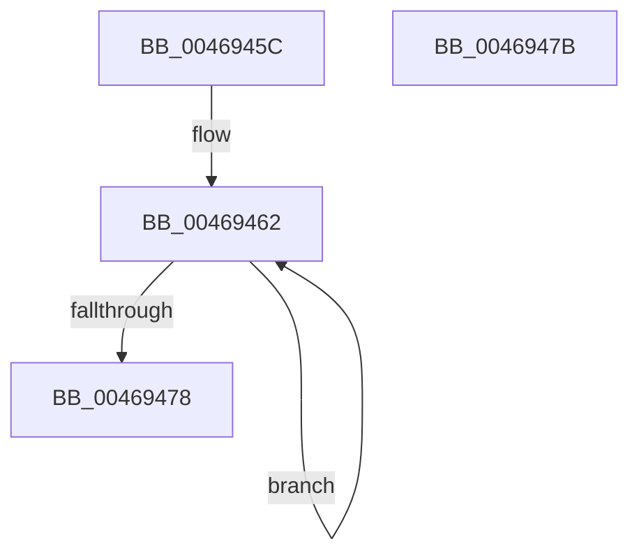

# crc_word

- RVA: `0x0046945C`–`0x0046947C` (길이 `32` bytes)
- VA: `0x000000014046945C`
- 실행 섹션: `.text`
- PDB 이름 있음: `예`; PDB Function 태그: `예`
- unwind 정보 RVA: `0x000DB714`
- 디코드: `10`개 명령, `32/32` bytes 표시
- 미해석 바이트: `0` (있으면 어셈블리에 `.byte`로 보존)

> 이 문서는 커널 이미지의 기계어와 PDB 기호를 분석해 생성했습니다. 4번과 5번은 함수 원형과 자료형을 바이너리 사용 방식에서 추정한 C 해석이며 원본 소스 복구 결과는 아닙니다.

## 1. Dependencies

- 직접 호출 지점: **0**; 고유 호출 대상: **0**
- 직접 호출자로 확인된 함수: **1**
- RIP 상대 이미지 참조: **1**

### Outgoing calls
- 직접 디코드된 call 명령이 없습니다.

### Direct callers
- [crc32_z](crc32_z_function_00468F7C.md) at `0x004691C5`
- [crc32_z](crc32_z_function_00468F7C.md) at `0x004691D2`
- [crc32_z](crc32_z_function_00468F7C.md) at `0x004691DF`
- [crc32_z](crc32_z_function_00468F7C.md) at `0x004691EC`
- [crc32_z](crc32_z_function_00468F7C.md) at `0x004691FA`

### Static image references
- `0x00469465` → RVA `0x00019AA0` (`.rdata`; read)

## 2. Other-region calls and transfers

- 다른 실행 섹션으로 향하는 call: **0**
- 별도 외부 분기/꼬리 이동을 확인하지 못했습니다.

## 3. Assembly (complete function range)

```asm
0046945C  41 B8 04 00 00 00               mov r8d, 4
00469462  0F B6 D1                        movzx edx, cl
00469465  48 8D 05 34 06 BB FF            lea rax, [rip - 0x44f9cc]
0046946C  C1 E9 08                        shr ecx, 8
0046946F  33 0C 90                        xor ecx, dword ptr [rax + rdx*4]
00469472  49 83 E8 01                     sub r8, 1
00469476  75 EA                           jne 0x140469462
00469478  8B C1                           mov eax, ecx
0046947A  C3                              ret
0046947B  CC                              int3
```

## 4. C-style interpretation (structured pseudocode)

```c
__int64 __fastcall crc_word(int a1)
{
loc_00469462:
    a1 = (unsigned int)((a1) >> (8));
    a1 = (unsigned int)((a1) ^ (*(unsigned int *)(v_rip - 4520396 + (unsigned __int8)(a1) * 4)));
    a3 = (4) - (1);
    if (condition_is_not_equal) goto loc_00469462;
    return (unsigned int)(a1);
}
```

## 5. (Beta) C Style

```c
int64_t crc_word(int32_t Arg1)
{
loc_00469462:
    Arg1 = (uint32_t)((Arg1) >> (8));
    Arg1 = (uint32_t)((Arg1) ^ (*(uint32_t *)(v_rip - 0x44F9CC + (uint8_t)(Arg1) * 4)));
    a3 = (4) - (1);
    if (condition_is_not_equal) goto loc_00469462;
    return (uint32_t)(Arg1);
}
```

## 6. Execution-region graph

[열기: 2D/3D 그래프와 함수 탐색 컨트롤 패널](../../../control-panel.html?section=text&rva=0x0046945C&view=graph)

- 2D 그래프는 위에서 아래로 흐르고, 3D 그래프는 빈 공간을 드래그해 회전합니다. Shift+드래그는 이동, 휠은 확대·축소, 함수 노드 선택은 대상 보고서 이동입니다.

### Static fallback


