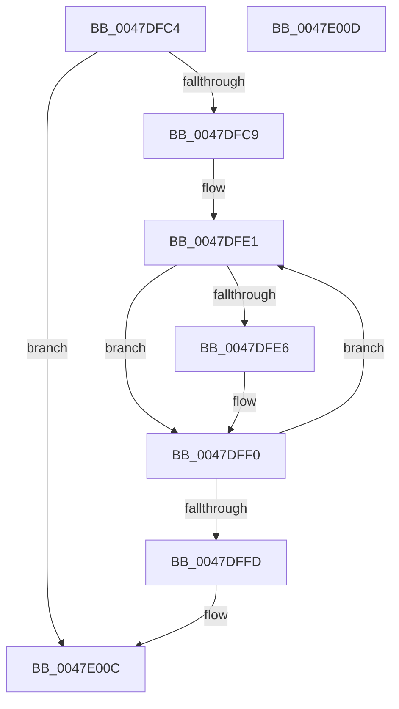

# AdtpCleanupParameterAllocations

- RVA: `0x0047DFC4`–`0x0047E00E` (길이 `74` bytes)
- VA: `0x000000014047DFC4`
- 실행 섹션: `.text`
- PDB 이름 있음: `예`; PDB Function 태그: `아니요`
- unwind 정보 RVA: `0x000ADC24`
- 디코드: `24`개 명령, `74/74` bytes 표시
- 미해석 바이트: `0` (있으면 어셈블리에 `.byte`로 보존)

> 이 문서는 커널 이미지의 기계어와 PDB 기호를 분석해 생성했습니다. 4번과 5번은 함수 원형과 자료형을 바이너리 사용 방식에서 추정한 C 해석이며 원본 소스 복구 결과는 아닙니다.

## 1. Dependencies

- 직접 호출 지점: **1**; 고유 호출 대상: **1**
- 직접 호출자로 확인된 함수: **1**
- RIP 상대 이미지 참조: **0**

### Outgoing calls
- `0x0047DFEB` → [ExFreePoolWithTag](../../poolcode/B8/ExFreePoolWithTag_function_00B82870.md) (function, `0x00B82870`)

### Direct callers
- [AdtpWriteToEtw](../../page/AF/AdtpWriteToEtw_function_00AF98B0.md) at `0x00AF9CAD`

### Static image references
- 디코드된 RIP-relative 메모리 참조가 없습니다.

## 2. Other-region calls and transfers

- 다른 실행 섹션으로 향하는 call: **1**
  - `0x0047DFEB` → [ExFreePoolWithTag](../../poolcode/B8/ExFreePoolWithTag_function_00B82870.md) (`.text` → `POOLCODE`)
- 별도 외부 분기/꼬리 이동을 확인하지 못했습니다.

## 3. Assembly (complete function range)

```asm
0047DFC4  45 85 C0                        test r8d, r8d
0047DFC7  74 43                           je 0x14047e00c
0047DFC9  48 89 5C 24 08                  mov qword ptr [rsp + 8], rbx
0047DFCE  48 89 74 24 10                  mov qword ptr [rsp + 0x10], rsi
0047DFD3  57                              push rdi
0047DFD4  48 83 EC 20                     sub rsp, 0x20
0047DFD8  48 8B FA                        mov rdi, rdx
0047DFDB  41 8B F0                        mov esi, r8d
0047DFDE  48 8B D9                        mov rbx, rcx
0047DFE1  80 3B 00                        cmp byte ptr [rbx], 0
0047DFE4  74 0A                           je 0x14047dff0
0047DFE6  48 8B 0F                        mov rcx, qword ptr [rdi]
0047DFE9  33 D2                           xor edx, edx
0047DFEB  E8 80 48 70 00                  call 0x140b82870
0047DFF0  48 FF C3                        inc rbx
0047DFF3  48 83 C7 10                     add rdi, 0x10
0047DFF7  48 83 EE 01                     sub rsi, 1
0047DFFB  75 E4                           jne 0x14047dfe1
0047DFFD  48 8B 5C 24 30                  mov rbx, qword ptr [rsp + 0x30]
0047E002  48 8B 74 24 38                  mov rsi, qword ptr [rsp + 0x38]
0047E007  48 83 C4 20                     add rsp, 0x20
0047E00B  5F                              pop rdi
0047E00C  C3                              ret
0047E00D  CC                              int3
```

## 4. C-style interpretation (structured pseudocode)

```c
__int64 __fastcall AdtpCleanupParameterAllocations(__int64 a1, __int64 a2, int a3)
{
    __int64 result;
    __int64 v_rbx;
    __int64 v_rdi;
    __int64 v_rsi;
    __int64 v_rsp;
    unsigned __int64 v_stack_p10;
    unsigned __int64 v_stack_p8;

    if (a3 == 0) goto loc_0047E00C;
    v_stack_p8 = v_rbx;
    v_stack_p10 = v_rsi;
    v_rsp = (v_rsp) - (32);
loc_0047DFE1:
    if ((*(unsigned __int8 *)(a1)) != 0) {
        a1 = *(unsigned __int64 *)(a2);
        a2 = 0;
        result = ExFreePoolWithTag(a1, a2, a3, a4);
    }
    v_rbx = (a1) + 1;
    v_rdi = (a2) + (16);
    v_rsi = ((unsigned int)(a3)) - (1);
    if (condition_is_not_equal) goto loc_0047DFE1;
    v_rsp = (v_rsp) + (32);
loc_0047E00C:
    return result;
}
```

## 5. (Beta) C Style

```c
int64_t AdtpCleanupParameterAllocations(int64_t Arg1, void *Arg2, int32_t Arg3)
{
    uint8_t *arg2 = (uint8_t *)Arg2;

    int64_t result;
    int64_t local_rbx;
    int64_t local_rdi;
    int64_t local_rsi;
    int64_t local_rsp;
    uint64_t v_stack_p10;
    uint64_t v_stack_p8;

    if (Arg3 == 0) goto loc_0047E00C;
    v_stack_p8 = local_rbx;
    v_stack_p10 = local_rsi;
    local_rsp = (local_rsp) - (32);
loc_0047DFE1:
    if ((*(uint8_t *)(Arg1)) != 0) {
        Arg1 = *(uint64_t *)(arg2);
        Arg2 = 0;
        result = ExFreePoolWithTag(Arg1, Arg2, Arg3, a4);
    }
    local_rbx = (Arg1) + 1;
    local_rdi = (Arg2) + (16);
    local_rsi = ((uint32_t)(Arg3)) - (1);
    if (condition_is_not_equal) goto loc_0047DFE1;
    local_rsp = (local_rsp) + (32);
loc_0047E00C:
    return result;
}
```

### 관측된 메모리 오프셋

구조체 형식이 확인되지 않은 접근은 인자 기준의 오프셋으로만 기록했습니다.

| 기준 인자 | 오프셋 표현 | 폭 (bit) | 접근 |
|---|---:|---:|---|
| `Arg2` | `+ 0x0` | `64` | `R` |

## 6. Execution-region graph

[열기: 2D/3D 그래프와 함수 탐색 컨트롤 패널](../../../control-panel.html?section=text&rva=0x0047DFC4&view=graph)

- 2D 그래프는 위에서 아래로 흐르고, 3D 그래프는 빈 공간을 드래그해 회전합니다. Shift+드래그는 이동, 휠은 확대·축소, 함수 노드 선택은 대상 보고서 이동입니다.

### Static fallback


