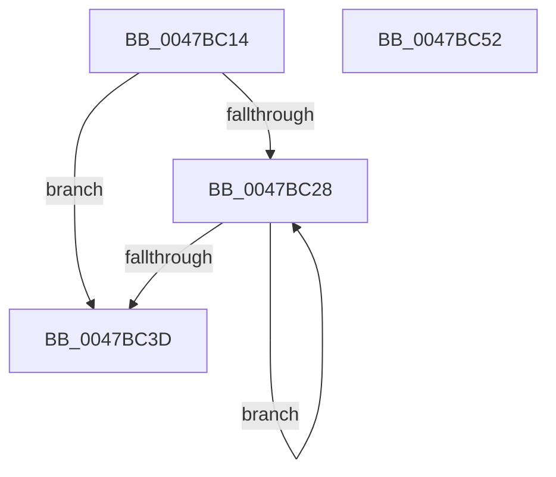

# AlpcpDeferredFreeCompletionPacketLookaside

- RVA: `0x0047BC14`–`0x0047BC53` (길이 `63` bytes)
- VA: `0x000000014047BC14`
- 실행 섹션: `.text`
- PDB 이름 있음: `예`; PDB Function 태그: `아니요`
- unwind 정보 RVA: `0x0005CAAC`
- 디코드: `21`개 명령, `63/63` bytes 표시
- 미해석 바이트: `0` (있으면 어셈블리에 `.byte`로 보존)

> 이 문서는 커널 이미지의 기계어와 PDB 기호를 분석해 생성했습니다. 4번과 5번은 함수 원형과 자료형을 바이너리 사용 방식에서 추정한 C 해석이며 원본 소스 복구 결과는 아닙니다.

## 1. Dependencies

- 직접 호출 지점: **2**; 고유 호출 대상: **2**
- 직접 호출자로 확인된 함수: **1**
- RIP 상대 이미지 참조: **0**

### Outgoing calls
- `0x0047BC31` → [IoFreeMiniCompletionPacket](../../page/9A/IoFreeMiniCompletionPacket_function_009A82B0.md) (function, `0x009A82B0`)
- `0x0047BC42` → [ExFreePoolWithTag](../../poolcode/B8/ExFreePoolWithTag_function_00B82870.md) (function, `0x00B82870`)

### Direct callers
- [AlpcpFreeCompletionPacketLookaside](AlpcpFreeCompletionPacketLookaside_function_0047BBB0.md) at `0x0047BBF2`

### Static image references
- 디코드된 RIP-relative 메모리 참조가 없습니다.

## 2. Other-region calls and transfers

- 다른 실행 섹션으로 향하는 call: **2**
  - `0x0047BC31` → [IoFreeMiniCompletionPacket](../../page/9A/IoFreeMiniCompletionPacket_function_009A82B0.md) (`.text` → `PAGE`)
  - `0x0047BC42` → [ExFreePoolWithTag](../../poolcode/B8/ExFreePoolWithTag_function_00B82870.md) (`.text` → `POOLCODE`)
- 별도 외부 분기/꼬리 이동을 확인하지 못했습니다.

## 3. Assembly (complete function range)

```asm
0047BC14  48 89 5C 24 08                  mov qword ptr [rsp + 8], rbx
0047BC19  57                              push rdi
0047BC1A  48 83 EC 20                     sub rsp, 0x20
0047BC1E  33 DB                           xor ebx, ebx
0047BC20  48 8B F9                        mov rdi, rcx
0047BC23  39 59 08                        cmp dword ptr [rcx + 8], ebx
0047BC26  76 15                           jbe 0x14047bc3d
0047BC28  48 8D 0C 5B                     lea rcx, [rbx + rbx*2]
0047BC2C  48 8B 4C CF 40                  mov rcx, qword ptr [rdi + rcx*8 + 0x40]
0047BC31  E8 7A C6 52 00                  call 0x1409a82b0
0047BC36  FF C3                           inc ebx
0047BC38  3B 5F 08                        cmp ebx, dword ptr [rdi + 8]
0047BC3B  72 EB                           jb 0x14047bc28
0047BC3D  33 D2                           xor edx, edx
0047BC3F  48 8B CF                        mov rcx, rdi
0047BC42  E8 29 6C 70 00                  call 0x140b82870
0047BC47  48 8B 5C 24 30                  mov rbx, qword ptr [rsp + 0x30]
0047BC4C  48 83 C4 20                     add rsp, 0x20
0047BC50  5F                              pop rdi
0047BC51  C3                              ret
0047BC52  CC                              int3
```

## 4. C-style interpretation (structured pseudocode)

```c
__int64 __fastcall AlpcpDeferredFreeCompletionPacketLookaside(__int64 a1, int a2)
{
    __int64 result;
    __int64 v_rbx;
    __int64 v_rsp;
    unsigned __int64 v_stack_p8;

    v_stack_p8 = v_rbx;
    v_rsp = (v_rsp) - (32);
    v_rbx = 0;
    if ((*(unsigned int *)(a1 + 8)) <= 0) goto loc_0047BC3D;
loc_0047BC28:
    result = IoFreeMiniCompletionPacket(*(unsigned __int64 *)(a1 + v_rbx + v_rbx * 2 * 8 + 64), a2, a3, a4);
    v_rbx = (unsigned int)((v_rbx) + 1);
    if (((unsigned int)(v_rbx)) < (*(unsigned int *)(a1 + 8))) goto loc_0047BC28;
loc_0047BC3D:
    a2 = 0;
    result = ExFreePoolWithTag(a1, a2, a3, a4);
    v_rsp = (v_rsp) + (32);
    return result;
}
```

## 5. (Beta) C Style

```c
int64_t AlpcpDeferredFreeCompletionPacketLookaside(void *Arg1, int32_t Arg2)
{
    uint8_t *arg1 = (uint8_t *)Arg1;

    int64_t result;
    int64_t local_rbx;
    int64_t local_rsp;
    uint64_t v_stack_p8;

    v_stack_p8 = local_rbx;
    local_rsp = (local_rsp) - (32);
    local_rbx = 0;
    if ((*(uint32_t *)(arg1 + 0x8)) <= 0) goto loc_0047BC3D;
loc_0047BC28:
    result = IoFreeMiniCompletionPacket(*(uint64_t *)(arg1 + local_rbx + local_rbx * 2 * 8 + 0x40), Arg2, a3, a4);
    local_rbx = (uint32_t)((local_rbx) + 1);
    if (((uint32_t)(local_rbx)) < (*(uint32_t *)(arg1 + 0x8))) goto loc_0047BC28;
loc_0047BC3D:
    Arg2 = 0;
    result = ExFreePoolWithTag(Arg1, Arg2, a3, a4);
    local_rsp = (local_rsp) + (32);
    return result;
}
```

### 관측된 메모리 오프셋

구조체 형식이 확인되지 않은 접근은 인자 기준의 오프셋으로만 기록했습니다.

| 기준 인자 | 오프셋 표현 | 폭 (bit) | 접근 |
|---|---:|---:|---|
| `Arg1` | `+ 0x8` | `32` | `R` |
| `Arg1` | `+ 0x40 + rcx*8` | `64` | `R` |

## 6. Execution-region graph

[열기: 2D/3D 그래프와 함수 탐색 컨트롤 패널](../../../control-panel.html?section=text&rva=0x0047BC14&view=graph)

- 2D 그래프는 위에서 아래로 흐르고, 3D 그래프는 빈 공간을 드래그해 회전합니다. Shift+드래그는 이동, 휠은 확대·축소, 함수 노드 선택은 대상 보고서 이동입니다.

### Static fallback


