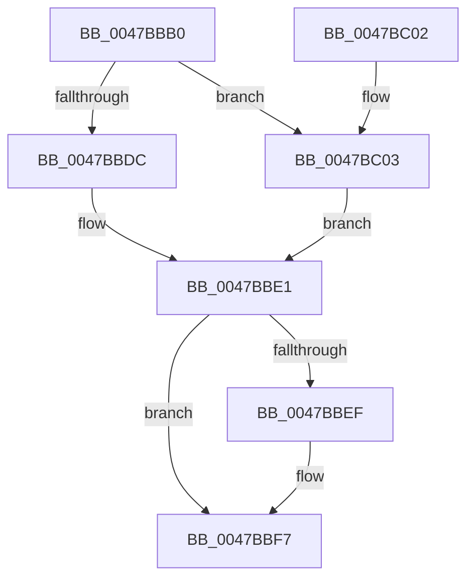

# AlpcpFreeCompletionPacketLookaside

- RVA: `0x0047BBB0`–`0x0047BC0E` (길이 `94` bytes)
- VA: `0x000000014047BBB0`
- 실행 섹션: `.text`
- PDB 이름 있음: `예`; PDB Function 태그: `아니요`
- unwind 정보 RVA: `0x000AD740`
- 디코드: `27`개 명령, `94/94` bytes 표시
- 미해석 바이트: `0` (있으면 어셈블리에 `.byte`로 보존)

> 이 문서는 커널 이미지의 기계어와 PDB 기호를 분석해 생성했습니다. 4번과 5번은 함수 원형과 자료형을 바이너리 사용 방식에서 추정한 C 해석이며 원본 소스 복구 결과는 아닙니다.

## 1. Dependencies

- 직접 호출 지점: **3**; 고유 호출 대상: **3**
- 직접 호출자로 확인된 함수: **3**
- RIP 상대 이미지 참조: **0**

### Outgoing calls
- `0x0047BBD1` → [KeAcquireInStackQueuedSpinLock](../27/KeAcquireInStackQueuedSpinLock_function_002757A0.md) (function, `0x002757A0`)
- `0x0047BBE6` → [KeReleaseInStackQueuedSpinLock](../34/KeReleaseInStackQueuedSpinLock_function_00342CE0.md) (function, `0x00342CE0`)
- `0x0047BBF2` → [AlpcpDeferredFreeCompletionPacketLookaside](AlpcpDeferredFreeCompletionPacketLookaside_function_0047BC14.md) (function, `0x0047BC14`)

### Direct callers
- [AlpcpDeletePort](../../page/92/AlpcpDeletePort_function_00925010.md) at `0x009250B8`
- [AlpcpInitializeCompletionList](../../page/A1/AlpcpInitializeCompletionList_function_00A1A6D0.md) at `0x00A1AADF`
- [sub_00B37302](../../page/B3/Unknown_function_00B37302.md) at `0x00B3730F`

### Static image references
- 디코드된 RIP-relative 메모리 참조가 없습니다.

## 2. Other-region calls and transfers

- 다른 실행 섹션으로 향하는 call: **0**
- 별도 외부 분기/꼬리 이동을 확인하지 못했습니다.

## 3. Assembly (complete function range)

```asm
0047BBB0  48 89 5C 24 08                  mov qword ptr [rsp + 8], rbx
0047BBB5  57                              push rdi
0047BBB6  48 83 EC 40                     sub rsp, 0x40
0047BBBA  0F 57 C0                        xorps xmm0, xmm0
0047BBBD  48 8D 54 24 20                  lea rdx, [rsp + 0x20]
0047BBC2  33 C0                           xor eax, eax
0047BBC4  48 8B D9                        mov rbx, rcx
0047BBC7  0F 11 44 24 20                  movups xmmword ptr [rsp + 0x20], xmm0
0047BBCC  48 89 44 24 30                  mov qword ptr [rsp + 0x30], rax
0047BBD1  E8 CA 9B DF FF                  call 0x1402757a0
0047BBD6  83 7B 0C 00                     cmp dword ptr [rbx + 0xc], 0
0047BBDA  75 27                           jne 0x14047bc03
0047BBDC  BF 01 00 00 00                  mov edi, 1
0047BBE1  48 8D 4C 24 20                  lea rcx, [rsp + 0x20]
0047BBE6  E8 F5 70 EC FF                  call 0x140342ce0
0047BBEB  85 FF                           test edi, edi
0047BBED  74 08                           je 0x14047bbf7
0047BBEF  48 8B CB                        mov rcx, rbx
0047BBF2  E8 1D 00 00 00                  call 0x14047bc14
0047BBF7  48 8B 5C 24 50                  mov rbx, qword ptr [rsp + 0x50]
0047BBFC  48 83 C4 40                     add rsp, 0x40
0047BC00  5F                              pop rdi
0047BC01  C3                              ret
0047BC02  CC                              int3
0047BC03  33 FF                           xor edi, edi
0047BC05  C7 43 18 01 00 00 00            mov dword ptr [rbx + 0x18], 1
0047BC0C  EB D3                           jmp 0x14047bbe1
```

## 4. C-style interpretation (structured pseudocode)

```c
__int64 __fastcall AlpcpFreeCompletionPacketLookaside(__int64 a1)
{
    __int64 result;
    __int64 v_rdi;
    __int64 v_rsp;
    unsigned __int64 v_stack_m18;
    unsigned __int64 v_stack_m28;
    unsigned __int64 v_stack_p8;

    v_stack_p8 = v_rbx;
    v_rsp = (v_rsp) - (64);
    result = 0;
    v_stack_m28 = v_xmm0;
    v_stack_m18 = 0;
    result = KeAcquireInStackQueuedSpinLock(a1, v_stack_m28, a3, a4);
    if ((*(unsigned int *)(a1 + 12)) != 0) goto loc_0047BC03;
loc_0047BBE1:
    result = KeReleaseInStackQueuedSpinLock(v_stack_m28, v_stack_m28, a3, a4);
    if (1 != 0) {
        a1 = a1;
        result = AlpcpDeferredFreeCompletionPacketLookaside(a1, v_stack_m28, a3, a4);
    }
    v_rsp = (v_rsp) + (64);
    return result;
loc_0047BC03:
    v_rdi = 0;
    *(unsigned int *)(v_stack_p8 + 24) = 1;
    goto loc_0047BBE1;
}
```

## 5. (Beta) C Style

```c
int64_t AlpcpFreeCompletionPacketLookaside(void *Arg1)
{
    uint8_t *arg1 = (uint8_t *)Arg1;

    int64_t result;
    int64_t local_rdi;
    int64_t local_rsp;
    uint64_t v_stack_m18;
    uint64_t v_stack_m28;
    uint64_t v_stack_p8;

    v_stack_p8 = local_rbx;
    local_rsp = (local_rsp) - (64);
    result = 0;
    v_stack_m28 = v_xmm0;
    v_stack_m18 = 0;
    result = KeAcquireInStackQueuedSpinLock(Arg1, v_stack_m28, a3, a4);
    if ((*(uint32_t *)(arg1 + 0xC)) != 0) goto loc_0047BC03;
loc_0047BBE1:
    result = KeReleaseInStackQueuedSpinLock(v_stack_m28, v_stack_m28, a3, a4);
    if (1 != 0) {
        Arg1 = Arg1;
        result = AlpcpDeferredFreeCompletionPacketLookaside(Arg1, v_stack_m28, a3, a4);
    }
    local_rsp = (local_rsp) + (64);
    return result;
loc_0047BC03:
    local_rdi = 0;
    *(uint32_t *)(v_stack_p8 + 0x18) = 1;
    goto loc_0047BBE1;
}
```

### 관측된 메모리 오프셋

구조체 형식이 확인되지 않은 접근은 인자 기준의 오프셋으로만 기록했습니다.

| 기준 인자 | 오프셋 표현 | 폭 (bit) | 접근 |
|---|---:|---:|---|
| `Arg1` | `+ 0xC` | `32` | `R` |
| `Arg1` | `+ 0x18` | `32` | `W` |

## 6. Execution-region graph

[열기: 2D/3D 그래프와 함수 탐색 컨트롤 패널](../../../control-panel.html?section=text&rva=0x0047BBB0&view=graph)

- 2D 그래프는 위에서 아래로 흐르고, 3D 그래프는 빈 공간을 드래그해 회전합니다. Shift+드래그는 이동, 휠은 확대·축소, 함수 노드 선택은 대상 보고서 이동입니다.

### Static fallback


