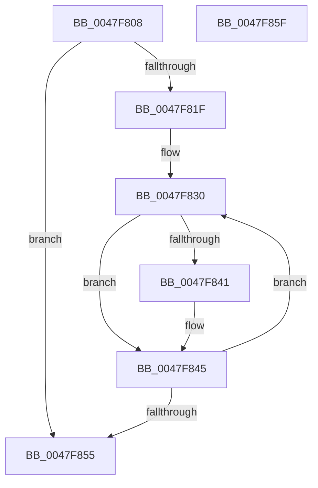

# BgpGxFillRectangle

- RVA: `0x0047F808`–`0x0047F860` (길이 `88` bytes)
- VA: `0x000000014047F808`
- 실행 섹션: `.text`
- PDB 이름 있음: `예`; PDB Function 태그: `아니요`
- unwind 정보 RVA: `0x000AE0D8`
- 디코드: `26`개 명령, `88/88` bytes 표시
- 미해석 바이트: `0` (있으면 어셈블리에 `.byte`로 보존)

> 이 문서는 커널 이미지의 기계어와 PDB 기호를 분석해 생성했습니다. 4번과 5번은 함수 원형과 자료형을 바이너리 사용 방식에서 추정한 C 해석이며 원본 소스 복구 결과는 아닙니다.

## 1. Dependencies

- 직접 호출 지점: **0**; 고유 호출 대상: **0**
- 직접 호출자로 확인된 함수: **6**
- RIP 상대 이미지 참조: **0**

### Outgoing calls
- 직접 디코드된 call 명령이 없습니다.

### Direct callers
- [RaspAntiAlias](RaspAntiAlias_function_0047EED4.md) at `0x0047EF18`
- [BgpTxtDisplayCharacter](BgpTxtDisplayCharacter_function_0047F120.md) at `0x0047F1D6`
- [BgpClearScreen](../69/BgpClearScreen_function_0069EAB0.md) at `0x0069EB72`
- [BgpClearScreen](../69/BgpClearScreen_function_0069EAB0.md) at `0x0069EBAC`
- [BgpTxtAdjustStaticRegion](../69/BgpTxtAdjustStaticRegion_function_0069F410.md) at `0x0069F45C`
- [BgpTxtCreateRegion](../../pagebgfx/BC/BgpTxtCreateRegion_function_00BC2908.md) at `0x00BC2AA1`
- [BgpTxtDisplayString](../../pagebgfx/BC/BgpTxtDisplayString_function_00BC2BB0.md) at `0x00BC2CD0`

### Static image references
- 디코드된 RIP-relative 메모리 참조가 없습니다.

## 2. Other-region calls and transfers

- 다른 실행 섹션으로 향하는 call: **0**
- 별도 외부 분기/꼬리 이동을 확인하지 못했습니다.

## 3. Assembly (complete function range)

```asm
0047F808  48 89 5C 24 08                  mov qword ptr [rsp + 8], rbx
0047F80D  8B 41 04                        mov eax, dword ptr [rcx + 4]
0047F810  0F AF 01                        imul eax, dword ptr [rcx]
0047F813  4C 8B 41 18                     mov r8, qword ptr [rcx + 0x18]
0047F817  89 54 24 10                     mov dword ptr [rsp + 0x10], edx
0047F81B  85 C0                           test eax, eax
0047F81D  74 36                           je 0x14047f855
0047F81F  44 8A 54 24 13                  mov r10b, byte ptr [rsp + 0x13]
0047F824  44 8A 5C 24 12                  mov r11b, byte ptr [rsp + 0x12]
0047F829  8A 5C 24 11                     mov bl, byte ptr [rsp + 0x11]
0047F82D  44 8B C8                        mov r9d, eax
0047F830  45 88 58 02                     mov byte ptr [r8 + 2], r11b
0047F834  41 88 58 01                     mov byte ptr [r8 + 1], bl
0047F838  41 88 10                        mov byte ptr [r8], dl
0047F83B  83 79 08 20                     cmp dword ptr [rcx + 8], 0x20
0047F83F  75 04                           jne 0x14047f845
0047F841  45 88 50 03                     mov byte ptr [r8 + 3], r10b
0047F845  8B 41 08                        mov eax, dword ptr [rcx + 8]
0047F848  48 C1 E8 03                     shr rax, 3
0047F84C  4C 03 C0                        add r8, rax
0047F84F  49 83 E9 01                     sub r9, 1
0047F853  75 DB                           jne 0x14047f830
0047F855  83 61 10 EF                     and dword ptr [rcx + 0x10], 0xffffffef
0047F859  48 8B 5C 24 08                  mov rbx, qword ptr [rsp + 8]
0047F85E  C3                              ret
0047F85F  CC                              int3
```

## 4. C-style interpretation (structured pseudocode)

```c
__int64 __fastcall BgpGxFillRectangle(__int64 a1, int a2)
{
    __int64 result;
    unsigned int v_stack_p10;
    unsigned __int8 v_stack_p11;
    unsigned __int8 v_stack_p12;
    unsigned __int8 v_stack_p13;
    unsigned __int64 v_stack_p8;

    v_stack_p8 = v_rbx;
    result = (unsigned int)(((unsigned int)(*(unsigned int *)(a1 + 4))) * (*(unsigned int *)(a1)));
    v_stack_p10 = a2;
    if ((unsigned int)(result) == 0) goto loc_0047F855;
loc_0047F830:
    *(unsigned __int8 *)(*(unsigned __int64 *)(a1 + 24) + 2) = (unsigned __int8)(v_stack_p12);
    *(unsigned __int8 *)(*(unsigned __int64 *)(a1 + 24) + 1) = (unsigned __int8)(v_stack_p11);
    *(unsigned __int8 *)(*(unsigned __int64 *)(a1 + 24)) = (unsigned __int8)(a2);
    if ((*(unsigned int *)(a1 + 8)) == 32) {
        *(unsigned __int8 *)(*(unsigned __int64 *)(a1 + 24) + 3) = (unsigned __int8)(v_stack_p13);
    }
    result = ((unsigned int)(*(unsigned int *)(a1 + 8))) >> (3);
    a3 = (*(unsigned __int64 *)(a1 + 24)) + (result);
    a4 = ((unsigned int)((unsigned int)(result))) - (1);
    if (condition_is_not_equal) goto loc_0047F830;
loc_0047F855:
    return result;
}
```

## 5. (Beta) C Style

```c
int64_t BgpGxFillRectangle(void *Arg1, int32_t Arg2)
{
    uint8_t *arg1 = (uint8_t *)Arg1;

    int64_t result;
    uint32_t v_stack_p10;
    uint8_t v_stack_p11;
    uint8_t v_stack_p12;
    uint8_t v_stack_p13;
    uint64_t v_stack_p8;

    v_stack_p8 = local_rbx;
    result = (uint32_t)(((uint32_t)(*(uint32_t *)(arg1 + 0x4))) * (*(uint32_t *)(arg1)));
    v_stack_p10 = Arg2;
    if ((uint32_t)(result) == 0) goto loc_0047F855;
loc_0047F830:
    *(uint8_t *)(*(uint64_t *)(arg1 + 0x18) + 0x2) = (uint8_t)(v_stack_p12);
    *(uint8_t *)(*(uint64_t *)(arg1 + 0x18) + 0x1) = (uint8_t)(v_stack_p11);
    *(uint8_t *)(*(uint64_t *)(arg1 + 0x18)) = (uint8_t)(Arg2);
    if ((*(uint32_t *)(arg1 + 0x8)) == 32) {
        *(uint8_t *)(*(uint64_t *)(arg1 + 0x18) + 0x3) = (uint8_t)(v_stack_p13);
    }
    result = ((uint32_t)(*(uint32_t *)(arg1 + 0x8))) >> (3);
    a3 = (*(uint64_t *)(arg1 + 0x18)) + (result);
    a4 = ((uint32_t)((uint32_t)(result))) - (1);
    if (condition_is_not_equal) goto loc_0047F830;
loc_0047F855:
    return result;
}
```

### 관측된 메모리 오프셋

구조체 형식이 확인되지 않은 접근은 인자 기준의 오프셋으로만 기록했습니다.

| 기준 인자 | 오프셋 표현 | 폭 (bit) | 접근 |
|---|---:|---:|---|
| `Arg1` | `+ 0x0` | `32` | `R` |
| `Arg1` | `+ 0x4` | `32` | `R` |
| `Arg1` | `+ 0x8` | `32` | `R` |
| `Arg1` | `+ 0x10` | `32` | `R/W` |
| `Arg1` | `+ 0x18` | `64` | `R` |

## 6. Execution-region graph

[열기: 2D/3D 그래프와 함수 탐색 컨트롤 패널](../../../control-panel.html?section=text&rva=0x0047F808&view=graph)

- 2D 그래프는 위에서 아래로 흐르고, 3D 그래프는 빈 공간을 드래그해 회전합니다. Shift+드래그는 이동, 휠은 확대·축소, 함수 노드 선택은 대상 보고서 이동입니다.

### Static fallback


