# BgpRasPrintGlyph

- RVA: `0x0047F3B4`–`0x0047F802` (길이 `1,102` bytes)
- VA: `0x000000014047F3B4`
- 실행 섹션: `.text`
- PDB 이름 있음: `예`; PDB Function 태그: `아니요`
- unwind 정보 RVA: `0x000AE0B4`
- 디코드: `297`개 명령, `1,102/1,102` bytes 표시
- 미해석 바이트: `0` (있으면 어셈블리에 `.byte`로 보존)

> 이 문서는 커널 이미지의 기계어와 PDB 기호를 분석해 생성했습니다. 4번과 5번은 함수 원형과 자료형을 바이너리 사용 방식에서 추정한 C 해석이며 원본 소스 복구 결과는 아닙니다.

## 1. Dependencies

- 직접 호출 지점: **15**; 고유 호출 대상: **13**
- 직접 호출자로 확인된 함수: **2**
- RIP 상대 이미지 참조: **4**

### Outgoing calls
- `0x0047F411` → [memset](../6C/memset_function_006C6C40.md) (function, `0x006C6C40`)
- `0x0047F420` → [memset](../6C/memset_function_006C6C40.md) (function, `0x006C6C40`)
- `0x0047F4AC` → [RaspGetCacheEntry](../6A/RaspGetCacheEntry_function_006A1ADC.md) (function, `0x006A1ADC`)
- `0x0047F527` → [RaspRasterize](../6A/RaspRasterize_function_006A2AA4.md) (function, `0x006A2AA4`)
- `0x0047F540` → [BgpFwAllocateMemory](../3E/BgpFwAllocateMemory_function_003E4374.md) (function, `0x003E4374`)
- `0x0047F619` → [BgpFmRoundUp](../3E/BgpFmRoundUp_function_003E4218.md) (function, `0x003E4218`)
- `0x0047F648` → [DbgPrintEx](../35/DbgPrintEx_function_00359290.md) (function, `0x00359290`)
- `0x0047F6F7` → [RaspRectangleCreate](../3E/RaspRectangleCreate_function_003E52D0.md) (function, `0x003E52D0`)
- `0x0047F720` → [RaspAntiAlias](RaspAntiAlias_function_0047EED4.md) (function, `0x0047EED4`)
- `0x0047F759` → [BgpGxCopyRectangle](../../pagebgfx/BC/BgpGxCopyRectangle_function_00BC2620.md) (function, `0x00BC2620`)
- `0x0047F773` → [RaspAddCacheEntry](../../pagebgfx/BC/RaspAddCacheEntry_function_00BC2E0C.md) (function, `0x00BC2E0C`)
- `0x0047F799` → [RaspDestroyCachedBitmap](../../pagebgfx/BC/RaspDestroyCachedBitmap_function_00BC5CE8.md) (function, `0x00BC5CE8`)
- `0x0047F7BC` → [RaspFreeMemory](../3E/RaspFreeMemory_function_003E28E4.md) (function, `0x003E28E4`)
- `0x0047F7D5` → [RaspFreeMemory](../3E/RaspFreeMemory_function_003E28E4.md) (function, `0x003E28E4`)
- `0x0047F7E8` → [_security_check_cookie](../6A/_security_check_cookie_function_006AC640.md) (function, `0x006AC640`)

### Direct callers
- [BgpTxtDisplayCharacter](BgpTxtDisplayCharacter_function_0047F120.md) at `0x0047F214`
- [BgpTxtDisplayString](../../pagebgfx/BC/BgpTxtDisplayString_function_00BC2BB0.md) at `0x00BC2D0D`

### Static image references
- `0x0047F3D0` → RVA `0x00E0A740` (`.data`; read)
- `0x0047F497` → RVA `0x00EF0300` (`.data`; read)
- `0x0047F4BF` → RVA `0x00EF0450` (`.data`; read)
- `0x0047F636` → RVA `0x006D10E0` (` ?? ::FNODOBFM::`string'`; read)

## 2. Other-region calls and transfers

- 다른 실행 섹션으로 향하는 call: **3**
  - `0x0047F759` → [BgpGxCopyRectangle](../../pagebgfx/BC/BgpGxCopyRectangle_function_00BC2620.md) (`.text` → `PAGEBGFX`)
  - `0x0047F773` → [RaspAddCacheEntry](../../pagebgfx/BC/RaspAddCacheEntry_function_00BC2E0C.md) (`.text` → `PAGEBGFX`)
  - `0x0047F799` → [RaspDestroyCachedBitmap](../../pagebgfx/BC/RaspDestroyCachedBitmap_function_00BC5CE8.md) (`.text` → `PAGEBGFX`)
- 별도 외부 분기/꼬리 이동을 확인하지 못했습니다.

## 3. Assembly (complete function range)

```asm
0047F3B4  40 55                           push rbp
0047F3B6  53                              push rbx
0047F3B7  56                              push rsi
0047F3B8  57                              push rdi
0047F3B9  41 54                           push r12
0047F3BB  41 55                           push r13
0047F3BD  41 56                           push r14
0047F3BF  41 57                           push r15
0047F3C1  48 8D AC 24 78 FF FF FF         lea rbp, [rsp - 0x88]
0047F3C9  48 81 EC 88 01 00 00            sub rsp, 0x188
0047F3D0  48 8B 05 69 B3 98 00            mov rax, qword ptr [rip + 0x98b369]
0047F3D7  48 33 C4                        xor rax, rsp
0047F3DA  48 89 45 70                     mov qword ptr [rbp + 0x70], rax
0047F3DE  4C 8B B5 00 01 00 00            mov r14, qword ptr [rbp + 0x100]
0047F3E5  48 8B F2                        mov rsi, rdx
0047F3E8  48 8B 9D 10 01 00 00            mov rbx, qword ptr [rbp + 0x110]
0047F3EF  48 89 54 24 60                  mov qword ptr [rsp + 0x60], rdx
0047F3F4  33 D2                           xor edx, edx
0047F3F6  66 44 89 44 24 50               mov word ptr [rsp + 0x50], r8w
0047F3FC  48 89 4D A0                     mov qword ptr [rbp - 0x60], rcx
0047F400  48 8D 4D 20                     lea rcx, [rbp + 0x20]
0047F404  44 89 4C 24 5C                  mov dword ptr [rsp + 0x5c], r9d
0047F409  44 8D 42 48                     lea r8d, [rdx + 0x48]
0047F40D  4C 89 75 A8                     mov qword ptr [rbp - 0x58], r14
0047F411  E8 2A 78 24 00                  call 0x1406c6c40
0047F416  33 D2                           xor edx, edx
0047F418  48 8D 4D D0                     lea rcx, [rbp - 0x30]
0047F41C  44 8D 42 46                     lea r8d, [rdx + 0x46]
0047F420  E8 1B 78 24 00                  call 0x1406c6c40
0047F425  83 64 24 58 00                  and dword ptr [rsp + 0x58], 0
0047F42A  4C 8D 7D B0                     lea r15, [rbp - 0x50]
0047F42E  0F B7 4C 24 50                  movzx ecx, word ptr [rsp + 0x50]
0047F433  33 C0                           xor eax, eax
0047F435  41 21 06                        and dword ptr [r14], eax
0047F438  33 FF                           xor edi, edi
0047F43A  21 45 90                        and dword ptr [rbp - 0x70], eax
0047F43D  45 33 ED                        xor r13d, r13d
0047F440  48 21 44 24 78                  and qword ptr [rsp + 0x78], rax
0047F445  45 33 F6                        xor r14d, r14d
0047F448  21 44 24 70                     and dword ptr [rsp + 0x70], eax
0047F44C  45 32 E4                        xor r12b, r12b
0047F44F  21 7C 24 54                     and dword ptr [rsp + 0x54], edi
0047F453  0F 57 C0                        xorps xmm0, xmm0
0047F456  48 89 45 C0                     mov qword ptr [rbp - 0x40], rax
0047F45A  8D 47 01                        lea eax, [rdi + 1]
0047F45D  21 85 F8 00 00 00               and dword ptr [rbp + 0xf8], eax
0047F463  8D 47 20                        lea eax, [rdi + 0x20]
0047F466  48 85 DB                        test rbx, rbx
0047F469  4C 89 6D 80                     mov qword ptr [rbp - 0x80], r13
0047F46D  0F 11 45 B0                     movups xmmword ptr [rbp - 0x50], xmm0
0047F471  4C 0F 45 FB                     cmovne r15, rbx
0047F475  4C 89 75 88                     mov qword ptr [rbp - 0x78], r14
0047F479  66 3B C8                        cmp cx, ax
0047F47C  0F 82 2F 03 00 00               jb 0x14047f7b1
0047F482  48 8B 46 08                     mov rax, qword ptr [rsi + 8]
0047F486  48 8D 54 24 78                  lea rdx, [rsp + 0x78]
0047F48B  44 8B 46 10                     mov r8d, dword ptr [rsi + 0x10]
0047F48F  48 89 54 24 28                  mov qword ptr [rsp + 0x28], rdx
0047F494  0F B7 D1                        movzx edx, cx
0047F497  48 8D 0D 62 0E A7 00            lea rcx, [rip + 0xa70e62]
0047F49E  48 89 44 24 68                  mov qword ptr [rsp + 0x68], rax
0047F4A3  44 8B 48 28                     mov r9d, dword ptr [rax + 0x28]
0047F4A7  48 89 44 24 20                  mov qword ptr [rsp + 0x20], rax
0047F4AC  E8 2B 26 22 00                  call 0x1406a1adc
0047F4B1  48 8B 5C 24 78                  mov rbx, qword ptr [rsp + 0x78]
0047F4B6  48 85 DB                        test rbx, rbx
0047F4B9  0F 85 08 01 00 00               jne 0x14047f5c7
0047F4BF  F7 05 87 0F A7 00 04 00 00 00   test dword ptr [rip + 0xa70f87], 4
0047F4C9  8B F7                           mov esi, edi
0047F4CB  48 8B 4C 24 60                  mov rcx, qword ptr [rsp + 0x60]
0047F4D0  40 0F 95 C6                     setne sil
0047F4D4  F7 05 72 0F A7 00 04 00 00 00   test dword ptr [rip + 0xa70f72], 4
0047F4DE  89 74 24 54                     mov dword ptr [rsp + 0x54], esi
0047F4E2  75 13                           jne 0x14047f4f7
0047F4E4  49 39 3F                        cmp qword ptr [r15], rdi
0047F4E7  75 0E                           jne 0x14047f4f7
0047F4E9  8D 57 01                        lea edx, [rdi + 1]
0047F4EC  45 0F B6 E4                     movzx r12d, r12b
0047F4F0  84 51 14                        test byte ptr [rcx + 0x14], dl
0047F4F3  44 0F 44 E2                     cmove r12d, edx
0047F4F7  44 0F B7 6C 24 50               movzx r13d, word ptr [rsp + 0x50]
0047F4FD  48 8D 44 24 58                  lea rax, [rsp + 0x58]
0047F502  4C 89 7C 24 40                  mov qword ptr [rsp + 0x40], r15
0047F507  41 0F B7 D5                     movzx edx, r13w
0047F50B  48 89 44 24 38                  mov qword ptr [rsp + 0x38], rax
0047F510  48 8D 44 24 70                  lea rax, [rsp + 0x70]
0047F515  48 89 44 24 30                  mov qword ptr [rsp + 0x30], rax
0047F51A  48 8D 45 80                     lea rax, [rbp - 0x80]
0047F51E  48 89 44 24 28                  mov qword ptr [rsp + 0x28], rax
0047F523  89 74 24 20                     mov dword ptr [rsp + 0x20], esi
0047F527  E8 78 35 22 00                  call 0x1406a2aa4
0047F52C  8B F8                           mov edi, eax
0047F52E  85 C0                           test eax, eax
0047F530  0F 88 88 00 00 00               js 0x14047f5be
0047F536  45 84 E4                        test r12b, r12b
0047F539  74 25                           je 0x14047f560
0047F53B  B9 46 00 00 00                  mov ecx, 0x46
0047F540  E8 2F 4E F6 FF                  call 0x1403e4374
0047F545  48 8B D8                        mov rbx, rax
0047F548  48 85 C0                        test rax, rax
0047F54B  75 0E                           jne 0x14047f55b
0047F54D  4C 8B 6D 80                     mov r13, qword ptr [rbp - 0x80]
0047F551  BF 17 00 00 C0                  mov edi, 0xc0000017
0047F556  E9 36 02 00 00                  jmp 0x14047f791
0047F55B  4C 8B C0                        mov r8, rax
0047F55E  EB 08                           jmp 0x14047f568
0047F560  48 8D 5D D0                     lea rbx, [rbp - 0x30]
0047F564  4C 8D 45 D0                     lea r8, [rbp - 0x30]
0047F568  49 8B 57 10                     mov rdx, qword ptr [r15 + 0x10]
0047F56C  4C 8B 54 24 68                  mov r10, qword ptr [rsp + 0x68]
0047F571  4C 8B 4C 24 60                  mov r9, qword ptr [rsp + 0x60]
0047F576  89 74 24 54                     mov dword ptr [rsp + 0x54], esi
0047F57A  41 8B 4A 28                     mov ecx, dword ptr [r10 + 0x28]
0047F57E  41 8B 41 10                     mov eax, dword ptr [r9 + 0x10]
0047F582  41 89 40 28                     mov dword ptr [r8 + 0x28], eax
0047F586  8B 44 24 70                     mov eax, dword ptr [rsp + 0x70]
0047F58A  41 89 40 2C                     mov dword ptr [r8 + 0x2c], eax
0047F58E  8B 44 24 58                     mov eax, dword ptr [rsp + 0x58]
0047F592  41 89 40 30                     mov dword ptr [r8 + 0x30], eax
0047F596  B8 04 00 00 00                  mov eax, 4
0047F59B  66 45 89 68 3C                  mov word ptr [r8 + 0x3c], r13w
0047F5A0  4C 8B 6D 80                     mov r13, qword ptr [rbp - 0x80]
0047F5A4  41 89 40 34                     mov dword ptr [r8 + 0x34], eax
0047F5A8  41 89 40 38                     mov dword ptr [r8 + 0x38], eax
0047F5AC  41 89 48 24                     mov dword ptr [r8 + 0x24], ecx
0047F5B0  4D 89 50 18                     mov qword ptr [r8 + 0x18], r10
0047F5B4  4D 89 68 10                     mov qword ptr [r8 + 0x10], r13
0047F5B8  49 89 50 3E                     mov qword ptr [r8 + 0x3e], rdx
0047F5BC  EB 11                           jmp 0x14047f5cf
0047F5BE  4C 8B 6D 80                     mov r13, qword ptr [rbp - 0x80]
0047F5C2  E9 B5 01 00 00                  jmp 0x14047f77c
0047F5C7  4C 8B 54 24 68                  mov r10, qword ptr [rsp + 0x68]
0047F5CC  4C 8B CE                        mov r9, rsi
0047F5CF  48 8B 43 10                     mov rax, qword ptr [rbx + 0x10]
0047F5D3  33 D2                           xor edx, edx
0047F5D5  49 0F BF 4A 56                  movsx rcx, word ptr [r10 + 0x56]
0047F5DA  8B 73 2C                        mov esi, dword ptr [rbx + 0x2c]
0047F5DD  48 89 44 24 68                  mov qword ptr [rsp + 0x68], rax
0047F5E2  8B 00                           mov eax, dword ptr [rax]
0047F5E4  F7 73 38                        div dword ptr [rbx + 0x38]
0047F5E7  49 8B 51 08                     mov rdx, qword ptr [r9 + 8]
0047F5EB  44 8B D8                        mov r11d, eax
0047F5EE  89 44 24 58                     mov dword ptr [rsp + 0x58], eax
0047F5F2  8B 42 60                        mov eax, dword ptr [rdx + 0x60]
0047F5F5  48 0F AF C1                     imul rax, rcx
0047F5F9  41 8B 49 10                     mov ecx, dword ptr [r9 + 0x10]
0047F5FD  48 0F AF C1                     imul rax, rcx
0047F601  0F B7 4A 78                     movzx ecx, word ptr [rdx + 0x78]
0047F605  48 C1 E0 06                     shl rax, 6
0047F609  48 99                           cqo
0047F60B  4C 8D 04 C9                     lea r8, [rcx + rcx*8]
0047F60F  49 C1 E0 03                     shl r8, 3
0047F613  49 F7 F8                        idiv r8
0047F616  48 8B C8                        mov rcx, rax
0047F619  E8 FA 4B F6 FF                  call 0x1403e4218
0047F61E  8B C8                           mov ecx, eax
0047F620  8B 43 30                        mov eax, dword ptr [rbx + 0x30]
0047F623  03 8D F0 00 00 00               add ecx, dword ptr [rbp + 0xf0]
0047F629  85 C0                           test eax, eax
0047F62B  78 2F                           js 0x14047f65c
0047F62D  3B C1                           cmp eax, ecx
0047F62F  76 2B                           jbe 0x14047f65c
0047F631  44 0F B7 4B 3C                  movzx r9d, word ptr [rbx + 0x3c]
0047F636  4C 8D 05 A3 1A 25 00            lea r8, [rip + 0x251aa3]
0047F63D  33 C0                           xor eax, eax
0047F63F  33 D2                           xor edx, edx
0047F641  89 44 24 50                     mov dword ptr [rsp + 0x50], eax
0047F645  8D 48 65                        lea ecx, [rax + 0x65]
0047F648  E8 43 9C ED FF                  call 0x140359290
0047F64D  4C 8B 4C 24 60                  mov r9, qword ptr [rsp + 0x60]
0047F652  41 8B CE                        mov ecx, r14d
0047F655  44 8B 5C 24 58                  mov r11d, dword ptr [rsp + 0x58]
0047F65A  EB 06                           jmp 0x14047f662
0047F65C  2B C8                           sub ecx, eax
0047F65E  89 4C 24 50                     mov dword ptr [rsp + 0x50], ecx
0047F662  48 8B 55 A0                     mov rdx, qword ptr [rbp - 0x60]
0047F666  41 8D 04 0B                     lea eax, [r11 + rcx]
0047F66A  39 02                           cmp dword ptr [rdx], eax
0047F66C  0F 82 15 01 00 00               jb 0x14047f787
0047F672  8B 44 24 5C                     mov eax, dword ptr [rsp + 0x5c]
0047F676  03 C6                           add eax, esi
0047F678  39 42 04                        cmp dword ptr [rdx + 4], eax
0047F67B  0F 82 06 01 00 00               jb 0x14047f787
0047F681  44 38 B5 F8 00 00 00            cmp byte ptr [rbp + 0xf8], r14b
0047F688  74 53                           je 0x14047f6dd
0047F68A  0F 10 02                        movups xmm0, xmmword ptr [rdx]
0047F68D  41 8B 41 14                     mov eax, dword ptr [r9 + 0x14]
0047F691  4C 8D 75 20                     lea r14, [rbp + 0x20]
0047F695  0F 10 4A 10                     movups xmm1, xmmword ptr [rdx + 0x10]
0047F699  0F 29 45 20                     movaps xmmword ptr [rbp + 0x20], xmm0
0047F69D  0F 29 4D 30                     movaps xmmword ptr [rbp + 0x30], xmm1
0047F6A1  0F 10 42 20                     movups xmm0, xmmword ptr [rdx + 0x20]
0047F6A5  0F 10 4A 30                     movups xmm1, xmmword ptr [rdx + 0x30]
0047F6A9  0F 29 45 40                     movaps xmmword ptr [rbp + 0x40], xmm0
0047F6AD  F2 0F 10 42 40                  movsd xmm0, qword ptr [rdx + 0x40]
0047F6B2  F2 0F 11 45 60                  movsd qword ptr [rbp + 0x60], xmm0
0047F6B7  0F 29 4D 50                     movaps xmmword ptr [rbp + 0x50], xmm1
0047F6BB  A8 01                           test al, 1
0047F6BD  75 05                           jne 0x14047f6c4
0047F6BF  89 75 24                        mov dword ptr [rbp + 0x24], esi
0047F6C2  EB 03                           jmp 0x14047f6c7
0047F6C4  8B 75 24                        mov esi, dword ptr [rbp + 0x24]
0047F6C7  8B 45 28                        mov eax, dword ptr [rbp + 0x28]
0047F6CA  C1 E8 03                        shr eax, 3
0047F6CD  0F AF C6                        imul eax, esi
0047F6D0  44 89 5D 20                     mov dword ptr [rbp + 0x20], r11d
0047F6D4  0F AF C1                        imul eax, ecx
0047F6D7  48 01 45 38                     add qword ptr [rbp + 0x38], rax
0047F6DB  EB 2E                           jmp 0x14047f70b
0047F6DD  4D 8B CF                        mov r9, r15
0047F6E0  44 89 5D 94                     mov dword ptr [rbp - 0x6c], r11d
0047F6E4  4C 8D 45 88                     lea r8, [rbp - 0x78]
0047F6E8  89 75 90                        mov dword ptr [rbp - 0x70], esi
0047F6EB  BA 20 00 00 00                  mov edx, 0x20
0047F6F0  89 75 98                        mov dword ptr [rbp - 0x68], esi
0047F6F3  48 8D 4D 90                     lea rcx, [rbp - 0x70]
0047F6F7  E8 D4 5B F6 FF                  call 0x1403e52d0
0047F6FC  4C 8B 75 88                     mov r14, qword ptr [rbp - 0x78]
0047F700  8B F8                           mov edi, eax
0047F702  85 C0                           test eax, eax
0047F704  78 72                           js 0x14047f778
0047F706  4C 8B 4C 24 60                  mov r9, qword ptr [rsp + 0x60]
0047F70B  44 8B 43 34                     mov r8d, dword ptr [rbx + 0x34]
0047F70F  49 8B D6                        mov rdx, r14
0047F712  48 8B 4C 24 68                  mov rcx, qword ptr [rsp + 0x68]
0047F717  4C 89 4C 24 20                  mov qword ptr [rsp + 0x20], r9
0047F71C  44 8B 4B 38                     mov r9d, dword ptr [rbx + 0x38]
0047F720  E8 AF F7 FF FF                  call 0x14047eed4
0047F725  80 BD F8 00 00 00 00            cmp byte ptr [rbp + 0xf8], 0
0047F72C  75 30                           jne 0x14047f75e
0047F72E  8B 44 24 5C                     mov eax, dword ptr [rsp + 0x5c]
0047F732  4C 8D 4C 24 68                  lea r9, [rsp + 0x68]
0047F737  83 64 24 68 00                  and dword ptr [rsp + 0x68], 0
0047F73C  4C 8D 44 24 78                  lea r8, [rsp + 0x78]
0047F741  83 64 24 6C 00                  and dword ptr [rsp + 0x6c], 0
0047F746  49 8B D6                        mov rdx, r14
0047F749  48 8B 4D A0                     mov rcx, qword ptr [rbp - 0x60]
0047F74D  89 44 24 78                     mov dword ptr [rsp + 0x78], eax
0047F751  8B 44 24 50                     mov eax, dword ptr [rsp + 0x50]
0047F755  89 44 24 7C                     mov dword ptr [rsp + 0x7c], eax
0047F759  E8 C2 2E 74 00                  call 0x140bc2620
0047F75E  48 8B 45 A8                     mov rax, qword ptr [rbp - 0x58]
0047F762  89 30                           mov dword ptr [rax], esi
0047F764  45 84 E4                        test r12b, r12b
0047F767  74 0F                           je 0x14047f778
0047F769  48 8B D3                        mov rdx, rbx
0047F76C  48 8D 0D 8D 0B A7 00            lea rcx, [rip + 0xa70b8d]
0047F773  E8 94 36 74 00                  call 0x140bc2e0c
0047F778  8B 74 24 54                     mov esi, dword ptr [rsp + 0x54]
0047F77C  85 FF                           test edi, edi
0047F77E  78 0C                           js 0x14047f78c
0047F780  45 84 E4                        test r12b, r12b
0047F783  74 1F                           je 0x14047f7a4
0047F785  EB 3A                           jmp 0x14047f7c1
0047F787  BF 05 00 00 80                  mov edi, 0x80000005
0047F78C  45 84 E4                        test r12b, r12b
0047F78F  74 0F                           je 0x14047f7a0
0047F791  48 85 DB                        test rbx, rbx
0047F794  74 1B                           je 0x14047f7b1
0047F796  48 8B CB                        mov rcx, rbx
0047F799  E8 4A 65 74 00                  call 0x140bc5ce8
0047F79E  EB 08                           jmp 0x14047f7a8
0047F7A0  8B 74 24 54                     mov esi, dword ptr [rsp + 0x54]
0047F7A4  85 F6                           test esi, esi
0047F7A6  74 09                           je 0x14047f7b1
0047F7A8  85 FF                           test edi, edi
0047F7AA  79 15                           jns 0x14047f7c1
0047F7AC  48 85 DB                        test rbx, rbx
0047F7AF  75 10                           jne 0x14047f7c1
0047F7B1  4D 85 ED                        test r13, r13
0047F7B4  74 0B                           je 0x14047f7c1
0047F7B6  49 8B D7                        mov rdx, r15
0047F7B9  49 8B CD                        mov rcx, r13
0047F7BC  E8 23 31 F6 FF                  call 0x1403e28e4
0047F7C1  80 BD F8 00 00 00 00            cmp byte ptr [rbp + 0xf8], 0
0047F7C8  75 10                           jne 0x14047f7da
0047F7CA  4D 85 F6                        test r14, r14
0047F7CD  74 0B                           je 0x14047f7da
0047F7CF  49 8B D7                        mov rdx, r15
0047F7D2  49 8B CE                        mov rcx, r14
0047F7D5  E8 0A 31 F6 FF                  call 0x1403e28e4
0047F7DA  49 83 67 10 00                  and qword ptr [r15 + 0x10], 0
0047F7DF  8B C7                           mov eax, edi
0047F7E1  48 8B 4D 70                     mov rcx, qword ptr [rbp + 0x70]
0047F7E5  48 33 CC                        xor rcx, rsp
0047F7E8  E8 53 CE 22 00                  call 0x1406ac640
0047F7ED  48 81 C4 88 01 00 00            add rsp, 0x188
0047F7F4  41 5F                           pop r15
0047F7F6  41 5E                           pop r14
0047F7F8  41 5D                           pop r13
0047F7FA  41 5C                           pop r12
0047F7FC  5F                              pop rdi
0047F7FD  5E                              pop rsi
0047F7FE  5B                              pop rbx
0047F7FF  5D                              pop rbp
0047F800  C3                              ret
0047F801  CC                              int3
```

## 4. C-style interpretation (structured pseudocode)

```c
__int64 __fastcall BgpRasPrintGlyph(__int64 a1, __int64 a2, unsigned __int16 a3, int a4, unsigned int a5, unsigned __int8 a6, __int64 a7, __int64 a8, __int64 a9)
{
    __int64 result;
    __int64 v_r12;
    __int64 v_r13;
    __int64 v_r14;
    __int64 v_r15;
    __int64 v_rdi;
    __int64 v_rsi;
    __int64 v_rsp;
    unsigned __int64 v_stack_m108;
    unsigned __int64 v_stack_m118;
    unsigned __int64 v_stack_m120;
    unsigned __int64 v_stack_m128;
    unsigned int v_stack_m130;
    unsigned int v_stack_m134;
    unsigned int v_stack_m138;
    unsigned __int64 v_stack_m140;
    unsigned __int64 v_stack_m148;
    unsigned int v_stack_m14C;
    unsigned __int64 v_stack_m150;
    unsigned int v_stack_m158;
    unsigned int v_stack_m15C;
    unsigned __int64 v_stack_m160;
    unsigned __int64 v_stack_m168;
    unsigned int v_stack_m16C;
    unsigned int v_stack_m170;
    unsigned int v_stack_m174;
    unsigned __int16 v_stack_m178;
    unsigned __int64 v_stack_m188;
    unsigned __int64 v_stack_m190;
    unsigned __int64 v_stack_m198;
    unsigned __int64 v_stack_m1A0;
    unsigned __int64 v_stack_m1A8;
    unsigned __int64 v_stack_m58;
    unsigned __int64 v_stack_m68;
    unsigned __int64 v_stack_m78;
    unsigned __int64 v_stack_m88;
    unsigned __int64 v_stack_m90;
    unsigned __int64 v_stack_m98;
    unsigned int v_stack_mA0;
    unsigned int v_stack_mA4;
    unsigned __int64 v_stack_mA8;
    unsigned __int64 v_stack_mC8;
    unsigned __int64 v_stack_mF8;

    v_rsp = (v_rsp) - (392);
    result = (*(unsigned __int64 *)(v_rip + 10007401)) ^ (v_rsp);
    v_stack_m58 = result;
    v_stack_m168 = a2;
    a2 = 0;
    v_stack_m178 = a3;
    v_stack_m128 = a1;
    v_stack_m16C = a4;
    v_stack_m120 = a7;
    result = memset(v_stack_mA8, a2, a2 + 72, a4);
    a2 = 0;
    result = memset(v_stack_mF8, a2, a2 + 70, a4);
    result = 0;
    v_rdi = 0;
    v_r13 = 0;
    v_r14 = 0;
    v_r12 = 0;
    v_stack_m108 = 0;
    v_stack_m148 = 0;
    v_stack_m118 = v_xmm0;
    v_r15 = v_stack_m118;
    if (a9 != 0) { v_r15 = a9; }
    v_stack_m140 = 0;
    if (((unsigned __int16)(v_stack_m178)) < ((unsigned __int16)(v_rdi + 32))) goto loc_0047F7B1;
    v_stack_m1A0 = v_stack_m150;
    v_stack_m160 = *(unsigned __int64 *)(a2 + 8);
    v_stack_m1A8 = *(unsigned __int64 *)(a2 + 8);
    result = RaspGetCacheEntry(v_rip + 10948194, (unsigned __int16)(v_stack_m178), (unsigned int)(*(unsigned int *)(a2 + 16)), (unsigned int)(*(unsigned int *)(*(unsigned __int64 *)(a2 + 8) + 40)));
    if (v_stack_m150 != 0) goto loc_0047F5C7;
    v_rsi = (((*(unsigned int *)(v_rip + 10948487)) & (4)) != 0) ? 1 : 0;
    v_stack_m174 = (unsigned int)(v_rsi);
    if (((*(unsigned int *)(v_rip + 10948466)) & (4)) != 0) goto loc_0047F4F7;
    if ((*(unsigned __int64 *)(v_r15)) == 0) {
        a2 = v_rdi + 1;
        v_r12 = 0;
        if (((*(unsigned __int8 *)(v_stack_m168 + 20)) & ((unsigned __int8)(a2))) == 0) { v_r12 = (unsigned int)(a2); }
    }
    v_stack_m188 = v_r15;
    v_stack_m190 = v_stack_m170;
    v_stack_m198 = v_stack_m158;
    v_stack_m1A0 = v_stack_m148;
    v_stack_m1A8 = (unsigned int)(v_rsi);
    result = RaspRasterize(v_stack_m168, (unsigned __int16)(v_stack_m178), (unsigned int)(*(unsigned int *)(a2 + 16)), (unsigned int)(*(unsigned int *)(*(unsigned __int64 *)(a2 + 8) + 40)));
    if (sign_flag) goto loc_0047F5BE;
    if ((unsigned __int8)(v_r12) == 0) goto loc_0047F560;
    result = BgpFwAllocateMemory(70, (unsigned __int16)(v_stack_m178), (unsigned int)(*(unsigned int *)(a2 + 16)), (unsigned int)(*(unsigned int *)(*(unsigned __int64 *)(a2 + 8) + 40)));
    if (result != 0) goto loc_0047F55B;
    goto loc_0047F791;
loc_0047F55B:
    goto loc_0047F568;
loc_0047F560:
loc_0047F568:
    v_stack_m174 = (unsigned int)(v_rsi);
    *(unsigned int *)(v_stack_mF8 + 40) = (unsigned int)((unsigned int)(*(unsigned int *)(v_stack_m168 + 16)));
    *(unsigned int *)(v_stack_mF8 + 44) = (unsigned int)((unsigned int)(v_stack_m158));
    *(unsigned int *)(v_stack_mF8 + 48) = (unsigned int)((unsigned int)(v_stack_m170));
    *(unsigned __int16 *)(v_stack_mF8 + 60) = (unsigned __int16)(v_stack_m148);
    *(unsigned int *)(v_stack_mF8 + 52) = 4;
    *(unsigned int *)(v_stack_mF8 + 56) = 4;
    *(unsigned int *)(v_stack_mF8 + 36) = (unsigned int)((unsigned int)(*(unsigned int *)(v_stack_m160 + 40)));
    *(unsigned __int64 *)(v_stack_mF8 + 24) = v_stack_m160;
    *(unsigned __int64 *)(v_stack_mF8 + 16) = v_stack_m148;
    *(unsigned __int64 *)(v_stack_mF8 + 62) = *(unsigned __int64 *)(v_r15 + 16);
    goto loc_0047F5CF;
loc_0047F5BE:
    goto loc_0047F77C;
loc_0047F5C7:
loc_0047F5CF:
    a2 = 0;
    v_stack_m160 = *(unsigned __int64 *)(v_stack_mF8 + 16);
    v_stack_m170 = (unsigned int)((unsigned int)(*(unsigned int *)(*(unsigned __int64 *)(v_stack_mF8 + 16))));
    result = ((unsigned int)(*(unsigned int *)(*(unsigned __int64 *)(v_rsi + 8) + 96))) * ((__int16)(*(unsigned __int16 *)(v_stack_m160 + 86)));
    result = (result) * ((unsigned int)(*(unsigned int *)(v_rsi + 16)));
    result = (result) << (6);
    a3 = (*(unsigned __int16 *)(*(unsigned __int64 *)(v_rsi + 8) + 120) + *(unsigned __int16 *)(*(unsigned __int64 *)(v_rsi + 8) + 120) * 8) << (3);
    result = BgpFmRoundUp(result, *(unsigned __int64 *)(v_rsi + 8), a3, v_rsi);
    a1 = (unsigned int)(((unsigned int)((unsigned int)(result))) + (a5));
    if (sign_flag) goto loc_0047F65C;
    if (((unsigned int)((unsigned int)(*(unsigned int *)(v_stack_mF8 + 48)))) <= ((unsigned int)(a1))) goto loc_0047F65C;
    result = 0;
    a2 = 0;
    v_stack_m178 = 0;
    result = DbgPrintEx(result + 101, a2, v_rip + 2431651, *(unsigned __int16 *)(v_stack_mF8 + 60));
    goto loc_0047F662;
loc_0047F65C:
    a1 = (unsigned int)((0) - ((unsigned int)(result)));
    v_stack_m178 = (unsigned int)(a1);
loc_0047F662:
    if ((*(unsigned int *)(v_stack_m128)) < ((unsigned int)((unsigned int)(v_stack_m170) + a1 * 1))) goto loc_0047F787;
    result = (unsigned int)(((unsigned int)(v_stack_m16C)) + ((unsigned int)((unsigned int)(*(unsigned int *)(v_stack_mF8 + 44)))));
    if ((*(unsigned int *)(v_stack_m128 + 4)) < ((unsigned int)(result))) goto loc_0047F787;
    if (a6 == 0) goto loc_0047F6DD;
    v_stack_mA8 = v_xmm0;
    v_stack_m98 = v_xmm1;
    v_stack_m88 = v_xmm0;
    v_stack_m68 = v_xmm0;
    v_stack_m78 = v_xmm1;
    if ((((unsigned __int8)((unsigned int)(*(unsigned int *)(v_stack_m168 + 20)))) & (1)) != 0) goto loc_0047F6C4;
    v_stack_mA4 = (unsigned int)((unsigned int)(*(unsigned int *)(v_stack_mF8 + 44)));
    goto loc_0047F6C7;
loc_0047F6C4:
loc_0047F6C7:
    result = (unsigned int)(((unsigned int)(v_stack_mA0)) >> (3));
    result = (unsigned int)((result) * ((unsigned int)((unsigned int)(v_stack_mA4))));
    v_stack_mA8 = (unsigned int)((unsigned int)(v_stack_m170));
    result = (unsigned int)((result) * ((unsigned int)(a1)));
    goto loc_0047F70B;
loc_0047F6DD:
    v_stack_m134 = (unsigned int)((unsigned int)(v_stack_m170));
    v_stack_m138 = (unsigned int)((unsigned int)(v_stack_mA4));
    v_stack_m130 = (unsigned int)((unsigned int)(v_stack_mA4));
    result = RaspRectangleCreate(v_stack_m138, 32, v_stack_m140, v_r15);
    if (sign_flag) goto loc_0047F778;
loc_0047F70B:
    v_stack_m1A8 = v_stack_m168;
    result = RaspAntiAlias(v_stack_m160, v_stack_m140, (unsigned int)(*(unsigned int *)(v_stack_mF8 + 52)), (unsigned int)(*(unsigned int *)(v_stack_mF8 + 56)));
    if (a6 == 0) {
        result = v_stack_m16C;
        a4 = v_stack_m160;
        a3 = v_stack_m150;
        a2 = v_stack_m140;
        a1 = v_stack_m128;
        v_stack_m150 = (unsigned int)(result);
        result = v_stack_m178;
        v_stack_m14C = (unsigned int)(result);
        result = BgpGxCopyRectangle(a1, a2, a3, a4);
    }
    *(unsigned int *)(v_stack_m120) = (unsigned int)((unsigned int)(v_stack_mA4));
    result = v_stack_m120;
    if ((unsigned __int8)(v_r12) != 0) {
        a2 = v_stack_mF8;
        a1 = v_rip + 10947469;
        result = RaspAddCacheEntry(a1, a2, a3, a4);
    }
loc_0047F77C:
    if (sign_flag) goto loc_0047F78C;
    if ((unsigned __int8)(v_r12) == 0) goto loc_0047F7A4;
    goto loc_0047F7C1;
loc_0047F787:
loc_0047F78C:
    if ((unsigned __int8)(v_r12) == 0) goto loc_0047F7A0;
loc_0047F791:
    if (v_stack_mF8 == 0) goto loc_0047F7B1;
    result = RaspDestroyCachedBitmap(v_stack_mF8, a2, a3, a4);
    goto loc_0047F7A8;
loc_0047F7A0:
loc_0047F7A4:
    if ((unsigned int)((unsigned int)(v_stack_m174)) == 0) goto loc_0047F7B1;
loc_0047F7A8:
    if (!sign_flag) goto loc_0047F7C1;
    if (v_stack_mF8 != 0) goto loc_0047F7C1;
loc_0047F7B1:
    if (v_stack_m148 != 0) {
        a2 = v_r15;
        a1 = v_stack_m148;
        result = RaspFreeMemory(a1, a2, a3, a4);
    }
    if (a6 != 0) goto loc_0047F7DA;
    if (v_stack_m140 != 0) {
        a2 = v_r15;
        a1 = v_stack_m140;
        result = RaspFreeMemory(a1, a2, a3, a4);
    }
    a1 = (v_stack_m58) ^ (v_rsp);
    result = _security_check_cookie(a1, a2, a3, a4);
    v_rsp = (v_rsp) + (392);
    return result;
}
```

## 5. (Beta) C Style

```c
int64_t BgpRasPrintGlyph(int64_t Arg1, void *Arg2, uint16_t Arg3, int32_t Arg4, uint32_t Arg5, uint8_t Arg6, void *Arg7, uint64_t Arg8, int64_t Arg9)
{
    uint8_t *arg2 = (uint8_t *)Arg2;
    uint8_t *arg7 = (uint8_t *)Arg7;

    int64_t result;
    int64_t local_r12;
    int64_t local_r13;
    int64_t local_r14;
    int64_t local_r15;
    int64_t local_rdi;
    int64_t local_rsi;
    int64_t local_rsp;
    uint64_t v_stack_m108;
    uint64_t v_stack_m118;
    uint64_t v_stack_m120;
    uint64_t v_stack_m128;
    uint32_t v_stack_m130;
    uint32_t v_stack_m134;
    uint32_t v_stack_m138;
    uint64_t v_stack_m140;
    uint64_t v_stack_m148;
    uint32_t v_stack_m14C;
    uint64_t v_stack_m150;
    uint32_t v_stack_m158;
    uint32_t v_stack_m15C;
    uint64_t v_stack_m160;
    uint64_t v_stack_m168;
    uint32_t v_stack_m16C;
    uint32_t v_stack_m170;
    uint32_t v_stack_m174;
    uint16_t v_stack_m178;
    uint64_t v_stack_m188;
    uint64_t v_stack_m190;
    uint64_t v_stack_m198;
    uint64_t v_stack_m1A0;
    uint64_t v_stack_m1A8;
    uint64_t v_stack_m58;
    uint64_t v_stack_m68;
    uint64_t v_stack_m78;
    uint64_t v_stack_m88;
    uint64_t v_stack_m90;
    uint64_t v_stack_m98;
    uint32_t v_stack_mA0;
    uint32_t v_stack_mA4;
    uint64_t v_stack_mA8;
    uint64_t v_stack_mC8;
    uint64_t v_stack_mF8;

    local_rsp = (local_rsp) - (392);
    result = (*(uint64_t *)(v_rip + 0x98B369)) ^ (local_rsp);
    v_stack_m58 = result;
    v_stack_m168 = Arg2;
    Arg2 = 0;
    v_stack_m178 = Arg3;
    v_stack_m128 = Arg1;
    v_stack_m16C = Arg4;
    v_stack_m120 = Arg7;
    result = memset(v_stack_mA8, Arg2, Arg2 + 72, Arg4);
    Arg2 = 0;
    result = memset(v_stack_mF8, Arg2, Arg2 + 70, Arg4);
    result = 0;
    local_rdi = 0;
    local_r13 = 0;
    local_r14 = 0;
    local_r12 = 0;
    v_stack_m108 = 0;
    v_stack_m148 = 0;
    v_stack_m118 = v_xmm0;
    local_r15 = v_stack_m118;
    if (Arg9 != 0) { local_r15 = Arg9; }
    v_stack_m140 = 0;
    if (((uint16_t)(v_stack_m178)) < ((uint16_t)(local_rdi + 32))) goto loc_0047F7B1;
    v_stack_m1A0 = v_stack_m150;
    v_stack_m160 = *(uint64_t *)(arg2 + 0x8);
    v_stack_m1A8 = *(uint64_t *)(arg2 + 0x8);
    result = RaspGetCacheEntry(v_rip + 10948194, (uint16_t)(v_stack_m178), (uint32_t)(*(uint32_t *)(arg2 + 0x10)), (uint32_t)(*(uint32_t *)(*(uint64_t *)(arg2 + 0x8) + 0x28)));
    if (v_stack_m150 != 0) goto loc_0047F5C7;
    local_rsi = (((*(uint32_t *)(v_rip + 0xA70F87)) & (4)) != 0) ? 1 : 0;
    v_stack_m174 = (uint32_t)(local_rsi);
    if (((*(uint32_t *)(v_rip + 0xA70F72)) & (4)) != 0) goto loc_0047F4F7;
    if ((*(uint64_t *)(local_r15)) == 0) {
        Arg2 = local_rdi + 1;
        local_r12 = 0;
        if (((*(uint8_t *)(v_stack_m168 + 0x14)) & ((uint8_t)(Arg2))) == 0) { local_r12 = (uint32_t)(Arg2); }
    }
    v_stack_m188 = local_r15;
    v_stack_m190 = v_stack_m170;
    v_stack_m198 = v_stack_m158;
    v_stack_m1A0 = v_stack_m148;
    v_stack_m1A8 = (uint32_t)(local_rsi);
    result = RaspRasterize(v_stack_m168, (uint16_t)(v_stack_m178), (uint32_t)(*(uint32_t *)(arg2 + 0x10)), (uint32_t)(*(uint32_t *)(*(uint64_t *)(arg2 + 0x8) + 0x28)));
    if (sign_flag) goto loc_0047F5BE;
    if ((uint8_t)(local_r12) == 0) goto loc_0047F560;
    result = BgpFwAllocateMemory(70, (uint16_t)(v_stack_m178), (uint32_t)(*(uint32_t *)(arg2 + 0x10)), (uint32_t)(*(uint32_t *)(*(uint64_t *)(arg2 + 0x8) + 0x28)));
    if (result != 0) goto loc_0047F55B;
    goto loc_0047F791;
loc_0047F55B:
    goto loc_0047F568;
loc_0047F560:
loc_0047F568:
    v_stack_m174 = (uint32_t)(local_rsi);
    *(uint32_t *)(v_stack_mF8 + 0x28) = (uint32_t)((uint32_t)(*(uint32_t *)(v_stack_m168 + 0x10)));
    *(uint32_t *)(v_stack_mF8 + 0x2C) = (uint32_t)((uint32_t)(v_stack_m158));
    *(uint32_t *)(v_stack_mF8 + 0x30) = (uint32_t)((uint32_t)(v_stack_m170));
    *(uint16_t *)(v_stack_mF8 + 0x3C) = (uint16_t)(v_stack_m148);
    *(uint32_t *)(v_stack_mF8 + 0x34) = 4;
    *(uint32_t *)(v_stack_mF8 + 0x38) = 4;
    *(uint32_t *)(v_stack_mF8 + 0x24) = (uint32_t)((uint32_t)(*(uint32_t *)(v_stack_m160 + 0x28)));
    *(uint64_t *)(v_stack_mF8 + 0x18) = v_stack_m160;
    *(uint64_t *)(v_stack_mF8 + 0x10) = v_stack_m148;
    *(uint64_t *)(v_stack_mF8 + 0x3E) = *(uint64_t *)(local_r15 + 0x10);
    goto loc_0047F5CF;
loc_0047F5BE:
    goto loc_0047F77C;
loc_0047F5C7:
loc_0047F5CF:
    Arg2 = 0;
    v_stack_m160 = *(uint64_t *)(v_stack_mF8 + 0x10);
    v_stack_m170 = (uint32_t)((uint32_t)(*(uint32_t *)(*(uint64_t *)(v_stack_mF8 + 0x10))));
    result = ((uint32_t)(*(uint32_t *)(*(uint64_t *)(local_rsi + 0x8) + 0x60))) * ((int16_t)(*(uint16_t *)(v_stack_m160 + 0x56)));
    result = (result) * ((uint32_t)(*(uint32_t *)(local_rsi + 0x10)));
    result = (result) << (6);
    Arg3 = (*(uint16_t *)(*(uint64_t *)(local_rsi + 0x8) + 0x78) + *(uint16_t *)(*(uint64_t *)(local_rsi + 0x8) + 0x78) * 8) << (3);
    result = BgpFmRoundUp(result, *(uint64_t *)(local_rsi + 0x8), Arg3, local_rsi);
    Arg1 = (uint32_t)(((uint32_t)((uint32_t)(result))) + (Arg5));
    if (sign_flag) goto loc_0047F65C;
    if (((uint32_t)((uint32_t)(*(uint32_t *)(v_stack_mF8 + 0x30)))) <= ((uint32_t)(Arg1))) goto loc_0047F65C;
    result = 0;
    Arg2 = 0;
    v_stack_m178 = 0;
    result = DbgPrintEx(result + 101, Arg2, v_rip + 2431651, *(uint16_t *)(v_stack_mF8 + 0x3C));
    goto loc_0047F662;
loc_0047F65C:
    Arg1 = (uint32_t)((0) - ((uint32_t)(result)));
    v_stack_m178 = (uint32_t)(Arg1);
loc_0047F662:
    if ((*(uint32_t *)(v_stack_m128)) < ((uint32_t)((uint32_t)(v_stack_m170) + Arg1 * 1))) goto loc_0047F787;
    result = (uint32_t)(((uint32_t)(v_stack_m16C)) + ((uint32_t)((uint32_t)(*(uint32_t *)(v_stack_mF8 + 0x2C)))));
    if ((*(uint32_t *)(v_stack_m128 + 0x4)) < ((uint32_t)(result))) goto loc_0047F787;
    if (Arg6 == 0) goto loc_0047F6DD;
    v_stack_mA8 = v_xmm0;
    v_stack_m98 = v_xmm1;
    v_stack_m88 = v_xmm0;
    v_stack_m68 = v_xmm0;
    v_stack_m78 = v_xmm1;
    if ((((uint8_t)((uint32_t)(*(uint32_t *)(v_stack_m168 + 0x14)))) & (1)) != 0) goto loc_0047F6C4;
    v_stack_mA4 = (uint32_t)((uint32_t)(*(uint32_t *)(v_stack_mF8 + 0x2C)));
    goto loc_0047F6C7;
loc_0047F6C4:
loc_0047F6C7:
    result = (uint32_t)(((uint32_t)(v_stack_mA0)) >> (3));
    result = (uint32_t)((result) * ((uint32_t)((uint32_t)(v_stack_mA4))));
    v_stack_mA8 = (uint32_t)((uint32_t)(v_stack_m170));
    result = (uint32_t)((result) * ((uint32_t)(Arg1)));
    goto loc_0047F70B;
loc_0047F6DD:
    v_stack_m134 = (uint32_t)((uint32_t)(v_stack_m170));
    v_stack_m138 = (uint32_t)((uint32_t)(v_stack_mA4));
    v_stack_m130 = (uint32_t)((uint32_t)(v_stack_mA4));
    result = RaspRectangleCreate(v_stack_m138, 32, v_stack_m140, local_r15);
    if (sign_flag) goto loc_0047F778;
loc_0047F70B:
    v_stack_m1A8 = v_stack_m168;
    result = RaspAntiAlias(v_stack_m160, v_stack_m140, (uint32_t)(*(uint32_t *)(v_stack_mF8 + 0x34)), (uint32_t)(*(uint32_t *)(v_stack_mF8 + 0x38)));
    if (Arg6 == 0) {
        result = v_stack_m16C;
        Arg4 = v_stack_m160;
        Arg3 = v_stack_m150;
        Arg2 = v_stack_m140;
        Arg1 = v_stack_m128;
        v_stack_m150 = (uint32_t)(result);
        result = v_stack_m178;
        v_stack_m14C = (uint32_t)(result);
        result = BgpGxCopyRectangle(Arg1, Arg2, Arg3, Arg4);
    }
    *(uint32_t *)(v_stack_m120) = (uint32_t)((uint32_t)(v_stack_mA4));
    result = v_stack_m120;
    if ((uint8_t)(local_r12) != 0) {
        Arg2 = v_stack_mF8;
        Arg1 = v_rip + 10947469;
        result = RaspAddCacheEntry(Arg1, Arg2, Arg3, Arg4);
    }
loc_0047F77C:
    if (sign_flag) goto loc_0047F78C;
    if ((uint8_t)(local_r12) == 0) goto loc_0047F7A4;
    goto loc_0047F7C1;
loc_0047F787:
loc_0047F78C:
    if ((uint8_t)(local_r12) == 0) goto loc_0047F7A0;
loc_0047F791:
    if (v_stack_mF8 == 0) goto loc_0047F7B1;
    result = RaspDestroyCachedBitmap(v_stack_mF8, Arg2, Arg3, Arg4);
    goto loc_0047F7A8;
loc_0047F7A0:
loc_0047F7A4:
    if ((uint32_t)((uint32_t)(v_stack_m174)) == 0) goto loc_0047F7B1;
loc_0047F7A8:
    if (!sign_flag) goto loc_0047F7C1;
    if (v_stack_mF8 != 0) goto loc_0047F7C1;
loc_0047F7B1:
    if (v_stack_m148 != 0) {
        Arg2 = local_r15;
        Arg1 = v_stack_m148;
        result = RaspFreeMemory(Arg1, Arg2, Arg3, Arg4);
    }
    if (Arg6 != 0) goto loc_0047F7DA;
    if (v_stack_m140 != 0) {
        Arg2 = local_r15;
        Arg1 = v_stack_m140;
        result = RaspFreeMemory(Arg1, Arg2, Arg3, Arg4);
    }
    Arg1 = (v_stack_m58) ^ (local_rsp);
    result = _security_check_cookie(Arg1, Arg2, Arg3, Arg4);
    local_rsp = (local_rsp) + (392);
    return result;
}
```

### 관측된 메모리 오프셋

구조체 형식이 확인되지 않은 접근은 인자 기준의 오프셋으로만 기록했습니다.

| 기준 인자 | 오프셋 표현 | 폭 (bit) | 접근 |
|---|---:|---:|---|
| `Arg2` | `+ 0x8` | `64` | `R` |
| `Arg2` | `+ 0x10` | `32` | `R` |
| `Arg7` | `+ 0x0` | `32` | `R/W` |

## 6. Execution-region graph

[열기: 2D/3D 그래프와 함수 탐색 컨트롤 패널](../../../control-panel.html?section=text&rva=0x0047F3B4&view=graph)

- 2D 그래프는 위에서 아래로 흐르고, 3D 그래프는 빈 공간을 드래그해 회전합니다. Shift+드래그는 이동, 휠은 확대·축소, 함수 노드 선택은 대상 보고서 이동입니다.

### Static fallback

```mermaid
flowchart TD
  bb_0047F3B4[BB_0047F3B4]
  bb_0047F482[BB_0047F482]
  bb_0047F4BF[BB_0047F4BF]
  bb_0047F4E4[BB_0047F4E4]
  bb_0047F4E9[BB_0047F4E9]
  bb_0047F4F7[BB_0047F4F7]
  bb_0047F536[BB_0047F536]
  bb_0047F53B[BB_0047F53B]
  bb_0047F54D[BB_0047F54D]
  bb_0047F55B[BB_0047F55B]
  bb_0047F560[BB_0047F560]
  bb_0047F568[BB_0047F568]
  bb_0047F5BE[BB_0047F5BE]
  bb_0047F5C7[BB_0047F5C7]
  bb_0047F5CF[BB_0047F5CF]
  bb_0047F62D[BB_0047F62D]
  bb_0047F631[BB_0047F631]
  bb_0047F65C[BB_0047F65C]
  bb_0047F662[BB_0047F662]
  bb_0047F672[BB_0047F672]
  bb_0047F681[BB_0047F681]
  bb_0047F68A[BB_0047F68A]
  bb_0047F6BF[BB_0047F6BF]
  bb_0047F6C4[BB_0047F6C4]
  bb_0047F6C7[BB_0047F6C7]
  bb_0047F6DD[BB_0047F6DD]
  bb_0047F706[BB_0047F706]
  bb_0047F70B[BB_0047F70B]
  bb_0047F72E[BB_0047F72E]
  bb_0047F75E[BB_0047F75E]
  bb_0047F769[BB_0047F769]
  bb_0047F778[BB_0047F778]
  bb_0047F77C[BB_0047F77C]
  bb_0047F780[BB_0047F780]
  bb_0047F785[BB_0047F785]
  bb_0047F787[BB_0047F787]
  bb_0047F78C[BB_0047F78C]
  bb_0047F791[BB_0047F791]
  bb_0047F796[BB_0047F796]
  bb_0047F7A0[BB_0047F7A0]
  bb_0047F7A4[BB_0047F7A4]
  bb_0047F7A8[BB_0047F7A8]
  bb_0047F7AC[BB_0047F7AC]
  bb_0047F7B1[BB_0047F7B1]
  bb_0047F7B6[BB_0047F7B6]
  bb_0047F7C1[BB_0047F7C1]
  bb_0047F7CA[BB_0047F7CA]
  bb_0047F7CF[BB_0047F7CF]
  bb_0047F7DA[BB_0047F7DA]
  bb_0047F801[BB_0047F801]
  bb_0047F3B4 -->|branch| bb_0047F7B1
  bb_0047F3B4 -->|fallthrough| bb_0047F482
  bb_0047F482 -->|branch| bb_0047F5C7
  bb_0047F482 -->|fallthrough| bb_0047F4BF
  bb_0047F4BF -->|branch| bb_0047F4F7
  bb_0047F4BF -->|fallthrough| bb_0047F4E4
  bb_0047F4E4 -->|branch| bb_0047F4F7
  bb_0047F4E4 -->|fallthrough| bb_0047F4E9
  bb_0047F4E9 -->|flow| bb_0047F4F7
  bb_0047F4F7 -->|branch| bb_0047F5BE
  bb_0047F4F7 -->|fallthrough| bb_0047F536
  bb_0047F536 -->|branch| bb_0047F560
  bb_0047F536 -->|fallthrough| bb_0047F53B
  bb_0047F53B -->|branch| bb_0047F55B
  bb_0047F53B -->|fallthrough| bb_0047F54D
  bb_0047F54D -->|branch| bb_0047F791
  bb_0047F55B -->|branch| bb_0047F568
  bb_0047F560 -->|flow| bb_0047F568
  bb_0047F568 -->|branch| bb_0047F5CF
  bb_0047F5BE -->|branch| bb_0047F77C
  bb_0047F5C7 -->|flow| bb_0047F5CF
  bb_0047F5CF -->|branch| bb_0047F65C
  bb_0047F5CF -->|fallthrough| bb_0047F62D
  bb_0047F62D -->|branch| bb_0047F65C
  bb_0047F62D -->|fallthrough| bb_0047F631
  bb_0047F631 -->|branch| bb_0047F662
  bb_0047F65C -->|flow| bb_0047F662
  bb_0047F662 -->|branch| bb_0047F787
  bb_0047F662 -->|fallthrough| bb_0047F672
  bb_0047F672 -->|branch| bb_0047F787
  bb_0047F672 -->|fallthrough| bb_0047F681
  bb_0047F681 -->|branch| bb_0047F6DD
  bb_0047F681 -->|fallthrough| bb_0047F68A
  bb_0047F68A -->|branch| bb_0047F6C4
  bb_0047F68A -->|fallthrough| bb_0047F6BF
  bb_0047F6BF -->|branch| bb_0047F6C7
  bb_0047F6C4 -->|flow| bb_0047F6C7
  bb_0047F6C7 -->|branch| bb_0047F70B
  bb_0047F6DD -->|branch| bb_0047F778
  bb_0047F6DD -->|fallthrough| bb_0047F706
  bb_0047F706 -->|flow| bb_0047F70B
  bb_0047F70B -->|branch| bb_0047F75E
  bb_0047F70B -->|fallthrough| bb_0047F72E
  bb_0047F72E -->|flow| bb_0047F75E
  bb_0047F75E -->|branch| bb_0047F778
  bb_0047F75E -->|fallthrough| bb_0047F769
  bb_0047F769 -->|flow| bb_0047F778
  bb_0047F778 -->|flow| bb_0047F77C
  bb_0047F77C -->|branch| bb_0047F78C
  bb_0047F77C -->|fallthrough| bb_0047F780
  bb_0047F780 -->|branch| bb_0047F7A4
  bb_0047F780 -->|fallthrough| bb_0047F785
  bb_0047F785 -->|branch| bb_0047F7C1
  bb_0047F787 -->|flow| bb_0047F78C
  bb_0047F78C -->|branch| bb_0047F7A0
  bb_0047F78C -->|fallthrough| bb_0047F791
  bb_0047F791 -->|branch| bb_0047F7B1
  bb_0047F791 -->|fallthrough| bb_0047F796
  bb_0047F796 -->|branch| bb_0047F7A8
  bb_0047F7A0 -->|flow| bb_0047F7A4
  bb_0047F7A4 -->|branch| bb_0047F7B1
  bb_0047F7A4 -->|fallthrough| bb_0047F7A8
  bb_0047F7A8 -->|branch| bb_0047F7C1
  bb_0047F7A8 -->|fallthrough| bb_0047F7AC
  bb_0047F7AC -->|branch| bb_0047F7C1
  bb_0047F7AC -->|fallthrough| bb_0047F7B1
  bb_0047F7B1 -->|branch| bb_0047F7C1
  bb_0047F7B1 -->|fallthrough| bb_0047F7B6
  bb_0047F7B6 -->|flow| bb_0047F7C1
  bb_0047F7C1 -->|branch| bb_0047F7DA
  bb_0047F7C1 -->|fallthrough| bb_0047F7CA
  bb_0047F7CA -->|branch| bb_0047F7DA
  bb_0047F7CA -->|fallthrough| bb_0047F7CF
  bb_0047F7CF -->|flow| bb_0047F7DA
```


