# BgpTxtDisplayCharacter

- RVA: `0x0047F120`–`0x0047F3AD` (길이 `653` bytes)
- VA: `0x000000014047F120`
- 실행 섹션: `.text`
- PDB 이름 있음: `예`; PDB Function 태그: `아니요`
- unwind 정보 RVA: `0x000AE098`
- 디코드: `199`개 명령, `653/653` bytes 표시
- 미해석 바이트: `0` (있으면 어셈블리에 `.byte`로 보존)

> 이 문서는 커널 이미지의 기계어와 PDB 기호를 분석해 생성했습니다. 4번과 5번은 함수 원형과 자료형을 바이너리 사용 방식에서 추정한 C 해석이며 원본 소스 복구 결과는 아닙니다.

## 1. Dependencies

- 직접 호출 지점: **13**; 고유 호출 대상: **12**
- 직접 호출자로 확인된 함수: **4**
- RIP 상대 이미지 참조: **3**

### Outgoing calls
- `0x0047F1B6` → [TxtpGetCacheEntry](../4A/TxtpGetCacheEntry_function_004A79DC.md) (function, `0x004A79DC`)
- `0x0047F1D6` → [BgpGxFillRectangle](BgpGxFillRectangle_function_0047F808.md) (function, `0x0047F808`)
- `0x0047F214` → [BgpRasPrintGlyph](BgpRasPrintGlyph_function_0047F3B4.md) (function, `0x0047F3B4`)
- `0x0047F236` → [DbgPrintEx](../35/DbgPrintEx_function_00359290.md) (function, `0x00359290`)
- `0x0047F254` → [BgpRasGetGlyphTextCellDimensions](../6A/BgpRasGetGlyphTextCellDimensions_function_006A18D8.md) (function, `0x006A18D8`)
- `0x0047F281` → [TxtpJustifyRectangle](../../pagebgfx/BC/TxtpJustifyRectangle_function_00BC2DD4.md) (function, `0x00BC2DD4`)
- `0x0047F294` → [BgpGxBlendRectangle](../../pagebgfx/BC/BgpGxBlendRectangle_function_00BC2400.md) (function, `0x00BC2400`)
- `0x0047F2B4` → [BgpGetBitsPerPixel](../48/BgpGetBitsPerPixel_function_0048CDA0.md) (function, `0x0048CDA0`)
- `0x0047F2D4` → [BgpGxConvertRectangleEx](../46/BgpGxConvertRectangleEx_function_004696D4.md) (function, `0x004696D4`)
- `0x0047F2E7` → [BgpGxRectangleDestroy](../../pagebgfx/BC/BgpGxRectangleDestroy_function_00BC3F04.md) (function, `0x00BC3F04`)
- `0x0047F31A` → [BgpGxDrawRectangle](../48/BgpGxDrawRectangle_function_0048C91C.md) (function, `0x0048C91C`)
- `0x0047F33C` → [TxtpAddCacheEntry](../../pagebgfx/BC/TxtpAddCacheEntry_function_00BC33FC.md) (function, `0x00BC33FC`)
- `0x0047F380` → [BgpGxRectangleDestroy](../../pagebgfx/BC/BgpGxRectangleDestroy_function_00BC3F04.md) (function, `0x00BC3F04`)

### Direct callers
- [BgpDisplayCharacterEx](../69/BgpDisplayCharacterEx_function_0069EBF4.md) at `0x0069EC98`
- [AnFwDisplayProgressIndicator](../../pagebgfx/BC/AnFwDisplayProgressIndicator_function_00BC1FD0.md) at `0x00BC20B1`
- [AnFwDisplayProgressIndicator](../../pagebgfx/BC/AnFwDisplayProgressIndicator_function_00BC1FD0.md) at `0x00BC2102`
- [AnFwDisplayProgressIndicator](../../pagebgfx/BC/AnFwDisplayProgressIndicator_function_00BC1FD0.md) at `0x00BC2196`
- [AnFwpProgressAnimationManual](../../pagebgfx/BC/AnFwpProgressAnimationManual_function_00BC227C.md) at `0x00BC2372`
- [AnFwpProgressIndicatorTimer](../../pagebgfx/BC/AnFwpProgressIndicatorTimer_function_00BC49D0.md) at `0x00BC4AB1`

### Static image references
- `0x0047F1AF` → RVA `0x00E0A2A0` (`.data`; read)
- `0x0047F223` → RVA `0x006D1050` (` ?? ::FNODOBFM::`string'`; read)
- `0x0047F307` → RVA `0x00EF0450` (`.data`; read)

## 2. Other-region calls and transfers

- 다른 실행 섹션으로 향하는 call: **5**
  - `0x0047F281` → [TxtpJustifyRectangle](../../pagebgfx/BC/TxtpJustifyRectangle_function_00BC2DD4.md) (`.text` → `PAGEBGFX`)
  - `0x0047F294` → [BgpGxBlendRectangle](../../pagebgfx/BC/BgpGxBlendRectangle_function_00BC2400.md) (`.text` → `PAGEBGFX`)
  - `0x0047F2E7` → [BgpGxRectangleDestroy](../../pagebgfx/BC/BgpGxRectangleDestroy_function_00BC3F04.md) (`.text` → `PAGEBGFX`)
  - `0x0047F33C` → [TxtpAddCacheEntry](../../pagebgfx/BC/TxtpAddCacheEntry_function_00BC33FC.md) (`.text` → `PAGEBGFX`)
  - `0x0047F380` → [BgpGxRectangleDestroy](../../pagebgfx/BC/BgpGxRectangleDestroy_function_00BC3F04.md) (`.text` → `PAGEBGFX`)
- 별도 외부 분기/꼬리 이동을 확인하지 못했습니다.

## 3. Assembly (complete function range)

```asm
0047F120  48 8B C4                        mov rax, rsp
0047F123  4C 89 48 20                     mov qword ptr [rax + 0x20], r9
0047F127  44 89 40 18                     mov dword ptr [rax + 0x18], r8d
0047F12B  66 89 50 10                     mov word ptr [rax + 0x10], dx
0047F12F  55                              push rbp
0047F130  53                              push rbx
0047F131  56                              push rsi
0047F132  57                              push rdi
0047F133  41 54                           push r12
0047F135  41 55                           push r13
0047F137  41 56                           push r14
0047F139  41 57                           push r15
0047F13B  48 8D 68 B9                     lea rbp, [rax - 0x47]
0047F13F  48 81 EC 98 00 00 00            sub rsp, 0x98
0047F146  48 8B 41 18                     mov rax, qword ptr [rcx + 0x18]
0047F14A  45 33 F6                        xor r14d, r14d
0047F14D  4C 8B E9                        mov r13, rcx
0047F150  48 89 45 F7                     mov qword ptr [rbp - 9], rax
0047F154  41 8B CE                        mov ecx, r14d
0047F157  4C 89 75 DF                     mov qword ptr [rbp - 0x21], r14
0047F15B  41 8B DE                        mov ebx, r14d
0047F15E  44 89 75 BF                     mov dword ptr [rbp - 0x41], r14d
0047F162  41 8B C6                        mov eax, r14d
0047F165  4C 89 75 C7                     mov qword ptr [rbp - 0x39], r14
0047F169  49 8B 7D 20                     mov rdi, qword ptr [r13 + 0x20]
0047F16D  4D 8D 45 28                     lea r8, [r13 + 0x28]
0047F171  45 8A 78 14                     mov r15b, byte ptr [r8 + 0x14]
0047F175  45 8B CE                        mov r9d, r14d
0047F178  41 80 E7 01                     and r15b, 1
0047F17C  44 89 75 D7                     mov dword ptr [rbp - 0x29], r14d
0047F180  44 89 75 DB                     mov dword ptr [rbp - 0x25], r14d
0047F184  45 8B E6                        mov r12d, r14d
0047F187  4C 89 75 EF                     mov qword ptr [rbp - 0x11], r14
0047F18B  41 8B F6                        mov esi, r14d
0047F18E  44 88 75 4F                     mov byte ptr [rbp + 0x4f], r14b
0047F192  45 8A F7                        mov r14b, r15b
0047F195  48 89 4D CF                     mov qword ptr [rbp - 0x31], rcx
0047F199  48 89 5D E7                     mov qword ptr [rbp - 0x19], rbx
0047F19D  89 45 77                        mov dword ptr [rbp + 0x77], eax
0047F1A0  66 83 FA 20                     cmp dx, 0x20
0047F1A4  0F 82 A4 01 00 00               jb 0x14047f34e
0047F1AA  45 84 FF                        test r15b, r15b
0047F1AD  74 21                           je 0x14047f1d0
0047F1AF  48 8D 0D EA B0 98 00            lea rcx, [rip + 0x98b0ea]
0047F1B6  E8 21 88 02 00                  call 0x1404a79dc
0047F1BB  48 89 45 CF                     mov qword ptr [rbp - 0x31], rax
0047F1BF  48 85 C0                        test rax, rax
0047F1C2  74 0C                           je 0x14047f1d0
0047F1C4  48 8B 58 30                     mov rbx, qword ptr [rax + 0x30]
0047F1C8  45 32 F6                        xor r14b, r14b
0047F1CB  E9 23 01 00 00                  jmp 0x14047f2f3
0047F1D0  41 8B 10                        mov edx, dword ptr [r8]
0047F1D3  48 8B CF                        mov rcx, rdi
0047F1D6  E8 2D 06 00 00                  call 0x14047f808
0047F1DB  8B 47 04                        mov eax, dword ptr [rdi + 4]
0047F1DE  49 8D 55 28                     lea rdx, [r13 + 0x28]
0047F1E2  44 8B 4D C7                     mov r9d, dword ptr [rbp - 0x39]
0047F1E6  44 0F B7 45 57                  movzx r8d, word ptr [rbp + 0x57]
0047F1EB  89 45 DB                        mov dword ptr [rbp - 0x25], eax
0047F1EE  8B 07                           mov eax, dword ptr [rdi]
0047F1F0  89 45 D7                        mov dword ptr [rbp - 0x29], eax
0047F1F3  48 8B 45 7F                     mov rax, qword ptr [rbp + 0x7f]
0047F1F7  48 89 44 24 40                  mov qword ptr [rsp + 0x40], rax
0047F1FC  48 8D 45 77                     lea rax, [rbp + 0x77]
0047F200  48 89 44 24 30                  mov qword ptr [rsp + 0x30], rax
0047F205  8B 45 CB                        mov eax, dword ptr [rbp - 0x35]
0047F208  C7 44 24 28 01 00 00 00         mov dword ptr [rsp + 0x28], 1
0047F210  89 44 24 20                     mov dword ptr [rsp + 0x20], eax
0047F214  E8 9B 01 00 00                  call 0x14047f3b4
0047F219  8B F0                           mov esi, eax
0047F21B  85 C0                           test eax, eax
0047F21D  79 24                           jns 0x14047f243
0047F21F  0F B7 4D 57                     movzx ecx, word ptr [rbp + 0x57]
0047F223  4C 8D 05 26 1E 25 00            lea r8, [rip + 0x251e26]
0047F22A  33 D2                           xor edx, edx
0047F22C  89 4C 24 20                     mov dword ptr [rsp + 0x20], ecx
0047F230  44 8B C8                        mov r9d, eax
0047F233  8D 4A 65                        lea ecx, [rdx + 0x65]
0047F236  E8 55 A0 ED FF                  call 0x140359290
0047F23B  44 8B CB                        mov r9d, ebx
0047F23E  E9 04 01 00 00                  jmp 0x14047f347
0047F243  45 84 FF                        test r15b, r15b
0047F246  75 25                           jne 0x14047f26d
0047F248  4C 8D 45 DF                     lea r8, [rbp - 0x21]
0047F24C  48 8D 55 E3                     lea rdx, [rbp - 0x1d]
0047F250  49 8D 4D 28                     lea rcx, [r13 + 0x28]
0047F254  E8 7F 26 22 00                  call 0x1406a18d8
0047F259  8B 45 E3                        mov eax, dword ptr [rbp - 0x1d]
0047F25C  33 F6                           xor esi, esi
0047F25E  89 45 BF                        mov dword ptr [rbp - 0x41], eax
0047F261  89 07                           mov dword ptr [rdi], eax
0047F263  8B 45 77                        mov eax, dword ptr [rbp + 0x77]
0047F266  89 47 04                        mov dword ptr [rdi + 4], eax
0047F269  C6 45 4F 01                     mov byte ptr [rbp + 0x4f], 1
0047F26D  4C 8B 55 F7                     mov r10, qword ptr [rbp - 9]
0047F271  4D 85 D2                        test r10, r10
0047F274  74 33                           je 0x14047f2a9
0047F276  49 8D 55 08                     lea rdx, [r13 + 8]
0047F27A  49 8B CD                        mov rcx, r13
0047F27D  4C 8D 45 C7                     lea r8, [rbp - 0x39]
0047F281  E8 4E 3B 74 00                  call 0x140bc2dd4
0047F286  4C 8D 4D E7                     lea r9, [rbp - 0x19]
0047F28A  48 8B D7                        mov rdx, rdi
0047F28D  4C 8D 45 C7                     lea r8, [rbp - 0x39]
0047F291  49 8B CA                        mov rcx, r10
0047F294  E8 67 31 74 00                  call 0x140bc2400
0047F299  48 8B 5D E7                     mov rbx, qword ptr [rbp - 0x19]
0047F29D  8B F0                           mov esi, eax
0047F29F  85 C0                           test eax, eax
0047F2A1  0F 88 9C 00 00 00               js 0x14047f343
0047F2A7  EB 03                           jmp 0x14047f2ac
0047F2A9  48 8B DF                        mov rbx, rdi
0047F2AC  45 8A F7                        mov r14b, r15b
0047F2AF  45 84 FF                        test r15b, r15b
0047F2B2  74 3F                           je 0x14047f2f3
0047F2B4  E8 E7 DA 00 00                  call 0x14048cda0
0047F2B9  48 3B DF                        cmp rbx, rdi
0047F2BC  74 0A                           je 0x14047f2c8
0047F2BE  3B 43 08                        cmp eax, dword ptr [rbx + 8]
0047F2C1  75 05                           jne 0x14047f2c8
0047F2C3  4C 8B E3                        mov r12, rbx
0047F2C6  EB 2B                           jmp 0x14047f2f3
0047F2C8  45 33 C9                        xor r9d, r9d
0047F2CB  4C 8D 45 EF                     lea r8, [rbp - 0x11]
0047F2CF  8B D0                           mov edx, eax
0047F2D1  48 8B CB                        mov rcx, rbx
0047F2D4  E8 FB A3 FE FF                  call 0x1404696d4
0047F2D9  8B F0                           mov esi, eax
0047F2DB  85 C0                           test eax, eax
0047F2DD  78 64                           js 0x14047f343
0047F2DF  48 3B DF                        cmp rbx, rdi
0047F2E2  74 08                           je 0x14047f2ec
0047F2E4  48 8B CB                        mov rcx, rbx
0047F2E7  E8 18 4C 74 00                  call 0x140bc3f04
0047F2EC  4C 8B 65 EF                     mov r12, qword ptr [rbp - 0x11]
0047F2F0  49 8B DC                        mov rbx, r12
0047F2F3  41 8B 45 04                     mov eax, dword ptr [r13 + 4]
0047F2F7  89 45 CB                        mov dword ptr [rbp - 0x35], eax
0047F2FA  41 8B 45 00                     mov eax, dword ptr [r13]
0047F2FE  01 45 C7                        add dword ptr [rbp - 0x39], eax
0047F301  F6 45 5F 01                     test byte ptr [rbp + 0x5f], 1
0047F305  75 1E                           jne 0x14047f325
0047F307  F7 05 3F 11 A7 00 00 00 00 01   test dword ptr [rip + 0xa7113f], 0x1000000
0047F311  75 12                           jne 0x14047f325
0047F313  48 8D 55 C7                     lea rdx, [rbp - 0x39]
0047F317  48 8B CB                        mov rcx, rbx
0047F31A  E8 FD D5 00 00                  call 0x14048c91c
0047F31F  8B F0                           mov esi, eax
0047F321  85 C0                           test eax, eax
0047F323  78 1E                           js 0x14047f343
0047F325  45 84 F6                        test r14b, r14b
0047F328  74 19                           je 0x14047f343
0047F32A  0F B7 55 57                     movzx edx, word ptr [rbp + 0x57]
0047F32E  4D 8D 45 28                     lea r8, [r13 + 0x28]
0047F332  4D 8B CC                        mov r9, r12
0047F335  48 8D 0D 64 AF 98 00            lea rcx, [rip + 0x98af64]
0047F33C  E8 BB 40 74 00                  call 0x140bc33fc
0047F341  8B F0                           mov esi, eax
0047F343  44 8B 4D BF                     mov r9d, dword ptr [rbp - 0x41]
0047F347  48 8B 4D CF                     mov rcx, qword ptr [rbp - 0x31]
0047F34B  8B 45 77                        mov eax, dword ptr [rbp + 0x77]
0047F34E  48 8B 55 67                     mov rdx, qword ptr [rbp + 0x67]
0047F352  48 85 D2                        test rdx, rdx
0047F355  74 02                           je 0x14047f359
0047F357  89 02                           mov dword ptr [rdx], eax
0047F359  48 8B 45 6F                     mov rax, qword ptr [rbp + 0x6f]
0047F35D  48 85 C0                        test rax, rax
0047F360  74 03                           je 0x14047f365
0047F362  44 89 08                        mov dword ptr [rax], r9d
0047F365  48 3B DF                        cmp rbx, rdi
0047F368  74 1B                           je 0x14047f385
0047F36A  48 85 C9                        test rcx, rcx
0047F36D  75 16                           jne 0x14047f385
0047F36F  45 84 F6                        test r14b, r14b
0047F372  74 04                           je 0x14047f378
0047F374  85 F6                           test esi, esi
0047F376  79 0D                           jns 0x14047f385
0047F378  48 85 DB                        test rbx, rbx
0047F37B  74 08                           je 0x14047f385
0047F37D  48 8B CB                        mov rcx, rbx
0047F380  E8 7F 4B 74 00                  call 0x140bc3f04
0047F385  80 7D 4F 00                     cmp byte ptr [rbp + 0x4f], 0
0047F389  74 0B                           je 0x14047f396
0047F38B  8B 45 D7                        mov eax, dword ptr [rbp - 0x29]
0047F38E  89 07                           mov dword ptr [rdi], eax
0047F390  8B 45 DB                        mov eax, dword ptr [rbp - 0x25]
0047F393  89 47 04                        mov dword ptr [rdi + 4], eax
0047F396  8B C6                           mov eax, esi
0047F398  48 81 C4 98 00 00 00            add rsp, 0x98
0047F39F  41 5F                           pop r15
0047F3A1  41 5E                           pop r14
0047F3A3  41 5D                           pop r13
0047F3A5  41 5C                           pop r12
0047F3A7  5F                              pop rdi
0047F3A8  5E                              pop rsi
0047F3A9  5B                              pop rbx
0047F3AA  5D                              pop rbp
0047F3AB  C3                              ret
0047F3AC  CC                              int3
```

## 4. C-style interpretation (structured pseudocode)

```c
__int64 __fastcall BgpTxtDisplayCharacter(__int64 a1, unsigned __int16 a2, int a3, __int64 a4)
{
    __int64 result;
    __int64 v_r14;
    __int64 v_r15;
    __int64 v_rsi;
    __int64 v_rsp;
    unsigned __int64 v_stack_m98;
    unsigned __int64 v_stack_mA8;
    unsigned int v_stack_mB0;
    unsigned int v_stack_mB8;

    *(unsigned __int64 *)(v_rsp + 32) = a4;
    *(unsigned int *)(v_rsp + 24) = a3;
    *(unsigned __int16 *)(v_rsp + 16) = a2;
    v_rsp = (v_rsp) - (152);
    v_r14 = 0;
    *(unsigned __int64 *)(v_rsp - 71 - 9) = *(unsigned __int64 *)(a1 + 24);
    *(unsigned __int64 *)(v_rsp - 71 - 33) = 0;
    *(unsigned int *)(v_rsp - 71 - 65) = 0;
    *(unsigned __int64 *)(v_rsp - 71 - 57) = 0;
    v_r15 = (unsigned __int8)((*(unsigned __int8 *)(a1 + 40 + 20)) & (1));
    *(unsigned int *)(v_rsp - 71 - 41) = 0;
    *(unsigned int *)(v_rsp - 71 - 37) = 0;
    *(unsigned __int64 *)(v_rsp - 71 - 17) = 0;
    *(unsigned __int8 *)(v_rsp - 71 + 79) = 0;
    *(unsigned __int64 *)(v_rsp - 71 - 49) = 0;
    *(unsigned __int64 *)(v_rsp - 71 - 25) = 0;
    *(unsigned int *)(v_rsp - 71 + 119) = 0;
    if (a2 < 32) goto loc_0047F34E;
    if ((unsigned __int8)(v_r15) == 0) goto loc_0047F1D0;
    result = TxtpGetCacheEntry(v_rip + 10006762, a2, a1 + 40, 0);
    *(unsigned __int64 *)(v_rsp - 71 - 49) = result;
    if (result == 0) goto loc_0047F1D0;
    v_r14 = 0;
    goto loc_0047F2F3;
loc_0047F1D0:
    result = BgpGxFillRectangle(*(unsigned __int64 *)(a1 + 32), (unsigned int)(*(unsigned int *)(a1 + 40)), a1 + 40, 0);
    *(unsigned int *)(v_rsp - 71 - 37) = (unsigned int)((unsigned int)(*(unsigned int *)(*(unsigned __int64 *)(a1 + 32) + 4)));
    *(unsigned int *)(v_rsp - 71 - 41) = (unsigned int)((unsigned int)(*(unsigned int *)(*(unsigned __int64 *)(a1 + 32))));
    v_stack_m98 = *(unsigned __int64 *)(v_rsp - 71 + 127);
    v_stack_mA8 = v_rsp - 71 + 119;
    v_stack_mB0 = 1;
    v_stack_mB8 = (unsigned int)((unsigned int)(*(unsigned int *)(v_rsp - 71 - 53)));
    result = BgpRasPrintGlyph(*(unsigned __int64 *)(a1 + 32), a1 + 40, *(unsigned __int16 *)(v_rsp - 71 + 87), (unsigned int)(*(unsigned int *)(v_rsp - 71 - 57)));
    if (!sign_flag) goto loc_0047F243;
    a2 = 0;
    v_stack_mB8 = (unsigned int)(*(unsigned __int16 *)(v_rsp - 71 + 87));
    result = DbgPrintEx(a2 + 101, a2, v_rip + 2432550, (unsigned int)((unsigned int)(result)));
    goto loc_0047F347;
loc_0047F243:
    v_rsi = (unsigned int)((unsigned int)(result));
    if ((unsigned __int8)(v_r15) == 0) {
        a3 = v_rsp - 71 - 33;
        a2 = v_rsp - 71 - 29;
        a1 = a1 + 40;
        result = BgpRasGetGlyphTextCellDimensions(a1, a2, a3, (unsigned int)((unsigned int)(*(unsigned __int64 *)(result + 48))));
        result = *(unsigned int *)(v_rsp - 71 - 29);
        v_rsi = 0;
        *(unsigned int *)(v_rsp - 71 - 65) = (unsigned int)(result);
        *(unsigned int *)(*(unsigned __int64 *)(a1 + 32)) = (unsigned int)(result);
        result = *(unsigned int *)(v_rsp - 71 + 119);
        *(unsigned int *)(*(unsigned __int64 *)(a1 + 32) + 4) = (unsigned int)(result);
        *(unsigned __int8 *)(v_rsp - 71 + 79) = 1;
    }
    if (*(unsigned __int64 *)(v_rsp - 71 - 9) == 0) goto loc_0047F2A9;
    result = TxtpJustifyRectangle(a1, a1 + 8, v_rsp - 71 - 57, (unsigned int)((unsigned int)(*(unsigned __int64 *)(result + 48))));
    result = BgpGxBlendRectangle(*(unsigned __int64 *)(v_rsp - 71 - 9), *(unsigned __int64 *)(a1 + 32), v_rsp - 71 - 57, v_rsp - 71 - 25);
    if (sign_flag) goto loc_0047F343;
    goto loc_0047F2AC;
loc_0047F2A9:
loc_0047F2AC:
    if ((unsigned __int8)(v_r15) == 0) goto loc_0047F2F3;
    result = BgpGetBitsPerPixel(*(unsigned __int64 *)(v_rsp - 71 - 9), *(unsigned __int64 *)(a1 + 32), v_rsp - 71 - 57, v_rsp - 71 - 25);
    if ((*(unsigned __int64 *)(a1 + 32)) == (*(unsigned __int64 *)(a1 + 32))) goto loc_0047F2C8;
    if (((unsigned int)(result)) != (*(unsigned int *)(*(unsigned __int64 *)(a1 + 32) + 8))) goto loc_0047F2C8;
    goto loc_0047F2F3;
loc_0047F2C8:
    a4 = 0;
    result = BgpGxConvertRectangleEx(*(unsigned __int64 *)(a1 + 32), (unsigned int)((unsigned int)(result)), v_rsp - 71 - 17, a4);
    if (sign_flag) goto loc_0047F343;
    if ((*(unsigned __int64 *)(a1 + 32)) != (*(unsigned __int64 *)(a1 + 32))) {
        a1 = *(unsigned __int64 *)(a1 + 32);
        result = BgpGxRectangleDestroy(a1, (unsigned int)((unsigned int)(result)), v_rsp - 71 - 17, a4);
    }
loc_0047F2F3:
    *(unsigned int *)(v_rsp - 71 - 53) = (unsigned int)((unsigned int)(*(unsigned int *)(a1 + 4)));
    if (((*(unsigned __int8 *)(v_rsp - 71 + 95)) & (1)) != 0) goto loc_0047F325;
    if (((*(unsigned int *)(v_rip + 10948927)) & (0x1000000ULL)) != 0) goto loc_0047F325;
    result = BgpGxDrawRectangle(*(unsigned __int64 *)(v_rsp - 71 - 17), v_rsp - 71 - 57, v_rsp - 71 - 17, a4);
    if (sign_flag) goto loc_0047F343;
loc_0047F325:
    v_rsi = (unsigned int)((unsigned int)(result));
    if ((unsigned __int8)((unsigned __int8)(v_r15)) != 0) {
        a2 = *(unsigned __int16 *)(v_rsp - 71 + 87);
        a3 = a1 + 40;
        a4 = *(unsigned __int64 *)(v_rsp - 71 - 17);
        a1 = v_rip + 10006372;
        result = TxtpAddCacheEntry(a1, a2, a3, a4);
        v_rsi = (unsigned int)(result);
    }
loc_0047F347:
loc_0047F34E:
    if (*(unsigned __int64 *)(v_rsp - 71 + 103) != 0) {
        *(unsigned int *)(*(unsigned __int64 *)(v_rsp - 71 + 103)) = (unsigned int)((unsigned int)(*(unsigned int *)(v_rsp - 71 + 119)));
    }
    if (*(unsigned __int64 *)(v_rsp - 71 + 111) != 0) {
        *(unsigned int *)(*(unsigned __int64 *)(v_rsp - 71 + 111)) = (unsigned int)((unsigned int)(*(unsigned int *)(v_rsp - 71 - 65)));
    }
    if ((*(unsigned __int64 *)(v_rsp - 71 - 17)) == (*(unsigned __int64 *)(a1 + 32))) goto loc_0047F385;
    if (*(unsigned __int64 *)(v_rsp - 71 - 49) != 0) goto loc_0047F385;
    if ((unsigned __int8)((unsigned __int8)(v_r15)) == 0) goto loc_0047F378;
    if (!sign_flag) goto loc_0047F385;
loc_0047F378:
    result = *(unsigned __int64 *)(v_rsp - 71 + 111);
    if (*(unsigned __int64 *)(v_rsp - 71 - 17) != 0) {
        a1 = *(unsigned __int64 *)(v_rsp - 71 - 17);
        result = BgpGxRectangleDestroy(a1, *(unsigned __int64 *)(v_rsp - 71 + 103), a3, (unsigned int)(*(unsigned int *)(v_rsp - 71 - 65)));
    }
    if ((*(unsigned __int8 *)(v_rsp - 71 + 79)) != 0) {
        result = *(unsigned int *)(v_rsp - 71 - 41);
        *(unsigned int *)(*(unsigned __int64 *)(a1 + 32)) = (unsigned int)(result);
        result = *(unsigned int *)(v_rsp - 71 - 37);
        *(unsigned int *)(*(unsigned __int64 *)(a1 + 32) + 4) = (unsigned int)(result);
    }
    v_rsp = (v_rsp) + (152);
    return (unsigned int)((unsigned int)(v_rsi));
}
```

## 5. (Beta) C Style

```c
int64_t BgpTxtDisplayCharacter(void *Arg1, uint16_t Arg2, int32_t Arg3, int64_t Arg4)
{
    uint8_t *arg1 = (uint8_t *)Arg1;

    int64_t result;
    int64_t local_r14;
    int64_t local_r15;
    int64_t local_rsi;
    int64_t local_rsp;
    uint64_t v_stack_m98;
    uint64_t v_stack_mA8;
    uint32_t v_stack_mB0;
    uint32_t v_stack_mB8;

    *(uint64_t *)(local_rsp + 0x20) = Arg4;
    *(uint32_t *)(local_rsp + 0x18) = Arg3;
    *(uint16_t *)(local_rsp + 0x10) = Arg2;
    local_rsp = (local_rsp) - (152);
    local_r14 = 0;
    *(uint64_t *)(local_rsp - 0x47 - 0x9) = *(uint64_t *)(arg1 + 0x18);
    *(uint64_t *)(local_rsp - 0x47 - 0x21) = 0;
    *(uint32_t *)(local_rsp - 0x47 - 0x41) = 0;
    *(uint64_t *)(local_rsp - 0x47 - 0x39) = 0;
    local_r15 = (uint8_t)((*(uint8_t *)(arg1 + 0x28 + 0x14)) & (1));
    *(uint32_t *)(local_rsp - 0x47 - 0x29) = 0;
    *(uint32_t *)(local_rsp - 0x47 - 0x25) = 0;
    *(uint64_t *)(local_rsp - 0x47 - 0x11) = 0;
    *(uint8_t *)(local_rsp - 0x47 + 0x4F) = 0;
    *(uint64_t *)(local_rsp - 0x47 - 0x31) = 0;
    *(uint64_t *)(local_rsp - 0x47 - 0x19) = 0;
    *(uint32_t *)(local_rsp - 0x47 + 0x77) = 0;
    if (Arg2 < 32) goto loc_0047F34E;
    if ((uint8_t)(local_r15) == 0) goto loc_0047F1D0;
    result = TxtpGetCacheEntry(v_rip + 10006762, Arg2, Arg1 + 40, 0);
    *(uint64_t *)(local_rsp - 0x47 - 0x31) = result;
    if (result == 0) goto loc_0047F1D0;
    local_r14 = 0;
    goto loc_0047F2F3;
loc_0047F1D0:
    result = BgpGxFillRectangle(*(uint64_t *)(arg1 + 0x20), (uint32_t)(*(uint32_t *)(arg1 + 0x28)), Arg1 + 40, 0);
    *(uint32_t *)(local_rsp - 0x47 - 0x25) = (uint32_t)((uint32_t)(*(uint32_t *)(*(uint64_t *)(arg1 + 0x20) + 0x4)));
    *(uint32_t *)(local_rsp - 0x47 - 0x29) = (uint32_t)((uint32_t)(*(uint32_t *)(*(uint64_t *)(arg1 + 0x20))));
    v_stack_m98 = *(uint64_t *)(local_rsp - 0x47 + 0x7F);
    v_stack_mA8 = local_rsp - 71 + 119;
    v_stack_mB0 = 1;
    v_stack_mB8 = (uint32_t)((uint32_t)(*(uint32_t *)(local_rsp - 0x47 - 0x35)));
    result = BgpRasPrintGlyph(*(uint64_t *)(arg1 + 0x20), Arg1 + 40, *(uint16_t *)(local_rsp - 0x47 + 0x57), (uint32_t)(*(uint32_t *)(local_rsp - 0x47 - 0x39)));
    if (!sign_flag) goto loc_0047F243;
    Arg2 = 0;
    v_stack_mB8 = (uint32_t)(*(uint16_t *)(local_rsp - 0x47 + 0x57));
    result = DbgPrintEx(Arg2 + 101, Arg2, v_rip + 2432550, (uint32_t)((uint32_t)(result)));
    goto loc_0047F347;
loc_0047F243:
    local_rsi = (uint32_t)((uint32_t)(result));
    if ((uint8_t)(local_r15) == 0) {
        Arg3 = local_rsp - 71 - 33;
        Arg2 = local_rsp - 71 - 29;
        Arg1 = Arg1 + 40;
        result = BgpRasGetGlyphTextCellDimensions(Arg1, Arg2, Arg3, (uint32_t)((uint32_t)(*(uint64_t *)(result + 0x30))));
        result = *(uint32_t *)(local_rsp - 0x47 - 0x1D);
        local_rsi = 0;
        *(uint32_t *)(local_rsp - 0x47 - 0x41) = (uint32_t)(result);
        *(uint32_t *)(*(uint64_t *)(arg1 + 0x20)) = (uint32_t)(result);
        result = *(uint32_t *)(local_rsp - 0x47 + 0x77);
        *(uint32_t *)(*(uint64_t *)(arg1 + 0x20) + 0x4) = (uint32_t)(result);
        *(uint8_t *)(local_rsp - 0x47 + 0x4F) = 1;
    }
    if (*(uint64_t *)(local_rsp - 0x47 - 0x9) == 0) goto loc_0047F2A9;
    result = TxtpJustifyRectangle(Arg1, Arg1 + 8, local_rsp - 71 - 57, (uint32_t)((uint32_t)(*(uint64_t *)(result + 0x30))));
    result = BgpGxBlendRectangle(*(uint64_t *)(local_rsp - 0x47 - 0x9), *(uint64_t *)(arg1 + 0x20), local_rsp - 71 - 57, local_rsp - 71 - 25);
    if (sign_flag) goto loc_0047F343;
    goto loc_0047F2AC;
loc_0047F2A9:
loc_0047F2AC:
    if ((uint8_t)(local_r15) == 0) goto loc_0047F2F3;
    result = BgpGetBitsPerPixel(*(uint64_t *)(local_rsp - 0x47 - 0x9), *(uint64_t *)(arg1 + 0x20), local_rsp - 71 - 57, local_rsp - 71 - 25);
    if ((*(uint64_t *)(arg1 + 0x20)) == (*(uint64_t *)(arg1 + 0x20))) goto loc_0047F2C8;
    if (((uint32_t)(result)) != (*(uint32_t *)(*(uint64_t *)(arg1 + 0x20) + 0x8))) goto loc_0047F2C8;
    goto loc_0047F2F3;
loc_0047F2C8:
    Arg4 = 0;
    result = BgpGxConvertRectangleEx(*(uint64_t *)(arg1 + 0x20), (uint32_t)((uint32_t)(result)), local_rsp - 71 - 17, Arg4);
    if (sign_flag) goto loc_0047F343;
    if ((*(uint64_t *)(arg1 + 0x20)) != (*(uint64_t *)(arg1 + 0x20))) {
        Arg1 = *(uint64_t *)(arg1 + 0x20);
        result = BgpGxRectangleDestroy(Arg1, (uint32_t)((uint32_t)(result)), local_rsp - 71 - 17, Arg4);
    }
loc_0047F2F3:
    *(uint32_t *)(local_rsp - 0x47 - 0x35) = (uint32_t)((uint32_t)(*(uint32_t *)(arg1 + 0x4)));
    if (((*(uint8_t *)(local_rsp - 0x47 + 0x5F)) & (1)) != 0) goto loc_0047F325;
    if (((*(uint32_t *)(v_rip + 0xA7113F)) & (0x1000000ULL)) != 0) goto loc_0047F325;
    result = BgpGxDrawRectangle(*(uint64_t *)(local_rsp - 0x47 - 0x11), local_rsp - 71 - 57, local_rsp - 71 - 17, Arg4);
    if (sign_flag) goto loc_0047F343;
loc_0047F325:
    local_rsi = (uint32_t)((uint32_t)(result));
    if ((uint8_t)((uint8_t)(local_r15)) != 0) {
        Arg2 = *(uint16_t *)(local_rsp - 0x47 + 0x57);
        Arg3 = Arg1 + 40;
        Arg4 = *(uint64_t *)(local_rsp - 0x47 - 0x11);
        Arg1 = v_rip + 10006372;
        result = TxtpAddCacheEntry(Arg1, Arg2, Arg3, Arg4);
        local_rsi = (uint32_t)(result);
    }
loc_0047F347:
loc_0047F34E:
    if (*(uint64_t *)(local_rsp - 0x47 + 0x67) != 0) {
        *(uint32_t *)(*(uint64_t *)(local_rsp - 0x47 + 0x67)) = (uint32_t)((uint32_t)(*(uint32_t *)(local_rsp - 0x47 + 0x77)));
    }
    if (*(uint64_t *)(local_rsp - 0x47 + 0x6F) != 0) {
        *(uint32_t *)(*(uint64_t *)(local_rsp - 0x47 + 0x6F)) = (uint32_t)((uint32_t)(*(uint32_t *)(local_rsp - 0x47 - 0x41)));
    }
    if ((*(uint64_t *)(local_rsp - 0x47 - 0x11)) == (*(uint64_t *)(arg1 + 0x20))) goto loc_0047F385;
    if (*(uint64_t *)(local_rsp - 0x47 - 0x31) != 0) goto loc_0047F385;
    if ((uint8_t)((uint8_t)(local_r15)) == 0) goto loc_0047F378;
    if (!sign_flag) goto loc_0047F385;
loc_0047F378:
    result = *(uint64_t *)(local_rsp - 0x47 + 0x6F);
    if (*(uint64_t *)(local_rsp - 0x47 - 0x11) != 0) {
        Arg1 = *(uint64_t *)(local_rsp - 0x47 - 0x11);
        result = BgpGxRectangleDestroy(Arg1, *(uint64_t *)(local_rsp - 0x47 + 0x67), Arg3, (uint32_t)(*(uint32_t *)(local_rsp - 0x47 - 0x41)));
    }
    if ((*(uint8_t *)(local_rsp - 0x47 + 0x4F)) != 0) {
        result = *(uint32_t *)(local_rsp - 0x47 - 0x29);
        *(uint32_t *)(*(uint64_t *)(arg1 + 0x20)) = (uint32_t)(result);
        result = *(uint32_t *)(local_rsp - 0x47 - 0x25);
        *(uint32_t *)(*(uint64_t *)(arg1 + 0x20) + 0x4) = (uint32_t)(result);
    }
    local_rsp = (local_rsp) + (152);
    return (uint32_t)((uint32_t)(local_rsi));
}
```

### 관측된 메모리 오프셋

구조체 형식이 확인되지 않은 접근은 인자 기준의 오프셋으로만 기록했습니다.

| 기준 인자 | 오프셋 표현 | 폭 (bit) | 접근 |
|---|---:|---:|---|
| `Arg1` | `+ 0x0` | `32` | `R` |
| `Arg1` | `+ 0x4` | `32` | `R` |
| `Arg1` | `+ 0x8` | `64` | `R` |
| `Arg1` | `+ 0x14` | `8` | `R` |
| `Arg1` | `+ 0x18` | `64` | `R` |
| `Arg1` | `+ 0x20` | `64` | `R` |
| `Arg1` | `+ 0x28` | `64` | `R` |

## 6. Execution-region graph

[열기: 2D/3D 그래프와 함수 탐색 컨트롤 패널](../../../control-panel.html?section=text&rva=0x0047F120&view=graph)

- 2D 그래프는 위에서 아래로 흐르고, 3D 그래프는 빈 공간을 드래그해 회전합니다. Shift+드래그는 이동, 휠은 확대·축소, 함수 노드 선택은 대상 보고서 이동입니다.

### Static fallback

```mermaid
flowchart TD
  bb_0047F120[BB_0047F120]
  bb_0047F1AA[BB_0047F1AA]
  bb_0047F1AF[BB_0047F1AF]
  bb_0047F1C4[BB_0047F1C4]
  bb_0047F1D0[BB_0047F1D0]
  bb_0047F21F[BB_0047F21F]
  bb_0047F243[BB_0047F243]
  bb_0047F248[BB_0047F248]
  bb_0047F26D[BB_0047F26D]
  bb_0047F276[BB_0047F276]
  bb_0047F2A7[BB_0047F2A7]
  bb_0047F2A9[BB_0047F2A9]
  bb_0047F2AC[BB_0047F2AC]
  bb_0047F2B4[BB_0047F2B4]
  bb_0047F2BE[BB_0047F2BE]
  bb_0047F2C3[BB_0047F2C3]
  bb_0047F2C8[BB_0047F2C8]
  bb_0047F2DF[BB_0047F2DF]
  bb_0047F2E4[BB_0047F2E4]
  bb_0047F2EC[BB_0047F2EC]
  bb_0047F2F3[BB_0047F2F3]
  bb_0047F307[BB_0047F307]
  bb_0047F313[BB_0047F313]
  bb_0047F325[BB_0047F325]
  bb_0047F32A[BB_0047F32A]
  bb_0047F343[BB_0047F343]
  bb_0047F347[BB_0047F347]
  bb_0047F34E[BB_0047F34E]
  bb_0047F357[BB_0047F357]
  bb_0047F359[BB_0047F359]
  bb_0047F362[BB_0047F362]
  bb_0047F365[BB_0047F365]
  bb_0047F36A[BB_0047F36A]
  bb_0047F36F[BB_0047F36F]
  bb_0047F374[BB_0047F374]
  bb_0047F378[BB_0047F378]
  bb_0047F37D[BB_0047F37D]
  bb_0047F385[BB_0047F385]
  bb_0047F38B[BB_0047F38B]
  bb_0047F396[BB_0047F396]
  bb_0047F3AC[BB_0047F3AC]
  bb_0047F120 -->|branch| bb_0047F34E
  bb_0047F120 -->|fallthrough| bb_0047F1AA
  bb_0047F1AA -->|branch| bb_0047F1D0
  bb_0047F1AA -->|fallthrough| bb_0047F1AF
  bb_0047F1AF -->|branch| bb_0047F1D0
  bb_0047F1AF -->|fallthrough| bb_0047F1C4
  bb_0047F1C4 -->|branch| bb_0047F2F3
  bb_0047F1D0 -->|branch| bb_0047F243
  bb_0047F1D0 -->|fallthrough| bb_0047F21F
  bb_0047F21F -->|branch| bb_0047F347
  bb_0047F243 -->|branch| bb_0047F26D
  bb_0047F243 -->|fallthrough| bb_0047F248
  bb_0047F248 -->|flow| bb_0047F26D
  bb_0047F26D -->|branch| bb_0047F2A9
  bb_0047F26D -->|fallthrough| bb_0047F276
  bb_0047F276 -->|branch| bb_0047F343
  bb_0047F276 -->|fallthrough| bb_0047F2A7
  bb_0047F2A7 -->|branch| bb_0047F2AC
  bb_0047F2A9 -->|flow| bb_0047F2AC
  bb_0047F2AC -->|branch| bb_0047F2F3
  bb_0047F2AC -->|fallthrough| bb_0047F2B4
  bb_0047F2B4 -->|branch| bb_0047F2C8
  bb_0047F2B4 -->|fallthrough| bb_0047F2BE
  bb_0047F2BE -->|branch| bb_0047F2C8
  bb_0047F2BE -->|fallthrough| bb_0047F2C3
  bb_0047F2C3 -->|branch| bb_0047F2F3
  bb_0047F2C8 -->|branch| bb_0047F343
  bb_0047F2C8 -->|fallthrough| bb_0047F2DF
  bb_0047F2DF -->|branch| bb_0047F2EC
  bb_0047F2DF -->|fallthrough| bb_0047F2E4
  bb_0047F2E4 -->|flow| bb_0047F2EC
  bb_0047F2EC -->|flow| bb_0047F2F3
  bb_0047F2F3 -->|branch| bb_0047F325
  bb_0047F2F3 -->|fallthrough| bb_0047F307
  bb_0047F307 -->|branch| bb_0047F325
  bb_0047F307 -->|fallthrough| bb_0047F313
  bb_0047F313 -->|branch| bb_0047F343
  bb_0047F313 -->|fallthrough| bb_0047F325
  bb_0047F325 -->|branch| bb_0047F343
  bb_0047F325 -->|fallthrough| bb_0047F32A
  bb_0047F32A -->|flow| bb_0047F343
  bb_0047F343 -->|flow| bb_0047F347
  bb_0047F347 -->|flow| bb_0047F34E
  bb_0047F34E -->|branch| bb_0047F359
  bb_0047F34E -->|fallthrough| bb_0047F357
  bb_0047F357 -->|flow| bb_0047F359
  bb_0047F359 -->|branch| bb_0047F365
  bb_0047F359 -->|fallthrough| bb_0047F362
  bb_0047F362 -->|flow| bb_0047F365
  bb_0047F365 -->|branch| bb_0047F385
  bb_0047F365 -->|fallthrough| bb_0047F36A
  bb_0047F36A -->|branch| bb_0047F385
  bb_0047F36A -->|fallthrough| bb_0047F36F
  bb_0047F36F -->|branch| bb_0047F378
  bb_0047F36F -->|fallthrough| bb_0047F374
  bb_0047F374 -->|branch| bb_0047F385
  bb_0047F374 -->|fallthrough| bb_0047F378
  bb_0047F378 -->|branch| bb_0047F385
  bb_0047F378 -->|fallthrough| bb_0047F37D
  bb_0047F37D -->|flow| bb_0047F385
  bb_0047F385 -->|branch| bb_0047F396
  bb_0047F385 -->|fallthrough| bb_0047F38B
  bb_0047F38B -->|flow| bb_0047F396
```


